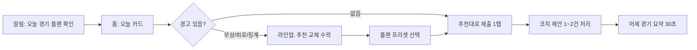
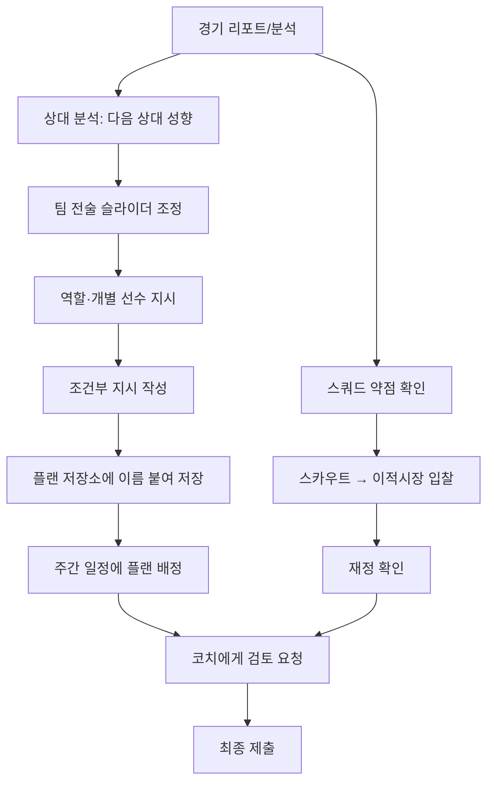

# 10. 모바일에 맞는 화면과 조작 흐름

> 이 문서는 기획서의 섹션 10·11만 다룬다. 경기 시각, 플랜 마감 시각, 코치 권한 체계, 조건부 지시의 엔진 규칙 등은 다른 섹션(3·4·5·8)에서 정한다. 여기서 쓰는 수치는 **UX 설계용 가정값**이며, `[가정]`으로 표시한다.
>
> 이 문서에서 쓰는 가정값: 정기 경기 매일 21:00 KST `[가정]`, 플랜 제출 마감 20:30 `[가정]`, 조건부 지시 슬롯 MVP 3개 `[가정]`.

## 10.1 UX 설계 원칙

| # | 원칙 | 의미 | 화면에서 지키는 방식 |
|---|---|---|---|
| P1 | **하루 3분이면 충분하다** | 매일 짧게 들어와도 경쟁력을 유지할 수 있어야 함 | 홈 첫 화면에 "오늘 할 일" 체크리스트, 추천값을 한 번에 적용하는 "추천대로 제출" 버튼 |
| P2 | **깊이는 선택이다** | 심화 조작은 원하는 사람만 들어가면 됨 | 모든 편집 화면은 1단계(프리셋) → 2단계(슬라이더) → 3단계(조건부 지시·개별 선수 지시) 순으로 점점 깊어지는 구조 |
| P3 | **한 손, 엄지 중심** | 출퇴근길 세로 화면에서 한 손으로 플레이 | 주요 버튼은 화면 하단 40% 안쪽, 상단은 읽기 전용 정보 위주 |
| P4 | **제출 안 해도 안전하다** | 미접속이 큰 손해가 되지 않게 | 항상 "현재 유효한 플랜"이 있고, 마감 전 미제출 시 마지막 플랜 또는 기본 플랜이 자동 적용됨을 화면에서 늘 보여줌 |
| P5 | **결정권은 구단주에게, 참여는 모두에게** | 코치는 제안하고 구단주(또는 위임받은 코치)가 확정 | 권한이 없는 영역은 편집 대신 "제안하기" 버튼, 편집 중인 사람 표시 |
| P6 | **결과는 이유와 함께** | 전술이 결과에 영향을 줬다는 걸 느끼게 | 경기 후 리포트에 "내 전술 설정 → 경기 지표" 연결 문장 표시 |
| P7 | **되돌릴 수 있다** | 실수에 대한 부담 감소 | 확인 모달 대신 5초 "되돌리기" 토스트, 플랜 버전 기록 |

## 10.2 내비게이션 구조

### 전역 구조

```
┌────────────────────────────────┐
│ 상단 바: 구단 엠블럼 · 리그 배지 · 예산 · 🔔 · 코치 접속 아바타 │  ← 읽기 전용 정보 (탭하면 상세)
├────────────────────────────────┤
│                                │
│          콘텐츠 영역            │
│                                │
├────────────────────────────────┤
│ [홈] [스쿼드] [전술] [경기] [클럽] │  ← 하단 탭 5개 (엄지 영역)
└────────────────────────────────┘
```

### 하단 탭 구성

| 탭 | 역할 | 하위 화면 | 배지 표시 조건 |
|---|---|---|---|
| **홈** | 오늘 할 일, 다음 경기, 마감 카운트다운 | 오늘 카드, 코치 제안함 요약, 최근 결과 | 미제출 플랜 / 처리 안 한 제안 |
| **스쿼드** | 선수단 조회·관리·영입 | 선수 목록, 선수 상세, 이적시장, 스카우트, 유스(후속) | 부상·징계·계약 만료 임박 |
| **전술** | 포메이션, 선발, 팀 전술, 경기 플랜 | 라인업 편집, 팀 전술, 조건부 지시, 세트피스, 플랜 저장소 | 다음 경기 플랜 미확정 |
| **경기** | 중계, 결과, 분석 | 경기 센터(라이브), 경기 리포트, 상대 분석, 일정 | 경기 진행 중(빨간 점) |
| **클럽** | 리그·재정·코치·설정 | 순위표, 시즌 현황, 재정, 코치 관리, 활동 기록, 설정 | 코치 초대 응답, 시즌 보상 수령 |

### 내비게이션 규칙

- **탭 깊이 최대 3단계**: 탭 → 목록 → 상세. 그보다 깊은 편집은 바텀시트로 처리해 뒤로가기 부담을 줄임.
- **탭 상태 유지**: 다른 탭에 갔다 와도 스크롤 위치와 편집 중인 내용이 그대로 남음.
- **딥링크**: 모든 알림은 해당 화면 + 해당 항목으로 바로 연결 (예: "부상 발생" 알림 → 라인업 편집 화면에서 해당 선수 자리 강조).
- **글로벌 액션 버튼(플로팅 버튼) 사용 안 함**: 탭별로 주요 행동이 다르므로, 각 화면 하단의 고정 버튼(스티키 CTA)으로 통일.
- **뒤로가기**: 안드로이드 뒤로가기/iOS 스와이프 뒤로가기 모두 지원. 저장 안 된 편집이 있으면 "임시 저장됨" 토스트만 띄우고 막지 않음(자동 임시 저장).

## 10.3 한 손 조작 원칙

| 항목 | 규칙 |
|---|---|
| 엄지 영역 | 화면을 위/중간/아래 3구역으로 나눠, **자주 쓰는 행동은 아래**, 확인용 정보는 위. 제출·저장 버튼은 항상 하단 고정 |
| 터치 영역 | 최소 48×48dp, 버튼 사이 간격 8dp 이상. 피치 위 선수 토큰은 최소 44dp |
| 바텀시트 우선 | 선택지(역할, 지시, 필터)는 화면 중앙 모달 대신 아래에서 올라오는 시트. 시트 높이는 절반/전체 2단계 |
| 스와이프 제스처 | 목록 항목 좌/우 스와이프 = 빠른 행동(예: 제안 카드 오른쪽=승인, 왼쪽=보류). **단, 모든 스와이프 행동은 버튼으로도 가능** |
| 길게 누르기 | 선수 토큰 길게 누르기 = 드래그 시작. 길게 누르기에만 기능을 숨기지 않음(상세 메뉴 버튼 병행) |
| 입력 최소화 | 키보드 입력은 구단명·채팅·코멘트에만. 수치는 슬라이더/스텝, 조건은 칩 선택 |
| 한 손 모드(설정) | 켜면 상단 콘텐츠를 아래로 내려 표시(화면 위쪽 1/3을 비움), 탭 영역도 커짐 |
| 가로 모드 | 경기 센터와 라인업 편집(태블릿)만 가로 지원. 나머지는 세로 고정 |

## 10.4 플레이 흐름

### 10.4.1 하루 짧은 루틴 (목표 3~5분)



| 단계 | 화면 | 사용자가 하는 일 | 예상 시간 | 스킵 가능 |
|---|---|---|---|---|
| 1 | 푸시 알림 | "오늘 21:00 vs 한강FC · 플랜 마감 20:30" 탭 | 5초 | - |
| 2 | 홈 > 오늘 카드 | 상대 요약(포메이션·최근 폼), 우리 팀 경고 3줄 확인 | 30초 | - |
| 3 | 라인업 편집 | 경고 선수 자리에 뜬 "추천 교체" 칩 탭 → 교체 | 30초~1분 | 경고 없으면 스킵 |
| 4 | 플랜 프리셋 | "균형 / 점유 / 역습 / 잠그기" 중 선택, 또는 "지난 경기와 동일" | 20초 | 가능 |
| 5 | 제출 | 하단 "플랜 제출" 버튼. 제출 후에도 마감 전까지 수정 가능 | 5초 | 미제출 시 자동 적용 |
| 6 | 코치 제안함 | 대기 중인 제안 카드 스와이프로 승인/보류 | 30초~1분 | 가능 |
| 7 | 어제 경기 요약 | 스코어, 핵심 장면 3개, "전술 한 줄 평가" | 30초 | 가능 |
| | | **합계** | **약 2.5~4.5분** | |

**"추천대로 제출" 버튼 규칙**
- 추천 = 현재 유효 플랜 + 부상/징계 선수 자동 대체 + 피로도 기준 로테이션.
- 버튼 옆에 추천이 바꾼 내용을 한 줄로 표시: "변경 2건: 박OO → 이OO (부상), 김OO 휴식".
- 추천 로직이 경쟁 공정성에 주는 영향(추천이 너무 강하면 심화 운영의 가치 하락)은 섹션 9·13과 조율 필요 → 미결정 질문 Q3.

### 10.4.2 경기 직후 루틴 (1~2분)

1. 알림 "경기 종료 2:1 승 · 승리 수당 +120K" → 경기 리포트
2. 리포트 상단: 결과, 순위 변동(▲2), 받은 수당
3. "전술이 만든 장면" 카드 2~3개 (예: "높은 라인 설정 → 상대 오프사이드 6회")
4. 선수 평점 상·하위 3명 → 탭하면 선수 상세
5. 하단 CTA: "내일 플랜 준비하기" (라인업 편집으로 이동, 내일 상대 미리 로드)

### 10.4.3 심화 운영 흐름 (15~30분, 주 1~3회 가정)



| 단계 | 화면 | 주요 행동 | 누가 주로 하나(협동 시 예) |
|---|---|---|---|
| 1 | 경기 리포트 > 상세 분석 | 존별 점유, 패스 네트워크, 실점 원인 태그 확인 | 경기 분석 코치 |
| 2 | 상대 분석 | 다음 3경기 상대의 포메이션·압박 강도·약점 존 | 경기 분석 코치 |
| 3 | 팀 전술 | 슬라이더 조정, 변경 전/후 예상 성향 비교 | 전술 코치 |
| 4 | 라인업 > 선수 역할 | 역할/개별 지시 변경 | 전술 코치 |
| 5 | 조건부 지시 | "후반 70분 이후 지고 있으면 공격적으로" 등 작성 | 전술 코치 |
| 6 | 플랜 저장소 | 플랜 A/B/C 저장, 요일별 경기에 배정 | 구단주 |
| 7 | 스쿼드 > 약점 리포트 | 포지션별 뎁스 부족 표시 | 선수단 관리 코치 |
| 8 | 스카우트 → 이적시장 | 후보 찜, 입찰 | 스카우트 코치 |
| 9 | 재정 | 입찰 후 예산 잔액, 이번 달 예상 수입 | 재정 코치 |
| 10 | 제안함 → 제출 | 코치 제안 검토 후 확정 | 구단주 |

**주간 플랜 배정**: 며칠 치 경기에 플랜을 미리 배정할 수 있어, 바쁜 주에는 월요일에 한 번만 들어와도 됨(P4). 배정 가능 일수는 미결정 질문 Q2.

### 10.4.4 미접속 대비 화면 표현

| 상황 | 화면 표시 |
|---|---|
| 마감 3시간 전, 미제출 | 홈 카드: "제출 안 하면 **플랜 A(지난 경기)** 가 자동 적용돼요" + 자동 적용될 라인업 미리보기 |
| 자동 적용 플랜에 출전 불가 선수 포함 | 경고 배지 + "자동 대체 규칙: 같은 포지션 최고 컨디션 선수" 표시 |
| 며칠 만에 복귀 | "놓친 경기 요약" 화면: 결과 목록 + 순위 변화 + 처리 안 된 제안 수, 한 화면에서 끝 |

## 10.5 핵심 인터랙션 설계

### 10.5.1 선발 편성 (드래그)

**화면 구성**: 상단 60% 피치(세로 방향, 우리 골대가 아래), 하단 40% 벤치/후보 트레이(가로 스크롤).

| 동작 | 결과 | 피드백 |
|---|---|---|
| 선수 토큰 길게 누르기(300ms) | 드래그 시작 | 약한 진동, 토큰 확대, 놓을 수 있는 자리 강조 |
| 피치 위 다른 선수 위에 놓기 | 두 선수 자리 교환 | 교환 애니메이션 |
| 벤치 선수를 피치 선수 위에 놓기 | 선발 ↔ 벤치 교체 | 되돌리기 토스트 5초 |
| 빈 포지션 위에 놓기 | 해당 자리에 배치 | - |
| 트레이 밖/원위치에 놓기 | 취소 | - |
| **탭 → 탭 (대체 방식)** | 첫 번째 탭으로 선택, 두 번째 탭으로 교환 | 드래그가 어려운 사용자·스크린리더용. 설정 없이 항상 동작 |
| 토큰 한 번 탭 | 선수 미니 카드(컨디션, 역할, 적합도) 바텀시트 | - |

**드래그 중 보이는 정보**
- 각 자리에 **포지션 적합도**를 색 + 기호로 표시: ◎ 최적 / ○ 가능 / △ 어색 / ✕ 불가. (색만으로 구분하지 않음)
- 토큰 하단에 컨디션 막대, 우측 상단에 경고 아이콘(부상 위험 🩹, 경고 누적 🟨).
- 드래그하는 선수가 놓일 경우 팀 전체 예상 변화(예: "왼쪽 수비 속도 ▼") 한 줄 미리보기.

**포메이션 변경**: 피치 상단의 포메이션 칩(4-3-3 ▾) 탭 → 바텀시트 목록. 변경 시 기존 선수를 가장 가까운 자리로 자동 재배치하고, 자리가 애매한 선수는 노란 테두리로 표시.

**리스트 보기 전환**: 피치 보기 ↔ 리스트 보기(포지션 순 행 목록, 각 행에 "교체" 버튼) 토글. 작은 화면·접근성 사용자용.

### 10.5.2 팀 전술 슬라이더

**설계 방침**: 연속값 대신 **5단계 스냅 슬라이더**. 모바일에서 미세 조정은 스트레스이고, 5단계면 차이를 이해하기 쉬움. (엔진 내부 값의 단계 수는 섹션 4·8 결정 사항)

| 슬라이더(예시) | 1 | 3 | 5 |
|---|---|---|---|
| 수비 라인 높이 | 매우 낮음 | 보통 | 매우 높음 |
| 압박 강도 | 기다림 | 보통 | 전방 압박 |
| 공격 템포 | 느림 | 보통 | 빠름 |
| 경기 폭 | 좁게 | 보통 | 넓게 |
| 패스 길이 | 짧게 | 혼합 | 길게 |

**인터랙션 규칙**
- 슬라이더 옆 **미니 피치 미리보기**: 라인 높이·폭을 바꾸면 선수 점 배치가 즉시 움직임.
- **상충 표시**: 조합이 선수단 능력과 맞지 않을 때 경고 문구. 예: 라인 높이 5 + 수비수 평균 속도 낮음 → "뒷공간 노출 위험 높음". 금지하지 않고 알려주기만 함(선택의 자유 + 결과의 이유 제공).
- **체력 소모 게이지**: 압박·템포 조합에 따른 예상 체력 소모를 하단 게이지로 표시.
- **프리셋 칩**: 상단에 "균형 · 점유 · 역습 · 전방압박 · 잠그기" 칩. 프리셋을 고른 뒤 슬라이더를 건드리면 "사용자 지정(점유 기반)"으로 표시.
- **변경 비교**: 하단 "변경 사항 2개" 버튼 → 이전 값/새 값 비교 목록.

### 10.5.3 조건부 지시 입력

**형태**: "만약 [조건] 이면 [행동]"을 칩으로 조립하는 문장형 빌더. 자유 텍스트 입력 없음.

```
┌ 조건부 지시 2 / 3 ─────────────────┐
│ 만약  [후반 70분 이후] 그리고 [1골 차 이하로 지고 있음] │
│ 이면  [공격 템포 +2]  [교체: 윙어 → 공격형 윙어]       │
│                                         │
│ 요약: "70분 이후 한 골 이하로 지면 템포를 올리고     │
│        공격형 윙어를 투입합니다."                 │
│ ⚠ 지시 1과 겹침: 같은 시간대 템포 변경            │
└─────────────────────────────────────┘
```

| 요소 | 선택지(예시, MVP 후보) |
|---|---|
| 조건: 시간 | 전반 / 후반 / N분 이후 (15분 단위) |
| 조건: 스코어 | 이기고 있음 / 비기고 있음 / 지고 있음, 점수 차 |
| 조건: 상태 | 퇴장 발생(우리/상대), 선수 체력 N% 이하 |
| 행동: 전술 | 슬라이더 ±1~2, 프리셋 전환 |
| 행동: 교체 | 특정 선수 ↔ 특정 선수, 또는 "같은 포지션 체력 최고" |
| 행동: 포메이션 | 저장된 포메이션으로 전환 |

**규칙**
- 슬롯 수 MVP 3개 `[가정]`. 우선순위는 목록 순서(드래그로 순서 변경).
- 작성 즉시 **자연어 요약**과 **충돌 검사**(같은 시점에 반대되는 행동, 이미 교체된 선수 재교체 등) 표시.
- 조건 칩을 탭하면 바텀시트에서 값 선택. 조건은 최대 2개 AND까지(OR 없음, 단순성 유지).
- "템플릿으로 시작" 버튼: 자주 쓰는 지시 5개(지키기, 추격, 퇴장 대응, 체력 관리, 동점 시 공세).
- 엔진이 조건부 지시를 어떻게 해석·실행하는지(지연 시간, 교체 횟수 제한)는 섹션 4·8 결정 사항.

### 10.5.4 플랜 저장소와 제출

- 플랜 = 라인업 + 팀 전술 + 조건부 지시 + 세트피스 묶음. 이름·태그(예: "강팀용", "로테이션")를 붙여 저장.
- 플랜 카드에 "마지막 사용 결과 3경기" 표시(승무패 점).
- 제출 버튼은 **2단 상태**: `초안 저장됨` → `제출 완료(20:30까지 수정 가능)`. 마감 후에는 잠금 아이콘과 함께 읽기 전용.
- 제출 직전 검사: 출전 불가 선수, 비어 있는 포지션, 조건부 지시 충돌. 문제가 있으면 버튼 위에 경고 줄을 띄우되 제출은 막지 않음(단, 11명 미만 등 치명 오류는 막음).

## 10.6 경기 중계 표현 방식

### 표현 레이어

| 레이어 | 내용 | MVP |
|---|---|---|
| 스코어 바 | 스코어, 경기 시간, 점유율, 슈팅 | O |
| 2D 탑뷰 피치 | 선수는 번호가 적힌 원, 공 궤적 선. 주요 장면에서만 움직임을 자세히 보여줌 | O |
| 텍스트 해설 | 한 줄 해설 피드. 전술 관련 해설 강조 (예: "전방 압박에 걸려 상대 빌드업 차단") | O |
| 모멘텀 그래프 | 시간대별 공격 흐름 막대(위=우리, 아래=상대) | O |
| 전술 발동 표시 | 조건부 지시가 발동되면 배너: "지시 2 발동: 70' 템포 ▲" | O |
| 주요 장면 다시보기 | 골·빅찬스를 탑뷰로 반복 재생 | 후속 |
| 3D/애니메이션 중계 | - | 후속(검토) |

### 시청 모드

| 모드 | 소요 시간 | 설명 |
|---|---|---|
| 라이브 | 약 15~20분 `[가정]` | 정해진 시각에 모든 유저가 동시에 봄. 친구·코치와 같은 화면 |
| 하이라이트 | 약 2~3분 | 주요 장면 8~12개만 탑뷰로 재생 |
| 결과만 | 즉시 | 스코어 + 리포트로 바로 이동 |
| 나중에 보기 | 자유 | 스포일러 보호: 알림·홈·순위표에서 결과를 가리고 "결과 보기" 버튼만 노출(설정) |

### 경기 중 개입

- MVP에서는 **경기 중 실시간 전술 변경 없음 `[가정]`**: 사전 플랜과 조건부 지시로만 운영. 접속 여부로 유불리가 생기지 않게 하기 위함.
- 라이브 화면의 개입 행동은 **응원 리액션, 코치 채팅, 장면 핀(나중에 분석용으로 표시)** 뿐.
- 하프타임 개입 허용 여부는 미결정 질문 Q1.

### 경기 센터 코치 채팅

- 화면 하단 접힌 채팅 바(한 줄). 올리면 절반 시트. 팀 내부 코치만 볼 수 있음.
- 해설 피드의 특정 장면을 길게 눌러 "이 장면 공유" → 채팅에 장면 카드로 첨부.

## 10.7 알림 설계

### 원칙
- **하루 최대 3개**(경기일 기준, 코치 협동 알림 제외) `[가정]`. 유저가 알림 유형별로 켜고 끔.
- 조용한 시간(기본 23:00~08:00) 동안 푸시 보류, 앱 내 알림함에만 쌓음.
- 모든 알림은 딥링크 + 알림 한 줄만 읽어도 판단 가능한 문장.

### 알림 목록

| 유형 | 시점 | 예시 문구 | 기본값 | 딥링크 |
|---|---|---|---|---|
| 플랜 확인 요청 | 경기 3시간 전 (미제출 시만) | "오늘 21:00 vs 한강FC. 제출 안 하면 플랜 A 적용돼요" | ON | 홈 오늘 카드 |
| 마감 임박 | 마감 30분 전 (미제출 + 출전 불가 선수 포함 시만) | "선발 중 1명이 부상이에요. 자동 대체될 예정" | ON | 라인업 편집(해당 자리) |
| 경기 시작 | 킥오프 | "킥오프! 라이브 보기" | OFF | 경기 센터 |
| 경기 결과 | 종료 직후 | "2:1 승리 · 3위 ▲2 · 수당 +120K" (스포일러 보호 시 "경기 종료") | ON | 경기 리포트 |
| 부상·징계 | 발생 시 (경기 결과에 합쳐 발송) | - | 결과에 합침 | 선수 상세 |
| 이적 | 입찰 결과·경쟁 입찰 | "입찰에서 밀렸어요. 12시간 남음" | ON | 이적시장 항목 |
| 코치 제안 | 제안 도착 (묶음: 1시간 단위) | "전술 코치 2건 제안" | ON(구단주) | 제안함 |
| 제안 처리 결과 | 승인/거절 시 | "구단주가 제안을 승인했어요" | ON(코치) | 해당 화면 |
| 편집 충돌 | 내 편집이 다른 사람과 충돌 시 | - | 앱 안에서만 | - |
| 시즌 이벤트 | 승격/강등 확정, 시즌 종료 | "이번 시즌 2부 리그 승격 확정!" | ON | 시즌 결산 |
| 복귀 유도 | 3일 미접속 | "3경기 동안 2승 1무. 제안 4건 대기 중" | ON | 놓친 경기 요약 |

## 10.8 코치 협동 UI

> 권한 종류와 충돌 규칙 자체는 섹션 5에서 정한다. 여기서는 그 규칙이 **화면에 어떻게 보이는지**만 설계한다.

### 10.8.1 누가 무엇을 하고 있는지 (프레즌스)

| 위치 | 표시 |
|---|---|
| 상단 바 | 지금 접속 중인 코치 아바타(최대 3개 + "+2") |
| 탭/화면 제목 옆 | 그 화면을 보고 있는 사람 아바타 작은 점 |
| 편집 영역 | 편집 중이면 해당 블록 테두리에 그 사람 색상 + "전술코치 민수 편집 중" 라벨 |

### 10.8.2 동시 편집 처리 (소프트 락)

- 편집 단위는 **블록**: 라인업 / 팀 전술 / 조건부 지시 / 세트피스 / 이적 입찰 / 재정 설정.
- 누군가 블록을 편집하기 시작하면 그 블록은 다른 사람에게 **읽기 전용 + "편집 중" 표시**. 다른 사람은 대신 "제안하기" 가능.
- 락은 **2분 동안 입력이 없으면 자동 해제** `[가정]`, 해제 전 편집자에게 "계속 편집 중인가요?" 토스트.
- 구단주는 "편집 넘겨받기" 가능 → 기존 편집자의 미저장 내용은 제안 카드로 자동 전환(내용 손실 없음).

### 10.8.3 제안 카드

권한이 없는 영역을 바꾸고 싶거나, 구단주 승인이 필요한 변경은 제안 카드로 보냄.

```
┌ 제안 · 전술코치 민수 · 12분 전 ─────────┐
│ 대상: 오늘 경기 플랜 (vs 한강FC)             │
│ 변경 3건                                   │
│  · 압박 강도   3 → 4                        │
│  · 수비 라인   3 → 2                        │
│  · 선발  박OO → 이OO (RW)                  │
│ 이유: "상대 왼쪽 풀백이 느려요. 뒤 공간 노림"   │
│ 💬 2  ·  👍 스카우트 지현                   │
│ [거절]   [수정 후 승인]   [승인]            │
└────────────────────────────────────┘
```

| 요소 | 규칙 |
|---|---|
| 변경 목록 | 전/후 값 비교(diff). 카드에서 탭하면 미리보기 화면(적용된 모습) |
| 이유 | 필수 입력 1줄(최대 80자). 코치 역할 참여감을 높이는 핵심 |
| 반응 | 다른 코치의 👍/💬. 의견을 모으는 용도이며 투표로 자동 결정되지 않음 |
| 처리 | 승인 / 수정 후 승인 / 거절(사유 선택: 이번 경기엔 안 맞음, 다른 제안과 겹침 등) |
| 만료 | 대상 경기의 마감이 지나면 "만료" 처리, 회색 표시 |
| 겹치는 제안 | 같은 항목을 바꾸는 제안이 여럿이면 카드끼리 묶어 "제안 2개가 압박 강도를 다르게 제안" 표시 |
| 빠른 처리 | 제안함 목록에서 오른쪽 스와이프=승인, 왼쪽=보류(거절은 버튼으로만: 실수 방지) |

### 10.8.4 기타 협동 화면 요소

- **활동 기록**: "민수가 압박 강도 3→4 변경 (승인: 구단주)" 형태의 시간순 기록. 되돌리기 버튼(권한자만).
- **역할 배지**: 코치 이름 옆에 역할 아이콘(전술·스카우트·선수단·분석·재정). 권한 없는 버튼은 숨기지 않고 비활성 + "재정 코치 권한 필요" 안내 → 누가 할 수 있는지 알 수 있게.
- **최종 제출 표시**: 플랜 카드에 "최종 제출: 구단주 20:12" 또는 "위임 제출: 전술코치 민수".
- **1인 모드**: 코치가 없으면 협동 UI 요소는 모두 숨김(빈 아바타·빈 제안함 노출 안 함).

## 10.9 접근성

| 영역 | 규칙 |
|---|---|
| 색상 | 적합도·컨디션·승패는 색 + 기호/텍스트로 함께 표시. 명도 대비 WCAG 2.1 AA(본문 4.5:1) 이상. 색각 이상 팔레트 옵션 |
| 글자 크기 | OS 글자 크기 설정 반영(최대 200%). 큰 글자에서는 피치 보기 대신 리스트 보기 기본 |
| 스크린리더 | 모든 선수 토큰에 레이블("오른쪽 윙어, 박OO, 컨디션 82%, 적합도 최적"). 드래그 대신 탭-탭 교환과 "이동할 자리 선택" 메뉴 제공 |
| 슬라이더 | 스크린리더 증감 동작 지원, 값 읽기("압박 강도 4단계, 높음") |
| 중계 | 텍스트 해설 피드가 단독으로 경기 이해 가능하도록 작성. 2D 피치는 보조 |
| 모션 | OS "동작 줄이기" 설정 시 드래그 애니메이션·골 연출 축소, 자동 재생 끔 |
| 햅틱/사운드 | 개별 끄기 가능. 햅틱에만 의존하는 정보 없음 |
| 시간 제한 | 소프트 락 만료, 되돌리기 토스트 시간은 설정에서 늘릴 수 있음 |
| 네트워크 | 저데이터 모드: 중계를 텍스트+모멘텀 그래프만, 선수 사진 대신 이니셜 |
| 테마 | 라이트 / 다크 / 시스템 설정 따르기 |
| 언어 | 축구 용어는 처음 나올 때 "?" 아이콘으로 짧은 설명(예: "하프스페이스") |

## 10.10 다른 섹션과의 의존 관계

| 이 섹션의 UI 요소 | 결정이 필요한 섹션 |
|---|---|
| 경기 시각·마감 시각·주간 플랜 배정 | 3 (플레이 흐름) |
| 슬라이더 항목·단계 수, 조건부 지시 조건·행동 목록, 슬롯 수 | 4 (전술 시스템), 8 (시뮬레이션) |
| 편집 블록 단위, 권한, 위임 제출 | 5 (코치 협동) |
| 수당·예산 표시 단위와 명칭 | 7 (경제) |
| "추천대로 제출" 강도, 미접속 자동 플랜 | 9 (온보딩·공정성), 13 (악용 대응) |

---

# 11. 핵심 화면 목록과 각 화면의 기능

## 11.1 화면 목록

MVP 열: **O** = MVP 포함, **△** = MVP에 축소판 포함, **X** = 후속 업데이트.

### 공통·온보딩

| ID | 화면명 | 목적 | 주요 기능/컴포넌트 | 진입 경로 | MVP |
|---|---|---|---|---|---|
| S00 | 스플래시/로그인 | 계정 진입 | 소셜 로그인, 약관 동의 | 앱 실행 | O |
| S01 | 구단 창단 | 구단 정체성 설정 | 구단명, 엠블럼 조합, 홈 컬러, 시작 스쿼드 받기 | 첫 로그인 | O |
| S02 | 튜토리얼 경기 | 핵심 루프 1회 체험 | 가이드 라인업 편집 → 프리셋 선택 → 하이라이트 중계 → 리포트 | 창단 직후 | O |
| S03 | 알림함 | 앱 내 알림 모아보기 | 유형 필터, 읽음 처리, 딥링크 | 상단 🔔 | O |
| S04 | 설정 | 개인 설정 | 알림 유형별 ON/OFF, 조용한 시간, 스포일러 보호, 테마, 한 손 모드, 접근성, 저데이터 | 클럽 탭 | O |

### 홈 탭

| ID | 화면명 | 목적 | 주요 기능/컴포넌트 | 진입 경로 | MVP |
|---|---|---|---|---|---|
| H01 | 홈(오늘) | 3분 루틴의 출발점 | 다음 경기 카드, 마감 카운트다운, 오늘 할 일 체크리스트, "추천대로 제출", 제안함 요약, 최근 결과 | 하단 탭, 대부분의 알림 | O |
| H02 | 놓친 경기 요약 | 복귀 유저 따라잡기 | 미접속 기간 결과 목록, 순위 변화, 대기 제안 수, 자동 적용된 플랜 | 복귀 시 자동 / 알림 | O |
| H03 | 코치 제안함 | 제안 처리 | 제안 카드 목록, 스와이프 승인/보류, 겹치는 제안 묶음, 만료 표시 | 홈 요약, 알림 | O |

### 스쿼드 탭

| ID | 화면명 | 목적 | 주요 기능/컴포넌트 | 진입 경로 | MVP |
|---|---|---|---|---|---|
| Q01 | 선수 목록 | 선수단 한눈에 보기 | 포지션/컨디션/계약 정렬·필터, 경고 배지, 비교 선택 | 스쿼드 탭 | O |
| Q02 | 선수 상세 | 개별 선수 판단 | 능력치 레이더, 선호 역할·적합 포지션, 컨디션·피로 추이, 최근 평점, 계약·연봉, 판매 등록 | 목록, 토큰 탭, 리포트 | O |
| Q03 | 선수 비교 | 영입·선발 판단 보조 | 2명 능력치 겹쳐 보기, 역할 적합도 비교 | 목록에서 2명 선택 | △ |
| Q04 | 스쿼드 약점 리포트 | 보강 방향 제시 | 포지션별 뎁스 막대, 노쇠화/계약 만료 경고 | 스쿼드 탭 상단 카드 | △ |
| Q05 | 이적시장 | 선수 영입 | 검색·필터, 입찰, 입찰 현황, 남은 시간, 예산 잔액 표시 | 스쿼드 탭, 알림 | O |
| Q06 | 스카우트 | 영입 후보 탐색 | 스카우트 파견 지역/포지션 설정, 발견 선수 리포트, 찜 목록 | 스쿼드 탭 | △ |
| Q07 | 훈련·로테이션 | 컨디션 관리 | 주간 훈련 강도, 휴식 지정 | 스쿼드 탭 | X |
| Q08 | 유스 아카데미 | 장기 육성 | 유망주 목록, 승격 | 스쿼드 탭 | X |

### 전술 탭

| ID | 화면명 | 목적 | 주요 기능/컴포넌트 | 진입 경로 | MVP |
|---|---|---|---|---|---|
| T01 | 라인업 편집 | 선발·포메이션 결정 | 피치 드래그, 탭-탭 교환, 벤치 트레이, 포메이션 칩, 적합도 표시, 리스트 보기, 추천 교체 칩, 제출 버튼 | 전술 탭 기본, 홈 카드, 알림 | O |
| T02 | 역할·개별 지시 | 선수별 역할 설정 | 역할 바텀시트(예: 풀백/윙백/인버티드), 개별 지시 토글 | T01에서 선수 탭 | O |
| T03 | 팀 전술 | 팀 성향 설정 | 프리셋 칩, 5단계 슬라이더, 미니 피치 미리보기, 상충 경고, 체력 게이지, 변경 비교 | 전술 탭 | O |
| T04 | 조건부 지시 | 경기 중 자동 대응 | 문장형 칩 빌더, 템플릿, 자연어 요약, 충돌 검사, 순서 변경 | 전술 탭, T03 하단 | △ (슬롯 3개) |
| T05 | 세트피스 | 코너킥·프리킥 설정 | 키커 지정, 루틴 프리셋 선택 | 전술 탭 | △ (키커 지정만) |
| T06 | 플랜 저장소 | 플랜 재사용 | 플랜 카드(이름·태그·최근 성적), 복제, 경기 배정 | 전술 탭 | O |
| T07 | 주간 플랜 배정 | 미리 여러 경기 준비 | 캘린더에 플랜 드래그 배정, 미배정 경기 경고 | T06, 일정 | △ |
| T08 | 제출 확인 | 최종 점검 | 검사 결과(출전 불가·빈 자리·충돌), 제출/수정 가능 시각 | T01·T03 제출 버튼 | O |

### 경기 탭

| ID | 화면명 | 목적 | 주요 기능/컴포넌트 | 진입 경로 | MVP |
|---|---|---|---|---|---|
| M01 | 일정 | 경기 흐름 파악 | 이번 달 캘린더, 경기별 결과·플랜 배정 상태 | 경기 탭 | O |
| M02 | 상대 분석 | 다음 상대 대비 | 최근 포메이션, 전술 성향 요약, 약점 존, 최근 5경기 | 홈 카드, 일정 | △ (요약만) |
| M03 | 경기 센터(라이브) | 경기 관람 | 스코어 바, 2D 탑뷰, 텍스트 해설, 모멘텀 그래프, 지시 발동 배너, 코치 채팅, 장면 핀 | 킥오프 알림, 경기 탭 | O |
| M04 | 하이라이트 재생 | 짧은 관람 | 주요 장면 연속 재생, 건너뛰기 | 경기 종료 후, 리포트 | O |
| M05 | 경기 리포트 | 결과 이해 | 스코어·수당·순위 변동, "전술이 만든 장면" 카드, 평점, 기본 통계 | 결과 알림, M03 종료 | O |
| M06 | 상세 분석 | 심화 운영 | 존별 점유, 패스 네트워크, 슈팅 맵, 실점 원인 태그, 지시 발동 기록 | M05 하단 | △ (슈팅 맵·지시 기록) |

### 클럽 탭

| ID | 화면명 | 목적 | 주요 기능/컴포넌트 | 진입 경로 | MVP |
|---|---|---|---|---|---|
| C01 | 리그 순위표 | 경쟁 상황 파악 | 순위, 승격/강등 구역 색·기호 구분, 내 팀 고정 행, 남은 경기 수 | 클럽 탭, 상단 리그 배지 | O |
| C02 | 시즌 현황 | 월간 목표 확인 | 시즌 진행 막대, 목표(승격선까지 승점), 시즌 보상 미리보기 | 클럽 탭 | O |
| C03 | 시즌 결산 | 시즌 마무리 | 최종 순위, 승격/강등 연출, 보상 수령, 시즌 기록 | 시즌 종료 알림 | O |
| C04 | 재정 | 예산 관리 | 잔액, 수입(승리·우승 수당)/지출(연봉·이적) 내역, 이번 달 예상 | 상단 예산 표시, 클럽 탭 | O |
| C05 | 코치 관리 | 협동 구성 | 코치 초대(링크/코드), 역할·권한 지정, 위임 설정, 내보내기 | 클럽 탭 | O |
| C06 | 활동 기록 | 협동 투명성 | 변경 이력, 승인자, 되돌리기 | 클럽 탭, 제안 카드 | O |
| C07 | 코치 채팅 | 팀 내부 소통 | 텍스트, 장면/플랜/선수 카드 공유 | 클럽 탭, M03 | △ (텍스트+카드 공유) |
| C08 | 다른 구단 보기 | 경쟁자 탐색 | 상대 구단 정보, 공개 전적 | 순위표 행 탭 | △ |
| C09 | 명예의 전당/기록 | 장기 동기 | 역대 우승, 개인 기록 | 클럽 탭 | X |
| C10 | 상점 | 수익화 | 외형 아이템 등 (공정성 원칙은 섹션 7·13) | 클럽 탭 | X (정책 결정 후) |

**MVP 화면 수**: O 26개, △ 10개, X 4개 (총 40개).

## 11.2 텍스트 와이어프레임

### W1. 홈(오늘) — H01

```
┌──────────────────────────────────┐
│ ⚽ 성수유나이티드   🏆 3부 · 5위   💰 2.4M  🔔² │
│                        코치 접속 ●민수 ●지현  │
├──────────────────────────────────┤
│ ┌ 다음 경기 ──────────────────────┐  │
│ │  오늘 21:00   vs 한강FC (4위)          │  │
│ │  상대: 4-2-3-1 · 전방 압박 강함          │  │
│ │  ⏱ 플랜 마감까지 2시간 14분             │  │
│ │  현재 플랜: 플랜 A "균형" (미제출)        │  │
│ │  ⚠ 제출 안 하면 플랜 A가 자동 적용돼요   │  │
│ └──────────────────────────────────┘  │
│                                    │
│ 오늘 할 일                            │
│  ☐ 부상 1명 교체 필요 (박OO, RW)    ›  │
│  ☐ 코치 제안 2건                    ›  │
│  ☑ 어제 경기 리포트 확인               │
│                                    │
│ ┌ 어제 결과 ───────────────────────┐  │
│ │  2 : 1 승 vs 마포시티   ▲2위  +120K   │  │
│ │  "높은 라인 → 오프사이드 유도 6회"     │  │
│ └──────────────────────────────────┘  │
│                                    │
│ ┌──────────────┐ ┌───────────────┐ │
│ │ 직접 수정하기   │ │ 추천대로 제출 ✓ │ │  ← 엄지 영역, 주요 CTA는 오른쪽
│ └──────────────┘ └───────────────┘ │
│   추천 변경: 박OO→이OO(부상), 김OO 휴식     │
├──────────────────────────────────┤
│  [홈]   [스쿼드]   [전술•]   [경기]   [클럽]   │
└──────────────────────────────────┘
```

### W2. 라인업 편집 — T01 (드래그 중 상태)

```
┌──────────────────────────────────┐
│ ‹ 라인업     [4-3-3 ▾]   플랜 A  ✎민수 보는 중 │
├──────────────────────────────────┤
│        상대 골대 ↑                    │
│   ┌──────────────────────────┐     │
│   │  (11)◎      (9)◎      (7)✕    │     │  ← 7번 자리: 부상 선수 🩹
│   │  손OO       황OO      박OO🩹   │     │
│   │                                │     │
│   │      (8)◎   (6)○   (10)◎       │     │
│   │                                │     │
│   │  (3)◎   (4)◎   (5)◎   (2)○    │     │
│   │                                │     │
│   │            (1)◎                │     │
│   └──────────────────────────┘     │
│   ◎최적 ○가능 △어색 ✕불가               │
│  ─ 드래그 중: 이OO → RW 자리 ◎최적 ─      │
│    예상 변화: 오른쪽 공격 속도 ▲         │
├──────────────────────────────────┤
│ 벤치 (7)                      [리스트 보기] │
│ ┌────┐┌────┐┌────┐┌────┐┌────┐ →   │
│ │이OO ││정OO ││최OO ││강OO ││윤OO │     │
│ │RW  ││CM  ││CB  ││ST  ││GK  │     │
│ │■■■□││■■■■││■■□□││■■■■││■■■■│     │  ← 컨디션 막대
│ └────┘└────┘└────┘└────┘└────┘     │
│  ⓘ 추천 교체: 박OO → 이OO  [적용]          │
│ ┌──────────────────────────────┐   │
│ │        플랜 제출 (마감 20:30)          │   │
│ └──────────────────────────────┘   │
└──────────────────────────────────┘
```

### W3. 경기 센터(라이브) — M03

```
┌──────────────────────────────────┐
│ ● LIVE  67'   성수 1 : 1 한강    점유 54% │
│          슈팅 9 : 7   유효 4 : 3          │
├──────────────────────────────────┤
│   ┌──────────────────────────┐     │
│   │   ·    ·       ○   ·        │     │  ← 2D 탑뷰: 우리 ●, 상대 ○
│   │ ●    ·  ⚽→→→   ●     ○     │     │     주요 장면만 상세 이동
│   │   ●     ○    ●      ·       │     │
│   │     ·       ●    ○          │     │
│   └──────────────────────────┘     │
│ 모멘텀  ▂▃▅▇▅▃▂▁▂▃▅▆▇█ (우리 ↑)          │
│        ▁▂▁▁▂▃▅▆▃▂▁▁▁▁ (상대 ↓)          │
├──────────────────────────────────┤
│ ┌ 📋 지시 1 발동 · 65' ─────────────┐ │
│ │ 동점 상황 → 공격 템포 ▲1             │ │
│ └──────────────────────────────────┘ │
│ 67' 이OO, 오른쪽 돌파 후 크로스 — 차단      │
│ 65' [전술] 템포를 올립니다. 풀백 전진     │
│ 61' 한강FC 동점골. 왼쪽 뒷공간 침투        │
│ 58' [전술] 전방 압박으로 공 탈취          │
│                                    │
├──────────────────────────────────┤
│ 💬 지현: 왼쪽 계속 뚫려요 ㅠ  ────  ▲ 채팅  │
│ [📌 장면 핀]   [👏 응원]   [⏩ 하이라이트로]  │
└──────────────────────────────────┘
```

---

## 담당 범위 미결정 질문

| # | 질문 | 왜 필요한가 | 선택지(예) |
|---|---|---|---|
| Q1 | 라이브 경기 중 **실시간 개입**(하프타임 전술 변경 등)을 허용할 것인가? | "실시간 FM 스타일" 표현과 "매일 접속 못 하는 유저 보호" 원칙이 충돌함. 경기 센터 화면 구성이 크게 달라짐 | ① 개입 없음(사전 플랜+조건부 지시만) ② 하프타임 1회, 미접속 시 조건부 지시로 대체 ③ 자유 개입 |
| Q2 | 주간 플랜 **미리 배정 가능 일수**는? | 바쁜 유저 편의 vs 매일 접속 동기 | 3일 / 7일 / 시즌 전체 |
| Q3 | **"추천대로 제출"** 의 추천 품질을 어디까지 올릴 것인가? | 너무 좋으면 심화 운영의 가치가 떨어지고, 너무 약하면 라이트 유저가 불리함 | 부상·징계 대체만 / + 피로 로테이션 / + 상대 맞춤 프리셋 추천 |
| Q4 | 경기 라이브 **길이와 동시 시청 방식**은? | 모든 유저가 같은 시각에 보면 서버 부하·재미 모두 영향. 경기 수가 하루 1경기인지도 연동 | 10분 / 15~20분 / 90분 실시간 |
| Q5 | 조건부 지시 **슬롯 수와 조건 종류**는 MVP에서 어디까지? | 인터랙션 복잡도와 엔진 구현 비용 결정 | 3개·시간/스코어만 / 5개·상태 조건 포함 |
| Q6 | 코치 편집의 **소프트 락 만료 시간**과 구단주 "넘겨받기" 허용 여부 | 섹션 5 권한 규칙과 맞춰야 함 | 1분 / 2분 / 5분, 넘겨받기 O/X |
| Q7 | 코치가 **구단주 대신 최종 제출**(위임 제출)할 수 있는가? | 구단주 미접속 시 협동 팀의 불이익 방지 vs 구단주 결정권 | 불가 / 지정 코치 1명 위임 / 마감 N분 전부터 자동 위임 |
| Q8 | 코치는 **여러 구단**에 동시에 소속될 수 있는가? | 가능하면 구단 전환 UI(상단 구단 스위처)가 필요 | 1개 구단 / 본인 구단 + 코치 1곳 / 제한 없음 |
| Q9 | **태블릿·PC(웹)** 지원 범위는? | 심화 운영(분석·조건부 지시)은 큰 화면 수요가 큼 | 모바일 전용 / 태블릿 가로 레이아웃 / 웹 관리 도구 |
| Q10 | 경기 중계 **그래픽 수준**의 목표는? | 제작 비용과 저사양 기기 지원에 직접 영향 | 2D 탑뷰(점) / 2D 스프라이트 / 3D |
| Q11 | 알림 **하루 최대 개수**와 코치 알림 묶음 주기 | 리텐션 vs 피로 | 3개·1시간 묶음 / 5개·즉시 |
| Q12 | 스포일러 보호를 기본 **ON**으로 할 것인가? | 나중에 보는 유저 경험 vs 즉시 결과 확인의 편리함 | 기본 ON / 기본 OFF / 첫 실행 때 선택 |
