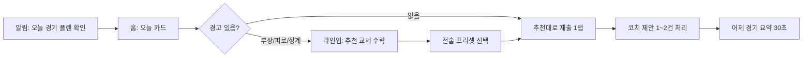
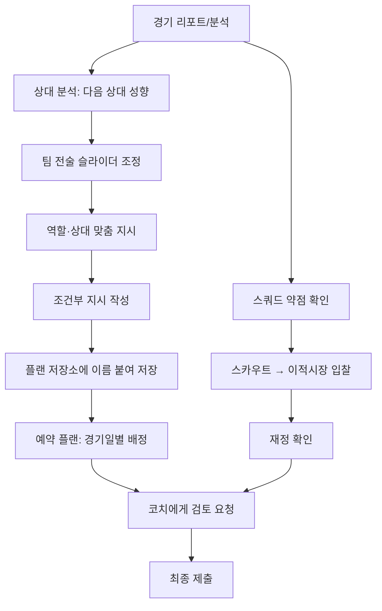

# 킥오프 FM(가칭) 게임 기획서 v1

> 모바일 축구 전략 게임 "실시간 FM 스타일" 경쟁 리그 기획서 (통합본)

| 항목 | 내용 |
|---|---|
| 문서 버전 | v1 (파트 A~F 통합본) |
| 작성일 | 2026-09-26 |
| 통합 출처 | A 게임 디자인(섹션 1·2·3·4·6·8·9·14) / B 코치 협동(섹션 5) / C 경제·수익화·경제 악용(섹션 7·13) / D UX(섹션 10·11) / E 법률·운영(부록 A) / F PM(섹션 12·13·핵심 질문) |
| 통일 기준 | 파트 간 서로 다른 값은 하나로 통일했다. 전체 통일 내역은 **부록 B** 참조 |

### 문서 구성
| 순서 | 섹션 |
|---|---|
| 0 | 전제: 예산 = 게임 내 재화(KC), 공통 상수, 용어 |
| 1~14 | 원래 요청의 섹션 1~14 |
| 부록 A | 현금성 보상 별도 선택지와 법률·운영 검토 |
| 핵심 질문 | 임의로 확정하지 않은 결정 사항 (15개) |
| 부록 B | 파트 간 통일 내역 |

---

## 0. 전제

### 0.1 "실제 사용이 가능한 예산"의 정의: 게임 내 재화로 설계

원래 요청의 "실제 사용이 가능한 예산"은 **게임 안에서만 쓰는 재화 KC(킥오프 크레딧)** 로 설계한다. 현금이나 현금성 가치와는 어떤 경로로도 연결하지 않는다.

| 구분 | 이 기획서에서의 처리 |
|---|---|
| 구단 예산, 승리 수당, 우승 수당, 리그 상금, 승격 보너스 | 모두 **KC**. 환전·양도·현금 인출 불가 (섹션 7) |
| 유료 재화 | **스타(★)**. 코스메틱·편의 전용, KC로 전환 불가 (섹션 7.13) |
| 현금성 보상 | **기본 설계에 포함하지 않음.** 법률·운영 검토가 필요한 별도 선택지로 **부록 A**에서만 다룬다 |

핵심 원칙:
- **돈으로 살 수 있는 재화는 경기력에 닿지 않고, 경기력에 닿는 재화는 돈으로 살 수 없다.**
- **본 게임 루프(매일 경기, 28일 시즌, 승격·강등)에서는 어떤 경로로도 현실 가치가 나오지 않아야 한다.** 현금성 보상을 넣는다면 본 게임과 분리된 이벤트·대회 구조로만 넣는다 (부록 A).

### 0.2 표기 규칙
- 이 문서의 모든 수치는 **제안 기본값**이다. 플레이테스트·시뮬레이션·CBT 텔레메트리 전까지 `[PH]`(Placeholder) 상태로 본다. 특히 `[PH]`로 표시한 값은 조정 가능성이 높다.
- 시각은 서버 현지 시각이며, 한국 서버 기준 KST다.
- 금액 단위는 M KC(백만 KC). `85.0M` = 8,500만 KC. 원화와 헷갈리지 않도록 ₩ 기호는 쓰지 않는다.
- 결정되지 않은 사항은 임의로 확정하지 않고 **핵심 질문**에 모았다. 결정 전까지 쓰는 값은 "임시 기본값"으로 표시한다.

### 0.3 공통 상수 (전 섹션 공통, 통일 값)
| 항목 | 값 | 비고 |
|---|---|---|
| 시즌 길이 | **28일 고정 주기** (달력 월과 분리, 연 13시즌) | 월 길이(28~31일) 차이로 인한 경기 수 불균형 방지 |
| 시즌 일정 | **Day 1~26 리그 26경기 / Day 27 시즌 리뷰 / Day 28 정산·승강** | 하루 1경기 |
| 리그당 팀 수 | **14팀** (인간 유저 + 봇) | 홈·원정 더블 라운드로빈 = 26경기 |
| 승격 / 강등 | 각 리그 **1·2위 자동 승격 / 11~14위 강등** | **2:1 피라미드** (상위 1개 리그 ↔ 하위 2개 리그). **루키 리그(최하위)는 강등 없음** |
| 킥오프 | **매일 21:00** | 슬롯 복수화는 핵심 질문 Q2 |
| 플랜 마감(잠금) | **20:50** (= D) | 20:50~21:00 서버 시뮬레이션 |
| 코치 편집 동결 | **1단계 D-30분(20:20) / 2단계 D-10분(20:40)** | 섹션 5.6.2 |
| 편집 소프트 락 | **90초** 무입력 시 자동 해제 | 섹션 5.6.1 |
| 중계 | 21:00~21:12 (90분을 12분으로 압축) | 21:15 결과 확정·보고서 공개 |
| 스쿼드 | **최소 18명 / 최대 25명** (포지션당 최대 5명) | 매치데이 엔트리 18명(선발 11 + 벤치 7) |
| 교체 | 최대 5명, 3회 창(하프타임 별도) | 실제 축구 규정 준용 |
| 이적 창 | **정규: Day 27 ~ 다음 시즌 Day 2 / 중간: Day 13~15** | 기간 외에는 긴급 영입만 (섹션 4.3) |
| 영입 방식 | **블라인드 입찰, 최소 48시간**, 매일 12:00 일괄 정산 | **MVP에서 유저 간 직접 트레이드 제외** |
| 재화 | 게임 내 재화 **KC**, 유료 재화 **스타(★)**, 명예 점수 **LP** | 섹션 7 |
| 급여 | **연봉** = 시즌(28일)당 급여. 1시즌 = 게임 내 1년 | 매일 연봉/28 차감 |
| 선수 나이 | 1시즌 = 게임 내 1년 | 시즌 종료 시 나이 +1 |

### 0.4 용어
| 용어 | 정의 |
|---|---|
| 티어 / 디비전 | 피라미드의 층. T1 프리미어 디비전, T2 디비전 1, T3 디비전 2, T4 디비전 3, …, 최하위 루키 리그 (섹션 6.1) |
| 리그 (리그 그룹) | 같은 순위표를 쓰는 14팀 단위. 같은 티어에 여러 리그가 있을 수 있다 |
| 구단주 | 구단을 만든 유저. 모든 결정의 최종 권한자 (섹션 5) |
| 코치 | 구단주가 초대한 최대 5명의 유저. 역할(TAC·SCT·SQD·ANL·FIN)을 맡는다 |
| 수석코치 | 코치 1명에게 부여하는 **사람 칭호**. 구단주 부재 시 대리 권한 (섹션 5.5.3). AI 기능과 무관 |
| AI 대행 | 부재 구단의 훈련·로테이션·라인업·기본 전술을 대신 운영하는 AI 자동 관리 기능. 이적·방출·계약은 하지 않는다 (섹션 3.5) |
| 전술 슬롯 | 포메이션 + 역할 + 팀 지시 묶음. 팀당 A/B/C 3개, 슬롯별 숙련도 보유 (섹션 4.4) |
| 경기 플랜 | 매 경기 제출 단위: 라인업 + 시작 전술 슬롯 + 상대 맞춤 지시 + 조건부 지시 + 자동 교체 규칙 + 세트피스 설정 (섹션 4.5) |
| 플랜 저장소 / 예약 플랜 | 이름 붙여 저장한 경기 플랜 모음 / 최대 7경기 앞까지 미리 배정한 플랜 |
| 가용 이적 예산(B) | 코치 금액 권한 구간의 기준 예산. 정의는 핵심 질문 Q14 |
| D | 플랜 마감 시각 20:50 |

---

## 1. 한 문장 게임 소개와 핵심 재미

### 1.1 한 문장 소개
> **"매일 밤 9시, 내가 짠 전술로 다른 유저의 팀과 붙는다 — 한 달이면 승격과 강등이 갈리는 모바일 축구 감독 리그."**

### 1.2 핵심 재미 (Fun Hypothesis)
게임이 성립하려면 **단 하나**가 반드시 재미있어야 한다:

> **"내가 상대를 읽고 바꾼 전술이, 경기 결과와 경기 후 리포트에서 '보인다'."**

이것이 성립하지 않으면(전술이 결과에 안 보이거나, 반대로 전술만으로 결과가 정해지면) 나머지 시스템은 의미가 없다. 섹션 8의 엔진 설계와 보고서가 이 가설을 직접 검증한다.

### 1.3 핵심 재미 요소 4가지
| # | 재미 | 플레이어가 하는 결정 | 보상 감각 |
|---|---|---|---|
| 1 | **상대 읽기** | 상대의 최근 전술·약점을 보고 오늘의 플랜 조정 | "내 카운터가 먹혔다" (보고서의 전술 기여 xG로 확인) |
| 2 | **선수단 운영** | 매일 경기라 체력·로테이션·영입 우선순위 결정 | 한정된 예산으로 약점 보완 |
| 3 | **한 달짜리 드라마** | 26경기 안에서 승격권/강등권 경쟁 | 마지막 주의 긴장감, 시즌 종료 승강 연출 |
| 4 | **함께 운영** | 최대 5명 코치와 역할 분담 (→ 섹션 5) | 친구와 같은 팀 응원, 역할 기여 |

### 1.4 디자인 필러 (모든 결정의 판단 기준)
1. **전술은 의미가 있지만 전부는 아니다** — 전술 최대 효과는 상한이 있다 (섹션 8).
2. **매일 접속하지 않아도 경쟁할 수 있다** — 부재가 곧 패배가 되지 않는다 (섹션 3, 9).
3. **결과는 설명 가능하다** — 모든 경기 결과에 "왜"가 붙는다.
4. **돈으로 이길 수 없다** — 과금은 경기력에 영향 없음 (→ 섹션 7, 13).
5. **짧은 세션, 깊은 선택** — 5분 확인으로도 충분하고, 30분 분석하면 더 좋아진다.

---

## 2. 주요 타깃 유저와 플레이 경험

### 2.1 타깃 페르소나
| 구분 | 페르소나 | 특징 | 원하는 것 | 이 게임이 주는 것 |
|---|---|---|---|---|
| **1차 핵심** | "퇴근 후 감독" (25~40세, 축구 시청·FM 경험) | PC FM을 좋아하지만 시즌 하나에 수십 시간 쓸 여유 없음 | 전술 깊이 + 짧은 세션 | 하루 5~20분, 한 달 시즌, 전술이 보이는 엔진 |
| **1차 핵심** | "단톡방 축구 모임" (친구 2~6명) | 같이 응원하고 떠들 거리 필요 | 함께하는 목표 | 코치 초대 협동, 매일 밤 9시 공동 관전 |
| 2차 | "전술 연구가" | 데이터·xG·상성 분석을 즐김 | 깊이, 최적화 여지 | 상세 경기 리포트, 상성 규칙, 상대 스카우팅 |
| 2차 | "라이트 축구팬" | 경기 결과 확인이 주 목적 | 간단함 | 추천 전술 프리셋, 자동 관리, 결과 알림 |
| 비타깃 | 액션 축구 게임 유저 | 직접 조작 선호 | — | 직접 조작 없음을 명확히 커뮤니케이션 |

### 2.2 플레이 경험 목표 (세션 유형별)
| 세션 | 시간 | 빈도 | 경험 | 예시 행동 |
|---|---|---|---|---|
| **확인형** | 1~5분 | 매일(선택) | "오늘도 준비됐다" | 알림 → 자동 추천 라인업 확인 → 체력 낮은 선수 1명 교체 → 끝 |
| **조정형** | 10~20분 | 주 3~4회 | "상대를 읽었다" | 상대 최근 5경기 스카우팅 → 압박 강도 조정 → 조건부 지시 추가 |
| **관전형** | 12분 | 매일 21:00(선택) | "같이 본다" | 코치들과 실시간 중계 관전, 채팅 |
| **운영형** | 30분+ | 주 1회 / 이적 기간 | "팀을 만든다" | 이적 입찰, 훈련 계획, 전술 A/B/C 재설계 |

### 2.3 감정 곡선 (시즌 단위)
```
긴장 ▲
     │                                          ★ Day 24~26 승강 경쟁 최고조
     │               ▲ Day 13~15 중간 이적창       ／
     │   ／＼       ／                        ／
     │ ／    ＼__／     ＼____／＼____／＼__／
     │ Day1 개막 기대감                                ▼ Day 27~28 리뷰·정산·승강 연출·리셋
     └────────────────────────────────────────────────────────▶ 시간
```

---

## 3. 하루 경기 일정부터 월간 시즌 종료까지의 플레이 흐름

### 3.1 하루 일정 (한국 서버 기준 KST)
| 시각 | 서버 이벤트 | 유저가 할 수 있는 일 | 알림(기본값, 끌 수 있음. 상세는 10.7) |
|---|---|---|---|
| 00:00 | **일일 처리**: 컨디션 회복, 훈련 효과 반영, 부상 경과, 전술 숙련도 감쇠, 연봉 일할 차감(연봉/28) | — | 없음 |
| 00:00~20:20 | 플랜 편집 가능 (코치는 권한 매트릭스 기본 권한) | 라인업·전술·조건부 지시 수정, 스카우팅, 이적 입찰 | — |
| 12:00 | **이적 입찰 정산** (이적 기간 중) | 결과 확인 | 입찰 결과 (입찰한 경우만) |
| 18:00 | — | — | 플랜 확인 요청 (플랜 미제출 시만) |
| **20:20** | **코치 편집 동결 1단계** (D-30분) | 구단주·플랜 책임자·해당 섹션 E 권한자만 편집. 새 제안 카드 생성 불가 | 마감 임박 (미제출 + 출전 불가 선수 포함 시만) |
| **20:40** | **코치 편집 동결 2단계** (D-10분) | 구단주·플랜 책임자만 편집 | — |
| **20:50** | **플랜 잠금(D)** → 제출된 플랜 또는 기본 플랜 확정 | 수정 불가 (열람만) | — |
| 20:50~21:00 | 전 경기 시뮬레이션 실행, 결과는 비공개 저장 | — | — |
| **21:00~21:12** | 실시간 중계(90분 → 12분 압축, 2D 탑뷰 + 텍스트 중계) | 관전, 코치 채팅 | "킥오프!" (기본 OFF) |
| 21:15 | 결과 확정, 순위표·리포트 공개 | 경기 리포트 확인, 다음 경기 준비 | 결과 요약 |
| 21:15~24:00 | — | 리뷰, 다음 날 플랜 편집 가능 | — |

규칙:
- 경기 중 **실시간 개입은 없다**. 접속 여부에 따른 불공정을 막기 위해, 경기 중 변화는 **사전 제출한 조건부 지시**로만 일어난다 (섹션 4.5). 허용 여부 재검토는 핵심 질문 Q11.
- 결과는 20:50에 이미 결정되지만 21:00 중계 전에는 누구에게도(운영 툴 포함 권한 제한) 노출되지 않는다.
- 중계를 놓쳐도 이후 언제든 **동일한 다시보기**(결정적 시드 재생)를 볼 수 있다.
- 플랜 편집 창은 **전날 경기 종료 후 ~ 당일 20:50 전체**다. 마감 직전에만 대응할 수 있는 구조가 아니므로 시간대가 맞지 않는 유저도 미리 준비할 수 있다.
- 알림은 경기일 기준 하루 최대 3개(코치 협동 알림 제외)이며, 초과분은 앱 내 알림함에만 쌓는다 (10.7).

### 3.2 주간 흐름
| 요일 개념 | 내용 |
|---|---|
| 매 7일(Day 7, 14, 21) | **주간 리포트**: 팀 폼, 체력 추세, 전술 숙련도, 다음 7경기 상대 미리보기 |
| 매 7일 | 훈련 계획 갱신 권장 시점 (훈련 계획은 주 단위 설정, 매일 바꿀 필요 없음) |
| Day 13~15 | **중간 이적창** (3일, 입찰은 매일 12:00 정산) |

### 3.3 시즌(28일) 타임라인
| Day | 단계 | 경기 | 주요 이벤트 |
|---|---|---|---|
| 1 | 개막 | 1R | 시즌 목표 설정(선택: 승격/잔류/중위권. 보상 보너스 여부는 미결정) |
| 2 | — | 2R | 정규 이적창 마감 23:59 |
| 3~12 | 전반기 | 3~12R | 일반 진행 (이적창 닫힘) |
| 13~15 | 중간 이적창 | 13~15R | 경기는 계속 진행 |
| 16~22 | 후반기 | 16~22R | Day 21 "승강 경쟁 구도" 알림 (이적창 닫힘) |
| 23~26 | 막판 | 23~26R | 승격권·강등권 팀에 "결정전" 연출, Day 26 최종전 동시 킥오프 |
| **27** | 시즌 리뷰 | 경기 없음 (보상 없는 이벤트 친선전 선택) | 순위 확정, 시상, 시즌 리포트, **정규 이적창 오픈** |
| **28** | 정산·승강 | 경기 없음 | 00:00 정산(보상 지급, 이월 상한 적용·LP 전환), 승강 반영, 나이 +1, 계약 만료 처리, 다음 시즌 편성 공개 |
| 다음 Day 1 | 새 시즌 | 1R | 기본 배정금 지급, 승격 보너스 지급 |

설계 근거:
- 14팀 더블 라운드로빈 = 26경기 → 26일 + 정리 2일 = 28일. 달력 월에 맞추면 매달 경기 수가 달라져 기록·보상 비교가 불가능하므로 **고정 28일 주기**를 쓴다 (연 13시즌).
- Day 27~28은 "숨 쉬는 구간"(비시즌 2일): 매일 경기 피로를 끊고 이적·재정비에 집중하게 한다.
- 밸런스 패치·경제 수치 변경은 이 구간(시즌 경계)에서만 적용한다 (섹션 7.8, 8.7).

### 3.4 핵심 루프
```markdown
## Moment-to-Moment (0~30초)
- 행동: 라인업 슬롯에 선수 드래그, 전술 슬라이더 조정
- 피드백: 즉시 "예상 영향" 칩 표시 (예: "압박 +1 → 체력 소모 +3, 상대 빌드업 방해 ↑")
- 보상: 준비 완료 체크, 팀 적합도 게이지 상승

## Session Loop (5~20분 / 하루)
- 목표: 오늘 상대에 맞춘 플랜 제출
- 긴장: 체력 vs 최정예 라인업, 익숙한 전술 vs 상대 맞춤 전술(숙련도 손실)
- 해결: 21:00 결과 + "승부 요인" 리포트 → 다음 날 조정 근거

## Long-Term Loop (28일 시즌 / 수개월)
- 진행: 승격 → 상위 리그 → 더 높은 예산·더 강한 상대 (→ 섹션 6, 7)
- 유지 훅: 매 시즌 리셋되는 순위 경쟁, 선수 성장/노화, 코치 팀원과의 공동 목표, 명예의 전당
```

### 3.5 매일 접속하지 못하는 유저를 위한 보완책 (필수)
원칙: **"부재 = 자동으로 합리적인 운영"**. 매일 접속한 유저가 얻는 이점은 "상대 맞춤 최적화"에 한정되고, "관리 누락으로 인한 붕괴"는 없어야 한다.

| # | 보완책 | 규칙 | 해결하는 문제 |
|---|---|---|---|
| 1 | **플랜 유지** | 미제출 시 직전 플랜 자동 사용 (코치 팀의 자동 제출 판정은 5.6.2) | 미접속 = 몰수패 방지 |
| 2 | **자동 로테이션** (기본 ON) | 선발 선수 컨디션 < 70 [PH] 또는 부상/징계 시, 같은 역할 적합도 최고 벤치/스쿼드 선수로 자동 대체 | 체력 붕괴·결장 방지 |
| 3 | **예약 플랜** | 최대 7경기 앞까지 경기별 플랜을 미리 제출 (상대 이름 기준) | 주말에만 접속하는 유저 |
| 4 | **조건부 지시** | 경기 중 상황별 자동 대응 최대 3개 (섹션 4.5) | 실시간 개입 불필요 |
| 5 | **AI 대행(자동 관리)** | 토글 시 훈련·로테이션·라인업·기본 전술을 AI가 운영. **이적·방출·계약은 하지 않음**. 7일 연속 미접속 시 강제 ON (6.4) | 장기 부재 |
| 6 | **코치 위임** | 협동 코치에게 권한 위임 (→ 섹션 5) | 사람이 대신 운영 |
| 7 | **입찰 기간 48시간** | 이적 입찰은 최소 48시간 열림, 정산은 매일 12:00 일괄 | 실시간 스나이핑 차단 |
| 8 | **보상 미수령 보호** | 경기·시즌 보상은 자동 적립, 시즌 종료 +1시즌까지 보관 | 접속 안 해도 보상 손실 없음 |
| 9 | **경쟁력 있는 일일 보상 없음** | 출석 보상은 코스메틱/소량 편의만, 선수 능력치·예산에 누적 영향 금지 | 출석 격차 누적 방지 |
| 10 | **"다녀오셨군요" 요약** | 마지막 접속 이후 N일 경기 결과·순위 변동·부상·추천 행동 3개를 한 화면에 | 복귀 부담 감소 |

경제 측 보완: 플랜을 제출했거나 AI 대행으로 경기를 치르면 **패배 참가 수당 이상**을 보장한다 (섹션 7.4.1).

**측정 목표(검증 기준)**: 동일 스쿼드 기준, "AI 대행" 팀의 경기당 승점(PPG)이 "숙련 유저 수동 관리" 팀 대비 **90% 이상** [PH]. 80% 미만이면 AI 대행을 개선하고, 97% 이상이면 수동 운영의 의미가 약하므로 AI 대행 성능을 낮춘다. (관찰 지표는 12.4의 "비접속 불이익" KPI. 목표치 자체는 핵심 질문 Q13)

---

## 4. 전술·선수단·경기 플랜 시스템

### 4.1 선수 모델
**능력치 14종 (1~20 정수)** — FM 계열 유저에게 익숙하되 모바일에서 읽을 수 있는 수로 압축.

| 그룹 | 능력치 | 주로 영향 주는 엔진 유닛 (섹션 8) |
|---|---|---|
| 기술 | 패스, 드리블, 결정력, 크로스, 태클 | 빌드업, 전진, 찬스메이킹, 마무리, 중원/박스 수비 |
| 정신 | 시야, 위치선정, 침착성, 활동량 | 찬스메이킹, 수비, 마무리, 압박 |
| 신체 | 속도, 체력, 피지컬(몸싸움+공중볼) | 역습, 라인 뒷공간, 체력 소모, 공중전 |
| GK 전용 | 선방, 공중 장악, 킥 | 실점 억제, 세트피스 수비, 빌드업 |

기타 속성:
| 속성 | 범위 | 규칙 |
|---|---|---|
| 종합 능력(OVR) | 1~100 | 표시용. 주 포지션 가중합 ×5 (엔진은 OVR을 직접 쓰지 않음) |
| 포지션 적합도 | 주 포지션 1.00 / 숙련 0.95 / 가능 0.88 / 부적합 0.75 | 효율 배수. UI 표기는 ◎ 주 포지션 / ○ 숙련 / △ 가능 / ✕ 부적합 (10.5.1) |
| 잠재력 | 숨김 값, 스카우트 등급으로 범위 공개 (예: "B~A") | 성장 상한 |
| 나이 | 16~38 | 시즌 종료 +1. 성장 16~23, 정점 24~29, 하락 30+ [PH] |
| 컨디션 | 0~100 | 4.2 참조 |
| 사기 | -2 ~ +2 (5단계) | 연승/연패, 출전 시간, 계약 만족도 |
| 계약 | 잔여 시즌 수 1~5 | 만료 시 재계약 또는 자유계약 방출. 연봉·재계약 보너스·방출 위약금은 섹션 7 |

### 4.2 컨디션·체력 (하루 1경기 구조의 핵심 레버)
| 변수 | 제안 기본값 | 근거 |
|---|---|---|
| 90분 풀타임 소모 | 27 (±압박 1단계당 3, 역할 보정 ±3) | 3경기 연속 출전 시 컨디션 60대 진입 → 로테이션 결정 발생 |
| 일일 회복 (00:00) | +18 + 체력 능력치 보정(0~6) | 평균 +20 |
| 효율 배수 | 컨디션 ≥85: 1.00 / 85→60 선형 1.00→0.85 / <60: 0.80 | 급격한 절벽 대신 완만한 손실 |
| 부상 위험 | 기본 0.8%/경기, 컨디션 <60이면 ×2 [PH] | 혹사 억제 |

예시: 컨디션 100 선수 연속 출전 → 73 → (회복) 93 → 66 → 86 → 59 ← 4번째 경기 전 휴식 권장.

### 4.3 스쿼드 규칙
| 규칙 | 값 | 비고 |
|---|---|---|
| 스쿼드 크기 | 18~25명, 포지션당 최대 5명 | 18 미만 시 경기 전 자동으로 최저 능력 "임시 계약 선수" 충원 (다음 이적창까지) |
| 매치데이 엔트리 | 18명 (선발 11 + 벤치 7) | GK 최소 1명 벤치 포함 권장 (강제 아님, 경고 표시) |
| 교체 | 최대 5명, 3회 창 + 하프타임 | 조건부 지시/자동 교체로만 실행 |
| 징계 | 경고 누적 4장 → 1경기 정지 / 퇴장 → 1~3경기 | 시즌 종료 시 경고 초기화 |
| 이적 기간 | 정규: Day 27 ~ 다음 시즌 Day 2 / 중간: Day 13~15 | 기간 외에는 스쿼드 18명 미만일 때만 자유계약 선수 긴급 영입 가능 |
| 영입 경로 (MVP) | 시스템 이적시장(NPC)·자유계약(FA)·유저 방출 선수 경매. **모두 블라인드 입찰** (섹션 7.9) | **유저 간 직접 트레이드는 MVP 제외** (담합·부계정·RMT 위험 → 섹션 12, 13) |
| 유스 | 후속 업데이트 (1차) | — |

**블라인드 입찰 규칙**: 입찰은 48시간 이상 열림 → 매일 12:00 일괄 정산 → 최고가 승리, 동률 시 (1) 하위 리그 팀 우선 (2) 먼저 입찰한 팀. 입찰가는 끝까지 비공개. 입찰 금액 범위·연봉·이적세는 섹션 7.9.

### 4.4 전술 시스템

#### (1) 포메이션 (MVP 10종)
4-4-2, 4-4-2 다이아몬드, 4-3-3, 4-2-3-1, 4-1-4-1, 4-3-1-2, 3-5-2, 3-4-3, 5-3-2, 5-4-1

#### (2) 역할 (포지션당 2~4개, MVP 총 22개)
| 포지션 | 역할 | 핵심 능력치 | 엔진 효과 요약 |
|---|---|---|---|
| GK | 전통형 / 스위퍼 키퍼 | 선방·공중 / 킥·속도 | 스위퍼: 높은 라인 뒷공간 보완, 빌드업 +, 실책 리스크 소폭 + |
| CB | 스토퍼 / 커버 / 볼플레잉 | 태클·피지컬 / 속도·위치 / 패스·침착 | 볼플레잉: 빌드업 유닛 가중 ↑ |
| FB/WB | 수비형 / 오버래핑 / 인버티드 | 태클·위치 / 속도·크로스 / 패스·시야 | 오버래핑: 크로스 찬스 ↑, 역습 허용 ↑ |
| DM | 앵커 / 딥 플레이메이커 / 볼 위너 | 위치·태클 / 패스·시야 / 태클·활동량 | 딥PM: 빌드업·전진 ↑, 중원 저지 ↓ |
| CM | 박스투박스 / 플레이메이커 / 수비형 | 활동량 / 시야·패스 / 태클·위치 | 박투박: 체력 소모 +3 |
| AM | 공격형 플메 / 섀도 스트라이커 | 시야·패스 / 결정력·위치 | — |
| W | 윙어 / 인사이드 포워드 | 속도·크로스 / 드리블·결정력 | 윙어: 크로스 비중 ↑, 인사이드: 컷인 슈팅 ↑ |
| ST | 타깃맨 / 침투형 / 가짜 9번 / 프레싱 포워드 | 피지컬 / 속도·위치 / 시야·패스 / 활동량 | 침투형: 스루패스·역습 xG ↑ |

MVP에서 선수별 개별 지시는 **상대 맞춤 지시(집중 마크 1명)와 세트피스 키커 지정**으로 한정한다. 선수별 상세 지시는 2차 업데이트 (섹션 12).

#### (3) 팀 지시 (6개 슬라이더, 5단계: -2 ~ +2, 기본 0)
| 지시 | -2 | +2 | 트레이드오프 |
|---|---|---|---|
| 공격 성향 | 매우 수비적 | 매우 공격적 | 찬스 수 ↑ ↔ 역습 허용 ↑ |
| 압박 강도 | 자기 진영 대기 | 전방 압박 | 상대 빌드업 방해 ↑ ↔ 체력 소모·뒷공간 ↑ |
| 수비 라인 | 낮음 | 높음 | 공간 압축·오프사이드 ↔ 스루패스·역습 취약 |
| 폭 | 좁게 | 넓게 | 중앙 밀집 ↔ 측면 활용·크로스 |
| 템포 | 느리게 | 빠르게 | 점유 안정·경기 수 ↓ ↔ 공격 횟수·턴오버 ↑ |
| 패스 방식 | 짧게 | 길게(직선적) | 점유·리셋 ↑ ↔ 압박 우회·턴오버 ↑ |

토글 3개: **역습 중시**(ON 시 공 탈취 직후 전진 시도 ↑), **오프사이드 트랩**(수비 라인 ≥ +1에서만 선택 가능), **세트피스 전담 키커 지정**.

UI는 같은 -2~+2 값을 5단계 스냅 슬라이더로 보여주고, 팀 지시 조합 프리셋(균형·점유·역습·전방압박·잠그기)을 제공한다 (10.5.2).

#### (4) 전술 슬롯과 숙련도
- 팀은 **전술 A/B/C 3개 슬롯**을 저장한다 (포메이션 + 역할 + 팀 지시).
- **전술 숙련도** 0~100 (슬롯별):
  - 경기 사용 +6, 훈련 초점 "전술" 선택 시 +2/일, 미사용 −2/일 [PH]
  - 포메이션 변경 시 숙련도 50%로 하락, 팀 지시만 변경 시 하락 없음 (프리셋 적용도 팀 지시만 바꾸면 하락 없음)
  - 효과: 숙련도 100 = 전술 이점 100% 발휘 / 0 = 긍정 효과 50%만 발휘 + 전 경합 −0.05 logit (섹션 8)
- **설계 의도**: 매일 상대에 맞춰 포메이션을 뒤집는 "만능 카운터 피킹"을 비용화. 대신 팀 지시 슬라이더 미세 조정은 자유 → "큰 틀은 유지, 디테일로 대응"이 최적 전략이 되도록.

### 4.5 경기 플랜 (매일 제출 단위)
경기 플랜 = **라인업 + 사용할 전술 슬롯 + 상대 맞춤 지시 + 조건부 지시 + 자동 교체 규칙 + 세트피스 설정**

| 구성 요소 | 내용 | 제한 |
|---|---|---|
| 라인업 | 선발 11 + 벤치 7 | 자동 추천 버튼 제공 |
| 시작 전술 | A/B/C 중 1개 | — |
| 상대 맞춤 지시 | ① 집중 마크 대상 1명(상대 선수) ② 공략 측면(좌/우/중앙/없음) | 각 1개 |
| 조건부 지시 | **IF (조건) THEN (행동)**, 최대 3개, 위에서부터 우선 | 동일 지시는 경기당 1회 발동 |
| 자동 교체 | 컨디션 임계치(기본 55) 이하 시 같은 포지션 벤치로 교체 | 교체 창 소진 시 중단 |
| 세트피스 | 전담 키커 지정 (MVP), 루틴 프리셋 (1차) | — |

플랜은 **플랜 저장소**에 이름·태그를 붙여 저장하고, **예약 플랜**으로 최대 7경기 앞까지 경기별로 배정할 수 있다 (10.5.4, 11 T06·T07).

**조건부 지시 문법 (MVP)** — 조건은 최대 2개까지 AND로 결합(OR 없음), 행동은 지시당 1개.
| 조건 | 행동(1개 선택) |
|---|---|
| 분 ≥ X (15분 단위: 45/60/75) AND 스코어 상태(리드/동점/열세, 점수차 N) | 전술 슬롯 전환(A/B/C) |
| 우리 팀 퇴장 발생 / 상대 퇴장 발생 | 공격 성향 ±1, ±2 |
| 특정 선수 컨디션 < X | 특정 선수 교체 (OUT→IN 지정) |
| 하프타임 | 템포/압박 ±1 |

예시 플랜:
```
시작 전술: A (4-3-3, 압박 +1, 라인 +1)
맞춤: 상대 10번 집중 마크(볼 위너 DM), 공략 측면: 왼쪽(상대 우측 풀백 속도 9)
IF 60분 이후 AND 1골 이상 리드 → 전술 C (5-4-1, 성향 -1)
IF 우리 팀 퇴장 → 공격 성향 -1
IF 75분 이후 AND 열세 → ST 9번 OUT, ST 19번(타깃맨) IN
```

**정보 대칭 규칙**: 모든 유저는 상대의 최근 5경기 포메이션·팀 지시 요약·경기 리포트를 볼 수 있다. **오늘 제출된 상대 플랜은 절대 볼 수 없다**. 제출 시각도 비공개(늦게 제출하는 이점 제거).

### 4.6 훈련 (주 단위 설정)
| 초점 | 효과 (일일) | 비용 |
|---|---|---|
| 균형 (기본) | 성장 기본, 회복 기본 | — |
| 전술 | 사용 중 슬롯 숙련도 +2 | 성장 −20% |
| 체력 관리 | 일일 회복 +4 | 성장 −30% |
| 개인 발전 | 지정 선수 3명 성장 +30% | 회복 −2 |
| 세트피스 | 세트피스 유닛 +3 (다음 3경기) | 성장 −10% |

훈련은 주 1회 설정으로 충분하도록 설계 (매일 접속 불필요). MVP는 **주간 초점 5종 선택과 휴식 지정**만 제공하고(11 Q07 △), 세부 훈련 강도 설계는 후속으로 둔다. 전술 숙련도와 체력 회복이 엔진 입력이므로 초점 선택은 MVP에 포함한다.

---

## 5. 최대 5명 코치 협동 시스템과 권한 충돌 방지

> 이 섹션의 모든 수치는 **제안 기본값**이며 플레이테스트 후 조정한다. 플랜 마감 시각(D = 20:50)과 동결 구간(20:20 / 20:40)은 0.3 공통 상수를 따른다.

### 5.1 설계 목표와 원칙

| # | 원칙 | 규칙으로 옮기면 |
|------|------|----------------|
| 1 | **구단은 구단주의 것** | 모든 결정은 구단주가 거부·되돌리기·회수할 수 있다. 코치 권한은 구단주가 "빌려준" 것이다. |
| 2 | **코치는 손님이 아니라 담당자** | 각 역할은 "자기 이름으로 단독 실행"할 수 있는 영역을 반드시 1개 이상 가진다. 보기 전용 코치는 없다. |
| 3 | **충돌은 사전에 막고, 못 막으면 규칙으로 판정** | 동시 편집은 잠금·버전으로, 돈은 예약(에스크로)으로, 마감은 서버 시각으로 판정한다. "누가 먼저 눌렀나"를 사람이 다투지 않게 한다. |
| 4 | **구단주가 자리를 비워도 팀은 돌아간다** | 구단주 미응답 시 자동 처리 규칙이 있다. 단, 되돌릴 수 없는 큰 결정은 자동 처리하지 않는다. |
| 5 | **의견 불일치 자체가 콘텐츠** | 반대 의견은 기록되고, 결과로 검증되며, 맞힌 쪽이 보상받는다. |

**플레이어 경험 목표**
- 구단주: "혼자라면 못 챙겼을 영역을 믿고 맡기되, 중요한 순간엔 내가 결정한다."
- 코치: "내 담당 영역의 성과가 숫자로 남고, 팀 승리에 내 몫이 보인다."

### 5.2 좌석 구조

| 좌석 | 인원 | 설명 |
|------|------|------|
| 구단주 (Owner) | 1 | 팀 생성자. 양도 불가(양도·승계 여부는 핵심 질문 Q8). |
| 코치 (Coach) | 0~5 | 구단주가 초대. 각자 **주 역할 1개 + 보조 역할 최대 1개**. 5명 전원 무료(코치 좌석 판매 금지, 7.13) |
| 수석코치 (Head Coach) 칭호 | 0~1 | 코치 중 1명에게 부여하는 **추가 칭호**(역할 아님). 구단주 부재 시 대리 권한(5.5.3). AI 대행과 무관 |

- 역할은 5종(5.3). 코치 수가 5명 미만이면 비어 있는 역할의 권한은 **구단주에게 귀속**된다(= 구단주가 직접 수행).
- 한 역할에 주담당은 1명만 둘 수 있다. 보조 담당은 해당 역할의 권한 중 **"제안" 이하**만 가진다(단독 실행 불가).
  - 예: 코치 3명 팀 → A=전술(주)+분석(보조), B=스카우트(주)+재정(보조), C=선수단(주). 분석·재정의 "단독 실행" 권한은 구단주에게 남는다.
- 역할 변경은 구단주만 가능. 변경은 **다음 경기 플랜 마감(20:50) 이후**에 적용된다(마감 직전 역할 바꿔치기 방지). 예외: 코치 이탈 시 즉시 재배정 가능.

#### 초대·가입 흐름
1. 구단주가 초대 링크/코드 생성 (유효 48시간, 1회용).
2. 초대받은 유저가 수락 → 역할 확인 화면 → 겸직·이해충돌 검사(5.9) 통과 시 합류.
3. 합류 후 **수습 기간 24시간**:
   - 권한 매트릭스상 "단독 실행" 항목이 전부 "제안"으로 강등된다. (계정 탈취·트롤 초대 피해 제한)
   - **당일 경기 플랜과 상대 분석 리포트는 플랜 마감(20:50) 이후에만 열람**할 수 있다. (코치 스파이 대응, 13.3)

### 5.3 코치 역할 정의

| 역할 | 코드 | 담당 영역 | 핵심 결정 (단독 실행 가능) | 성과 지표 (5.8 기록용) |
|------|------|-----------|---------------------------|------------------------|
| 전술 코치 | `TAC` | 포메이션, 선수 역할, 팀 지시, 경기별 플랜 작성·제출 | 경기 플랜 편집 및 확정 제출, 전술 슬롯 관리 | 담당 플랜 경기 승점률, 상대 전술 대응 성공률 |
| 스카우트 | `SCT` | 선수 탐색, 관찰 리포트, 영입 후보 목록, 소액 영입 입찰 | 스카우팅 배정, 관심 목록, **소액 구간** 입찰 | 영입 선수의 영입 후 평점·출전·가치 상승 |
| 선수단 관리 코치 | `SQD` | 선발/로테이션, 컨디션·부상 관리, 훈련, 계약 갱신 초안, 유스(1차 업데이트) | 훈련 계획, 로테이션 규칙, 유스 승격(1차) | 부상 경기 수, 평균 컨디션, 선수 성장치 |
| 경기 분석관 | `ANL` | 상대 분석 리포트, 경기 후 분석, 세트피스, 조건부 교체 규칙 | 세트피스 설정, 상대 리포트 게시, 조건부 규칙 편집 | 예측 적중률, 세트피스 득점/실점, 조건부 규칙 발동 후 득실 |
| 재정 코치 | `FIN` | 예산 배분, 연봉 상한, 소액 판매 응답, 시설·스폰서 선택(1차 업데이트) | 예산 카테고리 배분(±범위 내), 소액 판매 등록·응답 | 시즌 말 예산 잔액 대비 성적, 연봉 효율(승점/연봉) |

> 경기 플랜과 선발 명단이 겹치는 부분: **선발 11명·교체 명단은 TAC가 최종 편집**, SQD는 "출전 불가/제한" 태그(부상·피로 한도)를 걸 수 있고 TAC는 이 태그를 무시할 수 없다(무시하려면 구단주 승인). 두 코치의 경계가 가장 자주 부딪히는 곳이므로 태그라는 **데이터로 경계를 만든다**.

### 5.4 역할 × 기능 권한 매트릭스

범례: **E** = 단독 실행 · **P** = 제안(승인 필요) · **V** = 보기 · **—** = 접근 불가
보조 담당은 해당 역할 열의 E를 P로 강등해 적용한다. `(1차)` 표시는 MVP 이후 기능이다.

| 기능 | 구단주 | TAC | SCT | SQD | ANL | FIN |
|------|:---:|:---:|:---:|:---:|:---:|:---:|
| **전술/플랜** |||||||
| 포메이션·팀 지시 편집 | E | E | V | P | P | V |
| 경기별 플랜 편집 | E | E | V | P | P | V |
| 경기별 플랜 확정 제출 | E | E | — | — | — | — |
| 선발 11·교체 명단 | E | E | V | P | P | V |
| 출전 제한 태그 (부상·피로) | E | V | V | E | V | V |
| 세트피스 설정 | E | P | V | V | E | V |
| 조건부 교체·전술 변경 규칙 | E | P | V | P | E | V |
| 상대 분석 리포트 게시 | E | P | P | P | E | V |
| **선수단** |||||||
| 훈련 계획 | E | P | V | E | P | V |
| 유스 승격 (1차) | E | P | P | E | V | V |
| 계약 갱신 (연봉 인상 소액 구간) | E | V | V | P | V | E |
| 계약 갱신 (큰 금액 구간) | E | V | V | P | V | P |
| 선수 방출 | E | P | V | P | V | P |
| **이적** |||||||
| 스카우팅 배정·관심 목록 | E | P | E | P | P | V |
| 영입 입찰 — 소액 구간 | E | P | E | P | V | E |
| 영입 입찰 — 중간 구간 | E | P | P | P | V | P |
| 영입 입찰 — 큰 금액 구간 | E | P | P | P | V | P |
| 선수 판매(경매 등록) — 소액 구간 (비주전) | E | P | P | P | V | E |
| 판매 — 주전(최근 5경기 3회 이상 선발) 또는 중간 이상 | E | P | P | P | V | P |
| **재정** |||||||
| 예산 카테고리 배분 (±10%p 이내) | E | V | V | V | V | E |
| 예산 카테고리 배분 (±10%p 초과) | E | V | P | P | V | P |
| 시설 업그레이드 (1차) | E | V | V | P | V | P |
| 스폰서·수익 옵션 선택 (1차) | E | V | V | V | V | E |
| **운영** |||||||
| 코치 초대·추방·역할 지정 | E | — | — | — | — | — |
| 수석코치 칭호 지정 | E | — | — | — | — | — |
| 제안 카드 생성 | E | E | E | E | E | E |
| 투표 개설 | E | E | E | E | E | E |
| 활동 로그 전체 보기 | E | V | V | V | V | V |
| 자기 행동 되돌리기 (5.7) | E | E | E | E | E | E |
| 타인 행동 되돌리기 | E | P | P | P | P | P |
| 구단 설정 (팀명·엠블럼·공개 여부) | E | — | — | — | — | — |

> MVP에는 유저 간 직접 트레이드가 없으므로, "판매"는 방출 선수 공개 경매(블라인드 입찰) 등록과 그 결과 수락을 뜻한다 (7.9).

#### 금액 구간 정의 (제안 기본값)

`가용 이적 예산(B)`의 정확한 정의는 섹션 7과 맞춰 확정한다 (핵심 질문 Q14).

| 구간 | 기준 | 처리 |
|------|------|------|
| 소액 | 1건 ≤ B의 5% | 담당 역할 E. 단, 코치 1인 **24시간 누적 한도 B의 10%** |
| 중간 | B의 5% 초과 ~ 20% 이하 | 제안 → 구단주 승인, 또는 구단주 부재 시 5.5.2 자동 처리 |
| 큰 금액 | B의 20% 초과, 또는 팀 최고 연봉 3인 관련 거래 | **구단주 승인 필수**. 자동 처리 없음 |

- 비율 기준을 쓰는 이유: 리그마다 예산 규모가 달라 절대값은 하위/상위 리그에서 의미가 뒤틀린다.
- 연봉은 "이적료 + 계약기간 총연봉의 50%"를 거래 규모로 환산한다(연봉 폭탄 계약으로 구간 회피 방지).
- 이 구간 규칙이 재정 코치의 지출 한도를 겸한다. 되돌릴 수 없는 거래 중 코치가 단독으로 할 수 있는 것은 **소액 구간뿐**이며, 방출·주전 판매·큰 금액 거래는 항상 구단주 승인 대상이다.

### 5.5 구단주 최종 결정권 유지 방식

#### 5.5.1 구단주의 4가지 도구

| 도구 | 동작 | 제한 |
|------|------|------|
| **승인/거부** | 제안(P) 카드를 승인·거부. 거부 시 사유 선택 필수(프리셋 5종 + 자유 입력) | 없음 |
| **거부권(Veto)** | 코치가 E로 실행한 행동을 사후 취소 | 되돌리기 가능 창(5.7) 안에서만. 완료된 외부 거래는 불가 |
| **잠금(Pin)** | 특정 대상(선수, 포메이션, 예산 항목)을 "구단주 고정" → 모든 코치가 P로 강등 | 동시에 최대 5개 핀 |
| **권한 조정** | 역할 내 개별 기능을 E↔P↔V로 조정 (예: "우리 팀 스카우트는 소액 입찰도 제안만") | E로 올리는 건 매트릭스상 해당 역할 기본값까지만 |

> 구단주가 코치 권한을 역할 기본값 **이상**으로 올릴 수 없게 한 이유: "사실상 구단 전체 위임 → 대리 운영(계정 공유 우회)" 경로를 막기 위해.

#### 5.5.2 구단주 미응답 시 제안 자동 처리

| 제안 종류 | 응답 대기 | 미응답 시 |
|-----------|-----------|-----------|
| 전술·플랜 관련 | 동결 1단계 시작(D-30분, 20:20)까지 | 코치 과반 찬성이면 적용, 아니면 폐기 |
| 중간 구간 거래 | 12시간 | 해당 역할 주담당 + 코치 과반 찬성(찬성 ≥ 반대+1, 최소 2명) 시 실행 |
| 큰 금액 거래 | 24시간 | **자동 만료** (실행 안 함) |
| 방출·주전 판매 | 24시간 | 자동 만료 |
| 예산 배분 ±10%p 초과 | 24시간 | 자동 만료 |

- 구단주는 설정에서 "자동 처리 끄기"를 선택할 수 있다(모든 P가 만료만 됨).
- 자동 실행된 항목은 구단주 다음 접속 시 **요약 카드 최상단**에 노출되고, 되돌리기 가능 창 안이면 한 번에 취소 가능.

#### 5.5.3 구단주 장기 부재와 수석코치

| 부재 기간 (마지막 접속 기준) | 상태 |
|-----------------------------|------|
| 0~48시간 | 정상 |
| 48시간~7일 | **대리 모드**: 수석코치가 중간 구간 제안의 승인자가 됨. 큰 금액·방출·코치 추방은 여전히 불가 |
| 7일 초과 | 대리 모드 유지 + 모든 코치에게 알림. 이후 처리(구단 운영권 이전 등)는 핵심 질문 Q8 |

- 구단주는 "부재 예고"(최대 14일)를 걸어 대리 모드를 미리 켤 수 있다.
- 수석코치 칭호가 없으면 대리 모드에서 중간 구간 제안은 코치 **만장일치**일 때만 실행.
- 코치가 활동 중인 구단은 구단주가 부재해도 AI 대행 강제 적용 대상이 아니다. AI 대행 강제(6.4)는 **구단주와 코치 전원이 미접속**일 때만 적용한다.
- 수석코치 대리 모드는 1차 업데이트 기능이다(5.13). MVP에서는 구단주 부재 시 5.5.2 자동 처리와 자동 제출 규칙(5.6.2)만 동작한다.

### 5.6 충돌 상황별 규칙

#### 5.6.1 동시 편집 (플랜·전술판·명단)

편집 단위를 **섹션**으로 나눈다: `포메이션` · `선발/교체` · `팀 지시` · `세트피스` · `조건부 규칙` · `상대별 지시`. (이적 입찰·예산 배분은 편집 잠금이 아니라 예산 예약(5.6.3)과 제안 카드로 충돌을 막는다.)

| 상황 | 규칙 |
|------|------|
| A가 섹션 편집 시작 | 해당 섹션에 **소프트 잠금**(A 이름·아바타 표시). 다른 사람은 보기 + "제안으로 복제" 버튼만 |
| A가 **90초** 무입력 | 잠금 자동 해제(해제 전 A에게 "계속 편집 중인가요?" 토스트), A의 미저장 변경은 A 개인 초안으로 보존 |
| 권한 높은 사람이 잠긴 섹션 진입 | 구단주는 "잠금 가져오기" 가능 (A에게 알림, A 변경분은 개인 초안으로 보존되며 A가 원클릭으로 제안 카드로 전환 가능). 코치끼리는 불가 |
| 잠금 없이 동시 저장 도달 (네트워크 지연) | 섹션별 `version` 번호 비교(낙관적 동시성). 늦게 도착한 저장은 거부 → 차이(diff) 화면 → "내 것으로 덮기(권한 필요)" / "상대 것 유지" / "제안 카드로 전환" |
| 서로 다른 섹션 동시 편집 | 허용. 저장 시 교차 검증(예: 세트피스 키커가 선발 명단에서 빠짐 → 경고 배지) |

**예시**
> 21:40(경기 종료 후 다음 날 플랜 준비 중), 전술 코치가 `선발/교체` 편집 중. 선수단 코치가 같은 섹션을 열면 "전술 코치 편집 중 (1분 전 입력)" 표시와 함께 보기 모드. 선수단 코치는 "8번 교체 제안" 카드를 만들어 전술 코치에게 보낸다.

#### 5.6.2 플랜 마감 직전 경합

플랜 마감 시각 `D` = **20:50**.

| 구간 | 편집 가능자 | 비고 |
|------|------------|------|
| ~ D-30분 (~20:20) | 매트릭스 기본 권한 | 제안·투표 자유 |
| D-30분 ~ D-10분 (20:20~20:40, **동결 1단계**) | 구단주 + 플랜 책임자(기본 TAC 주담당) + 해당 섹션 E 권한자 | 새 제안 카드 생성 불가, 기존 제안 응답만 가능. 미결 제안은 D-10분(20:40)에 자동 만료 |
| D-10분 ~ D (20:40~20:50, **동결 2단계**) | 구단주 + 플랜 책임자 | 모든 코치 화면에 카운트다운 |
| D 이후 (20:50~) | 없음 (잠김) | 서버 시각 기준. D 이후 도착한 저장은 전부 거부 |

**제출 판정 규칙**
1. D 시점에 **마지막으로 "확정 제출"된 버전**이 사용된다.
2. 확정 제출이 없으면 **마지막 저장 버전 중 유효성 검사 통과한 것**을 자동 제출.
3. 그것도 없으면(명단 부족 등) 팀의 **기본 플랜**(구단주가 지정, 미지정 시 직전 경기 플랜)으로 대체. 이때 자동 로테이션(3.5)이 적용된다.
4. 구단주와 플랜 책임자가 D-10분 이후 서로 다른 버전을 확정 제출하면 **구단주 버전 우선**. 플랜 책임자 버전은 로그에 "미채택"으로 남는다.

> 매일 접속 못 하는 유저 보완: 규칙 2·3 덕분에 "아무도 안 들어와서 기권"은 발생하지 않는다.

이 동결 구간은 **코치 사보타주 대응**(경기 직전 전술 망가뜨리기)도 겸한다: 20:40 이후에는 구단주와 플랜 책임자 외에 누구도 플랜을 바꿀 수 없다 (13.3).

#### 5.6.3 큰 금액 거래와 예산 동시 소진

| 상황 | 규칙 |
|------|------|
| 제안 생성 시 | 해당 금액을 **예산 예약(에스크로)** 상태로 묶는다. 예약분은 다른 입찰·제안에 사용 불가 |
| 두 코치가 같은 선수에 각각 제안 | 두 번째 제안은 생성 불가 → 기존 카드에 "공동 지지" 또는 "대안 조건" 댓글로 유도 |
| 예약 합계가 가용 예산 초과 | 신규 제안 차단, "예산 예약 현황" 표시 |
| 제안 만료·거부 | 예약 즉시 해제 |
| 소액 구간 쪼개기 (같은 선수·같은 판매 구단에 24시간 내 반복 입찰) | 합산하여 구간 재판정 |
| 실행 직전 확인 | 중간 이상 거래는 승인 후 **10분 대기열**을 거쳐 전송. 대기 중 구단주·승인자 취소 가능 |
| 판매 후 자기 편 재구매, 동일 상대와 왕복 거래 | 이상 거래 탐지 대상 (섹션 13과 연결) |

**예시**
> 가용 이적 예산 B = 10.0M KC. 스카우트가 1.8M 입찰 제안(중간 구간 18%) → 1.8M 예약. 재정 코치가 동시에 8.5M 지출 제안 → "예약 후 잔액 8.2M 초과"로 생성 차단.

#### 5.6.4 코치 이탈

| 이탈 유형 | 즉시 처리 | 진행 중 항목 처리 |
|-----------|-----------|-------------------|
| 자진 탈퇴 | 권한 즉시 회수, 잠금 해제 | 본인이 만든 미결 제안 → 구단주에게 이관(만료 시한 유지). 본인 E로 진행 중인 입찰 → 계속 진행하되 이후 응답 권한은 구단주 |
| 구단주 추방 | 동일 | 동일(미결 제안은 구단주에게 이관되며 구단주가 거부하면 폐기). 추방된 코치의 되돌리기 가능 창 내 행동은 구단주 요약에 "일괄 되돌리기" 옵션 표시 |
| 비활동 (7일 미접속) | 구단주에게 "좌석 정리" 알림. 자동 추방 안 함 | 역할 E 권한은 구단주에게 임시 귀속 |
| 동결 구간 중 이탈 | 이탈은 즉시 처리하되 **플랜 책임자였다면** 플랜 책임은 구단주에게 즉시 이전 | 해당 코치가 확정 제출한 버전은 유효 |

- **재합류 쿨다운**: 같은 팀 재합류는 탈퇴/추방 후 72시간.
- **이탈 후 이적 제한**: 이탈 코치 본인이 구단주인 팀과 원래 팀 사이 이적(상대 경매 매물 입찰 포함)은 14일간 금지(정보 악용 방지).
- 코치가 이탈해도 **기록(5.8)은 본인 이력에 남는다**. 팀 쪽 로그에서는 "(전) 스카우트 ○○"로 표시.

#### 5.6.5 기타 충돌

| 상황 | 규칙 |
|------|------|
| 코치 간 E 권한이 같은 대상을 반대로 조작 (예: SQD가 출전 제한, TAC가 선발) | 태그가 우선. 명단 유효성 검사 실패 → 제출 차단 경고. 해소 경로: TAC가 제안 카드로 SQD/구단주에게 해제 요청 |
| 구단주 핀과 코치 E 행동 | 핀이 우선. 코치 행동은 자동으로 제안 카드로 전환 |
| 되돌리기 연쇄 (A 행동을 되돌렸더니 B의 후속 행동이 깨짐) | 5.7 의존성 규칙 |
| 투표 동률 | 구단주 표가 있으면 구단주 쪽. 구단주 미참여면 해당 역할 주담당 쪽. 그것도 없으면 현상 유지 |

### 5.7 되돌리기와 활동 로그

#### 5.7.1 되돌리기 규칙

| 대상 | 되돌리기 가능 창 | 누가 | 비고 |
|------|------------------|------|------|
| 플랜·전술·명단·세트피스 편집 | 플랜 마감 D(20:50)까지 | 본인: 즉시 / 타인: 구단주 즉시, 코치는 제안 | 버전 스냅샷으로 복원 |
| 훈련·예산 배분 | 24시간 | 본인·구단주 | 이미 소진된 훈련 효과는 복원 안 됨, 설정만 복원 |
| 입찰 (정산 전) | 12:00 정산 전까지 | 본인·구단주 | 입찰 철회 |
| 거래 대기열(10분) | 대기열 내 | 승인자·구단주 | |
| 완료된 이적·방출·계약 | **불가** | — | 외부 상대가 있는 확정 거래는 되돌릴 수 없음을 제안 카드에 명시 |
| 코치 추방 | 불가 (재초대로 대체) | — | |

**의존성 규칙**: 되돌리려는 행동 X 이후에 X를 전제로 한 행동 Y가 있으면, 되돌리기 화면에서 Y를 함께 보여주고 "X만 / X+Y 함께" 중 선택. Y가 되돌리기 불가 항목이면 X도 불가.

#### 5.7.2 플랜 버전 관리
- 저장마다 스냅샷. 경기당 최근 **30개** 보관, 확정 제출 버전은 시즌 종료까지 보관.
- 버전 목록에서 두 버전 비교(diff: 바뀐 선수·지시만 하이라이트).

#### 5.7.3 활동 로그

| 필드 | 예 |
|------|----|
| 시각 (서버) | 2026-10-03 21:47:12 |
| 행위자 · 역할 | 김코치 · SCT(주) |
| 행동 | 입찰 제안 생성 |
| 대상 | 선수 #1182 (FW) |
| 변경 전 → 후 | — → 1.8M KC |
| 권한 경로 | P → 구단주 승인 / 자동 처리(과반) / E 직접 |
| 상태 | 실행됨 / 되돌려짐 / 만료 |

- 로그는 수정·삭제 불가. 구단주 포함 전원 동일 로그를 본다(코치는 전체 V). 열람 행동(플랜·상대 분석 조회)도 기록한다(13.4).
- 필터: 역할별, 사람별, 돈이 움직인 항목만, 되돌려진 항목만.
- 보관: 현재 시즌 + 직전 2시즌. 이후 요약만 보관.

### 5.8 코치의 동기: 보상과 기록

**원칙**: 코치 보상은 **코치 개인 계정**에 쌓이며, 코치가 따로 운영하는 자기 구단의 **경쟁력(예산·선수)으로 전환되지 않는다**. (겸직 코치가 남의 팀 성과로 자기 팀을 키우는 것을 막고, 경쟁 공정성 유지)

#### 5.8.1 기록 (코치 이력서)

| 항목 | 모든 역할 공통 | 역할별 |
|------|---------------|--------|
| 경력 | 소속 팀, 기간, 소속 리그 등급, 승격/우승 참여 | — |
| 성과 | 재임 중 팀 승점률 | 5.3 표의 성과 지표 |
| 협업 | 제안 채택률, 투표 참여율, 반대 의견 적중 | — |

- 공개 프로필로 노출 → 구단주가 코치를 **스카우트**할 때 참고(코치 구인 게시판은 후속 업데이트 후보).
- 기록 집계는 재임 기간 **7일 이상** 또는 **경기 5회 이상** 참여부터(뜨내기 기록 부풀리기 방지).

#### 5.8.2 보상

| 보상 | 획득 조건 (제안 기본값) | 형태 |
|------|------------------------|------|
| 코치 명성(XP) | 제안 채택 +10, 담당 성과 지표 상위 25% +30/주, 시즌 승격 참여 +200, 우승 +400 | 코치 레벨 → 칭호·프로필 꾸미기 |
| 역할 배지 | 예: 스카우트 "원석 발굴"(영입가 대비 가치 2배 선수 발굴), 분석관 "예언자"(스코어 예측 5회 적중) | 영구 배지 |
| 시즌 코치 훈장 | 팀 시즌 보상 수령 시, 재임 조건 충족 코치 전원에게 동일 등급 훈장 | 코스메틱 |
| 이번 경기 MVP 코치 | 경기 후 구단주 1표 + 코치 상호 투표(자기 제외) | 주간 표시 + 명성 +20 |

> 구단 재화(KC)를 코치에게 분배하는 기능은 두지 않는다. 필요 시 "코치에게 구단 코스메틱 선물"(스타(★) 상품) 정도만 허용 → 핵심 질문 Q7.

### 5.9 겸직·이해충돌 제한

| 규칙 | 제안 기본값 | 이유 |
|------|------------|------|
| 한 유저의 코치 겸직 수 | 자기 구단 1개 + **다른 구단 코치 1자리** | 정보 과부하·스파이 행위 제한 |
| 같은 리그 그룹(같은 순위표) 소속 금지 | 자기 구단과 코치 구단이 같은 그룹이면 합류 불가. 같은 사람이 같은 리그 그룹의 두 구단에 동시에 관여할 수 없음 | 직접 경쟁자 정보 획득 방지 |
| 시즌 중 승강으로 같은 그룹이 된 경우 | 새 시즌 시작 시 코치 자격 **자동 정지(관찰자 전환)**. 7일 내 둘 중 하나 선택, 미선택 시 코치직 해제 | 강제 판정 |
| 컵·교류전 등으로 두 팀이 맞붙는 경기 (후속) | 해당 경기 D-24시간~종료까지 코치 구단 쪽 **플랜·상대 분석 접근 차단** | 경기 단위 차단 |
| 자기 구단 ↔ 코치 구단 간 이적 | **금지** (코치 재임 중 + 이탈 후 14일. 상대 경매 매물 입찰 포함) | 자산 이전 방지 |
| 동일 기기·결제 수단·IP 대역 다수 계정의 상호 코치 | 합류 시 경고 + 운영 검토 대상 플래그 | 다계정 악용 (섹션 13) |
| 팀 내 역할 겸임 | 주 1 + 보조 1 (5.2) | 권한 집중 방지 |
| 서로가 서로의 코치 (A는 B팀 코치, B는 A팀 코치) | 허용하되 두 팀 간 거래 금지 + 같은 그룹 금지 규칙 동일 적용 | 담합 거래 차단 |
| 같은 코치 그룹이 걸친 구단끼리의 경기 | 자동 플래그(13.2 #4) | 담합·승부 조작 탐지 |

겸직 코치는 상단 구단 스위처로 자기 구단과 코치 구단을 전환한다 (10.8).

### 5.10 협력의 재미를 만드는 장치

#### 5.10.1 제안 카드

모든 P 행동은 제안 카드로 표현된다. 카드는 채팅이 아니라 **구조화된 객체**라서 규칙 엔진이 처리할 수 있다. (화면 표현은 10.8.3)

```
┌─────────────────────────────────────────┐
│ [이적] 스카우트 김코치 · 중간 구간 (18%)       │
│ FW 루카 벨로 영입 입찰 1.8M KC               │
│ 근거: 스카우팅 리포트 #42 (정확도 ★★★★)        │
│ 예상 영향: 주전 FW 대비 결정력 +6, 연봉 +12%   │
│ 예산 예약: 1.8M · 만료 11:42:10              │
│ 찬성 2  반대 1  보류 0                        │
│ [찬성] [반대(사유)] [조건 수정 제안]  [구단주: 승인/거부] │
└─────────────────────────────────────────┘
```

| 필드 | 필수 | 설명 |
|------|:---:|------|
| 종류·구간 | O | 시스템 자동 산정 |
| 내용(구체 변경) | O | 실행 시 그대로 적용될 데이터 |
| 근거 첨부 | 중간 이상 구간 O | 리포트, 통계 스냅샷, 이전 경기 링크 중 1개 이상 |
| 예상 영향 | 자동 | 가능한 범위에서 시스템이 계산해 표시 |
| 만료 | O | 5.5.2 표 기준 (플랜 관련은 20:40) |
| 반응 | — | 찬성/반대(사유 필수)/보류 |

**카드 스팸 방지**: 코치 1인당 동시 미결 카드 5장, 동일 대상 중복 카드 불가.

#### 5.10.2 투표

| 투표 유형 | 예 | 구속력 |
|-----------|----|--------|
| 플랜 A/B 선택 | "내일 경기 4-3-3 압박 vs 5-3-2 역습" | 구단주 미참여 시 플랜 책임자가 결과를 따를 **의무**(동결 1단계 시작 시 다수안 자동 적용) |
| 여론 조사 | "여름 이적 우선순위: CB vs 윙어" | 비구속 (기록만) |
| 거래 승인 | 5.5.2 자동 처리의 근거 | 규칙에 의해 구속 |

- 투표 기간: 최소 1시간, 기본 6시간, 마감 전 동결 1단계(20:20)에서 강제 종료.
- 가중치: 1인 1표. 해당 영역 주담당은 동률 시 결정표. 구단주 표는 **최종**(투표 결과와 별개로 승인/거부 가능, 단 투표와 다르게 결정 시 "구단주 결정" 라벨이 기록됨).

#### 5.10.3 반대 의견 기록 → "선견지명"
- 반대 표에는 사유가 필수. 해당 결정의 결과가 나오면(경기 결과, 영입 선수 10경기 평점 등) 시스템이 자동 평가.
- 반대했는데 결과가 나빴다 → 반대자에게 "선견지명" 배지 진행도 +1.
- 목적: 반대가 "분위기 깨기"가 아니라 **베팅**이 되게 한다. 동시에 찬성해서 성공하면 채택률이 오르므로 무조건 반대도 손해.

#### 5.10.4 작전 회의 (경기 전 레디 체크)
마감 D-2시간(18:50)에 알림 → 작전 회의 화면에 역할별 체크리스트:

| 역할 | 체크 항목 | 미완료 시 |
|------|-----------|-----------|
| ANL | 상대 리포트 게시 | 플랜 화면에 "상대 정보 없음" 표시 |
| SQD | 출전 제한 태그 확인 | 직전 태그 유지 |
| TAC | 플랜 확정 제출 | 5.6.2 자동 제출 규칙 |
| SCT·FIN | (선택) 이적 시장 브리핑 | — |

- 전원 완료 시 "팀 준비 완료" 연출 + 전원 명성 +5. 달성률은 팀 협동 지표로 누적.

#### 5.10.5 경기 예측 미니게임
- 각 코치가 경기 전 스코어·점유율·MVP 선수 예측 → 경기 후 적중 점수. 주간 팀 내 랭킹.
- 경기 결과에 영향 없음. 목적은 **경기 시청 동기**와 분석관 역할 강화.

#### 5.10.6 경기 후 회고 카드
- 경기 후 분석관(없으면 시스템)이 "잘된 것 1 / 문제 1 / 다음 조치 1" 카드를 생성, 다른 코치가 댓글.
- "다음 조치"는 원클릭으로 제안 카드로 전환 가능 → 회고가 다음 경기 행동으로 이어지는 루프.

### 5.11 권한 체크 데이터 모델 (TypeScript 개요)

```ts
// ===== 기본 열거 =====
type Role = 'TAC' | 'SCT' | 'SQD' | 'ANL' | 'FIN';
type Seat = 'OWNER' | 'COACH';
type AccessLevel = 'EXECUTE' | 'PROPOSE' | 'VIEW' | 'NONE'; // 순서 중요: EXECUTE > PROPOSE > VIEW > NONE

type Capability =
  | 'tactics.formation.edit' | 'plan.edit' | 'plan.submit' | 'lineup.edit'
  | 'lineup.restrictionTag' | 'setpiece.edit' | 'conditionalRule.edit' | 'opponentReport.publish'
  | 'training.edit' | 'youth.promote' | 'contract.renew' | 'player.release'
  | 'scouting.assign' | 'transfer.bid' | 'transfer.sell'
  | 'budget.allocate' | 'facility.upgrade' | 'sponsor.select'
  | 'coach.manage' | 'headCoach.assign' | 'proposal.create' | 'vote.create'
  | 'log.view' | 'undo.own' | 'undo.others' | 'club.settings';

type MoneyTier = 'SMALL' | 'MEDIUM' | 'LARGE';

// ===== 정책 (서버 설정, 데이터로 관리) =====
interface RolePolicy {
  // 역할 기본 매트릭스. 금액 구간별로 다른 기능은 tier 키로 분리
  matrix: Record<Role, Partial<Record<Capability, AccessLevel | Record<MoneyTier, AccessLevel>>>>;
  subRoleCap: AccessLevel;          // 보조 담당 상한 = 'PROPOSE'
  probationHours: number;           // 24
  probationCap: AccessLevel;        // 'PROPOSE'
}

interface MoneyPolicy {
  smallMaxRatio: number;            // 0.05
  mediumMaxRatio: number;           // 0.20
  dailySmallCapRatio: number;       // 0.10 (코치 1인 24h 누적)
  wageWeightInDealSize: number;     // 0.5 (총연봉 환산 비율)
  splitDetectWindowHours: number;   // 24
  executionQueueMinutes: number;    // 10
}

interface DeadlinePolicy {
  freeze1MinutesBefore: number;     // 30 (D=20:50 → 20:20)
  freeze2MinutesBefore: number;     // 10 (D=20:50 → 20:40)
  softLockIdleSeconds: number;      // 90
}

// ===== 구단 멤버십 =====
interface Membership {
  clubId: string;
  userId: string;
  seat: Seat;
  mainRole?: Role;                  // COACH만
  subRole?: Role;
  isHeadCoach: boolean;
  joinedAt: string;                 // ISO
  status: 'ACTIVE' | 'SUSPENDED_CONFLICT' | 'LEFT' | 'KICKED';
  // 구단주가 개별 조정한 값. 역할 기본값보다 높게 설정 불가 (서버 검증)
  overrides: Partial<Record<Capability, AccessLevel>>;
}

interface OwnerPin {
  clubId: string;
  target: TargetRef;                // 선수·포메이션·예산 항목 등
  createdAt: string;
}

interface TargetRef {
  kind: 'PLAYER' | 'PLAN_SECTION' | 'BUDGET_CATEGORY' | 'CONTRACT' | 'CLUB';
  id: string;
}

// ===== 권한 체크 입력/출력 =====
interface ActionRequest {
  clubId: string;
  actorId: string;
  capability: Capability;
  target: TargetRef;
  amount?: number;                  // 거래 규모 (이적료 + 연봉 환산)
  isKeyPlayer?: boolean;            // 주전·최고연봉 3인 여부 → 구간 상향
  now: string;                      // 서버 시각
}

type CheckResult =
  | { decision: 'ALLOW' }                                  // 즉시 실행
  | { decision: 'REQUIRE_PROPOSAL'; tier?: MoneyTier; approvers: Approver[] }
  | { decision: 'DENY'; reason: DenyReason };

type Approver = { kind: 'OWNER' } | { kind: 'HEAD_COACH' } | { kind: 'COACH_MAJORITY'; minVotes: number };

type DenyReason =
  | 'NO_ACCESS' | 'FROZEN_WINDOW' | 'LOCKED_BY_OTHER' | 'BUDGET_RESERVED_EXCEEDED'
  | 'DAILY_CAP_EXCEEDED' | 'CONFLICT_OF_INTEREST' | 'DUPLICATE_PROPOSAL' | 'OPEN_PROPOSAL_LIMIT';

// ===== 제안·투표·예약 =====
interface Proposal {
  id: string;
  clubId: string;
  authorId: string;
  request: ActionRequest;           // 승인 시 그대로 재검증 후 실행
  payload: unknown;                 // 실제 적용될 변경 데이터
  tier?: MoneyTier;
  evidence: string[];               // 리포트/스냅샷 ID
  reservationId?: string;
  votes: Vote[];
  expiresAt: string;
  status: 'OPEN' | 'APPROVED' | 'REJECTED' | 'EXPIRED' | 'AUTO_EXECUTED' | 'QUEUED' | 'EXECUTED' | 'CANCELLED';
  resolvedBy?: { userId?: string; rule?: 'AUTO_MAJORITY' | 'HEAD_COACH_PROXY' | 'DEADLINE_VOTE' };
}

interface Vote {
  userId: string;
  choice: 'FOR' | 'AGAINST' | 'ABSTAIN';
  reason?: string;                  // AGAINST면 필수
  at: string;
}

interface BudgetReservation {
  id: string;
  clubId: string;
  amount: number;
  proposalId: string;
  status: 'HELD' | 'RELEASED' | 'CONSUMED';
}

// ===== 편집 잠금 & 버전 =====
interface SectionLock {
  clubId: string;
  matchId: string;
  section: 'FORMATION' | 'LINEUP' | 'INSTRUCTIONS' | 'SETPIECE' | 'CONDITIONAL' | 'OPPONENT';
  holderId: string;
  lastInputAt: string;              // softLockIdleSeconds 경과 시 해제
}

interface PlanSectionVersion {
  matchId: string;
  section: SectionLock['section'];
  version: number;                  // 낙관적 동시성: 저장 시 baseVersion 일치해야 함
  authorId: string;
  data: unknown;
  savedAt: string;
  submitted: boolean;               // 확정 제출 여부
}

// ===== 활동 로그 (append-only) =====
interface ActivityLog {
  id: string;
  clubId: string;
  at: string;
  actorId: string;
  actorRoleSnapshot: { seat: Seat; mainRole?: Role; subRole?: Role };
  capability: Capability;
  target: TargetRef;
  before?: unknown;
  after?: unknown;
  path: 'DIRECT' | 'PROPOSAL_OWNER' | 'PROPOSAL_AUTO' | 'PROXY' | 'SYSTEM_FALLBACK';
  undoableUntil?: string;           // 없으면 되돌리기 불가
  dependsOn?: string[];             // 의존성 규칙용
  state: 'APPLIED' | 'UNDONE' | 'EXPIRED';
}
```

#### 권한 체크 순서 (서버 단일 함수 `checkAction`)

```ts
function checkAction(req: ActionRequest, ctx: ClubContext): CheckResult {
  // 1. 멤버십 상태: ACTIVE 아니면 DENY(NO_ACCESS / CONFLICT_OF_INTEREST)
  // 2. 이해충돌: 거래 상대가 겸직 구단·이탈 14일 구단이면 DENY(CONFLICT_OF_INTEREST)
  // 3. 시간 창: 플랜 관련 capability면 동결 단계 확인 → 권한자 아니면 DENY(FROZEN_WINDOW)
  // 4. 잠금: 섹션 잠금 보유자가 타인이면 DENY(LOCKED_BY_OTHER) (구단주는 takeover 경로 별도)
  // 5. 기본 레벨 = 구단주 ? EXECUTE : max(mainRole 레벨, min(subRole 레벨, subRoleCap))
  //    금액 기능이면 tier = classify(amount, isKeyPlayer, 분할합산) 후 tier별 레벨 사용
  // 6. 강등 적용: overrides(하향만) → 수습기간 cap → OwnerPin 대상이면 PROPOSE로 강등
  // 7. 금액 한도: SMALL이라도 24h 누적 초과 시 PROPOSE로 강등; 예약 합계 초과면 DENY(BUDGET_RESERVED_EXCEEDED)
  // 8. 결과: EXECUTE → ALLOW / PROPOSE → REQUIRE_PROPOSAL(approvers by tier & 구단주 부재 상태) / else DENY
}
```

- 클라이언트는 같은 함수를 UI 표시용(버튼 활성/비활성)으로만 호출하고, **실행 판정은 서버만** 한다.
- 제안이 승인되어 실행될 때 `checkAction`을 **실행 시점 상태로 한 번 더** 호출한다(승인 사이에 예산·명단이 바뀌었을 수 있음). 재검증 실패 시 제안은 `CANCELLED` + 사유 알림.
- 정책 값(`RolePolicy`, `MoneyPolicy`, `DeadlinePolicy`)은 코드 상수가 아니라 서버 설정 데이터로 두어 플레이테스트 중 배포 없이 조정한다.

### 5.12 튜닝 변수 요약

| 변수 | 기본값 | 범위 | 조정 시 볼 지표 |
|------|--------|------|-----------------|
| 최대 코치 수 | 5 | 고정 (요청 사항) | — |
| 수습 기간 | 24h | 0~72h | 신규 코치의 첫 주 이탈률, 스파이 신고 건수 |
| 소액 구간 상한 | B의 5% | 2~10% | 구단주 승인 대기 건수/일 |
| 중간 구간 상한 | B의 20% | 10~30% | 큰 금액 거래 만료율 |
| 코치 1인 24h 소액 누적 | B의 10% | 5~20% | 소액 거래 후회(되돌리기 요청) 비율 |
| 소프트 잠금 무입력 해제 | 90초 | 30~180초 | "잠겨서 못 고침" 불만, diff 충돌 빈도 |
| 동결 1/2단계 | D-30 / D-10분 (20:20 / 20:40) | 15~60 / 5~15분 | 마감 직전 편집 건수, 미채택 버전 비율 |
| 중간 구간 자동 처리 대기 | 12h | 6~24h | 자동 실행 후 구단주 취소율 (목표 < 15%) |
| 대리 모드 시작 | 48h 부재 | 24~96h | 구단주 부재 팀의 경기 플랜 품질 |
| 겸직 코치 자리 | 1 | 0~2 | 다계정 플래그 수 |
| 동시 미결 카드/인 | 5 | 3~10 | 카드 처리율, 구단주 알림 피로 |

**"망가졌다"의 정의 (플레이테스트 전 합의)**
- 구단주가 코치 행동을 거부·되돌리는 비율이 30% 초과 → 권한이 너무 넓다.
- 코치 1인당 주간 E 행동 0건인 코치 비율이 40% 초과 → 권한이 너무 좁다(구경꾼화).
- 마감 직전 10분 내 편집 충돌(diff 화면 발생)이 경기당 평균 1회 초과 → 잠금·동결 규칙 재설계.
- 코치 있는 팀의 구단주 이탈률이 솔로 팀보다 높음 → 협동이 부담으로 작동.

### 5.13 협동 기능 MVP 범위 (섹션 12와 동일)

| MVP | 1차 업데이트 | 2차 이후 |
|-----|-------------|---------|
| 5개 역할, 권한 매트릭스(기본값 고정), 제안 카드(찬성/반대/보류), 구단주 승인·거부·핀, 섹션 잠금+버전, 동결 구간, 자동 제출 규칙, 예산 예약, 활동 로그(열람 포함), 자기 되돌리기·구단주 되돌리기, 겸직 1자리+같은 그룹 금지, 수습 기간, 팀 내 채팅(텍스트+카드 공유) | 구단주 권한 세부 조정(override), 수석코치 대리 모드, 투표(플랜 A/B), 작전 회의 레디 체크, 선견지명 배지, 경기 예측 미니게임, 회고 카드 | 코치 이력서 공개·코치 평판, 코치 구인 게시판, 코치 전용 보상 트랙 |

---

## 6. 리그 구조, 승격·강등, 시즌 보상

### 6.1 리그 피라미드 (2:1 구조)
| 티어 | 명칭(가칭) | 리그 수 | 팀 수 | 비고 |
|---|---|---|---|---|
| T1 | 프리미어 디비전 | 1 | 14 | 서버 최상위 |
| T2 | 디비전 1 | 2 | 28 | — |
| T3 | 디비전 2 | 4 | 56 | — |
| T4 | 디비전 3 | 8 | 112 | — |
| … | 디비전 4, 5, … | ×2 | ×2 | 인원 증가 시 추가 |
| 최하위 | 루키 리그 | 가변 | 가변 | 신규 유저 진입, **강등 없음** |

- 출시 시에는 **5티어**(T1~T4 + T5 루키 리그)로 시작한다. 섹션 7의 경제 수치표는 이 5티어 기준이다.
- 각 상위 리그는 정확히 **2개의 하위 리그**와 연결된다(피더 리그).
- 인원 흐름 불변식: 상위 리그 강등 4팀 → 피더 리그 2곳에 **2팀씩** 배분 / 피더 리그 2곳 × 승격 2팀 = 4팀 상승.
- 티어 수는 인원에 따라 늘어난다: 최하위 티어의 인간 유저 비율이 70% [PH]를 넘으면 시즌 종료 시 새 최하위 티어(새 루키 리그)를 생성하고, 기존 루키 리그는 그 위 디비전이 된다. 티어가 늘면 경제 수치는 섹션 7과 같은 공식(티어당 약 1.55배)으로 다시 계산한다.
- 규모 예: 동시 활동 10,000팀 ≈ 715리그 → 10티어 (1+2+…+512 = 1,023리그 용량).

### 6.2 승격·강등 규칙
| 규칙 | 값 |
|---|---|
| 자동 승격 | 각 리그 **1·2위** (거부 불가) |
| 강등 | 각 리그 **11~14위** (최하위 루키 리그 제외) |
| 승강 플레이오프 | MVP 제외 (피더 2:1 구조에서 대진 균형 문제 → 후속 검토) |
| 순위 결정 | ① 승점(승3/무1/패0) ② 득실차 ③ 다득점 ④ 승자승 ⑤ 승자승 득실 ⑥ 시즌 누적 xG 차 ⑦ 추첨(시드 공개) |
| 강등 팀 배분 | 11·13위 → 피더 A, 12·14위 → 피더 B (전력 분산) |
| 승격 팀 배분 | 재편 시 상위 리그 내 균형(전 시즌 승점 기준 스네이크 배치) |

### 6.3 봇(AI 구단) 규칙
빈 슬롯은 봇으로 채운다. 봇은 리그 건전성을 위한 **대체재**이지 경쟁자가 아니다.

| 규칙 | 내용 |
|---|---|
| 봇 전력 | 해당 티어 인간 팀 평균 전력의 85~95% [PH] 범위에서 무작위 |
| 봇 승격 | **봇은 승격하지 않는다**. 봇이 1·2위면 다음 순위 인간 팀이 승격 |
| 봇 강등 | 강등권 판단 시 봇을 먼저 강등 대상으로 채움(인간 팀 강등 수 감소) |
| 신규 유저 교체 | 시즌 중 신규 유저는 루키 리그의 봇 팀을 **인수**(성적 승계, 아래 9.2 참조) |
| 리그 통합 | 시즌 종료 시 인간 유저 < 8팀인 리그는 같은 티어 리그와 재편. 비활성 팀 비율이 높은 리그를 우선 통합 |

### 6.4 비활성 팀 처리
"미접속"은 **구단주와 코치 전원이 접속하지 않은 상태**를 뜻한다(코치가 운영 중인 구단은 해당 없음, 5.5.3).

| 상태 | 조건 | 처리 |
|---|---|---|
| 자동 운영 | 당일 플랜 미제출 | 직전 플랜 자동 사용 + 자동 로테이션(3.5) |
| AI 대행 강제 | **7일 연속 미접속** | AI 대행 강제 ON (평균 수준 전술, 컨디션 관리, 부상자 교체. 이적·방출·계약 없음). 리그 무결성: 공짜 승점 방지 |
| 휴면 | **14일 이상 미접속 상태로 시즌 종료** | 다음 시즌 피라미드에서 제외, 슬롯은 봇/승격팀으로 대체, 구단 데이터 보존 |
| 복귀 | 휴면 후 접속 | 이탈 당시 티어 **−1**(최하 루키 리그) 리그의 다음 시즌에 배치 [임시 기본값, 핵심 질문 Q10] |

### 6.5 시즌 보상 구조 (구조와 상대 크기. 금액은 섹션 7.4)
| 보상 종류 | 구조 | 상대 크기 (섹션 7.4 수치 기준) |
|---|---|---|
| 티어 기본 배정금 | 상위 티어일수록 큼 | 티어 한 단계 ↑ 당 약 ×1.55 |
| 순위 상금 | 같은 리그 내 순위 차등 | 1위 100% / 2~3위 75% / 4~6위 50% / 7~10위 30% / 11~14위 15% (1위 = 배정금의 20%) |
| 승격 보너스 | 1회성 | 새 티어 배정금의 15% |
| 강등 낙하산 | 강등 팀에 1회성 | (이전 티어 배정금 − 새 티어 배정금) × 50%. 연봉·방출 위약금 전용 |
| 우승 | 트로피 + 우승 수당 | 순위 상금과 별도, 배정금의 10% |
| 비경제 보상 | 트로피 진열장, 시즌 칭호, 엠블럼 테두리, 명예의 전당(1티어 우승) | 경기력 영향 없음 |
| 개인 기록 | 득점왕·도움왕·올해의 선수(리그별) | 선수 가치/사기 소폭 |

설계 원칙:
- 보상 격차가 너무 크면 상위 티어 고착 → 티어 간 배율을 고정하고 **성과 수입 비중을 약 40%로 상한**한다 (섹션 7.4, 7.7).
- 리그별 구단 예산(샐러리캡 등)은 섹션 7이 정의하며, "상위 티어 = 더 큰 예산 + 더 강한 경쟁"이 기본 방향이다.

### 6.6 컵 대회 (후속)
- MVP 제외. 후속안: 서버 전체 토너먼트, 리그 경기와 겹치지 않게 Day 27 결승, 조기 라운드는 별도 킥오프 슬롯 필요 → 일정 부담 검토 필요.

---

## 7. 구단 예산과 보상 경제의 기본 구조

> 이 섹션의 수치는 모두 **제안 기본값**이다. 출시 전 84일(3시즌) 시뮬레이션과 CBT 텔레메트리로 확정한다. 리그 구조(섹션 6)가 바뀌면 같은 공식으로 수치만 다시 계산한다.

### 7.0 경제 계산 기준
| 항목 | 값 | 비고 |
|---|---|---|
| 시즌 길이 | 28일 | Day 1~26 리그 경기, Day 27~28 비시즌(리뷰·정산) |
| 경기 수 | 하루 1경기, 시즌 26경기 | 14팀 더블 라운드로빈 |
| 리그당 팀 수 | 14팀 | 빈자리는 AI 구단(봇)으로 채움 |
| 피라미드 | 출시 5티어: T1 프리미어(1개 리그) - T2 디비전 1(2) - T3 디비전 2(4) - T4 디비전 3(8) - T5 루키 리그(유저 수에 따라 증설) | 상위 1개 리그 아래에 하위 2개 리그가 연결되는 2:1 구조 |
| 승강 | 각 리그 1·2위 승격, 11~14위 강등 (루키 리그 강등 없음) | 하위 2개 리그 × 2팀 = 4팀으로 수가 맞음 |
| 선수단 규모 | 최소 18명, 최대 25명 | 연봉 계산 기준 |
| 재화 단위 | KC(킥오프 크레딧), 표기는 `85.0M` = 8,500만 KC | ₩ 기호는 쓰지 않음 |

### 7.1 "실제 사용 가능한 예산"의 정의: 게임 내 재화로 확정

원 요청의 "실제 사용 가능한 예산"은 **게임 안에서만 쓰는 재화(KC)** 로 설계한다. 현금이나 현금성 가치와는 연결하지 않는다.

| 구분 | 무엇인가 | 현금으로 살 수 있나 | 현금으로 바꿀 수 있나 | 경쟁력에 영향 |
|---|---|---|---|---|
| **구단 운영 예산 (KC)** | 이적료, 연봉, 스카우트(MVP), 시설(1차)에 쓰는 돈. 원 요청의 "실제 사용 가능한 예산"에 해당 | **불가** | **불가** | 있음. 그래서 플레이로만 얻음 |
| **샐러리캡** | 재화가 아니라 **지출 한도**. KC가 많아도 연봉 총액은 이 선을 넘을 수 없음 | 해당 없음 | 해당 없음 | 공정성 장치 |
| **프리미엄 재화 (스타 ★)** | 유료 구매 재화. 코스메틱과 편의 기능 전용 | 가능 | 불가 | **없음**. KC로 바꿀 수 없음 |
| **레거시 포인트 (LP)** | 이월 상한을 넘긴 KC가 바뀌는 명예 점수. 트로피룸과 구단 역사 꾸미기 전용 | 불가 | 불가 | 없음 |
| **이벤트 토큰** | 기간 한정 이벤트 재화. 이벤트 종료 후 7일이 지나면 소멸 | 불가 | 불가 | 없음. 보상은 코스메틱 위주 |
| **현금성 보상** | **별도 선택지. 본 설계에 포함하지 않음** (법률·운영 검토는 부록 A) | - | - | 7.12에 경제 영향만 적음 |

> 핵심 원칙: **돈으로 살 수 있는 재화는 경기력에 닿지 않고, 경기력에 닿는 재화는 돈으로 살 수 없다.**

### 7.2 재화 명세

#### 구단 운영 예산 (KC)
- **목적**: "지금 영입할까, 아껴 둘까", "스타 1명에 몰아줄까, 주전 여러 명을 고르게 쓸까" 같은 선택을 만든다.
- **유형**: 소프트 재화. 구단 단위로 보유하며 계정 간 이동은 불가.
- **소스**: 시즌 기본 배정금, 경기 수당(승/무/패), 순위 상금, 우승 수당, 승격 보너스, 강등 낙하산, 선수 판매 대금(이적세 공제 후).
- **싱크**: 선수 연봉, 이적료(시스템 시장·경매), 이적세, 계약 갱신 보너스, 방출 위약금, 스카우트 파견비, 시설 유지비·업그레이드(1차), 시즌 종료 시 이월 상한 초과분(LP로 전환).
- **수입/지출 목표 비율**: 중위권 팀 기준 시즌 수입 : 시즌 지출 = **1.05~1.10 : 1**. 흑자는 이월 상한 안에서만 남는다.
- **보유 상한**: 시즌 중에는 상한 없음. 시즌 종료 시 **다음 시즌 기본 배정금의 20%** 까지만 이월.
- **전환 경로**: KC에서 LP로 가는 한 방향만 존재(1M KC = 1 LP). 스타(★)와 KC 사이의 전환은 양방향 모두 없음.
- **악용 위험**: 부계정 몰아주기, 시장 조작, 탱킹. 대응은 섹션 13.2.

#### 프리미엄 재화 (스타 ★)
- **목적**: 구단 정체성 표현과 편의 기능.
- **소스**: 인앱 구매, 소량 무료 지급(시즌 패스 무료 트랙과 업적으로 시즌당 약 150★).
- **싱크**: 코스메틱 상점, 시즌 패스 프리미엄 트랙, 구단명·엠블럼 변경.
- **금지**: KC, 선수, 능력치, 정보, 시간 단축 구매.

### 7.3 경제 흐름도

```
[리그 경기] --수당--> [KC 구단 예산] --지출--> [연봉 / 이적료 / 스카우트 / 시설(1차)]
[시즌 결과] --상금·우승·승격·낙하산--> [KC]
[선수 판매] --대금(이적세 판매 측 5% 차감)--> [KC]
[시즌 종료] --잔액 중 이월 상한 이내--> [다음 시즌 KC]
            --이월 상한 초과분--> [레거시 포인트 LP] --> 트로피룸 / 구단 역사 (경기력 영향 없음)
[인앱 결제] --> [스타 ★] --> [코스메틱 / 시즌 패스 / 편의]    (KC로 가는 경로 없음)

모든 루프의 종착점: 연봉·이적세·시스템 이적료·시설비(싱크) 또는 이월 상한(캡)
```

닫힌 루프 점검:

| 소스 | 최종 배출 경로 |
|---|---|
| 기본 배정금, 경기 수당, 상금 | 연봉(가장 큰 싱크), 시스템 이적료, 시설비 → 소멸 |
| 선수 판매 대금 | 거래 시 이적세 10%(구매·판매 측 각 5%) 소멸, 나머지는 다시 연봉·이적료로 순환 |
| 쓰지 않고 남은 돈 | 이월 상한 초과분이 LP로 전환(경제에서 빠짐) |
| 낙하산 자금 | 연봉과 방출 위약금에만 쓸 수 있음 → 소멸 |

### 7.4 티어별 예산·보상 수치표 (제안 기본값)

단위는 M KC(백만 KC). 티어가 하나 오를 때마다 약 1.55배 커지도록 설계했다.

#### 7.4.1 시즌 예산과 경기 수당

| 티어 | 시즌 기본 배정금 | 샐러리캡 (시즌 연봉 총액) | 승리 수당 | 무승부 수당 | 패배 참가 수당 | 26경기 전승 시 수당 |
|---|---|---|---|---|---|---|
| T1 프리미어 디비전 | 200.0 | 150.0 | 3.00 | 1.20 | 0.40 | 78.0 |
| T2 디비전 1 | 130.0 | 98.0 | 2.00 | 0.80 | 0.30 | 52.0 |
| T3 디비전 2 | 85.0 | 64.0 | 1.30 | 0.50 | 0.20 | 33.8 |
| T4 디비전 3 | 55.0 | 41.0 | 0.85 | 0.35 | 0.12 | 22.1 |
| T5 루키 리그 | 35.0 | 26.0 | 0.55 | 0.20 | 0.08 | 14.3 |

설계 근거:
- **샐러리캡 = 기본 배정금의 75%**: 성적이 나빠 수당을 거의 못 받은 팀도 캡을 끝까지 채울 수 있다. 캡은 부자 팀을 막는 장치이면서, 가난한 팀도 도달할 수 있는 선이어야 한다.
- **무승부 수당 = 승리의 약 40%**: 원정에서 "지지 않는 플랜"도 전술적으로 의미 있는 선택이 된다. 동시에 승리 대비 낮게 유지해 약속 무승부의 경제적 이득을 줄인다(13.3).
- **패배 참가 수당**: 플랜을 제출했거나 AI 대행으로 경기를 치르면 지급한다. 매일 접속하지 못하는 유저의 최저 수입을 보장한다(섹션 3, 9와 연계).
- **성과 수입 비중 상한은 약 40%**: 우승 팀도 전체 수입의 약 60%는 기본 배정금에서 나온다. 이기면 확실히 보상받지만, 한 시즌 성적이 다음 시즌 격차를 결정적으로 벌리지는 못한다.

#### 7.4.2 순위 상금·우승 수당·승격 보너스·강등 낙하산

순위 상금은 **해당 티어 기본 배정금 대비 비율**로 정의해 티어별로 자동 계산한다.

| 최종 순위 | 순위 상금 (배정금 대비) | T1 | T2 | T3 | T4 | T5 |
|---|---|---|---|---|---|---|
| 1위 | 20% | 40.0 | 26.0 | 17.0 | 11.0 | 7.0 |
| 2~3위 | 15% | 30.0 | 19.5 | 12.75 | 8.25 | 5.25 |
| 4~6위 | 10% | 20.0 | 13.0 | 8.5 | 5.5 | 3.5 |
| 7~10위 | 6% | 12.0 | 7.8 | 5.1 | 3.3 | 2.1 |
| 11~14위 | 3% | 6.0 | 3.9 | 2.55 | 1.65 | 1.05 |
| **우승 수당** (1위 추가 지급) | 10% | 20.0 | 13.0 | 8.5 | 5.5 | 3.5 |

| 이동 | 승격 보너스 (다음 시즌 시작 시 1회) | 강등 낙하산 (1시즌 한정) | 샐러리캡 유예 |
|---|---|---|---|
| T2 → T1 | 30.0 (T1 배정금의 15%) | - | - |
| T3 → T2 | 19.5 | - | - |
| T4 → T3 | 12.75 | - | - |
| T5 → T4 | 8.25 | - | - |
| T1 → T2 강등 | - | 35.0 | 새 캡의 120%까지 1시즌 허용 |
| T2 → T3 강등 | - | 22.5 | 동일 |
| T3 → T4 강등 | - | 15.0 | 동일 |
| T4 → T5 강등 | - | 10.0 | 동일 |

- **승격 보너스 = 새 티어 배정금의 15%**: 새 티어 캡에 맞춰 선수를 보강할 초기 자금이다. 승격 직후 바로 다시 강등되는 요요 현상을 줄인다.
- **강등 낙하산 = (이전 티어 배정금 - 새 티어 배정금) x 50%**
  - 쓸 수 있는 곳을 **연봉과 방출 위약금으로 제한**한다. 이적료에는 쓸 수 없다. 낙하산 자금으로 하위 리그를 휩쓰는 것을 막고, 비싼 선수단을 정리하는 비용에만 쓰게 하기 위함이다.
  - 캡 유예: 강등 시즌에는 새 캡의 120%까지 허용한다. 다음 시즌 시작 전까지 캡 이하로 줄이지 못하면 초과분만큼 **선발 가능 인원이 제한**된다(캡 초과 선수부터 출전 불가).
  - 추가로 **무위약 방출권 2장**을 준다(해당 선수는 경매 시장으로 이동).
- **루키 리그 신규 구단**: 첫 시즌에 신규 지원금 5.0M을 추가 지급한다. 온보딩(섹션 9)과 연계하며, 부계정 파밍을 막기 위해 **계정당 1회, 기기당 1회**만 준다.

### 7.5 한 티어의 시즌 수입/지출 계산 예시

**상황**: T3 디비전 2, 중위권 구단. 12승 6무 8패로 5위. 전 시즌 이월금 8.0M.

| 수입 항목 | 계산 | 금액 (M) |
|---|---|---|
| 시즌 기본 배정금 | T3 고정 | 85.0 |
| 전 시즌 이월금 | 상한(85 x 20% = 17.0) 이내 | 8.0 |
| 승리 수당 | 12 x 1.30 | 15.6 |
| 무승부 수당 | 6 x 0.50 | 3.0 |
| 패배 참가 수당 | 8 x 0.20 | 1.6 |
| 순위 상금 | 5위, 배정금의 10% | 8.5 |
| 선수 판매 대금 | 매각 15.0M에서 판매 측 이적세 5% 차감 | 14.25 |
| **수입 합계** | | **135.95** |

| 지출 항목 | 계산 | 금액 (M) |
|---|---|---|
| 선수 연봉 | 22명, 캡 64.0M의 94% 사용 | 60.0 |
| 이적료 (경매 1명 + 시스템 시장 1명) | 18.0 + 12.0 | 30.0 |
| 이적세 (구매 측 5%) | 30.0 x 5% | 1.5 |
| 계약 갱신 보너스 | 주전 3명 재계약 | 5.0 |
| 방출 위약금 | 1명, 잔여 연봉의 50% | 2.0 |
| 스카우트 파견비 | 지역 파견 4회 x 1.0 | 4.0 |
| 시설 유지비 (1차 업데이트) | 훈련장 Lv3·의료 Lv2 | 6.0 |
| 유스 아카데미 업그레이드 (1차 업데이트) | Lv2 → Lv3 | 8.0 |
| **지출 합계** | | **116.5** |

| 시즌 종료 정산 | 금액 (M) |
|---|---|
| 잔액 | 135.95 - 116.5 = **19.45** |
| 다음 시즌 이월 (상한 17.0) | **17.0** |
| LP 전환 (초과분) | 2.45M → **2.45 LP** |

읽는 법:
- 흑자가 이월 상한을 조금 넘었다. "남기면 손해니 시즌 막바지에 쓸 곳을 찾자"는 결정이 생긴다. 의도한 동작이다.
- 같은 T3에서 **최하위(4승 5무 17패)** 여도 배정금과 수당, 상금을 합쳐 약 98.6M을 받는다. 샐러리캡 64.0M을 채우고도 약 35M이 남으므로 재건이 가능하다.
- **T3 우승 팀(20승 4무 2패)** 수입은 약 138.9M(이월 제외)이다. 최하위보다 약 41% 많지만, 연봉은 같은 캡(64.0M)에 묶인다. 차이는 이적료, 시설, 이월(상한 17.0M)로만 나타난다.
- **MVP 주의**: 시설·유스 아카데미는 1차 업데이트 기능이다(섹션 12). MVP에서는 이 두 지출(14.0M)이 빠지므로, 수입/지출 비율 1.05~1.10을 맞추려면 시스템 이적시장 공급·스카우트 비용을 조정하거나 기본 배정금을 낮춰야 한다. 조정 방식은 CBT 시뮬레이션으로 정한다 (핵심 질문 Q14).

### 7.6 84일(3시즌) 아키타입 시뮬레이션 요약

시즌마다 기본 배정금이 새로 지급되고 이월 상한이 있으므로, 보유 잔액은 누적되지 않고 상한 근처에서 멈춘다. 과금 유저도 KC 이점이 0이므로 같은 곡선을 따른다.

| 아키타입 | 접속 패턴 | 위치 (1→3시즌) | 시즌 수입 (M) | 시즌 지출 (M) | 1시즌 말(28일차) 이월 | 3시즌 말(84일차) 이월 | 판정 |
|---|---|---|---|---|---|---|---|
| 캐주얼 | 주 3~4회, 나머지는 AI 대행 | T4 중하위 유지 | 약 70 | 약 58 | 11.0 (상한) | 11.0 (상한) | 정상. 초과분은 LP로 |
| 코어 | 매일 플랜 제출 | T4 → T3 → T3 | 74 → 110 → 114 | 65 → 100 → 105 | 8.3 | 9.0 | 정상 |
| 그라인더 | 매일 + 코치 5명 풀 운영 | T3 우승 → T2 우승 → T1 | 139 → 213 → 260 | 125 → 185 → 245 | 13.0 | 15.0 | 상한 도달 빈번. 싱크 참여율 모니터링 필요 |
| 과금 유저 | 코어와 동일 + 월 3~5만 원 과금 | 코어와 동일 | 코어와 동일 | 코어와 동일 | 코어와 동일 | 코어와 동일 | 경기력 격차 0% (목표 상한 0%) |

> 모델과 현실 구분: 위 수치는 승률 가정에 기반한 스프레드시트 추정치다(시즌 단위 수입·지출은 경기 수 26경기 기준이라 28일 주기에서도 동일). 확정은 몬테카를로(아키타입별 1만 회, 84일) 결과와 CBT 텔레메트리로 한다.

### 7.7 공정성 장치

| 장치 | 규칙 (제안 기본값) | 막는 문제 |
|---|---|---|
| **하드 샐러리캡** | 등록 선수 연봉 총액 ≤ 티어 캡. 초과하면 영입 계약 자체가 불가 | 돈으로 전력을 사재기 |
| **티어별 배정금 리셋** | 매 시즌 기본 배정금을 새로 지급하고, 전 시즌 잔액은 이월 상한 20%까지만 인정 | 장기 누적에 따른 부익부 |
| **이월 상한 + LP 전환** | 초과분은 경기력과 무관한 LP로 전환 | 인플레이션, 시즌 간 격차 누적 |
| **선수단 인원 상한** | 최대 25명, 포지션당 최대 5명 | 유망주 사재기, 시장 매점 |
| **시설 레벨 상한의 티어 연동 (1차)** | T5는 Lv2, T4는 Lv3, T3는 Lv4, T2 이상은 Lv5까지. 시설은 매 시즌 유지비 발생 | 하위 리그에서 시설만 키워 두는 스머프 행위 |
| **성과 수입 비중 상한** | 수당+상금이 총수입의 약 40%를 넘지 않도록 수치 조정 | 한 시즌 성적이 다음 시즌 격차로 고착 |
| **AI 대행 참가 수당** | 미접속일에도 AI 대행 경기가 치러지고 패배 참가 수당 이상을 보장 | 매일 접속 못 하는 유저의 경제적 낙오 |
| **코치 금액 권한 구간** | 코치 단독 지출은 소액 구간(1건 ≤ B의 5%, 코치 1인 24시간 누적 ≤ B의 10%)만. 초과 시 구단주 승인 (섹션 5.4) | 코치 권한 남용 |

### 7.8 인플레이션 제어

이 경제는 **재화 인플레이션**보다 **전력 인플레이션**(선수 능력치 누적 상승) 위험이 더 크다. 둘을 나눠 관리한다.

| 위험 | 제어 장치 | 경보 기준 (텔레메트리) |
|---|---|---|
| KC 잔액 누적 | 이월 상한 20%, LP 전환 | 티어별 이월액 중앙값이 상한의 80%를 3시즌 연속 초과하면 싱크 추가 검토 |
| 이적 가격 상승 | 시스템 평가가치(공식) 기반 가격 밴드(7.9) | 경매 낙찰가 / 평가가치 비율의 7일 이동 중앙값이 1.3을 초과 |
| 선수 능력치 상승 | 노화(30세 이후 하락), 은퇴, OVR 상승 시 재계약 연봉 상승 | 티어별 평균 OVR이 시즌당 +1.5 이상 상승 |
| 수입/지출 비율 이탈 | 수당 계수 조정 | 티어별 7일 이동 비율이 1.15를 넘거나 0.90 미만인 상태가 7일 지속 |
| 싱크 외면 | 참여율 20% 미만인 싱크는 재설계 | 싱크별 시즌 참여율 |

튜닝 원칙:
- 소스를 깎기보다 싱크를 더한다.
- 수치 변경은 **다음 시즌 시작 시점(시즌 경계)에만** 적용하고, 최소 7일 전에 공지한다.
- 모든 변경에는 예상 영향과 롤백 계획을 붙인다.

### 7.9 이적 가격 규칙

#### 7.9.1 시장 구조 (MVP)

모든 영입 채널은 **블라인드 입찰**이다: 입찰가 비공개, 매물은 최소 48시간 열림, 매일 12:00 일괄 정산, 최고가 낙찰, 동률 시 ① 하위 리그 팀 ② 먼저 입찰한 팀 우선 (섹션 4.3). 이적 창 밖에서는 스쿼드 18명 미만 구단의 FA 긴급 영입만 가능하다.

| 채널 | 방식 | KC 흐름 |
|---|---|---|
| 시스템 이적시장 | 매일 갱신되는 NPC 선수 풀. **시스템 평가가치를 최저 입찰가로 하는 블라인드 입찰** | 낙찰가 전액 소멸 (순수 싱크) |
| 자유계약(FA) | 블라인드 입찰 48시간. 계약금 + 연봉 제안 | 계약금 소멸 |
| 유저 방출 선수 경매 | 판매자가 **특정 구매자를 지정할 수 없음**. 공개 매물 + 블라인드 입찰로만 판매 | 낙찰가의 10%가 이적세로 소멸(구매·판매 측 각 5%) |
| 유저 간 직접 트레이드 | **MVP 제외**. 후속 업데이트에서 검토 (핵심 질문 Q15) | - |

직접 트레이드를 빼는 이유는 부계정 몰아주기의 가장 쉬운 통로이기 때문이다(섹션 13.2).

#### 7.9.2 가격 공식

```
기준 연봉        S(OVR) = 0.3M x 1.10^(OVR - 50)
시스템 평가가치 V = S(OVR) x 5 x 나이계수 x 잠재력계수 x 계약잔여계수
```

| 변수 | 값 |
|---|---|
| 나이계수 | 21세 이하 1.3 / 22~27세 1.0 / 28~30세 0.8 / 31세 이상 0.5 |
| 잠재력계수 | 잠재 OVR과 현재 OVR의 차이 1당 +3% (최대 +45%) |
| 계약잔여계수 | 3시즌 이상 1.0 / 2시즌 0.85 / 1시즌 0.6 / 만료 예정 0.3 |

| OVR | 기준 연봉 (M) | 전형적인 소속 티어 |
|---|---|---|
| 66 | 1.38 | T5 루키 리그 평균 (캡 26.0 / 18명 = 1.44) |
| 71 | 2.22 | T4 평균 |
| 76 | 3.58 | T3 평균 |
| 80 | 5.23 | T2 평균 |
| 85 | 8.43 | T1 평균 |
| 90 | 13.58 | T1 스타 |

#### 7.9.3 거래 규칙

| 규칙 | 기본값 | 목적 |
|---|---|---|
| 경매 최저 입찰가 | 평가가치의 70% | 헐값 넘기기 방지 |
| 경매 입찰 상한 | 평가가치의 150% (상한가 동률 입찰은 동률 규칙으로 판정) | 가격 부풀리기, 자금 세탁 방지 |
| 이적세 | 10% (구매·판매 측 각 5%) | 싱크, 왕복 거래 비용 부과 |
| 재판매 금지 | 영입 후 7일 | 단타, 세탁 방지 |
| 방출 위약금 | 잔여 계약 연봉의 50% | 무분별한 선수 교체 억제, 싱크 |
| 이적 창구 | 정규: Day 27 ~ 다음 시즌 Day 2 / 중간: Day 13~15. 그 외 기간 잠금(긴급 FA 영입 제외) | 막판 전력 몰아넣기와 우승 경쟁 왜곡 방지 |
| 시즌당 경매 영입 한도 | 6명 | 시장 독점 방지 |
| 스나이핑·속도 이점 제거 | 입찰가 비공개 + 최소 48시간 + 12:00 일괄 정산. 마감 직전 입찰·초단위 매크로의 이점 없음 | 공정한 가격 발견, 매크로 차단 |

### 7.10 싱크 목록과 목표 참여율

| 싱크 | 빈도 | 규모 (T3 기준) | 목표 참여율 |
|---|---|---|---|
| 선수 연봉 | 매일 자동 차감 (시즌 연봉 / 28) | 55~64M | 100% (강제) |
| 시스템 이적료 | 이적 창 기간 | 10~30M | 60% 이상 |
| 이적세 | 경매마다 | 낙찰가의 10% | 40% 이상 |
| 계약 갱신 보너스 | 계약 만료 시 | 선수당 1~3M | 70% 이상 |
| 시설 유지비·업그레이드 (1차) | 시즌 시작 시 / 수시 | 4~15M | 50% 이상 |
| 스카우트 파견 | 수시 | 회당 1.0M | 30% 이상 |
| 방출 위약금 | 방출 시 | 잔여 연봉의 50% | 해당자만 (참여율 목표 없음) |
| 이월 초과분 LP 전환 | 시즌 종료 | 초과분 전액 | 자동 |

### 7.11 텔레메트리 요구사항

- 구단별·일별 KC 획득·지출을 소스·싱크별로 분리해 기록
- 티어·재적 기간별 이월액 중앙값과 P90
- 티어별 수입/지출 비율(7일 이동)
- 싱크별 참여율
- 경매 낙찰가 / 평가가치 비율 분포
- 과금자와 무과금자의 승률·평균 OVR 차이(목표: 통계적으로 유의한 차이 없음)
- 경보: 수입/지출 비율이 1.15를 넘는 상태가 7일 지속되면 밸런스 리뷰 소집

### 7.12 현금성 보상: 별도 선택지 (경제 영향만)

현금성 보상은 **별도 선택지**다. 법률·운영 검토는 **부록 A**에서 다룬다. 경제 관점의 영향은 다음과 같다.

- KC나 선수에 현금 가치가 암시되는 순간 부계정, 대리 운영, 현금 거래(RMT), 승부 조작의 기대 이익이 크게 커진다. 섹션 13 대응 비용도 함께 커진다.
- 도입한다면 **KC 경제와 완전히 분리**해야 한다. 예: 최상위 티어 시즌 순위나 별도 토너먼트에만 연동하고, KC·선수·계정 자산과는 교환 경로를 두지 않는다.
- 본인 인증 계정만 대상으로 하는 것을 경제 쪽 최소 조건으로 제안한다.

### 7.13 수익화: 경쟁 공정성 유지

#### 7.13.1 원칙

1. **경기 결과에 영향을 주는 것은 팔지 않는다.** 선수, 능력치, KC, 정보 우위, 시간 단축이 모두 여기에 해당한다.
2. 과금은 **표현(코스메틱)**, **기록과 추억(리플레이·아카이브)**, **공동체(구단 꾸미기·코치 그룹 연출)** 에 쓰게 한다.
3. 무작위 상품은 MVP에서 판매하지 않는다. 후속으로 도입하면 확률 공개, 천장(피티), 동일 상품 직접 구매 경로를 필수로 둔다 (법적 표시 의무는 부록 A-6).
4. 가짜 긴박감, 재화 환산을 흐리는 가격 표기 같은 다크 패턴을 쓰지 않는다. 스타(★) 가격 옆에 원화 환산가를 함께 표시한다.

#### 7.13.2 판매 가능 / 금지 목록

| 판매 가능 | 이유 |
|---|---|
| 유니폼, 엠블럼, 경기장 외관, 관중 연출, 골 세리머니 | 경기 시뮬레이션과 무관한 순수 표현 |
| 구단 테마, 감독실·트로피룸 꾸미기 | 표현. LP와 연결되는 명예 콘텐츠 |
| 시즌 패스 프리미엄 트랙 (코스메틱 전용) | 무료 트랙과 KC 보상이 **동일**하고, 추가분은 코스메틱만 |
| 하이라이트 리플레이 장기 보관, 공유용 영상 편집 | 기록과 추억. 분석 정보는 무료로 제공되는 범위와 같음 |
| 구단명·엠블럼 변경권 | 편의. 단, 시즌 중 1회 제한(상대 분석 회피 방지) |
| 코치 그룹 전용 채팅 스티커, 코치 명함 꾸미기 | 협동 모드의 공동체 표현 |

| 판매 금지 | 이유 |
|---|---|
| KC 직접 구매, 스타(★)를 KC로 전환 | 돈으로 전력을 사는 가장 직접적인 경로 |
| 선수, 선수 팩, 스카우트 결과 선공개 | 전력과 정보 우위 |
| 훈련 가속, 부상 회복, 체력 회복 | 시간 단축이 곧 전력 우위 |
| 상대 분석 리포트, 상대 전술 열람, 확장 통계 | 정보 우위. 전략 게임의 핵심 공정성을 훼손 |
| 추가 경기 플랜 슬롯·전술 슬롯, 조건부 지시 슬롯 확장, 경기 중 추가 지시 횟수 | 전술 선택 폭 자체가 경쟁력 (편의 상품 경계는 핵심 질문 Q6) |
| 샐러리캡 증액, 이월 상한 증액 | 공정성 장치를 무력화 |
| 강등 보험, 승점 보호 | 리그 결과 조작 |
| 코치 슬롯(5명) 추가 구매 | 협동 운영 인원이 곧 운영 역량. 5명까지 전원 무료 |
| 이적 우선권, 경매 선입찰권 | 시장 공정성 훼손 |

#### 7.13.3 상품 구조 (제안 기본값)

| 상품 | 가격 (KRW, 제안) | 내용 | 비고 | 도입 단계 |
|---|---|---|---|---|
| 스타 팩 | 1,200원(100★) / 5,900원(520★) / 11,000원(1,000★) / 33,000원(3,200★) | 코스메틱 상점 재화 | 대량 구매 보너스는 최대 +7%로 제한 | MVP |
| 코스메틱 단품 | 300~2,500★ | 유니폼 세트, 경기장 테마 등 | 모든 상품은 직접 구매 가능. 가챠 없음 | MVP |
| 시즌 패스 | 9,900원 / 시즌(28일) | 프리미엄 트랙 코스메틱 30단계 | 패스 경험치는 **승리가 아니라 참여**(플랜 제출, 경기 관람, 코치 협업)로 획득. 하위 티어 유저도 동일하게 완주 가능 | 1차 |
| 코치 그룹 번들 | 1인 구매로 코치 전원에게 적용되는 코스메틱 | 선물 기능 | 선물은 스타(★) 상품만. KC 선물 불가 | 1차 |
| 구단주 멤버십 | 5,900원 / 월 (스토어 월 구독) | 리플레이 90일 보관, 월 300★, 전용 프로필 테두리 | 경쟁 요소 없음. 통계 확장 등 정보 상품은 포함하지 않음 | 2차 이후 |

수익 구성 목표(전 상품 도입 후): 시즌 패스 약 40%, 코스메틱 단품 약 35%, 멤버십 약 25%. 경기력 격차 지표(과금자 대 무과금자)는 **0%를 목표**로 두고, 조금이라도 상승하면 즉시 원인을 조사한다. MVP는 매출이 아니라 리텐션 검증이 목적이므로 광고 없이 코스메틱 상점만 연다 (섹션 12).

---

## 8. 축구 경기 시뮬레이션이 전술 선택을 의미 있게 반영하는 방식

### 8.1 설계 목표와 영향 비중
**목표**: 전술은 "보이는 차이"를 만들지만, 선수 전력과 운을 뒤집는 데는 한계가 있다.

| 요소 | 목표 영향 비중 (경기 결과 분산 기여) | 상한 규칙 |
|---|---|---|
| 선수 전력 (능력치·포지션 적합) | **~50%** | — |
| 전술 (상성 + 스쿼드-전술 적합도) | **~20%** | 경합당 ±0.35 logit, 경기 xG 차 영향 ≤ 0.6 |
| 준비 상태 (컨디션·숙련도·사기) | **~15%** | 사기 ±0.04 logit, 숙련도 −0.05 logit |
| 무작위성 | **~15%** | 결정적 시드 RNG |

측정 방법: 몬테카를로(시나리오당 10,000경기)로 각 요소를 고정/변동시켜 기대 득실차의 분산 분해(Shapley 근사). 아래 **보정 목표**를 CI 자동 테스트로 걸어 둔다.

| 보정 목표 (수락 기준) | 목표값 [PH] |
|---|---|
| 평균 총 득점 | 2.5 ~ 2.9 |
| 무승부 비율 | 22 ~ 28% |
| 동일 전력·동일 전술 | 승/무/패 ≈ 37/26/37 (홈 이점 제외) |
| 동일 전력, 최선 카운터 vs 최악 매치업 | 승률 차 **10 ~ 15%p** (0이면 전술 무의미, 20%p 초과면 전술 과잉). 무승부 제외 승률로 환산하면 유리 상성 측 약 **55 ~ 62%** (12.5 H2와 같은 기준) |
| 전력 OVR 10점 차 (예: 70 vs 60) | 강팀 승률 60 ~ 68% |
| 전력 차 10점 + 약팀이 최선 카운터 | 강팀 승률 50 ~ 58% (여전히 우세) |
| 전력 차 25점 이상 | 강팀 승률 ≥ 85% (전술로 뒤집기 불가) |
| 경기당 슈팅 | 팀당 9 ~ 15 |

### 8.2 엔진 모델 개요: "구역 전진 경합 체인"
경기를 **점유 시퀀스(possession)** 의 연속으로 본다. 각 시퀀스는 3개 구역을 통과하려는 공격 팀과 저지하려는 수비 팀의 **경합(contest)** 으로 진행된다.

```
[Z0 자기 진영] --빌드업 vs 압박--> [Z1 중원] --전진 vs 중원 저지--> [Z2 공격 3분의1] --찬스메이킹 vs 박스 수비--> [찬스] --마무리 vs GK--> 골/무득점
      │ 실패(턴오버: 높은 위치에서 뺏김 → 상대 역습)       │ 실패(리셋 or 턴오버)                   │ 실패(차단 → 코너킥 확률)
```

- 경기는 5분 단위 **18개 세그먼트**. 세그먼트 경계마다 체력 감소, 조건부 지시·자동 교체 평가.
- 총 점유 시퀀스 수 ≈ 100 × 템포 계수(양 팀 템포 평균 −2..+2 → 0.85..1.15).
- 각 경합의 성공 확률은 **로지스틱 함수**로 계산하며, 전술은 로짓 공간의 **가산 보정치(상한 있음)** 로만 개입한다 → 전술 효과가 전력 차를 "밀어주지만" 뒤집지 못한다.

### 8.3 입력 계산: 유닛 레이팅
**1) 선수 유효 능력**
```
eff(attr) = attr(1~20) × 5 × positionFit × conditionMult × (1 + 0.02 × morale)
```

**2) 팀 유닛 레이팅(0~100)** = 역할별 가중치로 선수 유효 능력 가중 평균. 가중치는 데이터 파일(`roleWeights.json`)로 관리.

| 유닛 | 의미 | 주 기여 역할 (예시 가중치) |
|---|---|---|
| BU 빌드업 | Z0→Z1 공격 | CB(패스 .3, 침착 .2), GK 킥 .1, DM(패스 .2, 시야 .2) |
| PRG 전진 | Z1→Z2 공격 | CM(패스, 시야, 드리블), FB 오버래핑(속도, 드리블) |
| CRE 찬스메이킹 | Z2→찬스 | AM·W·ST(시야, 패스, 드리블, 크로스) |
| FIN 마무리 | 슈팅→골 | ST·W·AM(결정력 .5, 침착 .3, 위치선정 .2) |
| PRS 압박 | 상대 BU 저지 | 전방 5~6명(활동량 .4, 속도 .3, 태클 .3) |
| MID 중원 저지 | 상대 PRG 저지 | DM·CM(태클, 위치선정, 활동량) |
| BOX 박스 수비 | 상대 CRE 저지 | CB·FB(태클, 위치선정, 피지컬), GK 위치 |
| CTRL 점유 장악 | 리셋/점유 비율 | 중앙 MF 수 × (패스, 시야) |
| AER_A / AER_D | 공중전 공/수 | 타깃맨·CB 피지컬, GK 공중장악 |
| PACE_A / PACE_D | 뒷공간·역습 | 전방 속도 / 수비 라인 속도 |
| GK | 선방 | GK 선방 .7, 위치 .3 |
| SPA / SPD | 세트피스 공/수 | 키커 크로스, 공중전 |

**3) 스타일 벡터**: 팀 지시 6개 + 토글 → `Style { mentality, press, line, width, tempo, directness, counter, offsideTrap }`

**4) 스쿼드-전술 적합도(Fit)**: 전술이 요구하는 유닛 최소치 대비 부족분만큼 해당 전술 이점을 깎는다.
| 지시 | 요구 조건 | 미충족 시 |
|---|---|---|
| 압박 +2 | PRS ≥ 65 | 압박 이점 × (PRS/65), 체력 소모는 그대로 |
| 라인 +2 | PACE_D ≥ 60 | 뒷공간 허용 보정 추가 −0.10 |
| 패스 짧게 −2 | BU ≥ 60 | 빌드업 턴오버 확률 ↑ |
| 폭 +2 | 측면 역할 크로스/속도 평균 ≥ 60 | 폭 이점 × 비율 |

### 8.4 경합 확률 공식
```
logit = BASE[c] + K × (A − D) + tacMod(c) + prepMod + homeMod
p     = clamp(sigmoid(logit), 0.05, 0.95)
```
| 상수 | 제안 기본값 | 근거 |
|---|---|---|
| K | 0.045 / 레이팅 1점 | 10점 차 → +0.45 logit(50% 기준 약 +11%p) |
| BASE[Z0→Z1] | +1.10 (≈75%) | 대부분 빌드업은 성공 |
| BASE[Z1→Z2] | +0.20 (≈55%) | — |
| BASE[Z2→찬스] | −0.40 (≈40%) | — |
| tacMod 상한 | 경합당 **[−0.35, +0.35]** | 전술 과잉 방지의 핵심 상한 |
| prepMod | 숙련도·사기 합, [−0.10, +0.06] | — |
| homeMod | +0.04 (홈) | 작은 홈 이점 |

실패 시 분기:
| 경합 | 실패 결과 분포 (기본) | 보정 |
|---|---|---|
| Z0→Z1 | 리셋 40% / 턴오버 60% | 패스 짧게·CTRL 높을수록 리셋 ↑ (시퀀스당 리셋 최대 2회) |
| Z1→Z2 | 리셋 35% / 턴오버 65% | 동일 |
| Z2→찬스 | 차단 후 코너 25% / 프리킥 8% / 턴오버 67% | 크로스 중심일수록 코너 ↑ |

턴오버 위치 = 수비 팀의 공격 시작 구역(미러링). Z1 이상에서 뺏긴 턴오버 + 수비 팀 `counter=ON` → **역습 시퀀스**(Z1→Z2 경합 생략, 찬스 경합에 `+0.25 × 역습 적합도` 보정, 상대 라인 높이·PACE 차로 추가 보정).

### 8.5 찬스 유형과 xG
찬스 유형은 가중 확률로 선택된다(스타일·역할이 가중치를 이동).

| 찬스 유형 | 기본 가중 | 기본 xG | 가중 증가 요인 |
|---|---|---|---|
| 크로스 헤더 | 0.25 | 0.08 × 공중전 보정(AER_A vs AER_D) | 폭 +, 윙어, 오버래핑 FB, 타깃맨 |
| 스루패스 1대1 | 0.20 | 0.28 | 패스 길게, 침투형 ST, 상대 라인 높음 |
| 컷백 | 0.20 | 0.18 | 인사이드/윙어 드리블, 폭 + |
| 중거리 | 0.20 | 0.04 | 상대 낮은 블록, 공격형 MF |
| 개인 돌파 | 0.15 | 0.12 | 드리블 높은 선수 |
| 역습 | (역습 시퀀스 전용) | 0.22 | — |
| 코너킥 | (차단 파생) | 0.035 | SPA vs SPD |
| 직접 프리킥 | (파생) | 0.06 | 키커 |
| 페널티킥 | 박스 내 찬스 중 2.5% | 0.76 | 상대 태클 낮음 |

골 판정:
```
pGoal = clamp(xG × exp(0.03 × (FIN_shooter − GK)), 0.01, 0.85)
```
슈터는 찬스 유형에 따라 역할 가중치로 선택(크로스 → 타깃맨/CB 세트피스, 스루패스 → 침투형 ST 등). 선수별 기록(슈팅, 키패스, 태클)을 이벤트로 남긴다.

### 8.6 전술 상성 규칙 (tacMod 생성기)
상성은 "스타일 조합 + 해당 스쿼드 능력"이 동시에 충족될 때만 발동한다 → **같은 전술이라도 선수에 따라 효과가 다르다**.

| # | 상성 규칙 (공격측 → 수비측) | 발동 조건 | 효과 (logit / 가중치) | 파훼법 |
|---|---|---|---|---|
| R1 | **전방 압박이 약한 빌드업을 공략** | 수비 press ≥ +1, 공격 BU < 수비 PRS | 공격 Z0→Z1 −0.10 × press 단계 (최대 −0.25), 턴오버 시 역습 확률 ↑ | 패스 길게 / 볼플레잉 CB |
| R2 | **롱볼·침투로 압박 우회** | 공격 directness ≥ +1, 공격 PACE_A > 수비 PACE_D, 수비 line ≥ +1 | 공격 시퀀스 30% 확률로 Z0→Z1 생략, 스루패스 가중 +0.15 | 라인 내리기 / 스위퍼 키퍼 |
| R3 | **낮은 블록이 점유 축구를 질식** | 수비 line ≤ −1 & mentality ≤ 0, 공격 directness ≤ −1 | 공격 Z2→찬스 −0.20, 중거리·크로스 가중 ↑ | 폭 +, 타깃맨 (AER_A > AER_D면 크로스 xG 보정으로 상쇄) |
| R4 | **폭으로 좁은 수비 벌리기** | 공격 width ≥ +1, 수비 width ≤ −1 또는 3백·다이아몬드 | 공격 Z2→찬스 +0.15, 크로스·컷백 가중 ↑ | 5백 / 수비형 FB |
| R5 | **공격 성향 과잉을 역습으로 처벌** | 공격 mentality ≥ +1, 수비 counter=ON | 공격측 턴오버가 역습으로 이어질 확률 +20%p, 역습 찬스 +0.20 × PACE 차 계수 | 성향 낮추기 / 앵커 DM |
| R6 | **오프사이드 트랩 vs 침투형** | 수비 offsideTrap, 공격 침투형 ST | 스루패스 성공 판정 시 50% 오프사이드(무효), 단 침투형 ST 위치선정·침착 ≥ 15면 30%로 감소 & 성공 시 xG +0.05 | 가짜 9번 / 템포 느리게 |
| R7 | **중원 수적 우위** | 중앙 MF 수 차이 ≥ 1 | CTRL +8% (점유), Z1→Z2 +0.10 | 포메이션 변경 |
| R8 | **템포와 이변** | 약팀 tempo ≤ −1 | 총 시퀀스 수 감소 → 분산 ↑ (약팀 이변 확률 소폭 ↑) | 템포 올리기 |

모든 규칙의 합은 경합별 **[−0.35, +0.35]** 로 클램프되고, 긍정 효과에는 숙련도 계수(0.5~1.0)가 곱해진다. 모든 전술에 명확한 파훼법이 있는 가위바위보 구조이므로 단일 메타 고착을 설계로 억제한다 (13.3 메타 고착).

**상성 예시 시나리오**
> A팀(4-3-3, 압박 +2, 라인 +2, 짧은 패스) vs B팀(4-4-2, 패스 길게 +2, 침투형 ST 속도 17, 역습 ON)
> - A의 압박(R1)은 B의 BU가 낮아 원래 유효하지만, B가 롱볼로 우회(R2) → B 시퀀스 30%가 A의 압박을 건너뜀
> - A 라인이 높아 B 스루패스 1대1 가중 ↑ → A가 점유 62%에도 xG는 1.4 vs 1.3
> - 리포트: "상대의 롱볼 전환이 우리 압박을 무력화했다 (우회 11회, 추정 손실 xG 0.48). 제안: 라인 +2 → 0 또는 스위퍼 키퍼"

### 8.7 TypeScript 구현 알고리즘 개요
```ts
// ---- 타입 ----
type Zone = 0 | 1 | 2;
type ContestKind = 'BU' | 'PRG' | 'CRE';
interface Style { mentality: number; press: number; line: number; width: number;
  tempo: number; directness: number; counter: boolean; offsideTrap: boolean; }
interface Units { BU: number; PRG: number; CRE: number; FIN: number; PRS: number; MID: number;
  BOX: number; CTRL: number; AER_A: number; AER_D: number; PACE_A: number; PACE_D: number;
  GK: number; SPA: number; SPD: number; }
interface TeamState { id: string; lineup: PlayerState[]; bench: PlayerState[]; style: Style;
  tacticSlot: 'A'|'B'|'C'; familiarity: number; morale: number; subsLeft: number;
  subWindowsLeft: number; triggers: Trigger[]; units: Units; }
interface ContestLog { minute: number; team: string; kind: ContestKind; p: number;
  ruleContrib: Record<string, number>; success: boolean; }

// ---- 결정적 RNG ----
// seed = HMAC_SHA256(serverSecret, matchId + engineVersion); 경기 후 다시보기에 동일 재현
const rng = mulberry32(seedFrom(matchId));

// ---- 메인 루프 ----
function simulateMatch(home: TeamState, away: TeamState, seed: number): MatchResult {
  const log: MatchEvent[] = []; const contests: ContestLog[] = [];
  const totalSeq = Math.round(100 * tempoFactor(home.style, away.style) * jitter(rng, 0.08));
  const seqPerSeg = distribute(totalSeq, 18, rng);         // 5분 × 18 세그먼트
  let attacker = coinFlip(rng) ? home : away;              // 킥오프
  let startZone: Zone = 0; let isCounter = false;

  for (let seg = 0; seg < 18; seg++) {
    for (const t of [home, away]) { recomputeUnits(t); }    // 체력·교체·지시 변화 반영
    for (let s = 0; s < seqPerSeg[seg]; s++) {
      const defender = attacker === home ? away : home;
      const r = runSequence(attacker, defender, startZone, isCounter, seg, contests, log);
      // r.outcome: 'goal' | 'shotEnd' | 'turnover' | 'setPiece'
      ({ attacker, startZone, isCounter } = nextPossession(r, home, away));
    }
    applyFatigue(home, seg); applyFatigue(away, seg);       // 90분 기준 27 소모를 18등분 + 압박 보정
    evaluateTriggers(home, score, seg, log); evaluateTriggers(away, score, seg, log);
    autoSubstitute(home, log); autoSubstitute(away, log);
  }
  return buildResult(log, contests);
}

function runSequence(att, def, zone, isCounter, seg, contests, log): SeqResult {
  let resets = 0;
  if (isCounter) return resolveChance(att, def, 'COUNTER', contests, log);
  if (zone === 0 && bypassPress(att, def)) zone = 1;        // R2
  while (zone < 3) {
    const kind: ContestKind = zone === 0 ? 'BU' : zone === 1 ? 'PRG' : 'CRE';
    const { p, ruleContrib } = contestProbability(att, def, kind);
    const success = rng() < p;
    contests.push({ minute: seg * 5, team: att.id, kind, p, ruleContrib, success });
    if (success) { zone++; continue; }
    const fail = failureBranch(att, def, kind, resets);     // 'reset' | 'turnover' | 'corner' | 'freekick'
    if (fail === 'reset') { resets++; zone = Math.max(0, zone - 1) as Zone; continue; }
    if (fail === 'corner' || fail === 'freekick') return resolveSetPiece(att, def, fail, log);
    return { outcome: 'turnover', zone };                   // 턴오버 위치 → 상대 시작 구역
  }
  return resolveChance(att, def, pickChanceType(att, def, rng), contests, log);
}

function contestProbability(att: TeamState, def: TeamState, kind: ContestKind) {
  const [A, D] = pairFor(kind, att.units, def.units);      // BU-PRS, PRG-MID, CRE-BOX
  const ruleContrib = applyMatchupRules(att, def, kind);   // R1~R8 → { R1: -0.2, R4: 0.15, ... }
  let tac = Object.values(ruleContrib).reduce((a, b) => a + b, 0);
  if (tac > 0) tac *= famCoef(att.familiarity);             // 0.5~1.0
  tac = clamp(tac, -0.35, 0.35);
  const logit = BASE[kind] + K * (A - D) + tac + prepMod(att) + homeMod(att);
  return { p: clamp(sigmoid(logit), 0.05, 0.95), ruleContrib };
}
```
구현 메모:
- 한 경기 ≈ 100 시퀀스 × 최대 5경합 → 수 ms. 서버 1대로 수만 경기를 10분 내 처리 가능 (20:50~21:00 창).
- **엔진 버전 고정**: 경기 레코드에 `engineVersion` 저장. 밸런스 패치는 **시즌 경계(Day 28)에만** 적용. 예외: 명백한 엔진 버그 익스플로잇은 사전 공지 후 시즌 중 긴급 핫픽스 허용 (13.3).
- 모든 상수(BASE, K, 규칙 수치, 역할 가중치)는 데이터 파일로 분리 → 기획자가 코드 수정 없이 튜닝.
- 시뮬레이션 결과는 이벤트 로그 전체를 저장하고, 중계는 로그를 12분에 맞춰 재생(클라이언트는 결과를 계산하지 않음 = 조작 불가).

### 8.8 경기 후 설명 방식
**핵심 아이디어**: 경합마다 "전술 보정이 없었을 때의 확률"을 알고 있으므로, 추가 시뮬레이션 없이 **규칙별 기대 기여도**를 계산할 수 있다. 이 "승부 요인" 리포트는 핵심 재미 가설(1.2)을 직접 검증하므로 **MVP에 포함**한다.

```
규칙 i의 경합 기여 = p_actual − sigmoid(logit − contrib_i)
규칙 i의 xG 기여   = Σ(경합 기여 × ZONE_VALUE[kind])
ZONE_VALUE: BU 성공 = 0.04 xG, PRG 성공 = 0.07 xG, CRE 성공 = 0.13 xG  [PH, 몬테카를로로 산출]
```

**리포트 구성 (한 화면, 위에서 아래로)**
| 블록 | 내용 | 예시 |
|---|---|---|
| 1. 결과 요약 | 스코어, xG, 점유율, 슈팅 | 1 : 2 (xG 1.8 : 0.9) |
| 2. **운 지표** | 실제 득점 − xG 차를 3단계로 | "결정력/운이 따르지 않은 경기 (xG 우세에도 패배)" |
| 3. **승부 요인 카드 Top 3** | 규칙별 xG 기여 절댓값 상위 3개, 템플릿 문장 | "우리의 폭 넓은 공격(R4)이 상대 3백 측면을 흔들었다: 찬스 +4회, 기여 xG +0.36" |
| 4. 요소별 영향 막대 | 전력 차 / 전술 / 준비 상태 / 운 의 xG 환산 기여 | 전력 −0.3, 전술 +0.4, 준비 −0.1, 운 −0.9 |
| 5. 구역 흐름 | Z0/Z1/Z2 통과율 vs 리그 평균 | 빌드업 통과 62% (리그 평균 74%) |
| 6. 타임라인 | 골, 전술 전환(조건부 지시 발동), 교체, 컨디션 저하 | "60' 조건부 지시 발동: 전술 C 전환" |
| 7. 선수 평점 | 6.0~10.0, 주요 스탯 | — |
| 8. 다음 경기 제안 (최대 2개) | 가장 큰 음의 기여 규칙의 파훼법 | "상대 압박에 빌드업 턴오버 9회: 패스 방식 '길게' 또는 볼플레잉 CB 검토" |

설명 원칙:
- 숫자 없이 문장만 주지 않는다. 모든 요인 카드에는 **횟수 + 리그 평균 대비 + xG 환산**을 붙인다.
- "운"을 숨기지 않는다. 전술이 좋아도 질 수 있음을 명시해 "전술이 무의미하다"는 오해와 "엔진이 조작됐다"는 불신을 동시에 줄인다.
- 제안은 1~2개로 제한(정답 제시 과잉 → 탐구 재미 훼손 방지).
- 시즌 누적 "기대 승점 vs 실제 승점"도 함께 보여준다. 한 경기의 운은 크지만 26경기 누적에서는 실력으로 수렴함을 보여주기 위함이다 (13.3 난수 불만).

---

## 9. 신규 유저가 진입하기 쉬운 온보딩과 공정한 경쟁 방안

### 9.1 온보딩 흐름 (첫 30분 / 첫 7일)
| 단계 | 시점 | 내용 | 학습 목표 |
|---|---|---|---|
| 1 | 0~1분 | 구단 이름·엠블럼·홈 색상 선택 (소유감) | — |
| 2 | 1~3분 | **스타터 스쿼드** 지급 (루키 리그 평균 전력, 모든 유저 동일 총합) + 추천 전술 3종 중 선택 | 전술 = 스타일 선택 |
| 3 | 3~8분 | **튜토리얼 경기 1**(봇, 21:00 대기 없음, 승리 확정 설계: 봇 약체) → 하이라이트 3분 | 첫 성공 보장 |
| 4 | 8~12분 | 리포트 카드 1장 해설: "당신의 압박이 턴오버 8회를 만들었다" | 전술이 결과에 보인다 |
| 5 | 12~18분 | **튜토리얼 경기 2**: 상대가 롱볼로 압박 우회 → 파훼법 1개 제시 후 재도전 | 상성 개념 |
| 6 | 18~20분 | 오늘 21:00 첫 리그 경기 플랜 제출 (자동 추천 + 1개만 수정해보기) | 정기 경기 루프 |
| 7 | Day 1~7 | 신입 미션 7개 (조건부 지시 1개 설정, 로테이션 1회, 스카우팅 1회, 이적 입찰 1회 등). 보상은 소량(경기력 격차 유발 금지, 섹션 7) | 시스템 단계적 해금 |

튜토리얼 경기는 **2회**(봇 상대)다. 5단계의 "재도전"은 같은 튜토리얼 경기 2의 반복이다.

**정보 단계적 공개**: 첫 3일은 팀 지시 슬라이더 3개(성향·압박·라인)만 노출, 나머지는 "고급 설정"에 접힘. 4일 차 이후 또는 수동 해제 시 전체 노출.

### 9.2 시즌 중 합류 규칙
| 합류 시점 | 처리 |
|---|---|
| Day 1~20 | 루키 리그 봇 팀 **인수**: 봇의 현재 성적 승계, 선수단은 스타터 스쿼드로 교체. 인수 대상은 순위 중위권 봇 우선(승격 혜택/강등 부담 없는 위치). 기본 배정금 지급 방식(전액/잔여 일수 비례)은 핵심 질문 Q10 |
| Day 21~28 | 인수하지 않고 **프리시즌 모드**: 봇 상대 연습 리그(보상 없음·순위 없음) + 다음 시즌 루키 리그 확정 배정 |

### 9.3 루키 리그와 신규 보호
| 장치 | 규칙 |
|---|---|
| 루키 리그 배정 | 계정 생성 후 첫 1~2시즌은 루키 리그 (피라미드 최하위, 강등 없음) |
| 배치 그룹핑 | 같은 시기 가입자끼리 묶음 → 숙련 유저의 부계정 쏠림 완화 |
| 속성 승격 없음 | 루키 리그에서 우승해도 1티어 건너뛰기 없음 (정상 승격만) — 급성장보다 학습 곡선 우선. 시즌 중 조기 승격도 MVP에는 없음(스머핑 대응으로 1차 검토, 13.3) |
| 전술 연습실 | 봇 상대 즉시 시뮬레이션 **하루 5회** [PH], 결과는 스코어+요약만(상대 실제 플랜 역산·무한 최적화 방지) |
| 신규 지원금 | 루키 리그 신규 구단 첫 시즌 5.0M KC, 계정·기기당 1회 (7.4.2) |

### 9.4 공정한 경쟁 방안
| 영역 | 규칙 |
|---|---|
| **과금** | 경기력(능력치·예산·체력 회복·스카우팅 정확도·정보)에 영향 주는 판매 상품 없음. 코스메틱·기록 보관 편의만 (→ 섹션 7.13, 13) |
| **리그 예산 상한** | 티어별 샐러리캡·배정금 리셋·이월 상한 (섹션 7.4, 7.7) → 과거 누적 자산으로 하위 리그 학살 방지 |
| **정보 대칭** | 모든 팀이 같은 스카우팅 정보(최근 5경기) 열람. 상대 당일 플랜·제출 시각 비공개 |
| **접속 빈도 공정성** | 3.5의 10가지 보완책 + 측정 목표(AI 대행 PPG ≥ 수동의 90%) |
| **엔진 공정성** | 서버 권위 시뮬레이션, 결정적 시드(경기 후 검증 가능), 밸런스 패치는 시즌 경계에만 |
| **봇 공정성** | 같은 리그 내 봇 전력 분산은 좁게(85~95%), 봇 상대 경기 수는 리그 내 모든 팀이 동일(더블 라운드로빈이므로 자동 충족) |
| **이적 공정성** | 블라인드 입찰 + 동률 시 하위 리그 우선 + 48시간 입찰 기간 |
| **다계정·담합** | 섹션 13에서 상세. 게임 디자인 측 전제: 유저 간 직접 트레이드 MVP 제외 |

### 9.5 매일 접속하지 못하는 유저 보완 (섹션 3.5 요약 + 온보딩 관점)
- 온보딩 6단계에서 **"자동 로테이션"과 "예약 플랜"을 반드시 한 번 체험**시킨다 → 바쁜 유저가 첫 주에 "매일 들어와야 하는 게임"으로 오해하고 이탈하는 것을 방지.
- 첫 주 미션은 **7일 동안 아무 때나** 완료 가능(일일 미션 형식 금지).
- 3일 이상 미접속 복귀 시 "다녀오셨군요" 요약 + 추천 행동 3개(예: "컨디션 55인 CB 교체", "다음 3경기 예약 플랜").

---

## 10. 모바일에 맞는 화면과 조작 흐름

> 경기 시각(21:00), 플랜 마감(20:50), 코치 권한 체계(섹션 5), 조건부 지시 문법(섹션 4.5)은 다른 섹션의 정의를 따른다. 여기서는 그것이 화면에 어떻게 보이는지를 설계한다.

### 10.1 UX 설계 원칙

| # | 원칙 | 의미 | 화면에서 지키는 방식 |
|---|---|---|---|
| P1 | **하루 3분이면 충분하다** | 매일 짧게 들어와도 경쟁력을 유지할 수 있어야 함 | 홈 첫 화면에 "오늘 할 일" 체크리스트, 추천값을 한 번에 적용하는 "추천대로 제출" 버튼 |
| P2 | **깊이는 선택이다** | 심화 조작은 원하는 사람만 들어가면 됨 | 모든 편집 화면은 1단계(프리셋) → 2단계(슬라이더) → 3단계(조건부 지시·상대 맞춤 지시) 순으로 점점 깊어지는 구조 |
| P3 | **한 손, 엄지 중심** | 출퇴근길 세로 화면에서 한 손으로 플레이 | 주요 버튼은 화면 하단 40% 안쪽, 상단은 읽기 전용 정보 위주 |
| P4 | **제출 안 해도 안전하다** | 미접속이 큰 손해가 되지 않게 | 항상 "현재 유효한 플랜"이 있고, 마감 전 미제출 시 직전 플랜 또는 기본 플랜이 자동 적용됨을 화면에서 늘 보여줌 |
| P5 | **결정권은 구단주에게, 참여는 모두에게** | 코치는 권한 범위 안에서 실행하거나 제안하고, 구단주가 최종 결정 | 권한이 없는 영역은 편집 대신 "제안하기" 버튼, 편집 중인 사람 표시 |
| P6 | **결과는 이유와 함께** | 전술이 결과에 영향을 줬다는 걸 느끼게 | 경기 후 리포트에 "내 전술 설정 → 경기 지표" 연결 문장 표시 (8.8) |
| P7 | **되돌릴 수 있다** | 실수에 대한 부담 감소 | 확인 모달 대신 5초 "되돌리기" 토스트, 플랜 버전 기록 |

### 10.2 내비게이션 구조

#### 전역 구조

```
┌────────────────────────────────┐
│ 상단 바: 구단 엠블럼 · 리그 배지 · 예산(KC) · 🔔 · 코치 접속 아바타 │  ← 읽기 전용 정보 (탭하면 상세)
├────────────────────────────────┤
│                                │
│          콘텐츠 영역            │
│                                │
├────────────────────────────────┤
│ [홈] [스쿼드] [전술] [경기] [클럽] │  ← 하단 탭 5개 (엄지 영역)
└────────────────────────────────┘
```

겸직 코치(5.9)는 상단 바의 구단 엠블럼을 탭해 자기 구단과 코치 구단을 전환한다(구단 스위처).

#### 하단 탭 구성

| 탭 | 역할 | 하위 화면 | 배지 표시 조건 |
|---|---|---|---|
| **홈** | 오늘 할 일, 다음 경기, 마감 카운트다운 | 오늘 카드, 코치 제안함 요약, 최근 결과 | 미제출 플랜 / 처리 안 한 제안 |
| **스쿼드** | 선수단 조회·관리·영입 | 선수 목록, 선수 상세, 이적시장, 스카우트, 훈련, 유스(후속) | 부상·징계·계약 만료 임박 |
| **전술** | 포메이션, 선발, 팀 전술, 경기 플랜 | 라인업 편집, 팀 전술, 조건부 지시, 세트피스, 플랜 저장소 | 다음 경기 플랜 미확정 |
| **경기** | 중계, 결과, 분석 | 경기 센터(라이브), 경기 리포트, 상대 분석, 일정 | 경기 진행 중(빨간 점) |
| **클럽** | 리그·재정·코치·설정 | 순위표, 시즌 현황, 재정, 코치 관리, 활동 기록, 상점, 설정 | 코치 초대 응답, 시즌 보상 수령 |

#### 내비게이션 규칙

- **탭 깊이 최대 3단계**: 탭 → 목록 → 상세. 그보다 깊은 편집은 바텀시트로 처리해 뒤로가기 부담을 줄임.
- **탭 상태 유지**: 다른 탭에 갔다 와도 스크롤 위치와 편집 중인 내용이 그대로 남음.
- **딥링크**: 모든 알림은 해당 화면 + 해당 항목으로 바로 연결 (예: "부상 발생" 알림 → 라인업 편집 화면에서 해당 선수 자리 강조).
- **글로벌 액션 버튼(플로팅 버튼) 사용 안 함**: 탭별로 주요 행동이 다르므로, 각 화면 하단의 고정 버튼(스티키 CTA)으로 통일.
- **뒤로가기**: 안드로이드 뒤로가기/iOS 스와이프 뒤로가기 모두 지원. 저장 안 된 편집이 있으면 "임시 저장됨" 토스트만 띄우고 막지 않음(자동 임시 저장).

### 10.3 한 손 조작 원칙

| 항목 | 규칙 |
|---|---|
| 엄지 영역 | 화면을 위/중간/아래 3구역으로 나눠, **자주 쓰는 행동은 아래**, 확인용 정보는 위. 제출·저장 버튼은 항상 하단 고정 |
| 터치 영역 | 최소 48×48dp, 버튼 사이 간격 8dp 이상. 피치 위 선수 토큰은 최소 44dp |
| 바텀시트 우선 | 선택지(역할, 지시, 필터)는 화면 중앙 모달 대신 아래에서 올라오는 시트. 시트 높이는 절반/전체 2단계 |
| 스와이프 제스처 | 목록 항목 좌/우 스와이프 = 빠른 행동(예: 제안 카드 오른쪽=승인, 왼쪽=보류). **단, 모든 스와이프 행동은 버튼으로도 가능** |
| 길게 누르기 | 선수 토큰 길게 누르기 = 드래그 시작. 길게 누르기에만 기능을 숨기지 않음(상세 메뉴 버튼 병행) |
| 입력 최소화 | 키보드 입력은 구단명·채팅·코멘트에만. 수치는 슬라이더/스텝, 조건은 칩 선택 |
| 한 손 모드(설정) | 켜면 상단 콘텐츠를 아래로 내려 표시(화면 위쪽 1/3을 비움), 탭 영역도 커짐 |
| 가로 모드 | 경기 센터와 라인업 편집(태블릿)만 가로 지원. 나머지는 세로 고정 |

### 10.4 플레이 흐름

#### 10.4.1 하루 짧은 루틴 (목표 3~5분)



| 단계 | 화면 | 사용자가 하는 일 | 예상 시간 | 스킵 가능 |
|---|---|---|---|---|
| 1 | 푸시 알림 | "오늘 21:00 vs 한강FC · 플랜 마감 20:50" 탭 | 5초 | - |
| 2 | 홈 > 오늘 카드 | 상대 요약(포메이션·최근 폼), 우리 팀 경고 3줄 확인 | 30초 | - |
| 3 | 라인업 편집 | 경고 선수 자리에 뜬 "추천 교체" 칩 탭 → 교체 | 30초~1분 | 경고 없으면 스킵 |
| 4 | 전술 프리셋 | "균형 / 점유 / 역습 / 잠그기" 중 선택, 또는 "직전 플랜과 동일" | 20초 | 가능 |
| 5 | 제출 | 하단 "플랜 제출" 버튼. 제출 후에도 마감(20:50) 전까지 수정 가능 | 5초 | 미제출 시 자동 적용 |
| 6 | 코치 제안함 | 대기 중인 제안 카드 스와이프로 승인/보류 | 30초~1분 | 가능 |
| 7 | 어제 경기 요약 | 스코어, 핵심 장면 3개, "전술 한 줄 평가" | 30초 | 가능 |
| | | **합계** | **약 2.5~4.5분** | |

**"추천대로 제출" 버튼 규칙**
- 추천 = 현재 유효 플랜 + 부상/징계 선수 자동 대체 + 피로도 기준 로테이션 (3.5의 자동 로테이션과 같은 규칙).
- 버튼 옆에 추천이 바꾼 내용을 한 줄로 표시: "변경 2건: 박OO → 이OO (부상), 김OO 휴식".
- 추천 로직이 경쟁 공정성에 주는 영향(추천이 너무 강하면 심화 운영의 가치 하락)은 핵심 질문 Q13.

#### 10.4.2 경기 직후 루틴 (1~2분)

1. 알림 "경기 종료 2:1 승 · 승리 수당 +1.3M KC" → 경기 리포트
2. 리포트 상단: 결과, 순위 변동(▲2), 받은 수당
3. "전술이 만든 장면" 카드 2~3개 (예: "높은 라인 설정 → 상대 오프사이드 6회")
4. 선수 평점 상·하위 3명 → 탭하면 선수 상세
5. 하단 CTA: "내일 플랜 준비하기" (라인업 편집으로 이동, 내일 상대 미리 로드)

#### 10.4.3 심화 운영 흐름 (15~30분, 주 1~3회 가정)



| 단계 | 화면 | 주요 행동 | 누가 주로 하나(협동 시 예) |
|---|---|---|---|
| 1 | 경기 리포트 > 상세 분석 | 존별 점유, 패스 네트워크, 실점 원인 태그 확인 | 경기 분석관 |
| 2 | 상대 분석 | 다음 3경기 상대의 포메이션·압박 강도·약점 존 | 경기 분석관 |
| 3 | 팀 전술 | 슬라이더 조정, 변경 전/후 예상 성향 비교 | 전술 코치 |
| 4 | 라인업 > 선수 역할 | 역할 변경, 집중 마크·공략 측면 지정 | 전술 코치 |
| 5 | 조건부 지시 | "75분 이후 지고 있으면 공격 성향 +2" 등 작성 | 전술 코치 / 경기 분석관 |
| 6 | 플랜 저장소 | 이름 붙인 플랜 저장, 경기일(Day)별 경기에 배정 | 구단주 |
| 7 | 스쿼드 > 약점 리포트 | 포지션별 뎁스 부족 표시 | 선수단 관리 코치 |
| 8 | 스카우트 → 이적시장 | 후보 찜, 입찰 | 스카우트 |
| 9 | 재정 | 입찰 후 예산 잔액·예약액, 이번 시즌 예상 수입 | 재정 코치 |
| 10 | 제안함 → 제출 | 코치 제안 검토 후 확정 | 구단주 |

**예약 플랜 배정**: 최대 7경기 앞까지 플랜을 미리 배정할 수 있어, 바쁜 주에는 한 번만 들어와도 됨(P4, 3.5).

#### 10.4.4 미접속 대비 화면 표현

| 상황 | 화면 표시 |
|---|---|
| 18:00(마감 약 3시간 전), 미제출 | 홈 카드: "제출 안 하면 **직전 플랜 '균형'** 이 자동 적용돼요" + 자동 적용될 라인업 미리보기 |
| 자동 적용 플랜에 출전 불가 선수 포함 | 경고 배지 + "자동 대체 규칙: 같은 역할 적합도 최고 선수" 표시 |
| 며칠 만에 복귀 | "놓친 경기 요약" 화면: 결과 목록 + 순위 변화 + 처리 안 된 제안 수 + 자동 실행된 항목, 한 화면에서 끝 |

### 10.5 핵심 인터랙션 설계

#### 10.5.1 선발 편성 (드래그)

**화면 구성**: 상단 60% 피치(세로 방향, 우리 골대가 아래), 하단 40% 벤치/후보 트레이(가로 스크롤).

| 동작 | 결과 | 피드백 |
|---|---|---|
| 선수 토큰 길게 누르기(300ms) | 드래그 시작 | 약한 진동, 토큰 확대, 놓을 수 있는 자리 강조 |
| 피치 위 다른 선수 위에 놓기 | 두 선수 자리 교환 | 교환 애니메이션 |
| 벤치 선수를 피치 선수 위에 놓기 | 선발 ↔ 벤치 교체 | 되돌리기 토스트 5초 |
| 빈 포지션 위에 놓기 | 해당 자리에 배치 | - |
| 트레이 밖/원위치에 놓기 | 취소 | - |
| **탭 → 탭 (대체 방식)** | 첫 번째 탭으로 선택, 두 번째 탭으로 교환 | 드래그가 어려운 사용자·스크린리더용. 설정 없이 항상 동작 |
| 토큰 한 번 탭 | 선수 미니 카드(컨디션, 역할, 적합도) 바텀시트 | - |

**드래그 중 보이는 정보**
- 각 자리에 **포지션 적합도**를 색 + 기호로 표시: ◎ 주 포지션 / ○ 숙련 / △ 가능 / ✕ 부적합 (4.1의 1.00/0.95/0.88/0.75). 색만으로 구분하지 않음.
- 토큰 하단에 컨디션 막대, 우측 상단에 경고 아이콘(부상 위험 🩹, 경고 누적 🟨).
- 드래그하는 선수가 놓일 경우 팀 전체 예상 변화(예: "왼쪽 수비 속도 ▼") 한 줄 미리보기.

**포메이션 변경**: 피치 상단의 포메이션 칩(4-3-3 ▾) 탭 → 바텀시트 목록. 변경 시 기존 선수를 가장 가까운 자리로 자동 재배치하고, 자리가 애매한 선수는 노란 테두리로 표시. 포메이션 변경 시 해당 슬롯의 전술 숙련도가 50%로 떨어진다는 경고를 함께 표시한다(4.4).

**리스트 보기 전환**: 피치 보기 ↔ 리스트 보기(포지션 순 행 목록, 각 행에 "교체" 버튼) 토글. 작은 화면·접근성 사용자용.

#### 10.5.2 팀 전술 슬라이더

**설계 방침**: 연속값 대신 **5단계 스냅 슬라이더**(-2 ~ +2, 0 = 보통). 모바일에서 미세 조정은 스트레스이고, 5단계면 차이를 이해하기 쉬움. 엔진 값과 표기가 같다(4.4).

| 슬라이더 | -2 | 0 | +2 |
|---|---|---|---|
| 공격 성향 | 매우 수비적 | 보통 | 매우 공격적 |
| 수비 라인 높이 | 매우 낮음 | 보통 | 매우 높음 |
| 압박 강도 | 기다림 | 보통 | 전방 압박 |
| 공격 템포 | 느림 | 보통 | 빠름 |
| 경기 폭 | 좁게 | 보통 | 넓게 |
| 패스 방식 | 짧게 | 혼합 | 길게 |

**인터랙션 규칙**
- 슬라이더 옆 **미니 피치 미리보기**: 라인 높이·폭을 바꾸면 선수 점 배치가 즉시 움직임.
- **상충 표시**: 조합이 선수단 능력과 맞지 않을 때 경고 문구. 예: 라인 높이 +2 + 수비수 평균 속도 낮음 → "뒷공간 노출 위험 높음"(8.3 스쿼드-전술 적합도). 금지하지 않고 알려주기만 함(선택의 자유 + 결과의 이유 제공).
- **체력 소모 게이지**: 압박·템포 조합에 따른 예상 체력 소모를 하단 게이지로 표시.
- **프리셋 칩**: 상단에 "균형 · 점유 · 역습 · 전방압박 · 잠그기" 칩. 프리셋을 고른 뒤 슬라이더를 건드리면 "사용자 지정(점유 기반)"으로 표시. 프리셋은 팀 지시만 바꾸므로 숙련도 손실이 없다.
- **변경 비교**: 하단 "변경 사항 2개" 버튼 → 이전 값/새 값 비교 목록.
- 온보딩 첫 3일은 공격 성향·압박·라인 3개만 노출(9.1).

#### 10.5.3 조건부 지시 입력

**형태**: "만약 [조건] 이면 [행동]"을 칩으로 조립하는 문장형 빌더. 자유 텍스트 입력 없음.

```
┌ 조건부 지시 2 / 3 ─────────────────┐
│ 만약  [75분 이후] 그리고 [1골 차로 지고 있음]        │
│ 이면  [공격 성향 +2]                               │
│                                         │
│ 요약: "75분 이후 한 골 차로 지고 있으면          │
│        공격 성향을 +2로 올립니다."              │
│ ⚠ 지시 1과 겹침: 같은 시간대 공격 성향 변경        │
└─────────────────────────────────────┘
```

| 요소 | 선택지 (MVP, 4.5 문법과 동일) |
|---|---|
| 조건: 시간 | 하프타임 / N분 이후 (45·60·75, 15분 단위) |
| 조건: 스코어 | 이기고 있음 / 비기고 있음 / 지고 있음, 점수 차 |
| 조건: 상태 | 퇴장 발생(우리/상대), 특정 선수 컨디션 X 이하 |
| 행동: 전술 슬롯 | 전술 A/B/C로 전환 (포메이션 전환 포함) |
| 행동: 공격 성향 | ±1, ±2 |
| 행동: 교체 | 특정 선수 OUT → 특정 선수 IN |
| 행동: 하프타임 조정 | 템포/압박 ±1 (하프타임 조건 전용) |

**규칙**
- 슬롯 수 MVP 3개. 우선순위는 목록 순서(드래그로 순서 변경).
- 조건은 최대 2개 AND까지(OR 없음, 단순성 유지). 행동은 지시당 1개. 같은 지시는 경기당 1회만 발동.
- 컨디션 기반 일괄 교체("같은 포지션 체력 최고")는 조건부 지시가 아니라 플랜의 **자동 교체 규칙**(임계치 기본 55)으로 설정한다(4.5).
- 작성 즉시 **자연어 요약**과 **충돌 검사**(같은 시점에 반대되는 행동, 이미 교체된 선수 재교체 등) 표시.
- 조건 칩을 탭하면 바텀시트에서 값 선택.
- "템플릿으로 시작" 버튼: 자주 쓰는 지시 5개(지키기, 추격, 퇴장 대응, 체력 관리, 동점 시 공세).
- 엔진은 세그먼트(5분) 경계에서 조건을 평가하고, 교체는 남은 교체 창·인원 안에서만 실행한다(8.2, 4.3).

#### 10.5.4 플랜 저장소와 제출

- 플랜 = 라인업 + 시작 전술 슬롯 + 상대 맞춤 지시 + 조건부 지시 + 자동 교체 규칙 + 세트피스 묶음(4.5). 이름·태그(예: "강팀용", "로테이션")를 붙여 저장.
- 플랜 카드에 "마지막 사용 결과 3경기" 표시(승무패 점).
- 제출 버튼은 **2단 상태**: `초안 저장됨` → `제출 완료(20:50까지 수정 가능)`. 마감 후에는 잠금 아이콘과 함께 읽기 전용. 코치 협동 팀은 20:20·20:40 동결 단계를 카운트다운으로 표시(5.6.2).
- 제출 직전 검사: 출전 불가 선수, 비어 있는 포지션, 조건부 지시 충돌. 문제가 있으면 버튼 위에 경고 줄을 띄우되 제출은 막지 않음(단, 11명 미만 등 치명 오류는 막음).

### 10.6 경기 중계 표현 방식

#### 표현 레이어

| 레이어 | 내용 | MVP |
|---|---|---|
| 스코어 바 | 스코어, 경기 시간, 점유율, 슈팅 | O |
| 2D 탑뷰 피치 | 선수는 번호가 적힌 원, 공 궤적 선. 주요 장면에서만 움직임을 자세히 보여줌 | O |
| 텍스트 해설 | 한 줄 해설 피드. 전술 관련 해설 강조 (예: "전방 압박에 걸려 상대 빌드업 차단") | O |
| 모멘텀 그래프 | 시간대별 공격 흐름 막대(위=우리, 아래=상대) | O |
| 전술 발동 표시 | 조건부 지시가 발동되면 배너: "지시 2 발동: 75' 공격 성향 ▲2" | O |
| 주요 장면 다시보기 | 라이브 중 골·빅찬스를 탑뷰로 반복 재생 | 후속 |
| 3D/애니메이션 중계 | - | 후속(검토) |

#### 시청 모드

| 모드 | 소요 시간 | 설명 |
|---|---|---|
| 라이브 | **12분** (21:00~21:12) | 정해진 시각에 모든 유저가 동시에 봄. 친구·코치와 같은 화면 |
| 하이라이트 | 약 2~3분 | 주요 장면 8~12개만 탑뷰로 재생 |
| 결과만 | 즉시 | 스코어 + 리포트로 바로 이동 |
| 나중에 보기 | 자유 | 결정적 시드 다시보기. 스포일러 보호: 알림·홈·순위표에서 결과를 가리고 "결과 보기" 버튼만 노출(설정) |

#### 경기 중 개입

- MVP에서는 **경기 중 실시간 전술 변경 없음**: 사전 플랜과 조건부 지시로만 운영. 접속 여부로 유불리가 생기지 않게 하기 위함 (3.1, 12.3).
- 라이브 화면의 개입 행동은 **응원 리액션, 코치 채팅, 장면 핀(나중에 분석용으로 표시)** 뿐.
- 하프타임 개입 허용 여부는 핵심 질문 Q11.

#### 경기 센터 코치 채팅

- 화면 하단 접힌 채팅 바(한 줄). 올리면 절반 시트. 팀 내부 코치만 볼 수 있음.
- 해설 피드의 특정 장면을 길게 눌러 "이 장면 공유" → 채팅에 장면 카드로 첨부.

### 10.7 알림 설계

#### 원칙
- **하루 최대 3개**(경기일 기준, 코치 협동 알림 제외). 유저가 알림 유형별로 켜고 끔. 초과분은 앱 내 알림함에만 쌓음.
- 조용한 시간(기본 23:00~08:00) 동안 푸시 보류, 앱 내 알림함에만 쌓음.
- 모든 알림은 딥링크 + 알림 한 줄만 읽어도 판단 가능한 문장.

#### 알림 목록

| 유형 | 시점 | 예시 문구 | 기본값 | 딥링크 |
|---|---|---|---|---|
| 플랜 확인 요청 | 18:00 (미제출 시만) | "오늘 21:00 vs 한강FC. 제출 안 하면 직전 플랜이 적용돼요" | ON | 홈 오늘 카드 |
| 마감 임박 | 20:20, 마감 30분 전 (미제출 + 출전 불가 선수 포함 시만) | "선발 중 1명이 부상이에요. 자동 대체될 예정" | ON | 라인업 편집(해당 자리) |
| 경기 시작 | 21:00 킥오프 | "킥오프! 라이브 보기" | OFF | 경기 센터 |
| 경기 결과 | 21:15 결과 확정 | "2:1 승리 · 3위 ▲2 · 수당 +1.3M KC" (스포일러 보호 시 "경기 종료") | ON | 경기 리포트 |
| 부상·징계 | 발생 시 (경기 결과에 합쳐 발송) | - | 결과에 합침 | 선수 상세 |
| 이적 | 12:00 입찰 정산 결과 (이적 기간, 입찰한 경우만) | "입찰 결과: 낙찰 1건 · 유찰 1건" (경쟁 입찰가는 공개하지 않음) | ON | 이적시장 항목 |
| 코치 제안 | 제안 도착 (묶음: 1시간 단위) | "전술 코치 2건 제안" | ON(구단주) | 제안함 |
| 제안 처리 결과 | 승인/거절 시 | "구단주가 제안을 승인했어요" | ON(코치) | 해당 화면 |
| 작전 회의 | 18:50 (마감 2시간 전, 코치 팀만, 1차 업데이트) | "오늘 경기 준비 체크 3/5" | ON(코치) | 작전 회의 |
| 편집 충돌 | 내 편집이 다른 사람과 충돌 시 | - | 앱 안에서만 | - |
| 시즌 이벤트 | 승격/강등 확정, 시즌 종료 | "이번 시즌 디비전 1 승격 확정!" | ON | 시즌 결산 |
| 복귀 유도 | 3일 미접속 | "3경기 동안 2승 1무. 제안 4건 대기 중" | ON | 놓친 경기 요약 |

### 10.8 코치 협동 UI

> 권한 종류와 충돌 규칙 자체는 섹션 5에서 정한다. 여기서는 그 규칙이 **화면에 어떻게 보이는지**만 설계한다.

#### 10.8.1 누가 무엇을 하고 있는지 (프레즌스)

| 위치 | 표시 |
|---|---|
| 상단 바 | 지금 접속 중인 코치 아바타(최대 3개 + "+2") |
| 탭/화면 제목 옆 | 그 화면을 보고 있는 사람 아바타 작은 점 |
| 편집 영역 | 편집 중이면 해당 섹션 테두리에 그 사람 색상 + "전술코치 민수 편집 중" 라벨 |

#### 10.8.2 동시 편집 처리 (소프트 락)

- 편집 단위는 5.6.1의 **플랜 섹션 6개**: 포메이션 / 선발·교체 / 팀 지시 / 세트피스 / 조건부 규칙 / 상대별 지시. 이적 입찰·예산 배분은 잠금 대신 예산 예약과 제안 카드로 처리(5.6.3).
- 누군가 섹션을 편집하기 시작하면 그 섹션은 다른 사람에게 **읽기 전용 + "편집 중" 표시**. 다른 사람은 대신 "제안하기" 가능.
- 락은 **90초 동안 입력이 없으면 자동 해제**, 해제 전 편집자에게 "계속 편집 중인가요?" 토스트. 미저장 내용은 편집자 개인 초안으로 보존.
- 구단주는 "편집 넘겨받기" 가능 → 기존 편집자의 미저장 내용은 개인 초안으로 보존되고, 편집자가 원클릭으로 제안 카드로 전환할 수 있음(내용 손실 없음).
- 동결 1단계(20:20)·2단계(20:40)에는 편집 불가 사용자의 화면에 잠금 아이콘과 카운트다운을 표시.

#### 10.8.3 제안 카드

권한이 없는 영역을 바꾸고 싶거나, 구단주 승인이 필요한 변경은 제안 카드로 보냄 (데이터 구조와 만료 규칙은 5.10.1, 5.5.2).

```
┌ 제안 · 전술코치 민수 · 12분 전 ─────────┐
│ 대상: 오늘 경기 플랜 (vs 한강FC)             │
│ 변경 3건                                   │
│  · 압박 강도   0 → +1                       │
│  · 수비 라인   0 → -1                       │
│  · 선발  박OO → 이OO (RW)                  │
│ 이유: "상대 왼쪽 풀백이 느려요. 뒤 공간 노림"   │
│ 💬 2  ·  👍 스카우트 지현                   │
│ [거절]   [수정 후 승인]   [승인]            │
└────────────────────────────────────┘
```

| 요소 | 규칙 |
|---|---|
| 변경 목록 | 전/후 값 비교(diff). 카드에서 탭하면 미리보기 화면(적용된 모습) |
| 이유 | 필수 입력 1줄(최대 80자). 코치 역할 참여감을 높이는 핵심 |
| 반응 | 다른 코치의 찬성(👍)/반대(사유 필수)/보류와 💬 댓글. 구단주가 응답하지 않으면 5.5.2 자동 처리 규칙에 따라 찬반이 집계되어 적용·폐기가 결정됨. 구단주가 응답하면 구단주 결정이 우선 |
| 처리 | 승인 / 수정 후 승인 / 거절(사유 선택: 이번 경기엔 안 맞음, 다른 제안과 겹침 등) |
| 만료 | 플랜 관련 제안은 동결 2단계 시작(20:40)에 만료, 거래 제안은 5.5.2 대기 시간 경과 시 만료. 회색 표시 |
| 겹치는 제안 | 같은 항목을 바꾸는 제안이 여럿이면 카드끼리 묶어 "제안 2개가 압박 강도를 다르게 제안" 표시 |
| 빠른 처리 | 제안함 목록에서 오른쪽 스와이프=승인, 왼쪽=보류(거절은 버튼으로만: 실수 방지) |

#### 10.8.4 기타 협동 화면 요소

- **활동 기록**: "민수가 압박 강도 0→+1 변경 (승인: 구단주)" 형태의 시간순 기록. 되돌리기 버튼(권한자만).
- **역할 배지**: 코치 이름 옆에 역할 아이콘(전술·스카우트·선수단·분석·재정). 권한 없는 버튼은 숨기지 않고 비활성 + "재정 코치 권한 필요" 안내 → 누가 할 수 있는지 알 수 있게.
- **최종 제출 표시**: 플랜 카드에 "최종 제출: 구단주 20:12" 또는 "위임 제출: 전술코치 민수"(TAC 주담당은 플랜 확정 제출 권한 보유, 5.4).
- **1인 모드**: 코치가 없으면 협동 UI 요소는 모두 숨김(빈 아바타·빈 제안함 노출 안 함).

### 10.9 접근성

| 영역 | 규칙 |
|---|---|
| 색상 | 적합도·컨디션·승패는 색 + 기호/텍스트로 함께 표시. 명도 대비 WCAG 2.1 AA(본문 4.5:1) 이상. 색각 이상 팔레트 옵션 |
| 글자 크기 | OS 글자 크기 설정 반영(최대 200%). 큰 글자에서는 피치 보기 대신 리스트 보기 기본 |
| 스크린리더 | 모든 선수 토큰에 레이블("오른쪽 윙어, 박OO, 컨디션 82%, 적합도 주 포지션"). 드래그 대신 탭-탭 교환과 "이동할 자리 선택" 메뉴 제공 |
| 슬라이더 | 스크린리더 증감 동작 지원, 값 읽기("압박 강도 +1, 높음") |
| 중계 | 텍스트 해설 피드가 단독으로 경기 이해 가능하도록 작성. 2D 피치는 보조 |
| 모션 | OS "동작 줄이기" 설정 시 드래그 애니메이션·골 연출 축소, 자동 재생 끔 |
| 햅틱/사운드 | 개별 끄기 가능. 햅틱에만 의존하는 정보 없음 |
| 시간 제한 | 소프트 락 만료, 되돌리기 토스트 시간은 설정에서 늘릴 수 있음 |
| 네트워크 | 저데이터 모드: 중계를 텍스트+모멘텀 그래프만, 선수 사진 대신 이니셜 |
| 테마 | 라이트 / 다크 / 시스템 설정 따르기 |
| 언어 | 축구 용어는 처음 나올 때 "?" 아이콘으로 짧은 설명(예: "하프스페이스") |

### 10.10 다른 섹션과의 의존 관계

| 이 섹션의 UI 요소 | 근거 섹션 |
|---|---|
| 경기 시각·마감 시각·예약 플랜 | 3 (플레이 흐름), 0.3 공통 상수 |
| 슬라이더 항목·단계 수, 조건부 지시 조건·행동 목록, 슬롯 수 | 4 (전술 시스템), 8 (시뮬레이션) |
| 편집 섹션 단위, 권한, 위임 제출, 동결 | 5 (코치 협동) |
| 수당·예산 표시 단위와 명칭 | 7 (경제) |
| "추천대로 제출" 강도, 미접속 자동 플랜 | 9 (온보딩·공정성), 13 (악용 대응), 핵심 질문 Q13 |

---

## 11. 핵심 화면 목록과 각 화면의 기능

### 11.1 화면 목록

MVP 열: **O** = MVP 포함, **△** = MVP에 축소판 포함, **X** = 후속 업데이트.

#### 공통·온보딩

| ID | 화면명 | 목적 | 주요 기능/컴포넌트 | 진입 경로 | MVP |
|---|---|---|---|---|---|
| S00 | 스플래시/로그인 | 계정 진입 | 소셜 로그인, 약관 동의, 연령 확인(부록 A-7) | 앱 실행 | O |
| S01 | 구단 창단 | 구단 정체성 설정 | 구단명, 엠블럼 조합, 홈 컬러, 스타터 스쿼드 받기 | 첫 로그인 | O |
| S02 | 튜토리얼 경기 | 핵심 루프 체험 (2회) | 가이드 라인업 편집 → 프리셋 선택 → 하이라이트 중계 → 리포트 | 창단 직후 | O |
| S03 | 알림함 | 앱 내 알림 모아보기 | 유형 필터, 읽음 처리, 딥링크 | 상단 🔔 | O |
| S04 | 설정 | 개인 설정 | 알림 유형별 ON/OFF, 조용한 시간, 스포일러 보호, 테마, 한 손 모드, 접근성, 저데이터 | 클럽 탭 | O |

#### 홈 탭

| ID | 화면명 | 목적 | 주요 기능/컴포넌트 | 진입 경로 | MVP |
|---|---|---|---|---|---|
| H01 | 홈(오늘) | 3분 루틴의 출발점 | 다음 경기 카드, 마감 카운트다운, 오늘 할 일 체크리스트, "추천대로 제출", 제안함 요약, 최근 결과 | 하단 탭, 대부분의 알림 | O |
| H02 | 놓친 경기 요약 | 복귀 유저 따라잡기 ("다녀오셨군요") | 미접속 기간 결과 목록, 순위 변화, 대기 제안 수, 자동 적용된 플랜·자동 실행된 항목, 추천 행동 3개 | 복귀 시 자동 / 알림 | O |
| H03 | 코치 제안함 | 제안 처리 | 제안 카드 목록, 스와이프 승인/보류, 겹치는 제안 묶음, 만료 표시 | 홈 요약, 알림 | O |

#### 스쿼드 탭

| ID | 화면명 | 목적 | 주요 기능/컴포넌트 | 진입 경로 | MVP |
|---|---|---|---|---|---|
| Q01 | 선수 목록 | 선수단 한눈에 보기 | 포지션/컨디션/계약 정렬·필터, 경고 배지, 비교 선택 | 스쿼드 탭 | O |
| Q02 | 선수 상세 | 개별 선수 판단 | 능력치 레이더, 선호 역할·적합 포지션, 컨디션·피로 추이, 최근 평점, 계약·연봉, 판매(경매) 등록 | 목록, 토큰 탭, 리포트 | O |
| Q03 | 선수 비교 | 영입·선발 판단 보조 | 2명 능력치 겹쳐 보기, 역할 적합도 비교 | 목록에서 2명 선택 | △ |
| Q04 | 스쿼드 약점 리포트 | 보강 방향 제시 | 포지션별 뎁스 막대, 노쇠화/계약 만료 경고 | 스쿼드 탭 상단 카드 | △ |
| Q05 | 이적시장 | 선수 영입 | 검색·필터, 블라인드 입찰, 내 입찰 현황, 남은 시간·다음 정산(12:00), 예산 잔액·예약액 표시 | 스쿼드 탭, 알림 | O |
| Q06 | 스카우트 | 영입 후보 탐색 | 스카우트 파견 지역/포지션 설정, 발견 선수 리포트, 찜 목록 | 스쿼드 탭 | △ |
| Q07 | 훈련·로테이션 | 컨디션 관리 | 주간 훈련 초점 5종 선택, 휴식 지정, 자동 로테이션 설정 (세부 훈련 강도는 후속) | 스쿼드 탭 | △ |
| Q08 | 유스 아카데미 | 장기 육성 | 유망주 목록, 승격 | 스쿼드 탭 | X |

#### 전술 탭

| ID | 화면명 | 목적 | 주요 기능/컴포넌트 | 진입 경로 | MVP |
|---|---|---|---|---|---|
| T01 | 라인업 편집 | 선발·포메이션 결정 | 피치 드래그, 탭-탭 교환, 벤치 트레이, 포메이션 칩, 적합도 표시, 리스트 보기, 추천 교체 칩, 제출 버튼 | 전술 탭 기본, 홈 카드, 알림 | O |
| T02 | 역할·상대 맞춤 지시 | 선수별 역할 설정 | 역할 바텀시트(예: 풀백 수비형/오버래핑/인버티드), 집중 마크 대상·공략 측면 지정 (선수별 상세 지시는 2차) | T01에서 선수 탭 | O |
| T03 | 팀 전술 | 팀 성향 설정 | 전술 슬롯 A/B/C, 프리셋 칩, 5단계 슬라이더(-2~+2), 미니 피치 미리보기, 상충 경고, 체력 게이지, 숙련도 표시, 변경 비교 | 전술 탭 | O |
| T04 | 조건부 지시 | 경기 중 자동 대응 | 문장형 칩 빌더, 템플릿, 자연어 요약, 충돌 검사, 순서 변경 | 전술 탭, T03 하단 | △ (슬롯 3개) |
| T05 | 세트피스 | 코너킥·프리킥 설정 | 키커 지정, 루틴 프리셋 선택 | 전술 탭 | △ (키커 지정만) |
| T06 | 플랜 저장소 | 플랜 재사용 | 플랜 카드(이름·태그·최근 성적), 복제, 경기 배정 | 전술 탭 | O |
| T07 | 예약 플랜 배정 | 미리 여러 경기 준비 | 캘린더에 플랜 드래그 배정(최대 7경기 앞), 미배정 경기 경고 | T06, 일정 | △ |
| T08 | 제출 확인 | 최종 점검 | 검사 결과(출전 불가·빈 자리·충돌), 제출/수정 가능 시각(20:50, 동결 단계) | T01·T03 제출 버튼 | O |

#### 경기 탭

| ID | 화면명 | 목적 | 주요 기능/컴포넌트 | 진입 경로 | MVP |
|---|---|---|---|---|---|
| M01 | 일정 | 경기 흐름 파악 | 이번 시즌(28일) 캘린더, 경기별 결과·플랜 배정 상태, 이적 창 표시 | 경기 탭 | O |
| M02 | 상대 분석 | 다음 상대 대비 | 최근 포메이션, 전술 성향 요약, 약점 존, 최근 5경기 | 홈 카드, 일정 | △ (요약만) |
| M03 | 경기 센터(라이브) | 경기 관람 | 스코어 바, 2D 탑뷰, 텍스트 해설, 모멘텀 그래프, 지시 발동 배너, 코치 채팅, 장면 핀 | 킥오프 알림, 경기 탭 | O |
| M04 | 하이라이트 재생 | 짧은 관람 | 주요 장면 연속 재생, 건너뛰기 | 경기 종료 후, 리포트 | O |
| M05 | 경기 리포트 | 결과 이해 | 스코어·수당·순위 변동, 운 지표, "승부 요인" 카드(8.8), 평점, 기본 통계, 다음 경기 제안 | 결과 알림, M03 종료 | O |
| M06 | 상세 분석 | 심화 운영 | 존별 점유, 패스 네트워크, 슈팅 맵, 실점 원인 태그, 지시 발동 기록 | M05 하단 | △ (슈팅 맵·지시 기록) |

#### 클럽 탭

| ID | 화면명 | 목적 | 주요 기능/컴포넌트 | 진입 경로 | MVP |
|---|---|---|---|---|---|
| C01 | 리그 순위표 | 경쟁 상황 파악 | 순위, 승격/강등 구역 색·기호 구분, 내 팀 고정 행, 남은 경기 수 | 클럽 탭, 상단 리그 배지 | O |
| C02 | 시즌 현황 | 시즌 목표 확인 | 시즌 진행 막대(Day 1~28), 목표(승격선까지 승점), 시즌 보상 미리보기 | 클럽 탭 | O |
| C03 | 시즌 결산 | 시즌 마무리 | 최종 순위, 승격/강등 연출, 보상 수령, 이월·LP 전환 내역, 시즌 기록 | 시즌 종료 알림 | O |
| C04 | 재정 | 예산 관리 | KC 잔액·예약액, 수입(수당·상금)/지출(연봉·이적) 내역, 샐러리캡 사용률, 이번 시즌 예상 | 상단 예산 표시, 클럽 탭 | O |
| C05 | 코치 관리 | 협동 구성 | 코치 초대(링크/코드), 역할 지정, 수석코치 칭호, 내보내기 (권한 세부 조정은 1차) | 클럽 탭 | O |
| C06 | 활동 기록 | 협동 투명성 | 변경·열람 이력, 승인자, 되돌리기 | 클럽 탭, 제안 카드 | O |
| C07 | 코치 채팅 | 팀 내부 소통 | 텍스트, 장면/플랜/선수 카드 공유, 신고·차단 | 클럽 탭, M03 | △ (텍스트+카드 공유) |
| C08 | 다른 구단 보기 | 경쟁자 탐색 | 상대 구단 정보, 공개 전적 | 순위표 행 탭 | △ |
| C09 | 명예의 전당/기록 | 장기 동기 | 역대 우승, 개인 기록 | 클럽 탭 | X |
| C10 | 상점 | 수익화 | 스타(★) 팩, 코스메틱 단품 (공정성 원칙은 섹션 7.13) | 클럽 탭 | △ (코스메틱 상점만, 시즌 패스는 1차) |

**MVP 화면 수**: O 26개, △ 12개, X 2개 (총 40개).

### 11.2 텍스트 와이어프레임

#### W1. 홈(오늘) — H01

```
┌──────────────────────────────────┐
│ ⚽ 성수유나이티드  🏆 디비전 2 · 5위  💰 24.5M 🔔² │
│                        코치 접속 ●민수 ●지현  │
├──────────────────────────────────┤
│ ┌ 다음 경기 ──────────────────────┐  │
│ │  오늘 21:00   vs 한강FC (4위)          │  │
│ │  상대: 4-2-3-1 · 전방 압박 강함          │  │
│ │  ⏱ 플랜 마감(20:50)까지 2시간 14분      │  │
│ │  현재 플랜: 직전 플랜 "균형" (미제출)      │  │
│ │  ⚠ 제출 안 하면 직전 플랜이 자동 적용돼요 │  │
│ └──────────────────────────────────┘  │
│                                    │
│ 오늘 할 일                            │
│  ☐ 부상 1명 교체 필요 (박OO, RW)    ›  │
│  ☐ 코치 제안 2건                    ›  │
│  ☑ 어제 경기 리포트 확인               │
│                                    │
│ ┌ 어제 결과 ───────────────────────┐  │
│ │  2 : 1 승 vs 마포시티   ▲2위  +1.3M   │  │
│ │  "높은 라인 → 오프사이드 유도 6회"     │  │
│ └──────────────────────────────────┘  │
│                                    │
│ ┌──────────────┐ ┌───────────────┐ │
│ │ 직접 수정하기   │ │ 추천대로 제출 ✓ │ │  ← 엄지 영역, 주요 CTA는 오른쪽
│ └──────────────┘ └───────────────┘ │
│   추천 변경: 박OO→이OO(부상), 김OO 휴식     │
├──────────────────────────────────┤
│  [홈]   [스쿼드]   [전술•]   [경기]   [클럽]   │
└──────────────────────────────────┘
```

#### W2. 라인업 편집 — T01 (드래그 중 상태)

```
┌──────────────────────────────────┐
│ ‹ 라인업     [4-3-3 ▾]  전술 A  ✎민수 보는 중 │
├──────────────────────────────────┤
│        상대 골대 ↑                    │
│   ┌──────────────────────────┐     │
│   │  (11)◎      (9)◎      (7)◎    │     │  ← 7번 자리: 부상 선수 🩹
│   │  손OO       황OO      박OO🩹   │     │
│   │                                │     │
│   │      (8)◎   (6)○   (10)◎       │     │
│   │                                │     │
│   │  (3)◎   (4)◎   (5)◎   (2)○    │     │
│   │                                │     │
│   │            (1)◎                │     │
│   └──────────────────────────┘     │
│   ◎주 포지션 ○숙련 △가능 ✕부적합         │
│  ─ 드래그 중: 이OO → RW 자리 ◎주 포지션 ─  │
│    예상 변화: 오른쪽 공격 속도 ▲         │
├──────────────────────────────────┤
│ 벤치 (7)                      [리스트 보기] │
│ ┌────┐┌────┐┌────┐┌────┐┌────┐ →   │
│ │이OO ││정OO ││최OO ││강OO ││윤OO │     │
│ │RW  ││CM  ││CB  ││ST  ││GK  │     │
│ │■■■□││■■■■││■■□□││■■■■││■■■■│     │  ← 컨디션 막대
│ └────┘└────┘└────┘└────┘└────┘     │
│  ⓘ 추천 교체: 박OO → 이OO  [적용]          │
│ ┌──────────────────────────────┐   │
│ │        플랜 제출 (마감 20:50)          │   │
│ └──────────────────────────────┘   │
└──────────────────────────────────┘
```

#### W3. 경기 센터(라이브) — M03

```
┌──────────────────────────────────┐
│ ● LIVE  67'   성수 1 : 1 한강    점유 54% │
│          슈팅 9 : 7   유효 4 : 3          │
├──────────────────────────────────┤
│   ┌──────────────────────────┐     │
│   │   ·    ·       ○   ·        │     │  ← 2D 탑뷰: 우리 ●, 상대 ○
│   │ ●    ·  ⚽→→→   ●     ○     │     │     주요 장면만 상세 이동
│   │   ●     ○    ●      ·       │     │
│   │     ·       ●    ○          │     │
│   └──────────────────────────┘     │
│ 모멘텀  ▂▃▅▇▅▃▂▁▂▃▅▆▇█ (우리 ↑)          │
│        ▁▂▁▁▂▃▅▆▃▂▁▁▁▁ (상대 ↓)          │
├──────────────────────────────────┤
│ ┌ 📋 지시 1 발동 · 60' ─────────────┐ │
│ │ 동점 상황 → 공격 성향 ▲1             │ │
│ └──────────────────────────────────┘ │
│ 67' 이OO, 오른쪽 돌파 후 크로스 — 차단      │
│ 60' [전술] 공격 성향을 올립니다. 풀백 전진  │
│ 57' 한강FC 동점골. 왼쪽 뒷공간 침투        │
│ 52' [전술] 전방 압박으로 공 탈취          │
│                                    │
├──────────────────────────────────┤
│ 💬 지현: 왼쪽 계속 뚫려요 ㅠ  ────  ▲ 채팅  │
│ [📌 장면 핀]   [👏 응원]   [⏩ 하이라이트로]  │
└──────────────────────────────────┘
```

---

## 12. MVP에 포함할 기능과 후속 업데이트 기능

### 12.1 MVP 범위 원칙

MVP가 검증해야 할 질문은 하나다. **"하루 한 번 플랜을 제출하고 저녁 경기 결과를 확인하는 루프가 한 달(28일) 시즌 동안 유지되는가, 그리고 코치 협동이 그 루프를 더 강하게 만드는가."**

| 원칙 | 내용 | 적용 예시 |
|------|------|-----------|
| 핵심 루프 우선 | 플랜 제출 → 경기 → 결과·분석 → 다음 플랜 수정. 이 고리를 끊는 기능만 넣는다 | 승부 요인 리포트(8.8)는 MVP에 넣고 3D 하이라이트는 뺀다 |
| 차별점은 최소 형태라도 포함 | 코치 협동은 이 게임의 차별점이므로 MVP에서 빼면 가설 검증이 불가능하다 | 코치 5인 초대 + 고정 역할 권한 + 제안/승인은 포함, 역할 커스터마이징은 제외 |
| 공정성 장치는 선행 | 경쟁 게임에서 공정성이 한 번 무너지면 되돌리기 어렵다 | 비활성 팀 AI 대행, 담합 탐지 로그, 블라인드 입찰은 MVP 포함 |
| 수익화는 가볍게 | MVP의 목적은 매출이 아니라 리텐션 검증이다 | 코스메틱 상점 1종만, 시즌 패스는 1차 |
| 운영 가능성 | 라이브 경쟁 게임은 운영툴이 없으면 첫 주에 멈춘다 | 제재·리그 재배정·보상 재지급 툴은 MVP 포함 |

**출시 단계 가정 (임시)**

| 단계 | 기간 | 규모 | 목적 |
|------|------|------|------|
| 테크 테스트 | 2주 | 내부 + 초대 200명 | 경기 엔진 안정성, 정시 경기 일괄 처리 부하 |
| CBT | 1시즌(28일) | 2,000~5,000명 | 핵심 루프 리텐션, 코치 협동 사용률 |
| 소프트 런칭 | 2시즌 | 1개 권역 | KPI 게이트 통과 여부 판단 |
| 정식 출시 | - | 목표 권역 | 1차 업데이트 준비 상태에서 출시 |

### 12.2 영역별 MVP / 1차 / 2차 이후

"1차"는 정식 출시 후 약 1~3개월(2~3시즌), "2차 이후"는 그 이후를 뜻한다. 일정은 가정이며 KPI 결과에 따라 순서가 바뀐다.

| 영역 | MVP | 1차 업데이트 | 2차 이후 |
|------|-----|-------------|---------|
| **경기 엔진** | 구역 전진 경합 체인 시뮬레이션(8.2), 2D 탑뷰 + 텍스트 중계(12분) + 하이라이트 2D 재생, 경기 통계(점유율·슈팅·xG·패스맵), 서버 측 결정적 시드 처리·다시보기, **승부 요인 리포트(8.8)** | 상세 분석 화면(M06) 전체 기능, 조건부 지시 조건 종류 확장 검토(유료화 금지) | 3D/고품질 하이라이트, 날씨·잔디 등 환경 변수, 실시간 관전 중 제한적 개입(핵심 질문 Q11) |
| **전술** | 포메이션 10종, 역할 22개, 팀 지시 6축(공격 성향·압박·라인·폭·템포·패스 방식) + 토글 3개, 전술 슬롯 A/B/C + 숙련도, 상대 맞춤 지시, 조건부 지시 3개, 플랜 저장소·예약 플랜(최대 7경기), 세트피스 기본 설정(키커 지정) | 상대별 맞춤 플랜 저장 확대(무료), 세트피스 상세 설계(루틴), 전술 프리셋 공유(팀 내부) | 전술 공유 마켓(비거래형), 선수별 상세 지시 |
| **선수단** | 가상 선수 풀, 스쿼드 18~25명, 능력치 14종·포지션 적합도·컨디션·부상·징계·출장 피로, 나이 기반 성장, 계약(잔여 기간·재계약·방출 위약금), 주간 훈련 초점 5종 | 유스 아카데미, 팀 케미스트리 | 선수 은퇴·코치 전환, 선수 성격/멘탈 이벤트, 레전드 선수 |
| **리그** | 28일 시즌(26경기), 단일 권역 피라미드(출시 5티어, 인원에 따라 증설), 승격·강등, 순위표, 시즌 종료 보상, 루키 리그(봇 포함), 정규·중간 이적창, 봇 인수 합류 | 컵 대회(별도 킥오프 슬롯·Day 27 결승 등 일정 검토), 명예의 전당, 승강 플레이오프 검토 | 권역 간 챔피언스 대회, 친선전/스크림, 커뮤니티 커스텀 리그 |
| **경제** | 게임 내 재화 KC 단일 예산, 승리·무승부·패배 참가 수당, 순위 상금·우승 수당·승격 보너스·강등 낙하산, 티어별 배정금·샐러리캡, 연봉, 이적시장(시스템 시장·FA·방출 선수 경매, 모두 블라인드 입찰), 이월 상한·LP 전환, 스카우트 파견 | 스폰서 계약 선택지, 시설 투자(훈련장·의료·유스 아카데미), 시장 가격 안정화 장치 고도화 | 구단 가치 평가, 장기 부채/투자 시스템, 유저 간 직접 트레이드 검토(핵심 질문 Q15). 현금성 보상은 법률 검토 통과 시에만 별도 트랙(부록 A) |
| **협동** | 코치 최대 5인 초대, 고정 역할 5종(전술·스카우트·선수단·분석·재정), 역할별 권한 매트릭스, 제안→구단주 승인 흐름(찬성/반대/보류, 미응답 자동 처리), 섹션 소프트 락(90초)+버전, 동결 구간(20:20/20:40), 자동 제출 규칙, 예산 예약, 수습 기간, 팀 내 채팅, 변경·열람 이력 로그 | 구단주 권한 세부 조정(override), 수석코치 대리 모드, 코치 투표(플랜 A/B), 작전 회의 레디 체크, 선견지명·예측 미니게임·회고 카드 | 코치 평판/경력(이력서 공개), 코치 모집 게시판, 코치 전용 보상 트랙 |
| **온보딩** | 튜토리얼 경기 2회(봇 상대), 추천 전술 3종 자동 설정, 루키 리그(봇 섞임) 배정, "오늘 할 일" 체크리스트, 신입 미션 7개, 전술 연습실(하루 5회), 정보 단계적 공개 | 전술 코칭 팁(경기 결과 기반 "다음엔 이렇게"), 코치 초대 유도 퀘스트 | 멘토 매칭(상위 유저가 신규 팀 코치로 합류 시 보상) |
| **수익화** | 코스메틱 상점(스타 팩 + 유니폼·엠블럼·경기장 테마 단품, 가챠 없음), 광고 없음 | 시즌 패스(코스메틱 전용, 무료 트랙과 KC 보상 동일), 코치 그룹 번들, 편의 상품 범위 검토(현안: 플랜·전술 슬롯 판매 금지, 핵심 질문 Q6) | 구독형 구단주 멤버십(리플레이 보관·코스메틱, 정보 상품 제외), 크리에이터/리그 후원 |
| **운영툴** | 유저·팀 조회, 제재(경고·정지·영구), 경기 재처리/결과 무효, 보상 재지급·회수, 리그 재배정, 담합·비활성·연관 계정 탐지 대시보드, 경제 텔레메트리(7.11), 공지 발송 | 밸런스 모니터링 대시보드(포메이션·전술 승률), A/B 실험 플래그, CS 티켓 연동 | 자동 제재 파이프라인, 이상 거래 ML 탐지, 시즌 시뮬레이터(밸런스 사전 검증) |

### 12.3 MVP 제외 항목과 이유

| 제외 항목 | 제외 이유 | 다시 넣는 조건 |
|-----------|----------|---------------|
| 3D 경기 연출 | 제작 비용이 가장 크고 핵심 루프 검증과 무관. 전술 이해에는 2D 탑뷰가 더 명확함 | 경기 시청 완료율이 높고(예: 60%+) "보는 재미" 요구가 VOC 상위 3위 안에 들 때 |
| 경기 중 실시간 개입 | 매일 접속 못 하는 유저를 불리하게 만듦(작성 기준 위배), 정시 일괄 처리 서버 부하 증가 | 조건부 지시로 충분하지 않다는 데이터 + 비접속 유저 보정 장치 설계 완료 시 |
| 컵 대회 | 리그만으로 월간 루프가 성립하는지 먼저 확인해야 함. 경기 수 증가는 피로도 위험 | D30 리텐션 목표 달성 + 시즌 중반 이탈 구간 확인 시 |
| 유스 아카데미 | 선수단 깊이를 늘리지만 신규 유저 복잡도 증가 (계약은 경제 가격 공식·연봉 싱크와 얽혀 있어 단순형으로 MVP에 포함) | 3시즌 이상 유저 비율이 의미 있게 생기고 "할 게 없다" VOC 발생 시 |
| 시설·스폰서 | 경제 변수가 늘어 초기 밸런스 판단을 흐림 | 경제 밸런스가 2시즌 연속 안정된 후 |
| 역할 권한 커스터마이징 | 권한 조합 폭발로 QA·분쟁 처리 비용 급증. 고정 5역할로 충분한지 먼저 확인 | 구단주의 30% 이상이 권한 부족/과다 불만을 제기할 때 |
| 시즌 패스 | MVP는 리텐션 검증이 목적. 보상 구조가 경제와 얽혀 초기 밸런스 판단을 흐림 | 경제 밸런스가 2시즌 연속 안정된 후 |
| 유저 간 직접 트레이드 | 부계정 몰아주기·담합·RMT의 가장 쉬운 통로 (13.2) | 연관 계정 탐지 정밀도 확보 + 법무 검토(부록 A L9) 후, 핵심 질문 Q15 |
| 권역 간 대회 | 시간대 공정성 문제가 해결되지 않은 상태에서 도입하면 불만만 증가 | 권역별 서버가 2개 이상 안정 운영될 때 |
| 전술 공유 마켓 | 메타 고착을 가속할 위험. 먼저 메타 다양성 지표를 관찰해야 함 | 포메이션 다양성 지표가 목표 이상 유지될 때 |
| 실존 선수/리그 라이선스 | 라이선스 비용·협상 기간이 MVP 일정을 초과 | 사업 결정(핵심 질문 Q4) 이후 |
| 현금성 보상 | 사행성·경품 규제, 세무, 연령 제한 등 법률 검토 필수 | 법률·운영 검토 통과 후 별도 트랙으로만 (부록 A) |
| 자동 제재 파이프라인 | 오탐 시 경쟁 게임 신뢰를 크게 훼손. MVP는 탐지→사람 검토 | 수동 제재 데이터로 탐지 규칙 정밀도 90%+ 확인 후 |

### 12.4 MVP 성공 지표(KPI)

수치는 장르 벤치마크 기반의 **초기 가정 목표**이며, CBT 데이터로 재보정한다.

| 구분 | 지표 | 정의 | 목표(가정) | 경고선 |
|------|------|------|-----------|--------|
| 리텐션 | D1 / D7 / D30 | 설치 후 해당 일 접속 | 45% / 25% / 12% | 35% / 15% / 6% |
| 리텐션 | 시즌 완주율 | 시즌 시작 팀 중 마지막 라운드(Day 26)까지 플랜 제출(수동 또는 저장 플랜)한 팀 비율 | 60% | 40% |
| 리텐션 | 다음 시즌 재참여율 | 시즌 완주 팀 중 다음 시즌 참가 | 75% | 55% |
| 핵심 루프 | 일일 수동 플랜 제출률 | 활성 팀 중 경기 전 플랜을 직접 수정·확정한 비율 | 50% | 30% |
| 핵심 루프 | 경기 결과 확인률 | 경기 후 24시간 내 결과/리포트 열람 | 70% | 50% |
| 핵심 루프 | 전술 변경 빈도 | 주당 전술 설정 변경 횟수 중앙값 | 2회 이상 | 0.5회 미만 |
| 협동 | 코치 보유 팀 비율 | 코치 1명 이상 있는 활성 팀 | 30% | 15% |
| 협동 | 코치 유지율 | 초대 수락 코치의 14일 후 활동 | 50% | 30% |
| 협동 | 협동 팀 리텐션 우위 | 코치 보유 팀 vs 솔로 팀 D30 차이 | +8%p 이상 | 0 이하 |
| 협동 | 권한 분쟁 신고율 | 코치 보유 팀 중 분쟁 신고 발생 | 5% 미만 | 10% 이상 |
| 공정성 | 전술 영향 체감 | 설문 "내 전술이 결과에 영향을 준다" 동의 | 65% | 45% |
| 공정성 | 운 불만 비율 | 설문/VOC 중 "운빨·조작" 관련 비중 | 15% 미만 | 30% 이상 |
| 공정성 | 비접속 불이익 | 주 3일 이하 접속 팀의 평균 승점 vs 매일 접속 팀 (관찰 지표. 통제 실험 기준은 3.5의 AI 대행 PPG 90%) | 격차 25% 이내 | 40% 이상 |
| 공정성 | 과금 경기력 격차 | 과금자 vs 무과금자 승률·평균 OVR 차이 (7.11) | 통계적으로 유의한 차이 없음 | 유의한 차이 발생 |
| 메타 | 포메이션 다양성 | 상위 디비전에서 가장 많이 쓰인 포메이션 점유율 | 30% 미만 | 50% 이상 |
| 리그 | 비활성 팀 비율 | 7일 이상 미접속 팀 비율(디비전별) | 15% 미만 | 25% 이상 |
| 기술 | 정시 경기 처리 성공률 | 예정 시각 +5분 내 결과 산출 | 99.9% | 99% |
| 수익 | 결제 유저 비율(참고) | MVP 검증 대상 아님, 관찰만 | 관찰 | - |

### 12.5 검증 가설

| # | 가설 | 검증 방법 | 통과 기준 | 실패 시 대응 |
|---|------|----------|----------|------------|
| H1 | 하루 1경기 + 사전 플랜 제출은 "짧지만 매일 오는" 습관을 만든다 | CBT 코호트의 일일 플랜 제출률·세션 길이 | 수동 제출률 50%+, 평균 세션 5~15분 | 경기 빈도(하루 2경기/주말 휴식) A/B, 알림 타이밍 조정 |
| H2 | 전술 선택이 결과에 체감될 만큼 영향을 준다 | 동일 전력 팀 간 전술 상성별 승률 로그 + 설문 | 최선 카운터 vs 최악 매치업 승률 차 10~15%p(8.1), 즉 유리 상성의 무승부 제외 승률 55~62%, 체감 동의 65%+ | 상한 초과 시 운 요소 증가, 하한 미달 시 전술 가중치 증가 |
| H3 | 코치 협동은 리텐션을 높인다 | 코치 보유 팀 vs 솔로 팀 D30 비교(가입 시점·실력 통제) | +8%p 이상 | 초대 UX 개선, 코치 전용 보상 조기 도입, 역할 재설계 |
| H4 | 구단주 최종 승인 구조가 협동의 재미를 해치지 않는다 | 코치 제안 승인율, 코치 이탈 사유 설문 | 제안 승인율 40%+, "권한 부족" 이탈 사유 20% 미만 | 구단주 위임 옵션 확대(1차 커스터마이징 앞당김) |
| H5 | 비접속 보정(저장 플랜·AI 대행)으로 가끔 접속 유저도 경쟁할 수 있다 | 접속 빈도별 승점·강등률 | 주 3일 접속 팀 강등률이 매일 접속 팀의 1.5배 이내 | AI 대행 품질 향상, 플랜 자동 반복 옵션 강화 |
| H6 | 한 달(28일) 시즌 길이가 적절하다 | 시즌 주차별 이탈 곡선 | 3~4주차 이탈이 1~2주차의 1.3배 이내 | 3주 시즌 또는 시즌 중간 이벤트(컵) 도입 |
| H7 | 승격·강등이 동기부여가 되고 좌절을 과도하게 만들지 않는다 | 강등 팀의 다음 시즌 재참여율 | 강등 팀 재참여 60%+ | 강등 완충(낙하산 확대, 하위 리그 보상 상향. 강등 보험 판매는 금지) |

---

## 13. 예상되는 악용·밸런스 문제와 대응책

> 경제 악용(13.2)과 경제 외 악용·밸런스 문제(13.3)를 한 섹션으로 다룬다.

### 13.1 대응 원칙과 제재 단계

| 원칙 | 설명 |
|------|------|
| 탐지 → 사람 검토 → 제재 | MVP에서는 자동 제재 없이 탐지 규칙이 후보를 올리고 운영자가 판단한다. 오탐은 경쟁 게임에서 가장 비싼 실수다 |
| 설계로 먼저 막기 | 탐지보다 "애초에 이득이 없게" 만드는 설계가 우선이다 (예: 담합으로 얻을 수 있는 승점·KC 자체를 줄임, 직접 트레이드 없음) |
| 모든 권한 행동은 로그 | 코치·구단주의 모든 변경과 열람은 누가/언제/무엇을/이전 값과 함께 기록한다 (5.7.3) |
| 투명한 제재 기준 | 제재 사유와 단계를 공개하여 "운영 임의 판단" 불신을 줄인다 |

**제재 단계 (경제 악용 공통)**: 1차 경고와 부정 이득 회수 → 2차 이적시장 1시즌 이용 정지 → 3차 해당 시즌 기록 무효와 계정 정지. 연관 계정이 확인되면 모두 동일하게 적용한다. 경제 외 악용은 13.3 표의 유형별 대응을 따른다.

### 13.2 경제 악용

| # | 악용 유형 | 시나리오 | 대응책 | 탐지 지표 |
|---|---|---|---|---|
| 1 | **부계정 선수 몰아주기** | 부계정 루키 리그 구단이 신규 지원금과 수당으로 선수를 모은 뒤 헐값에 본계정으로 넘김 | ① 유저 간 직접 트레이드 없음(공개 매물 + 블라인드 입찰만) ② 최저 입찰가 70%, 입찰 상한 150% ③ 이적세 10% ④ 경매 참여 조건: 계정 생성 14일 이상 + 1시즌 완주 ⑤ 동일 기기·결제수단·네트워크 계정끼리는 서로의 경매에 입찰 불가 ⑥ 신규 지원금은 계정·기기당 1회 | 판매자-낙찰자 반복 쌍, 최저가 근처 낙찰의 연속 발생, 연관 계정 그래프 |
| 2 | **탱킹 (고의 강등)** | 하위 리그에서 쉽게 이기려고, 또는 낙하산 자금을 노려 일부러 짐 | ① 낙하산 < 승격·잔류 가치(낙하산은 연봉·위약금 전용) ② 강등 시 LP·명성 감소 ③ 선발 11명 평균 OVR이 보유 상위 18명 평균의 85% 미만인 경기가 3회 이상이면 경고, 이후 AI가 최적 라인업으로 대체 ④ 포지션 미스매치 라인업(GK를 공격수로 기용 등) 자동 보정 ⑤ 하위 티어 보상이 작아 머물러도 경제적 이득이 없음 | 시즌 후반 라인업 강도 급락, 강등 확정 전 연패 패턴 |
| 3 | **스머프 (상위 실력자의 하위 리그 체류)** | 승격을 일부러 피하고 루키 리그에서 우승 상금을 반복 수령 | ① 1·2위 자동 승격(거부 불가) ② 시설 레벨 상한 티어 연동(1차) ③ 루키 리그 보상 규모 자체가 작음 | 동일 티어 연속 3시즌 상위 3위 |
| 4 | **담합·승부 조작** | 친분 있는 두 구단이 약한 플랜을 제출해 무승부나 특정 결과를 만듦 | ① 같은 코치 그룹이 걸친 구단끼리의 경기는 자동 플래그 ② 한 사람은 같은 리그 그룹의 두 구단에 동시에 관여할 수 없음(5.9) ③ 이상 결과 쌍은 수동 검토, 확정 시 해당 경기 수당·상금 회수 | 특정 상대에게만 라인업 강도 저하 |
| 5 | **시장 조작 (가격 부풀리기·매점)** | 부계정으로 자기 선수 경매가를 끌어올리거나, 유망주 FA를 싹쓸이 | ① 연관 계정 입찰 금지 ② 입찰 상한 150% ③ 선수단 25명, 포지션당 5명 상한 ④ 시즌당 경매 영입 6명 한도 ⑤ NPC 선수 풀 공급량을 수요에 맞춰 자동 조정 | 낙찰가/평가가치 비율, 유망주 보유 집중도 |
| 6 | **부익부 고착** | 우승 팀이 수당·상금으로 격차를 계속 벌림 | ① 매 시즌 배정금 리셋, 이월 상한 20% ② 하드 샐러리캡 ③ 성과 수입 비중 약 40% 상한 ④ 노화·재계약 연봉 상승 ⑤ 승격 보너스로 신규 승격 팀 보강 지원 | 티어 내 상위 3팀의 연속 시즌 점유율, 우승 팀 재우승률 |
| 7 | **다계정 수당 파밍** | 여러 계정으로 수당·신규 지원금만 수확 | ① KC는 구단 귀속이라 계정 간 이동 불가 ② 이전 가능한 통로는 경매뿐이며 1번 대응책으로 차단 ③ 신규 지원금 계정·기기당 1회 | 기기·결제 연관 계정 수 |
| 8 | **방치 구단 착취** | 휴면 구단을 상대로 쉽게 승점을 쌓음 | ① 미제출 시 직전 플랜 + 자동 로테이션 ② 7일 연속 미접속 시 AI 대행 강제 ON ③ 14일 이상 미접속 상태로 시즌 종료 시 휴면(피라미드 제외), 복귀 시 6.4 복귀 배치 | 연속 미접속 일수 |
| 9 | **재정 코치 권한 남용** | 코치가 이적료로 예산을 소진하거나 헐값에 판매 | ① 코치 단독 지출은 소액 구간만(1건 ≤ B의 5%, 24시간 누적 ≤ 10%, 5.4) ② 주전·중간 이상 판매와 방출은 구단주 승인(부재 시 5.5.2) ③ 예산 예약(에스크로)과 10분 실행 대기열 ④ 모든 재정 행위 로그 공개 | 코치별 지출 로그 |
| 10 | **결제 환불 악용** | 코스메틱을 쓴 뒤 결제만 환불 | 환불 시 해당 스타(★) 회수, 잔액이 부족하면 코스메틱 잠금. 경기력과 무관하므로 경쟁 영향 없음 | 환불률 |

### 13.3 경제 외 악용·밸런스 문제

| 유형 | 악용·문제 시나리오 (예시) | 탐지 신호 | 대응책 | 단계 |
|------|--------------------------|----------|--------|------|
| **승부 담합 (고의 패배)** | 같은 디비전의 A·B 유저가 친구 사이. 시즌 막판 B가 강등 확정되자 A와의 경기에서 골키퍼를 필드 선수로, 전원 체력 20%로 출전시켜 A의 우승을 돕는다 | 평소 대비 급격한 라인업 품질 하락(선발 평균 능력치 z-score), 특정 상대전에서만 발생, 두 계정 간 친구·길드·같은 기기/IP 관계, 결과 확인 없이 플랜만 제출 | 1) 설계: 명백히 비정상 라인업(포지션 불일치 GK 등)은 제출 시 경고 + 자동 보정(13.2 #2) 2) 탐지 후보 → 운영 검토 3) 확정 시 해당 경기 결과 무효·몰수패 처리, 양측 시즌 보상 회수, 반복 시 정지 | MVP |
| **약속 무승부** | 두 팀 모두 무승부면 승격권 확보. 둘 다 극단적 수비 전술 + 공격 인원 최소화 | 양 팀 동시 극단 수비, 슈팅 수 극단적 저조, 해당 조합 이력 | 최종 2라운드 동일 조건 경기 모니터링, 무승부 수당을 승리 대비 약 40%로 낮게 유지(7.4.1), 확정 시 양측 패배 처리 | 1차 |
| **코치 스파이** | 라이벌 팀 구단주가 부계정으로 상대 팀 코치로 들어가 경기 전날 전술·라인업을 빼낸다 | 코치 계정이 같은 디비전 다른 팀의 구단주/코치와 기기·IP·결제 정보 공유, 코치 가입 직후 전술 화면만 조회, 해당 팀의 상대 팀이 조회 직후 대응 전술 변경 | 1) 설계: 같은 리그 그룹 팀 간 코치 겸임 금지(5.9) 2) 신규 코치 수습 24시간: 단독 실행 권한 없음 + 당일 플랜·상대 분석은 마감(20:50) 이후에만 열람(5.2) 3) 구단주가 코치별 열람 로그 확인 가능 4) 확정 시 코치 계정 제재 + 이득 본 팀 조사 | MVP |
| **코치 권한 남용 (사보타주)** | 불만을 품은 선수단 담당 코치가 탈퇴 직전 주전 선수 방출, 전술 담당이 경기 직전 전술을 엉망으로 바꾼다 | 짧은 시간 내 대량 변경, 탈퇴 직전 변경, 경기 직전 대규모 전술 변경 | 1) 설계: 방출·주전 판매·중간 이상 거래 등 **되돌릴 수 없는 큰 행동은 구단주 승인 필수**, 코치 단독은 소액 구간만(5.4) 2) 동결 1단계(20:20)·2단계(20:40): 마감 직전에는 구단주·플랜 책임자만 편집, 구단주 버전 우선(5.6.2) 3) 되돌리기 창 안의 변경은 구단주 원클릭 롤백, 추방 시 "일괄 되돌리기"(5.6.4, 5.7) 4) 추방된 코치의 미결 제안은 구단주에게 이관되어 거부 시 폐기 | MVP |
| **구단주 계정 공유/탈취** | 구단주가 비밀번호를 코치에게 공유 → 코치가 구단주 권한 사용, 또는 탈취 후 선수 매각 | 새 기기 로그인 + 즉시 고가치 행동, 비정상 지역 로그인 | 중요 행동 시 2단계 인증, 새 기기 로그인 후 24시간 고가치 행동 지연, 코치 권한·수석코치 대리 모드를 공식 제공해 공유 동기 제거 | MVP(기본)/1차(2FA) |
| **비활성 팀** | 시즌 2주차에 이탈한 유저의 팀이 매일 부실한 라인업으로 경기 → 같은 리그 팀들이 "공짜 승점"을 얻어 순위 왜곡 | 연속 미접속 일수, 플랜 미수정 일수 | 1) 미접속 시 **직전 플랜 자동 사용** + 자동 로테이션(컨디션 관리·부상자 교체) 2) 7일 미접속 시 AI 대행 강제 ON(평균 수준 전술), 14일 이상 미접속 상태로 시즌 종료 시 휴면(피라미드 제외) 3) 비활성 팀 비율 높은 리그는 다음 시즌 재편 시 우선 통합 4) 복귀 시 복귀 보호(이탈 당시 티어 −1 이내, 6.4) | MVP |
| **메타 고착** | 특정 포메이션(예: 4-2-3-1 고압박)이 상위 리그 60% 이상 점유, 다른 전술은 "틀린 답"이 됨 | 디비전별 포메이션·전술 조합 점유율과 승률, 전력 통제 후 상성 매트릭스 | 1) 설계: 모든 전술에 명확한 카운터 존재(가위바위보 구조, 8.6) + 체력 소모 등 비용 부여 2) 매 시즌 밸런스 패치는 **시즌 사이에만** 적용(시즌 중 변경 금지) 3) 패치 노트에 변경 근거 데이터 공개 4) 점유율 50% 초과 시 우선 검토 | MVP(모니터링)/1차(패치 사이클) |
| **엔진 익스플로잇** | 특정 슬라이더 조합(예: 수비 라인 최저 + 템포 최대)이 엔진 버그로 비정상 승률 | 특정 설정 조합의 기대 대비 과도한 승률, 커뮤니티 제보 | 긴급 핫픽스는 시즌 중에도 허용(사전 공지), 악용 기간 결과는 원칙적으로 유지하되 명백한 버그 악용자는 개별 검토, 버그 제보 보상 | MVP |
| **매크로/봇** | 스크립트로 여러 팀 플랜 자동 제출, 이적시장 매물 초단위 스나이핑, 보상 수집 자동화 | 인간 불가능한 반응 속도, 일정한 요청 간격, 비공식 클라이언트/API 호출, 한 기기 다수 계정 | 서버 측 요청 빈도 제한, 클라이언트 무결성 검사, 이적시장은 즉시 구매 없이 **최소 48시간 블라인드 입찰 + 12:00 일괄 정산**으로 속도 이점 제거(7.9), 단계적 제재 | MVP(레이트 리밋)/1차(무결성) |
| **계정 거래** | 상위 디비전 팀을 외부 사이트에서 현금 거래 → 경쟁 공정성 훼손, 사기 분쟁 CS 폭증 | 구단주 계정의 로그인 기기·지역·결제수단 일괄 변경, 외부 거래 사이트 모니터링 | 약관상 금지 명시(부록 A-10), 구단주 이전 기능 미제공(코치에게 구단 양도는 1차에서 공식 절차로 검토, 핵심 질문 Q8), 명백한 거래 확인 시 해당 팀 순위 기록 무효 + 계정 정지, 거래 피해 CS는 지원하지 않음을 공지 | MVP(약관)/1차(탐지) |
| **난수(운) 불만** | "슈팅 20 대 3인데 졌다", "조작 아니냐" | VOC 키워드, 경기 후 1분 내 이탈, 리포트 화면 체류 | 1) 설계: 결과 분산 목표 범위 명시(8.1, 12.5 H2), 한 경기 운은 크게·시즌 전체 운은 작게(26경기 누적 시 실력 수렴) 2) 경기 리포트에 xG·찬스 품질·운 지표 표시로 "운이었음"을 설명(8.8) 3) 시드 기반 결정론 처리로 운영 재현 가능, 요청 시 검증 4) 시즌 누적 "기대 승점 vs 실제 승점" 표시 | MVP |
| **시간대 불공정** | 경기 시각이 한국 21시로 고정되어 다른 시간대 유저나 야간 근무자는 경기 직전 대응이 불가능 | 접속 시간대 분포 vs 경기 시각, 시간대별 승률·이탈 | 1) 권역별 서버·리그 분리(같은 리그는 같은 경기 시각권) 2) 플랜 편집 창을 마감(20:50) 직전만이 아니라 **전날 경기 종료 후~당일 20:50 전체**로, 예약 플랜 최대 7경기 3) 조건부 지시로 실시간 대응 필요성 축소 4) 1차: 리그 가입 시 경기 슬롯(예: 12:30 / 19:00 / 21:00) 선택 → 같은 슬롯끼리 리그 편성 (핵심 질문 Q2) | MVP(1~3)/1차(4) |
| **상대 정보 비대칭** | 한쪽은 상대 플랜을 보고 마지막에 카운터 전술로 바꾸고, 다른 쪽은 미리 제출 후 접속 못함 | - (설계 문제) | 상대의 **당일 플랜과 제출 시각은 비공개**, 공개 정보는 과거 5경기 기록만(4.5). 마지막 순간 변경의 이점을 줄이기 위해 조건부 지시와 상대 성향 대응 옵션 제공 | MVP |
| **리그 배정 조작(스머핑)** | 상위 유저가 새 계정으로 루키 리그에 들어가 신규 유저를 학살 | 신규 계정의 비정상적 전술 숙련도(첫 경기부터 최적 설정), 루키 리그 압도적 득실차 | MVP: 같은 시기 가입자 배치 그룹핑(9.3), 기기·결제 정보 연계 계정 판별, 루키 리그 보상 상한(작은 보상 규모). 1차: 루키 리그 성적 극단적 상위 팀의 **시즌 중 조기 승격** 검토(MVP 규칙은 정상 승격만) | MVP/1차 |
| **팀 내 괴롭힘·분쟁** | 구단주가 코치를 모욕, 코치끼리 채팅 분쟁 | 신고, 금칙어 필터 | 신고·차단·코치 탈퇴 즉시 가능, 탈퇴 코치는 불이익 없음, 반복 신고 구단주는 코치 초대 제한. 미성년 계정 보호 옵션(부록 A-7) | MVP |

### 13.4 MVP에 필요한 로그와 운영툴 연결

| 로그 | 활용 |
|------|------|
| 플랜 제출 이력(제출자, 시각, 변경 전후 값) | 담합·사보타주·스파이 조사, 롤백 |
| 경기 시드 + 입력 스냅샷 | 결과 재현, 운 불만 검증, 엔진 버그 재현 |
| 코치 권한 행동 로그(열람 포함) | 스파이 탐지, 구단주 확인용 화면 |
| 계정 기기·IP·로그인·결제 연관 이력 | 다계정·계정 거래·탈취 판별, 연관 계정 입찰 차단 |
| 디비전별 전술 점유율·승률 집계 | 메타 모니터링, 패치 근거 |
| KC 소스·싱크별 원장, 경매 낙찰 쌍 | 부계정 몰아주기·시장 조작 탐지, 부정 이득 회수 (7.11) |

---

## 14. 게임의 차별점과 짧은 피치 문구

### 14.1 차별점
| 비교 축 | 기존 모바일 축구 매니지먼트 장르 일반 | 이 게임 |
|---|---|---|
| 시즌 길이 | 수개월(주 단위 경기) 또는 짧은 반복 시즌 | **28일 = 1시즌**, 매일 1경기, 한 달마다 승강 드라마 |
| 전술의 의미 | 능력치/부스터가 결과를 지배하거나, 전술 효과가 불투명 | **상성 규칙 + 상한 + 규칙별 xG 기여 리포트**로 "보이는 전술" |
| 과금 | 능력치 부스트·회복 아이템 판매가 흔함 | **경기력 영향 과금 없음** |
| 함께하기 | 길드/클럽 단위 느슨한 협동 | **한 구단을 최대 5명 코치가 역할 분담 운영** (→ 섹션 5) |
| 바쁜 유저 | 매일 접속·에너지 관리 강요 | 예약 플랜·조건부 지시·AI 대행 → **주 2~3회 접속으로도 경쟁 가능** |
| 신뢰성 | 결과 조작 의심이 흔한 장르 | 서버 권위 + 결정적 시드 다시보기 + "운 지표" 공개 |

### 14.2 피치 문구
- **메인**: "매일 밤 9시, 당신의 전술이 킥오프한다."
- **서브 1**: "한 달이면 한 시즌. 이번 달엔 승격이다."
- **서브 2**: "돈으로 사는 승리는 없다. 읽고, 바꾸고, 이긴다."
- **서브 3 (협동)**: "감독은 당신, 코치는 친구들. 다섯 명이 만드는 한 팀."
- **스토어 한 줄**: "진짜 축구 전술이 통하는 모바일 감독 게임 — 매일 한 경기, 매달 승강전."

---

## 부록 A. 현금성 보상 별도 선택지와 법률·운영 검토 포인트 (한국 기준)

> **면책 고지**
> 이 부록은 기획 단계에서 쟁점을 정리한 **검토용 체크리스트**이며 **법률·세무 자문이 아닙니다.**
> 법령·고시·판례·앱마켓 정책은 자주 바뀝니다. 조항 번호, 세율, 시행일, 해석은 출시 전에 **게임 전문 변호사, 세무사, 개인정보 전문가**가 반드시 확인해야 합니다.
> 본문의 "법무 검토 필요", "세무 검토 필요" 표시는 작성 시점에 단정할 수 없는 부분입니다.

---

### A-0. 기본 전제 (본 기획서의 기본 설계)

| 항목 | 기본 설계 | 비고 |
|---|---|---|
| 구단 예산, 승리 수당, 우승 수당, 리그 상금 | **게임 내 재화 KC(킥오프 크레딧)** | 환전·양도·현금 인출 불가 (섹션 7) |
| 게임 내 재화 획득 경로 | 경기 결과, 시즌 보상, 업적 | 유료 구매 재화(스타 ★)와 **지갑을 분리** (A-1 참고) |
| 현금성 보상 | **기본 설계에 포함하지 않음** | 이 부록에서 "별도 선택지"로만 다룸 |

핵심 원칙: **본 게임 루프(매일 경기, 28일 시즌, 승격·강등)에서는 어떤 경로로도 현실 가치가 나오지 않아야 한다.** 현금성 보상을 넣는다면 본 게임과 **분리된 이벤트·대회 구조**로만 넣는다.

---

### A-1. 게임 내 재화 vs 현금성 보상 구분 기준

#### A-1-1. 판단 기준표

아래 항목 중 하나라도 "예"라면 현금성(재산적 가치) 쪽으로 해석될 위험이 커집니다.

| # | 판단 질문 | 게임 내 재화 (안전) | 현금성 보상 (위험) |
|---|---|---|---|
| 1 | 운영사가 현금·상품권·포인트로 바꿔주는가? | 아니오 | 예 |
| 2 | 유저 간 양도·거래가 가능한가? | 불가 | 가능 (특히 제한 없는 거래) |
| 3 | 외부에서 시세가 형성될 수 있는가? | 계정 귀속, 거래 불가 → 시세 없음 | 거래소·커뮤니티에서 시세 형성 |
| 4 | 기프티콘·쿠폰·제휴 포인트로 교환되는가? | 아니오 | 예 (사실상 환전으로 볼 여지) |
| 5 | 유료 결제로 얻은 재화와 섞여 있는가? | 무상 재화와 유료 재화 지갑 분리 | 혼합 (유료 투입 → 우연 → 가치 산출 구조 우려) |
| 6 | 결과에 우연성이 크게 개입하는가? | 실력·전략 중심, 보상은 게임 내 사용만 | 우연 + 유료 투입 + 현실 가치 산출 = 사행성 핵심 쟁점 |
| 7 | 서비스 종료 시 환불·보상 대상이 되는가? | 무상 재화는 대상 아님을 약관 명시 | 대상으로 해석될 여지 |

#### A-1-2. 권장 재화 구조

| 재화 | 획득 | 사용처 | 양도 | 환전 |
|---|---|---|---|---|
| KC (무상) | 경기 수당, 시즌 보상 | 선수 영입, 연봉, 스카우트, 시설(1차) | 불가 | 불가 |
| 스타 ★ (유상) | 결제 | 외형 꾸미기, 편의 기능 (경쟁력 무관) | 불가 | 불가 (단, 법정 청약철회·환불 규정은 적용) |
| 레거시 포인트(LP) / 트로피 | 이월 상한 초과 KC 전환, 우승, 시즌 기록 | 트로피룸, 프로필 표시, 명예의 전당 | 불가 | 불가 |

> 유료 재화로 경쟁력(선수 능력치, 영입 예산)을 살 수 없게 하는 것은 공정성뿐 아니라 **사행성 논란을 줄이는 법적 방어선**이기도 합니다.

---

### A-2. 현금성 보상의 가능한 형태별 비교

#### A-2-1. 형태별 장단점·리스크

| 형태 | 예시 | 장점 | 단점 | 주요 리스크 | 위험도 |
|---|---|---|---|---|---|
| **A. 운영사 주최 오프라인/온라인 대회 상금** | 시즌 챔피언 초청전, 연말 e스포츠형 결승 | 마케팅 효과 큼, e스포츠 대회 관행과 유사, 본 게임과 분리 가능 | 운영비·세무 처리 부담, 부정행위 검증 필요 | 참가비 유료 시 도박성 논란, 미성년자 참가, 원천징수, 팀 상금 분배 분쟁 | 중 |
| **B. 실물 경품 (추첨)** | 시즌 참여자 추첨으로 유니폼·굿즈 | 비용 통제 쉬움, 유저 반응 좋음 | 배송 개인정보 수집, 경품 제세공과금 처리 | 게임물 이용 결과로 경품 지급 시 게임산업법상 경품 제공 제한 쟁점, 표시광고 규정 | 중 |
| **C. 실물 경품 (순위 보상)** | 프리미어 디비전 우승팀에 한정판 굿즈 | 실력 보상이라 명분 명확 | 유료 결제로 순위 영향이 있으면 위험 증가 | 게임 결과와 경품 연결 → 사행성·경품 규정 검토 필수 | 중~높음 |
| **D. 제휴 보상** | 스포츠 브랜드·구단 쿠폰, 경기 관람권 | 비용을 제휴사가 부담, 브랜드 신뢰 | 제휴사 계약·개인정보 제공 이슈 | 개인정보 제3자 제공 동의, 쿠폰의 현금성(재판매 가능성), 광고 표시 | 중 |
| **E. 기프티콘·상품권 교환** | 게임 재화 N개 → 편의점 기프티콘 | 유저 체감 가치 높음 | 사실상 환전 구조 | **게임 재화의 환전·환전 알선으로 해석될 위험 매우 높음** | **매우 높음 (비권장)** |
| **F. 현금·가상자산 직접 지급 (P2E형)** | 승리 시 토큰, 거래소 상장 | 초기 유입 효과 | 국내 등급분류 거부 사례 다수로 알려짐 | 사행성 게임물 판정, 등급분류 불가, 서비스 불가 가능성 | **매우 높음 (배제)** |
| **G. 크리에이터·커뮤니티 공모전 상금** | 전술 분석 콘텐츠 공모, 포메이션 공유 대회 | 게임 결과와 무관한 창작 활동 보상 → 상대적 안전 | 심사 공정성 관리 필요 | 저작권 귀속 약관, 원천징수 | 낮음 |

#### A-2-2. 설계 시 위험을 낮추는 공통 장치

| 장치 | 내용 |
|---|---|
| 참가비 무료 | 현금성 대회는 **유료 참가비를 받지 않는다.** (참가비 + 우연 + 상금 = 도박성 쟁점) |
| 유료 요소 차단 | 대회 모드는 **표준화된 선수단/예산**으로 진행하거나, 유료 결제가 경쟁력에 영향을 주지 않음을 보장 |
| 본 게임과 분리 | 시즌(28일) 리그 순위를 그대로 현금 상금에 연결하지 않고, 별도 **초청·예선 대회**로 분리 |
| 운영사 직접 지급 | 유저 간 이전 없이 운영사가 수상자에게 직접 지급 |
| 사전 공지 | 상금 규모, 세금 공제, 자격, 분배 방식, 실격 사유를 대회 규정으로 사전 공지 |
| 실력 비중 | 경기 엔진의 무작위성은 존재하되 대회는 다전제·리그 방식으로 **실력 비중을 높임** |

---

### A-3. 한국 게임산업진흥법상 쟁점 (경품·환전·사행성)

> 관련 법령: 「게임산업진흥에 관한 법률」(이하 게임산업법), 동법 시행령, 게임물관리위원회 규정, 형법(도박 관련). **개별 조항 번호는 법무 검토 필요.**

| 쟁점 | 개요 | 본 게임에서의 적용 포인트 | 검토 상태 |
|---|---|---|---|
| **사행성 게임물** | 우연적 방법으로 결과가 결정되고 재산상 이익 또는 손실을 주는 게임물은 사행성 게임물로 분류되어 등급분류 대상에서 제외될 수 있음 | 경기 시뮬레이션에 확률 요소 존재 → **결과에 현실 가치가 붙으면** 사행성 판단 위험 | 법무 검토 필요 |
| **경품 제공 제한** | 게임물 관련 사업자가 게임 이용 결과로 경품 등을 제공하여 사행성을 조장하는 것을 제한하는 취지의 규정이 있음 (예외 범위는 고시·시행령 등으로 정해질 수 있음) | 순위·승리에 따른 실물 경품, 제휴 쿠폰 지급 시 해당 여부 판단 필요 | 법무 검토 필요 |
| **게임 결과물 환전·환전 알선·재매입** | 게임 이용으로 획득한 유·무형 결과물을 환전, 환전 알선, 재매입하는 행위를 업으로 하는 것을 금지하는 취지의 규정이 있음 | 게임 재화 → 기프티콘/포인트 교환 기능, 운영사의 재화 재매입은 **도입 금지 권장** | 법무 검토 필요 |
| **도박 관련 형사 리스크** | 참가비(재물) 걸고 우연성 있는 승부로 재물 득실 → 도박 쟁점 | 유료 참가비 현금 대회, 유저 간 내기(배팅) 기능 금지 | 법무 검토 필요 |
| **유저 간 현금 거래(RMT)** | 판례·해석상 게임 아이템 거래 자체의 적법성 논의가 있으나, 사행성·환전 규정과 연결될 수 있음 | 약관으로 전면 금지 + 기술적 차단 (A-10) | 법무 검토 필요 |
| **e스포츠 대회 성격** | 「이스포츠(전자스포츠) 진흥에 관한 법률」 등 e스포츠 대회 관련 법제 존재 | 운영사 주최 대회를 e스포츠 대회로 구성할 때 적용 가능성 | 법무 검토 필요 |

**설계상 결론**: 현금·현실 가치가 **"유료 투입"과 "우연적 결과"에 동시에 연결되는 구조**를 만들지 않는 것이 핵심이다.

---

### A-4. 게임물 등급분류

| 항목 | 내용 | 비고 |
|---|---|---|
| 등급분류 필요성 | 국내 유통 게임물은 원칙적으로 등급분류 필요 | 게임물관리위원회(GRAC) |
| 모바일 오픈마켓 | Google Play, App Store 등 **자체등급분류사업자**를 통한 자율 등급분류 경로가 일반적 | 등급 기준·절차 확인 필요 |
| 현금성 보상 추가 시 | 사행성 요소 판단으로 등급분류 거부·취소, 등급 재분류 필요 가능성 | **대회·경품 기능을 업데이트로 추가할 때도 재검토** |
| 내용 수정 신고 | 등급분류 이후 게임 내용이 변경되면 신고·재분류가 필요할 수 있음 | 기준·범위는 법무 검토 필요 |
| 청소년이용불가 등급 | 자체등급분류로 처리 가능한 범위에 제한이 있을 수 있음 | 법무 검토 필요 |
| 사후 관리 | 위원회의 사후 모니터링, 등급 표시 의무 | 스토어 페이지·게임 내 등급 표시 |

**권장**: MVP는 현금성 보상 없이 **전체이용가 또는 12세 이용가 수준**을 목표로 등급분류를 받고, 현금성 대회는 별도 기능 추가 시점에 법무 검토와 함께 재분류 필요 여부를 확인한다.

---

### A-5. 상금 관련 세금·원천징수

> **세무 검토 필요.** 아래는 일반적으로 알려진 처리 방식이며, 세율·필요경비율·과세최저한은 개정될 수 있습니다.

| 항목 | 일반적 처리 (참고) | 기획상 조치 |
|---|---|---|
| 소득 구분 | 대회 상금·경품은 통상 **기타소득**으로 분류되는 경우가 많음 | 소득 구분 세무 확인 |
| 원천징수 | 지급자(운영사)가 지급 시 원천징수 후 신고·납부 | 수상자 인적사항(주민등록번호 등) 수집 필요 → 개인정보 이슈 (A-9) |
| 필요경비 | 다수가 순위를 경쟁하는 대회 입상 상금 등은 필요경비 인정 특례가 있는 것으로 알려져 있음 | 적용 요건 **세무 검토 필요** |
| 과세최저한 | 소액 기타소득은 과세최저한 이하 비과세 가능 | 금액 기준 세무 확인 |
| 실물 경품 | 시가 기준 과세, **제세공과금을 누가 부담하는지** 사전 공지 필요 | "제세공과금 운영사 부담" 또는 "수상자 부담" 명시 |
| 비거주자·외국인 | 다른 세율·조세조약 적용 가능 | 글로벌 서비스 시 별도 검토 |
| 팀 상금 | 누구의 소득인지(대표 1인 vs 각 코치) 명확해야 원천징수 가능 | A-8 분배 규칙과 연동 |
| 운영사 회계 | 상금·경품 비용 처리, 제휴 비용 정산 | 회계·세무 검토 |

**예시 (구조 설명용, 수치는 가정)**
- 대회 1위 팀 상금 100만 원(가정) → 사전 분배 설정: 구단주 40%, 코치 4명 각 15%
- 운영사가 **각 수령인별로** 원천징수 후 지급, 각자 지급명세 발행
- 세율·필요경비율은 세무사 확인 후 확정

---

### A-6. 확률형 아이템 정보 표시 의무 (수익화에 확률형을 넣는 경우)

> 본 기획서의 수익화 원칙상 **경쟁력에 영향을 주는 확률형 상품은 판매하지 않으며, MVP에는 확률형 상품 자체가 없다(섹션 7.13).** 외형(유니폼, 엠블럼, 경기장 꾸미기)에 한해 확률형을 도입하는 경우에도 아래 의무를 준수해야 함.

| 항목 | 내용 | 비고 |
|---|---|---|
| 법적 의무화 | 게임산업법 개정으로 **확률형 아이템 정보 표시가 법적 의무**가 됨 (2024년 시행으로 알려짐) | 시행일·세부 기준 법무 확인 |
| 표시 대상 | 확률형 아이템의 종류, 획득 확률 등 | 유료 재화로 직접·간접 구매하는 경우 포함 여부 확인 |
| 표시 위치 | 게임 내 구매 화면, 홈페이지, 광고물 등 | 세부 위치 기준은 시행령·고시 확인 |
| 간접 구매 | 유료 재화 → 무상 재화 경유 → 확률형 구매 구조도 대상이 될 수 있음 | 재화 지갑 분리 설계와 연동 |
| 천장(보장) 시스템 | 천장 조건도 정확히 표시 | 표시 오류는 제재·소비자 분쟁 원인 |
| 확률 변경 | 변경 시 사전 공지·기록 보관 | 변경 이력 로그 보관 |
| 전자상거래·표시광고 | 확률 허위·기만 표시 시 소비자 보호 법령 제재 가능 | 공정거래위원회 사례 존재 |
| 내부 통제 | 서버 확률 테이블과 공지 확률 자동 대조 검증 | QA 체크리스트에 포함 |

**설계 권장**
- 선수 영입은 **스카우트 리포트 + 입찰(게임 내 재화)** 방식으로 하고, 유료 확률형 선수 뽑기는 도입하지 않음
- 확률형 외형 상품을 넣는다면 **직접 구매 옵션**을 함께 제공

---

### A-7. 미성년자 이슈

| 쟁점 | 내용 | 기획상 조치 |
|---|---|---|
| 개인정보 수집 동의 | 만 14세 미만 아동의 개인정보 처리 시 **법정대리인 동의** 필요 | 가입 시 연령 확인, 14세 미만 가입 제한 또는 법정대리인 동의 절차 |
| 미성년자 결제 | 민법상 미성년자 법률행위 취소 가능성 → 결제 환불 분쟁 | 앱마켓 결제 정책 준수, 월 결제 한도, 보호자 안내 |
| 현금성 대회 참가 | 상금 수령·세금 처리·계약 체결에 법정대리인 동의 필요 가능성 | **현금성 대회는 성인(만 19세 이상 또는 법무 확인 기준) 한정 권장** |
| 경품 수령 | 배송지·인적사항 수집, 원천징수 정보 | 보호자 동의 또는 성인 한정 |
| 게임시간 선택제 | 강제적 셧다운제는 폐지되었으나 **보호자 요청 시 이용시간 제한(선택제)** 관련 의무 존재 여부 확인 | 법무 검토 필요 |
| 코치 초대 | 성인과 미성년자가 한 팀에서 소통 → 채팅 안전, 그루밍 우려 | 채팅 신고·차단, 미성년 계정 DM 제한 옵션 |
| 매일 정해진 경기 시간 | 심야 경기 시간대 설정 시 청소년 보호 관점 비판 가능 | 경기 시간대를 심야로 두지 않고, 플랜 사전 제출형 유지 |
| 등급 | 채팅·거래·경품 요소가 등급에 영향 | A-4와 연동 |

---

### A-8. 코치 5명 공동 운영 팀의 상금 분배 분쟁

> 기본 설계(게임 내 재화 KC)에서는 분배 문제가 **게임 내 명예·기록 공유**로 끝나지만, 현금성 상금을 도입하면 **실제 금전 분쟁**이 됩니다.

#### A-8-1. 예상 분쟁 유형

| 유형 | 사례 | 위험 |
|---|---|---|
| 기여도 분쟁 | "전술은 내가 다 짰는데 균등 분배냐" | 커뮤니티 분쟁, CS 폭증 |
| 중도 이탈·추방 | 시즌 중 코치 추방 후 팀 우승 → 추방된 코치의 몫 주장 | 민사 분쟁 가능성 |
| 구단주 독점 | 구단주 1인이 수령 후 분배 약속 불이행 | 운영사에 책임 전가 시도 |
| 계정 공유·대리 | 실제 플레이어와 수령자가 다름 | 부정 수상, 세무 문제 |
| 미성년 코치 | 미성년 코치 몫의 수령·동의 | 법정대리인 문제 |
| 다계정 코치 | 한 사람이 여러 코치 계정으로 몫을 늘림 | 부정행위 |

#### A-8-2. 권장 규칙

| 규칙 | 내용 |
|---|---|
| **사전 분배율 등록** | 대회 참가 신청 시 분배 비율을 팀원 전원이 **전자 동의**(로그 보관). 기본값은 균등 분배 |
| 등록 마감 후 변경 불가 | 대회 시작 후 분배율 변경·코치 추가 불가 (로스터 잠금) |
| **운영사 직접 개별 지급** | 대표 1인 일괄 수령 방식 대신 각 수령인에게 직접 지급 + 개별 원천징수 |
| 자격 요건 | 전원 본인인증, 성인 여부, 1인 1계정 확인. 요건 미달 코치의 몫 처리 규칙 사전 명시 |
| 이탈 처리 | 대회 중 이탈·추방 시 해당 몫 처리 방식(소멸/재분배) 사전 명시 |
| 최소 기여 요건 | 대회 기간 중 최소 활동(예: 플랜 제출 N회, 가정치) 미달 시 수령 제외 가능 조항 — 기준은 투명하게 |
| 분쟁 불개입 원칙 | 운영사는 **등록된 분배율대로 지급**하며 팀 내부 합의 분쟁에는 개입하지 않음을 약관·대회 규정에 명시 (소비자 보호 법령상 유효성 법무 검토 필요) |
| 기록 보관 | 권한 로그, 플랜 제출 로그, 동의 기록 보관 → 분쟁 시 증빙 |

---

### A-9. 개인정보·약관 고려사항

#### A-9-1. 개인정보

| 처리 상황 | 수집 항목 (예시) | 고려 사항 |
|---|---|---|
| 기본 서비스 | 계정 식별자, 닉네임, 기기 정보, 플레이 로그 | 최소 수집, 보유기간 명시, 처리방침 공개 |
| 코치 초대 | 초대 대상 식별자, 팀 내 역할·권한 로그 | 초대받은 사람의 동의, 팀원 간 공개 범위 설정 |
| 팀 채팅 | 채팅 내용 | 신고 처리 목적 보관 기간, 모니터링 고지 |
| 현금성 상금 | 실명, 주민등록번호(원천징수), 계좌 | **고유식별정보·금융정보 → 법령 근거·별도 동의·암호화** |
| 실물 경품 | 이름, 연락처, 주소 | 목적 달성 후 파기, 배송업체 위탁 고지 |
| 제휴 보상 | 제휴사에 전달하는 정보 | **제3자 제공 동의**(별도, 선택), 가명 쿠폰코드 방식 우선 |
| 본인인증 | 본인확인기관 인증 결과 (CI/DI 등) | 연령 확인·1인 1계정 목적 명시 |
| 해외 서버·클라우드 | 국외 이전 | 국외 이전 고지·동의 요건 확인 |

- 적용 법령: 「개인정보 보호법」 중심 (정보통신서비스 특례가 통합된 이후의 체계 기준으로 **법무 검토 필요**)
- 글로벌 출시 시 GDPR, 각국 아동 개인정보 규정 별도 검토

#### A-9-2. 약관·운영정책 필수 항목

| 항목 | 내용 |
|---|---|
| 재화의 법적 성격 | 게임 내 재화는 **게임 이용권의 일부**이며 재산권이 아니고, 환전·양도 불가임을 명시 |
| 유료 재화 | 청약철회·환불 기준 (「전자상거래 등에서의 소비자보호에 관한 법률」 및 앱마켓 정책 준수) |
| 무상 재화 | 환불·보상 대상 아님, 시즌 리셋·조정 가능성 고지 |
| 서비스 종료 | 종료 사전 공지 기간, 유료 재화 환불 처리 |
| 코치 권한 | 구단 소유권은 구단주에게 있고 코치는 권한 위임을 받은 이용자임을 명시 |
| 계정 도용·공유 | 공유 금지, 코치 초대로 공동 운영 기능 대체 |
| 부정행위 | 매크로, 다계정, 승부 조작(의도적 패배), 담합 제재 |
| 대회 규정 (별도) | 자격, 상금, 세금, 분배, 실격, 분쟁 처리, 운영사 면책 범위 |
| 약관 변경 | 사전 공지 및 동의 절차 |
| 불공정 약관 | 운영사 일방 면책 조항은 「약관의 규제에 관한 법률」상 무효 가능 → **표준약관(게임 이용 관련 공정위 표준약관) 참고, 법무 검토 필요** |

---

### A-10. 유저 간 계정·재화 현금 거래 금지 조항 권고

#### A-10-1. 약관 조항 권고안 (초안 예시, 법무 검토 필요)

> **제○조 (계정 및 게임 내 재화의 거래 금지)**
> ① 회원은 계정, 구단, 선수, 게임 내 재화 및 기타 게임 내 콘텐츠(이하 "게임 콘텐츠")를 타인에게 유상 또는 무상으로 양도, 대여, 판매, 담보 제공하거나 이를 위한 광고·알선을 할 수 없습니다.
> ② 회원은 게임 콘텐츠를 현금, 상품권, 가상자산 또는 이에 준하는 재산적 가치와 교환하거나 교환을 알선할 수 없습니다.
> ③ 회원은 코치 초대 기능을 이용하여 구단 운영 권한을 대가를 받고 제공하거나, 대가를 지급하고 경기 결과를 조작해서는 안 됩니다.
> ④ 회사는 제1항 내지 제3항 위반이 확인되는 경우 운영정책에 따라 게임 콘텐츠 회수, 이용 제한, 계정 해지 등의 조치를 할 수 있으며, 그 기준을 운영정책에 사전에 공개합니다.
> ⑤ 회사는 회원 간 제1항 내지 제3항의 거래로 발생한 손해에 대하여 책임을 지지 않습니다. 다만, 회사의 고의 또는 과실이 있는 경우에는 그러하지 아니합니다.

#### A-10-2. 기술·운영 차단 장치

| 위험 | 차단 장치 |
|---|---|
| 재화 이전 | 유저 간 재화 송금 기능 없음 |
| 선수 거래를 통한 우회 이전 | MVP는 유저 간 직접 트레이드 없음(공개 매물 + 블라인드 입찰만). 경매는 평가가치 70~150% 범위 제한, 비정상 가격 탐지, 신규 계정 거래 제한(섹션 7.9, 13.2). 직접 트레이드를 후속 도입할 때도 같은 장치 적용 |
| 의도적 패배(승부 조작) | 경기 플랜 이상 탐지 (주전 전원 제외, 비정상 포메이션 반복), 동일 상대 반복 패배 모니터링 |
| 구단 판매 | 구단주 변경 기능 제한, 변경 시 쿨다운·기록 보존 |
| "코치 자리" 판매 | 코치 권한 변경 로그, 외부 거래 사이트 모니터링, 신고 채널 |
| 대리 운영 | 로그인 패턴 이상 탐지, 코치 초대 기능으로 합법적 대안 제공 |

---

### A-11. 결론: 권장 선택지

#### A-11-1. 선택지 비교

| 선택지 | 내용 | 법적 리스크 | 운영 부담 | 권장 |
|---|---|---|---|---|
| **① 게임 내 재화 전용 (기본)** | 모든 예산·수당·상금을 환전 불가 게임 재화로 | 낮음 | 낮음 | **MVP 기본안** |
| **② ① + 명예 보상** | 트로피, 명예의 전당, 한정 외형 (거래 불가) | 낮음 | 낮음 | **MVP 권장** |
| **③ ② + 운영사 주최 초청 대회 (무료 참가, 성인 한정)** | 시즌 상위 팀 초청, 표준화 조건 경기, 소정 상금·실물 트로피 | 중 | 중 | 후속 업데이트, **법무·세무 검토 후** |
| **④ 제휴 실물 보상** | 스포츠 브랜드 굿즈, 관람권 | 중 | 중 | 후속, 제휴 계약·개인정보 검토 후 |
| ⑤ 게임 재화 → 기프티콘·포인트 교환 | 상시 교환 | 매우 높음 | 높음 | **비권장** |
| ⑥ 현금·가상자산 직접 보상 (P2E) | 승리 보상 현금화 | 매우 높음 | 매우 높음 | **배제** |

#### A-11-2. 단계별 로드맵

| 단계 | 적용 | 전제 조건 |
|---|---|---|
| MVP | ① + ② | 약관·운영정책에 A-10 조항 반영, 재화 지갑 분리 |
| 후속 1 | ③ 초청 대회 | 법무 의견서, 세무 처리 절차, 대회 규정, 분배 규칙(A-8), 성인 인증, 등급 재검토 |
| 후속 2 | ④ 제휴 보상 | 제휴 계약, 제3자 제공 동의, 쿠폰 재판매 방지 |

---

### A-12. 반드시 전문가 확인이 필요한 질문 목록

#### 법무 (게임 전문 변호사)

| # | 질문 |
|---|---|
| L1 | 경기 시뮬레이션의 확률 요소가 있는 상태에서, 운영사 주최 **무료 참가 대회에 현금 상금**을 지급하는 것이 게임산업법상 경품 제공 제한 또는 사행성 규정에 해당하는가? 해당하지 않으려면 어떤 조건이 필요한가? |
| L2 | 시즌 리그 순위를 기준으로 **실물 경품**을 지급하는 경우와, 별도 초청 대회 수상자에게 지급하는 경우의 법적 평가 차이는? |
| L3 | 제휴사 쿠폰·관람권 제공이 "게임 이용 결과로 제공하는 경품"에 해당하는가? 금액·방식에 따른 허용 범위는? |
| L4 | 게임 재화 → 외형 아이템 교환은 문제없고, 게임 재화 → 제휴 쿠폰 교환은 환전·환전 알선 규정에 해당하는가? 경계는 어디인가? |
| L5 | 현금성 대회 기능을 출시 후 업데이트로 추가하는 경우 **등급 재분류 또는 내용 수정 신고**가 필요한가? 자체등급분류 경로로 처리 가능한가? |
| L6 | 확률형 외형 상품 도입 시 표시 의무의 구체적 범위(간접 구매, 천장, 표시 위치)와 최신 시행령·고시 기준은? |
| L7 | 현금성 대회 참가 연령 기준을 몇 세로 해야 하는가? 미성년자 참가 허용 시 필요한 동의·절차는? |
| L8 | 팀 상금 분배에서 "운영사는 등록된 분배율대로 지급하고 내부 분쟁에 개입하지 않는다"는 조항이 약관규제법상 유효한가? |
| L9 | 유저 간 선수 트레이드 기능이 게임 결과물의 양도·환전 규정과 관련해 문제 될 소지가 있는가? |
| L10 | 해외 유저가 대회에 참가하는 경우 적용 법률과 운영사 의무는? |

#### 세무 (세무사)

| # | 질문 |
|---|---|
| T1 | 대회 상금·실물 경품의 소득 구분, 원천징수 세율, 필요경비 인정 특례 적용 요건은? |
| T2 | 팀 상금을 코치별로 개별 지급할 때와 대표 1인 지급 후 내부 분배할 때 세무상 차이와 운영사 의무는? |
| T3 | 제세공과금을 운영사가 부담하는 경우의 처리 방식 (대납분의 추가 과세 여부 등)은? |
| T4 | 과세최저한 이하 소액 상금의 처리와 지급명세서 제출 의무는? |
| T5 | 비거주자(해외 유저) 상금 지급 시 원천징수와 조세조약 적용은? |

#### 개인정보·운영

| # | 질문 |
|---|---|
| P1 | 원천징수를 위한 주민등록번호 수집의 법적 근거와 필요한 동의·보관·파기 절차는? |
| P2 | 제휴 보상 시 제3자 제공 없이 쿠폰코드 방식으로 처리할 수 있는 범위는? |
| P3 | 만 14세 미만 가입 허용 여부와 법정대리인 동의 절차 구현 방식은? |
| P4 | 팀 채팅 로그 보관 기간과 모니터링 고지 방식은? |
| P5 | 앱마켓(Google Play, App Store)의 대회·경품·상금 관련 정책과 충돌하는 부분은 없는가? |

---

> **재고지**: 이 부록은 기획 검토용 자료이며 법률·세무 자문이 아닙니다. 현금성 보상 도입 여부는 위 질문에 대한 전문가 의견을 받은 후 결정해야 합니다.

---

## 핵심 질문

원래 요청의 기준에 따라 아래 항목은 임의로 확정하지 않았다. 각 항목의 "임시 기본값"은 결정 전까지 기획·프로토타입을 진행하기 위한 가정일 뿐이며 확정이 아니다. (F 파트의 Q표를 기본으로, 다른 파트의 미결정 질문을 병합·중복 제거했다. 병합 출처는 마지막 열)

| # | 질문 | 왜 중요한가 | 선택지 | 결정 전 임시 기본값 | 병합 출처 |
|------|------|-----------|--------|------------------|------|
| Q1 | "실제 사용 가능한 예산"은 게임 내 재화로만 한정하는가, 현금성 보상 트랙을 둘 것인가? 둔다면 대상 티어·순위와 KC 경제 분리 방식은? | 현금성 보상은 사행성·경품 규제, 세무, 연령 제한, 계정 거래 유인까지 바꾼다. 경제 설계 전체의 전제 | A) 게임 내 재화만 B) 게임 내 재화 + 법률 검토 후 현금성 대회 상금(별도 이벤트) C) 현금성 보상을 핵심 루프에 포함 | **A**. B는 법률·운영 검토(부록 A-12) 후 별도 트랙 | F Q1, C Q8, E |
| Q2 | 정기 경기 시각은 어떻게 정하는가? 슬롯을 복수화하는가? | 일일 루프의 리듬, 서버 부하, 시간대 공정성, 알림 전략이 모두 여기에 달려 있다. 복수 슬롯이면 슬롯별로 피라미드가 나뉜다 | A) 권역별 하루 1회 고정 시각 B) 리그 가입 시 슬롯 선택(예: 12:30 / 19:00 / 21:00) C) 하루 2경기 | **A**(21:00 킥오프, 20:50 마감), 1차에서 B 검토 | F Q2, A Q1 |
| Q3 | 출시 권역·서버 구조와 지원 플랫폼은? 시간대가 다른 유저가 같은 리그에 섞이는 것을 허용하는가? | 시간대 공정성, 현지화, 법률 검토 범위(부록 A L10·T5), 초기 리그 인원 밀도, 심화 운영 UX(큰 화면)를 결정 | A) 한국 단일 B) 한국·일본 동시 C) 글로벌 권역별 서버 / 플랫폼: 모바일 전용 · 태블릿 가로 · 웹 관리 도구 | **A 한국 단일(KST) + 모바일(태블릿은 라인업·경기 센터 가로 지원)** | F Q3, A Q2, D Q9 |
| Q4 | 실존 선수·구단 라이선스를 쓸 것인가? | 마케팅 효과는 크지만 비용·일정·데이터 갱신 부담이 크고 수익화 제약이 생길 수 있다 | A) 완전 가상 선수 B) 선수협 라이선스(실명 선수) C) 리그/구단 라이선스까지 | **A** | F Q4 |
| Q5 | 수익화의 주축은 무엇인가? 시즌 패스 트랙에 KC를 넣는가? | "경쟁 공정성을 해치지 않는 수익화"의 경계를 명확히 해야 경제·밸런스 설계가 가능 | A) 코스메틱 + 시즌 패스 B) 구독(편의·기록) C) 선수 뽑기(능력치 영향) / 시즌 패스 KC: 두 트랙 모두 0 · 두 트랙 동일 소량 | **A**, C는 공정성 원칙상 배제. 시즌 패스 KC는 무료·유료 트랙 동일(7.13) 전제로 0 또는 소량 중 결정 필요 | F Q5, C Q7 |
| Q6 | 편의 상품(추가 플랜·전술 슬롯, 조건부 지시 슬롯, 상세 통계, 코치 좌석 등)은 어디까지 허용하는가? | "편의"와 "실질 우위"의 경계가 모호하다. 상세 분석 통계·플랜 슬롯도 전술 우위가 될 수 있다 | A) 코스메틱만 B) 시간 절약형 편의만 허용 C) 정보형(통계) 상품도 허용 | **A**(MVP). 플랜·전술·조건부 지시 슬롯, 코치 좌석은 판매 금지(7.13). B는 1차에서 판단 | F Q6, C Q6, A Q14, B Q10 |
| Q7 | 한 계정이 다른 팀의 코치를 겸임할 수 있는가? 코치 보상을 코치 본인 구단 재화와 연결하는가? | 협동 모드 활성화에 유리하지만 스파이·담합 위험이 커진다. 재화 연결 시 겸직 동기와 공정성 위험이 함께 커진다 | 겸임: A) 불가 B) 같은 리그 그룹이 아닌 팀 1곳까지 C) 제한 없음 / 금지 범위: 같은 리그 그룹만 · 같은 티어 전체 / 보상: 명성·배지만 · 소량 재화 · 코스메틱 선물 | **겸임 B(같은 리그 그룹 금지)**, 보상은 명성·배지·코스메틱만(KC 연결 없음) | F Q7, B Q4, B Q2, D Q8 |
| Q8 | 구단주와 코치의 최종 결정권 구조는? 구단주 장기 이탈(예: 30일) 시 구단은 동결·해체·수석코치 승계 중 무엇으로 처리하는가? | "협력하는 재미"와 "구단주 결정권" 사이의 균형 자체가 요청의 핵심 조건. 승계를 허용하면 계정 거래 우회로가 될 수 있다 | A) 구단주 최종 승인 + 영역별 위임 B) 코치 투표 + 구단주 거부권 C) 역할 담당자가 영역 내 전권 / 이탈 시: 동결 · 해체 · 승계 | **A** (코치 단독 실행은 역할별 소액·편집 권한까지, 방출·주전 판매·큰 금액은 항상 구단주 승인). 장기 이탈 처리는 미정(현안: 7일 초과 시 대리 모드 유지 + 알림) | F Q8, B Q1, D Q7 |
| Q9 | 시즌 길이·리그 규모·선수 나이 진행 속도는? 마케팅상 "달력 월 시즌"이 필요한가? | 한 달 시즌에 넣을 경기 수, 휴식일, 컵 대회 여지, 승격·강등 인원이 연쇄적으로 정해진다. 1시즌 = 1년이면 선수 커리어가 약 15개월로 짧다 | A) 14팀 더블 라운드로빈 26경기 + 휴식 2일(28일 고정) B) 16팀 30경기(하루 2경기 날 발생) C) 20팀 단일 라운드 19경기 + 컵 / 나이: 1시즌=1년 · 2시즌=1년 | **A (28일 고정 주기, 14팀, 1·2위 승격 / 11~14위 강등), 1시즌 = 1년** | F Q9, A Q3, A Q4, A Q9, C Q1 |
| Q10 | 비활성 팀은 언제, 어떻게 리그에서 빼고, 복귀·시즌 중 합류 구단은 어디에 어떤 예산으로 배치하는가? | 리그 순위 왜곡과 복귀 유저 보호가 충돌한다. 시즌 중 합류 구단의 배정금은 경제 형평성에 영향 | A) 시즌 중 AI 대행, 시즌 종료 후 휴면 처리 B) 시즌 중 봇 팀으로 교체 C) 시즌 중 즉시 퇴출·결과 무효 / 복귀 배치: 티어 −1 · −2 · 루키 리그 / 합류 예산: 전액 · 잔여 일수 비례 | **A** (7일 미접속 AI 대행 강제, 14일 이상 미접속으로 시즌 종료 시 휴면), 복귀 **티어 −1**, 합류 예산 미정 | F Q10, A Q6, C Q9 |
| Q11 | 경기 중 실시간 개입(하프타임 지시, 교체·전술 변경)을 허용하는가? | "실시간 FM 스타일" 표현과 비접속 유저 보호가 충돌한다. 경기 센터 화면 구성과 서버 구조가 바뀐다 | A) 사전 플랜 + 조건부 지시만 B) 관전 중 제한 횟수 개입(하프타임 1회 등, 비접속 시 조건부 지시/AI가 동일 횟수 사용) C) 완전 실시간 | **A**, B는 2차 이후 검토 | F Q11, A Q7, D Q1 |
| Q12 | 대상 연령 등급과 소통 기능 범위는? 코치 초대는 친구만인가, 공개 구인도 허용하는가? | 채팅·공개 커뮤니티·공개 구인은 연령 등급, 모더레이션 인력, 괴롭힘·트롤·스파이 대응 비용을 결정. 미성년자 가입·결제·동의 절차에 영향(부록 A-7, P3) | A) 팀 내 채팅만 B) 팀 내 + 리그 채팅 C) 전체 공개 채팅·DM / 초대: 친구·코드만 · 공개 구인 | **A** (팀 내 텍스트 채팅 + 카드 공유, 신고·차단). 초대는 링크/코드만, 공개 구인은 후속. 등급은 전체이용가~12세 목표(부록 A-4) | F Q12, B Q5, B Q8, E L7 |
| Q13 | 부재 보호의 강도는? (AI 대행 성능 목표, "추천대로 제출" 추천 품질, AI 대행 경기의 수당 지급률) | "매일 접속의 가치"와 "부재 보호"의 직접 트레이드오프. 너무 강하면 심화 운영 가치가 떨어지고, 약하면 라이트 유저가 불리 | AI 대행 PPG 목표: 수동 대비 85% · 90% · 95% / 추천: 부상·징계 대체만 · + 피로 로테이션 · + 상대 맞춤 프리셋 / 수당: 100% · 70% | **PPG 90%, 추천 = 부상·징계 대체 + 피로 로테이션, AI 대행 경기 수당 100%**(패배 참가 수당 이상 보장) | A Q11, D Q3, C Q5 |
| Q14 | 경제 세부 파라미터: 코치 금액 구간의 기준 예산 B의 정의, 이월 상한 20%·LP 전환에 대한 반감 수용 범위, 시설의 전력 영향 상한, 시설·유스가 빠진 MVP의 싱크 보완 방식은? | B 정의가 없으면 코치 권한 구간(5.4)이 확정되지 않는다. 남은 돈이 사라지는 것은 반감을 부를 수 있다. MVP에서 시설·유스 지출(T3 기준 14.0M)이 빠지면 수입/지출 비율이 어긋난다 | B: 이적 예산만 · 연봉 예산 포함 총예산(잔액 − 예약액) / 이월 초과분: LP 전환 · 50% 유스 자동 투자 / 시설 효과 상한: 최대 +10% 등 / MVP 보완: 배정금 하향 · 시스템 시장 공급 조정 | B = **현재 KC 잔액 − 예산 예약액**(임시), 이월 20% + LP 전환, 시설 효과 최대 +10%(1차), MVP 싱크 보완은 CBT 시뮬레이션으로 결정 | B Q7, C Q3, C Q4 |
| Q15 | 유저 간 직접 트레이드를 후속 업데이트에서 도입할 것인가? 도입 조건은? | 재미가 크지만 부계정 몰아주기·담합·RMT 비용이 가장 크고, 게임 결과물 양도 규정과도 연결될 수 있다(부록 A L9) | A) 도입하지 않음(공개 경매만) B) 가격 밴드·연관 계정 차단·신규 계정 제한 조건부 도입 C) 제한 없는 도입 | **MVP는 A**. 후속 도입은 연관 계정 탐지 정밀도 확보 + 법무 검토 후 B 검토 | A Q8, C Q2, E L9 |

### 기타 세부 미결정 사항 (핵심 질문 외)

아래는 중요도가 상대적으로 낮거나 플레이테스트로 정할 수 있어 핵심 질문에서 뺀 항목이다. 현안은 본문 값을 따른다.

| 항목 | 현안 | 출처 |
|---|---|---|
| 승강 플레이오프 도입 여부(3위 동기부여, 2:1 피더 구조 대진 방식) | MVP 제외, 1차 검토 | A Q5 |
| 전술 연습실 하루 5회 한도가 적절한가, 코치별 별도 한도를 주는가 | 구단당 하루 5회 | A Q10 |
| MVP 중계 그래픽 수준(점 / 2D 스프라이트 / 3D) | 2D 탑뷰(점) + 텍스트 | A Q12, D Q10 |
| 시즌 목표 설정(Day 1) 보상 보너스 여부와 크기, 신입 미션 보상 크기 | 경기력 격차 없는 소량 또는 없음 | A Q13 |
| 조건부 지시 슬롯 수와 조건 종류 | 3개, 4.5 문법 | A Q14, D Q5 |
| 예약 플랜 최대 배정 일수 | 7경기 | D Q2 |
| 코치 편집 소프트 락 시간, 구단주 넘겨받기 | 90초, 넘겨받기 허용 | D Q6 |
| 알림 하루 최대 개수와 코치 알림 묶음 주기 | 3개, 1시간 묶음 | D Q11 |
| 스포일러 보호 기본값 | 기본 OFF, 설정에서 ON (첫 실행 시 선택 제공 검토) | D Q12 |
| 5개 고정 역할 외 "커스텀 역할" 허용 | 불허(권한 세부 조정 override만 1차) | B Q9 |
| 코치 수에 따른 매칭·리그 배정 보정 | 보정 없음 | B Q3 |
| 가격대와 지역화(스타 팩·시즌 패스 원화 가격, 해외 지역 가격) | 7.13.3 제안가 | C Q10 |

---

## 부록 B. 파트 간 통일 내역

파트 A(게임 디자인)·B(코치 협동)·C(경제)·D(UX)·E(법률)·F(PM) 사이에서 서로 다르게 적혀 있던 값을 아래와 같이 통일했다. 본문은 모두 통일 값으로 고쳤다.

| # | 항목 | 기존 값들 (출처 파트) | 통일 값 | 이유 |
|---|---|---|---|---|
| 1 | 시즌 주기 | 28일 고정, Day 27 리뷰·Day 28 정산 (A) / 30일, 27~30일차 비시즌 (C) / 월간 시즌 약 4주, CBT 4주 (F) | **28일 고정 주기**: Day 1~26 리그 26경기, Day 27 리뷰, Day 28 정산·승강. 비시즌 2일(Day 27~28) | 14팀 더블 라운드로빈 26경기 + 정리 2일. 달력 월에 맞추면 경기 수·보상 비교가 불가능 |
| 2 | 30일 가정의 환산 (경제) | 연봉 일할 "시즌 주급/30", 시즌 패스 "시즌(30일)", 90일(3시즌) 시뮬레이션, "30일차/90일차 이월" (C) | 연봉 일할 **/28**, 시즌 패스 **시즌(28일)**, **84일(3시즌)** 시뮬레이션, "1시즌 말(28일차)/3시즌 말(84일차) 이월" | 시즌 = 28일 통일에 따른 환산. 시즌 단위 수입·지출 수치는 26경기 기준이라 그대로 유지 |
| 3 | 리그 규모·승강 | 14팀, 1·2위 승격 / 11~14위 강등, 2:1 피더, 루키 리그 강등 없음 (A) / 14팀, 상위 2팀 승격 / 하위 4팀 강등, 1:2 구조 (C) / 4~5 디비전 (F) | **14팀, 1·2위 자동 승격, 11~14위 강등, 2:1 피라미드, 루키 리그 강등 없음** | 지시된 통일 값. 표현("하위 4팀", "1:2")을 순위 기준으로 명확화 |
| 4 | 티어 구조·명칭 | 가변 티어, 프리미어 디비전 / 디비전 1·2·3 / 루키 리그 (A) / 5티어 고정, T1 프리미어 / T2 챔피언십 / T3 리그 1 / T4 리그 2 / T5 입문 리그 (C) / "입문 리그" (F) / "3부", "2부 리그" (D) / "1부 리그" (E) | **출시 5티어(T1 프리미어 디비전, T2 디비전 1, T3 디비전 2, T4 디비전 3, T5 루키 리그), 인원 증가 시 A 규칙으로 증설**. 경제 수치는 T번호 기준, 증설 시 같은 공식(×1.55)으로 재계산 | 리그 구조 담당(A) 명칭과 경제 담당(C)의 수치표를 함께 쓰기 위해 T번호에 A 명칭을 붙임 |
| 5 | 경기 시각·마감 | 킥오프 21:00, 마감 20:50 (A) / 킥오프 21:00, 마감 20:30 [가정] (D) / 마감 D (B) / "경기 30분 전" 마감 표현 (F) | **21:00 킥오프, 20:50 플랜 마감(D)** | 20:50~21:00에 전 경기 시뮬레이션 실행 |
| 6 | 코치 편집 동결 2단계 | D-30분 / D-10분, D 미정 (B) / "경기 시작 30분 전 전술 잠금(구단주만 해제)" (F) / 미결 제안 "마감 T-30분" (B) | **동결 1단계 D-30분(20:20), 2단계 D-10분(20:40)**. 사보타주 대응도 이 동결로 처리, 플랜 제안 자동 처리 기준은 20:20 | 마감 20:50 기준으로 B의 규칙을 시각으로 확정. F의 별도 30분 잠금은 동결 규칙과 중복·충돌 |
| 7 | 편집 소프트 락 | 90초 (B) / 2분 [가정] (D) | **90초** | 지시된 통일 값. B의 튜닝 범위(30~180초) 안 |
| 8 | 편집 단위 | 섹션 6개: 포메이션·선발/교체·팀 지시·세트피스·조건부 규칙·상대별 지시 (B) / 블록: 라인업·팀 전술·조건부 지시·세트피스·이적 입찰·재정 설정 (D) | **B의 플랜 섹션 6개**. 이적 입찰·예산 배분은 잠금 대신 예산 예약·제안 카드 | 권한 체크 모델(5.11 `SectionLock`)과 일치. 돈 관련 충돌은 에스크로가 담당 |
| 9 | 넘겨받기 시 미저장분 | 개인 초안으로 보존 (B) / 제안 카드로 자동 전환 (D) | **개인 초안으로 보존 + 편집자가 원클릭으로 제안 카드 전환 가능** | 두 안을 결합해 내용 손실 없이 원치 않는 카드 생성 방지 |
| 10 | 이적 창 | 정규 Day 27~다음 Day 2, 중간 Day 13~15 (A) / 시즌 1~20일차 + 비시즌 27~30일차, 21~26일차 잠금 (C) / 중간 이적 마감일은 1차 (F) | **정규 Day 27~다음 시즌 Day 2, 중간 Day 13~15 (MVP 포함)**. 그 외 기간은 스쿼드 18명 미만 시 FA 긴급 영입만 | 지시된 통일 값. 막판 전력 몰아넣기 방지 목적(C)도 충족 |
| 11 | 입찰 방식·기간 | 블라인드 입찰 48시간, 12:00 정산 (A) / 시스템 시장 고정가 구매, FA 블라인드 24시간, 경매 "종료 5분 전 입찰 시 5분 연장", "상한 도달 즉시 낙찰" (C) / "짧은 입찰 창(예: 10분)" (F) / "입찰에서 밀렸어요" 알림 (D) / 입찰 되돌리기 "상대 응답 전" (B) | **모든 채널 블라인드 입찰, 최소 48시간, 매일 12:00 일괄 정산**. 시스템 시장은 평가가치를 최저 입찰가로 하는 블라인드 입찰, 경매는 70~150% 범위·상한 동률은 동률 규칙, 연장 규칙 삭제. 알림은 "낙찰/유찰"만, 입찰 철회는 12:00 정산 전까지 | 지시된 통일 값. 입찰가 비공개이므로 스나이핑·초단위 매크로 이점이 사라져 C·F의 별도 장치가 불필요 |
| 12 | 유저 간 직접 트레이드 | MVP 제외 (A·C·F) / "판매 제의 응답", "왕복 거래" 등 구단 간 직접 거래 전제 표현 (B) / 트레이드 가격 제한 장치 (E) | **MVP 제외**. B의 "판매"는 방출 선수 경매 등록으로, 코치 이해충돌의 "이적 금지"는 상대 경매 매물 입찰 금지로 해석. E의 장치는 후속 도입 시 적용 | 지시된 통일 값 |
| 13 | 재화 명칭 | KC(킥오프 크레딧), 스타 ★, 레거시 포인트 LP (C) / "클럽 크레딧", "프리미엄 재화", "명예 포인트" (E) / "구단 자금" (F) / "예산 2.4M", "+120K" (D) | **게임 내 재화 KC, 유료 재화 스타(★), 명예 점수 LP**. 금액 표기 M KC | 지시된 통일 값 + C의 LP 명칭 채택 |
| 14 | 금액 예시 규모 | 홈 예산 "2.4M", 승리 수당 "+120K" (D) / 코치 예시 "가용 예산 1,000만, 입찰 180만" (B) | D: 디비전 2 기준 **잔액 24.5M, 승리 수당 +1.3M KC**. B: **B = 10.0M, 입찰 1.8M, 지출 제안 8.5M** | C의 T3 수치표(배정금 85.0M, 승리 1.30M)와 규모를 맞춤. B의 비율(18%)은 유지 |
| 15 | 급여 용어 | "주급"(실제로는 시즌 총액, C·F) / "연봉" (A·B·D) | **연봉 = 시즌(28일)당 급여**(1시즌 = 게임 내 1년), 샐러리캡 = 시즌 연봉 총액 | "시즌 주급 총액"은 오해 소지. 1시즌 = 1년 설정과 맞음 |
| 16 | 스쿼드 최대 인원 | 18~25명 (A·F) / 18~30명, 포지션당 5명 (C) | **18~25명, 포지션당 최대 5명** | 스쿼드 규칙 담당(A)과 MVP(F) 값. C의 포지션 상한은 유지 |
| 17 | 티어 보상 배율·순위 배당 | 티어 ×1.3~1.5, 순위 1위 100%/2위 75%/3위 60%/…/14위 20%, 승격 보너스 "순위 배당의 약 0.5배", 낙하산 "순위 배당보다 작게" (A) / 티어 ×1.55, 순위 20/15/10/6/3%, 승격 보너스 새 배정금 15%, 낙하산 배정금 차 50% (C) | **C의 수치**(티어 약 ×1.55, 순위 1위 100%/2~3위 75%/4~6위 50%/7~10위 30%/11~14위 15%, 승격 보너스 15%, 낙하산 공식). A 6.5는 상대 크기를 C 기준으로 수정 | A가 "금액은 섹션 7 확정"으로 위임. C의 공식이 성과 비중 40% 상한 등 검증 근거를 가짐 |
| 18 | 이적세 적용 | 선수 판매 대금 "이적세 10% 차감"(판매자) + 구매 측 5% 별도 (C 7.5 예시·흐름도) / "구매·판매 측 각 5%" (C 7.9.3) | **구매·판매 측 각 5%(합 10%)**. 7.5 예시의 판매 대금을 14.25M으로, 수입 합계 135.95M·잔액 19.45M·LP 2.45로 재계산 | C 내부 불일치. 거래 규칙 표(7.9.3)를 기준으로 통일 |
| 19 | 비활성 팀 처리 | 14일 미접속 → AI 강제, 2시즌 연속 미접속 → 휴면, 복귀 티어 −2 (A) / 7일 연속 미접속 → 시즌 종료 후 AI 구단 전환, 복귀 시 T5 보호 슬롯 (C) / 7일 AI 대행 강화, 14일 이상 → 시즌 종료 후 휴면 리그, 복귀 한 디비전 하락 이내 (F) | **당일 미제출 → 직전 플랜 + 자동 로테이션 / 7일 연속 미접속 → AI 대행 강제 / 14일 이상 미접속으로 시즌 종료 → 휴면(피라미드 제외, 데이터 보존) / 복귀 티어 −1(임시, 핵심 질문 Q10)** | F의 임시 기본값(Q10)을 골격으로 A의 처리 방식(피라미드 제외·데이터 보존)을 결합. 복귀 티어는 미확정이라 핵심 질문으로 유지 |
| 20 | "미접속" 판정 기준 | 구단 단위 기준 명시 없음 (A·C·F) / 구단주 부재 시 코치·수석코치가 운영 (B) | **구단주와 코치 전원 미접속**일 때만 AI 대행 강제·휴면 적용 | 코치가 운영 중인 구단에 AI 대행이 강제되면 협동 규칙(B)과 충돌 |
| 21 | AI 자동 관리 명칭 | "AI 수석코치 자동 관리" (A) / "AI 대행" (C·F) / "AI 감독 대행" (F) / 사람 코치 칭호 "수석코치" (B) | AI 기능은 **"AI 대행"**, **"수석코치"는 사람 코치 칭호**로만 사용 | 같은 단어가 AI 기능과 사람 칭호에 겹쳐 권한 규칙 해석이 모호 |
| 22 | 코치 금액 권한 | 금액 구간: 소액 ≤ B 5% 단독 / 중간 ≤ 20% 제안 / 큰 금액 구단주 필수 (B) / 재정 코치 1회 지출 잔액 15% 이하, 판매는 구단주 승인 필수 (C) / 되돌릴 수 없는 행동은 모두 구단주 승인 (F) | **B의 금액 구간**(소액만 단독, 코치 1인 24시간 누적 B의 10%). 방출·주전 판매·중간 이상은 구단주 승인 | 협동 담당(B) 규칙이 가장 구체적이고 권한 체크 모델과 연결됨. "보기 전용 코치 없음" 원칙 유지 |
| 23 | 신규 코치 제한 | 수습 24시간, 단독 실행 → 제안 강등 (B) / 첫 48시간 관찰자, 전술 열람은 경기 종료 후만 (F) | **수습 24시간: 단독 실행 → 제안 강등 + 당일 플랜·상대 분석은 마감(20:50) 이후에만 열람** | B의 기간과 F의 스파이 대응(열람 제한)을 결합 |
| 24 | 코치 변경 롤백·추방 시 제안 | 되돌리기 창: 플랜 D까지, 훈련·예산 24시간, 확정 거래 불가 / 추방 시 미결 제안 구단주 이관 (B) / 모든 변경 24시간 내 원클릭 롤백 / 추방 시 미승인 제안 자동 폐기 (F) | **B의 되돌리기 창 + 추방 시 "일괄 되돌리기"**, 미결 제안은 구단주 이관 후 거부 시 폐기 | 확정 거래는 외부 상대가 있어 24시간 롤백 불가. 이관 후 거부로 폐기와 같은 효과 |
| 25 | 코치 반응의 구속력 | 👍/💬는 의견 수렴용, 투표로 자동 결정 안 됨 (D) / 구단주 미응답 시 코치 과반 찬성으로 자동 처리 (B) | **B의 자동 처리 규칙 적용**. 구단주가 응답하면 구단주 결정 우선 | 구단주 부재 시 팀이 돌아가야 한다는 원칙(5.1) |
| 26 | 플랜 제안 만료 시각 | 대상 경기의 마감이 지나면 만료 (D) / D-10분(20:40)에 자동 만료 (B) | **20:40(동결 2단계 시작)** | 동결 규칙과 일치 |
| 27 | 팀 지시 슬라이더 | -2~+2, 6축(공격 성향·압박·라인·폭·템포·패스 방식) (A) / 1~5 표기, 5축(공격 성향 없음) (D) / 5~6축(라인·압박·템포·폭·빌드업 방식·수비 방식) (F) | **-2~+2(0 = 보통), A의 6축 + 토글 3개**. UI도 같은 값 표기 | 엔진 입력(Style 벡터)과 UI 값을 일치시켜 리포트·제안 카드 문구 혼선 제거 |
| 28 | 조건부 지시 문법 | 시간 15분 단위(45/60/75), 행동 1개 (A) / "70분 이후", 한 지시에 행동 2개(템포 +2 + 교체), 슬라이더 ±1~2·프리셋 전환 (D) / 1차에 "하프타임 조건부 지시 확장(스코어·시간·퇴장)" (F) | **조건 최대 2개 AND, 행동 1개, 시간 45/60/75, 행동 = 슬롯 전환·공격 성향 ±1/±2·교체·(하프타임) 템포/압박 ±1. 스코어·시간·퇴장·컨디션 조건은 MVP 포함**. 예시의 70분은 75분으로 수정 | 엔진 평가 단위(5분 세그먼트, 4.5)와 일치. F의 1차 항목은 MVP에 이미 포함 |
| 29 | 포지션 적합도 표기 | 주 1.00 / 숙련 0.95 / 가능 0.88 / 부적합 0.75 (A) / ◎ 최적 / ○ 가능 / △ 어색 / ✕ 불가 (D) | **◎ 주 포지션 / ○ 숙련 / △ 가능 / ✕ 부적합** | 엔진에는 "불가"가 없음(0.75로 배치 가능). 기호는 D 유지 |
| 30 | 플랜·전술 명칭 | 전술 슬롯 A/B/C (A) / "플랜 A/B/C", "플랜 A(지난 경기) 자동 적용" (D) / 경기 플랜 1개 + 대체 플랜 1개 (F) | **전술 슬롯 A/B/C**(포메이션·역할·지시), **경기 플랜**은 이름 붙여 플랜 저장소에 저장, 미제출 시 **직전 플랜** 적용, 예약 플랜 최대 7경기 | 같은 "A/B/C"가 두 개념에 쓰여 혼동. A의 숙련도 시스템이 슬롯 단위 |
| 31 | 개별 선수 지시 | 상대 맞춤 지시(집중 마크 1명)만 (A) / "개별 지시 토글", 예시 역할 "풀백/윙백/인버티드" (D) / 개인 선수 상세 지시는 2차 (F) | **MVP는 집중 마크 1명·세트피스 키커 지정만, 선수별 상세 지시는 2차**. 풀백 역할 예시는 A의 수비형/오버래핑/인버티드 | 엔진(A)과 로드맵(F)에 맞춤 |
| 32 | 포메이션 수 | 10종 (A) / 8~10종 (F) | **10종** | A의 목록 확정 |
| 33 | 중계 길이 | 21:00~21:12, 12분 (A) / 라이브 약 15~20분 [가정] (D) | **12분 (21:00~21:12), 21:15 결과 확정** | 하루 일정·결과 공개 시각과 일치 |
| 34 | 튜토리얼 경기 수 | 2회 (A) / 3회 (F) / 화면 1개 (D) | **2회** (화면 S02에서 2회 진행) | A의 온보딩 흐름에 단계별 학습 목표가 정의됨 |
| 35 | 알림 시각·기본값 | 12:00 "오늘 상대", 20:00 "마감 50분 전", 킥오프 알림 기본 (A) / 3시간 전 플랜 확인, 30분 전 마감 임박, 킥오프 OFF, 하루 최대 3개 (D) | **12:00 입찰 결과(이적 기간·입찰 시), 18:00 플랜 확인(미제출 시), 20:20 마감 임박(조건부), 21:00 킥오프(기본 OFF), 21:15 결과**, 하루 최대 3개 | D의 알림 체계를 마감 20:50에 맞춰 시각으로 확정. 하루 3개 원칙 유지 |
| 36 | 전술 영향 리포트 단계 | 승부 요인 리포트가 핵심 재미 검증 수단 (A) / "경기 후 전술 영향 분석 리포트"는 1차 (F) | **MVP 포함** | 핵심 재미 가설(1.2)을 MVP에서 검증해야 함 |
| 37 | 계약·훈련 MVP 여부 | 계약 잔여 1~5시즌, 주간 훈련 초점 (A) / 계약 갱신·방출 권한, 훈련 계획이 SQD 핵심 권한 (B) / 계약 보너스·방출 위약금·계약잔여계수 (C) / 훈련·로테이션 화면 X (D) / 계약 기간·재계약 1차, 훈련 연계 숙련도 2차 (F) | **계약(단순형)과 주간 훈련 초점 5종은 MVP**. 유스 아카데미는 1차. D의 Q07 화면은 △ | 계약은 이적 가격 공식·연봉 싱크, 훈련은 전술 숙련도·체력 회복 엔진 입력과 코치 역할(SQD)의 핵심 권한이라 빼면 다른 시스템이 깨짐 |
| 38 | 시설·스폰서·유스 | 시설 레벨·유지비·유스 아카데미 업그레이드를 싱크로 사용 (C) / 시설·스폰서 권한 (B) / 유스 후속 (A·D) / 시설·스폰서·유스 1차 (F) | **1차 업데이트**. C의 7.5 예시는 유지하되 MVP 싱크 보완을 핵심 질문 Q14로 | MVP 범위 담당(F)과 A·D 일치 |
| 39 | 수익화 도입 단계 | 스타 팩·단품·시즌 패스·멤버십·번들 단계 미정 (C) / 코스메틱 상점 MVP, 시즌 패스 1차, 구독 2차 (F) / 상점 화면 X (D) | **MVP: 스타 팩 + 코스메틱 단품 / 1차: 시즌 패스·코치 그룹 번들 / 2차: 구단주 멤버십**. 상점 화면 C10은 △ | MVP 범위 담당(F) 기준 |
| 40 | 편의·정보 상품 경계 | 추가 플랜 슬롯·정보 우위 판매 금지 (C) / 1차 "스쿼드 추가 플랜 슬롯 등 편의 상품 검토", 2차 구독 "통계 확장" (F) | **플랜·전술·조건부 지시 슬롯, 확장 통계는 판매 금지(현안)**. 구독은 리플레이 보관·코스메틱만. 최종 경계는 핵심 질문 Q6 | "경기력 영향 과금 없음" 필러(1.4)와 C의 금지 목록 |
| 41 | 강등 완충 수단 | "강등 보호권" (F H7) / 강등 보험 판매 금지 (C) | **낙하산 확대·하위 리그 보상 상향**으로 완충, 강등 보험·보호권은 판매·지급하지 않음 | 리그 결과 조작 방지(C 판매 금지 목록) |
| 42 | 전술 상성 검증 기준 | 최선 카운터 vs 최악 매치업 승률 차 10~15%p (A) / 유리 상성 승률 55~62% (F H2) | **승률 차 10~15%p, 무승부 제외 승률로 환산 시 유리 상성 약 55~62%**로 두 지표를 같은 기준으로 정의 | 무승부 26% 기준으로 환산하면 두 값이 같은 범위. 정의를 명시해 혼선 제거 |
| 43 | 스머핑 조기 승격 | 루키 리그 우승 시 1티어 건너뛰기 없음, 정상 승격만 (A) / 입문 리그 극단 상위 팀 시즌 중 조기 승격 (F, 1차) | **MVP는 정상 승격만, 조기 승격은 1차 검토 항목** | A의 학습 곡선 원칙 유지, F 단계 표기와도 일치 |
| 44 | 코치 겸직 범위 표현 | 자기 구단 + 다른 구단 코치 1자리, 같은 리그 그룹 금지 (B) / "같은 리그의 두 구단에서 코치 겸직 불가" (C) / "다른 디비전 팀 1곳까지" (F) | **자기 구단 + 같은 리그 그룹이 아닌 구단 코치 1자리** | F의 "다른 디비전"은 같은 티어의 다른 리그를 막는 것처럼 읽혀 B와 충돌 |
| 45 | 신규 지원금 제한 | 계정당 1회 (C 7.4.2) / 기기당 1회 (C 13장) | **계정당 1회 + 기기당 1회** | C 내부 불일치. 두 제한을 모두 적용해 부계정 파밍 차단 |
| 46 | 협동 기능 단계 | 섹션 잠금 MVP, 투표·대리 모드·배지·예측·회고·이력서 후속 (B) / 공동 편집 잠금·코치 투표·전술 회의 1차, 코치 평판 2차 (F) | **잠금·동결·자동 제출은 MVP, 투표·대리 모드·작전 회의·배지·예측·회고는 1차, 코치 이력서 공개·구인 게시판·전용 보상은 2차** | 충돌 방지 장치는 MVP 필수(B). 나머지는 F의 단계 구분에 맞춤 |
| 47 | 운(난수) 수렴 기준 | "30경기 누적 시 실력 수렴" (F) | **26경기** | 시즌 경기 수 통일 |
| 48 | 경기 슬롯 예시 | 12:30 / 21:00 (A) / 12시 / 19시 / 22시 (F) | **12:30 / 19:00 / 21:00** (예시, 핵심 질문 Q2) | 기본 킥오프 21:00을 포함하도록 예시 정리 |

