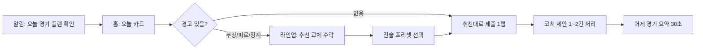
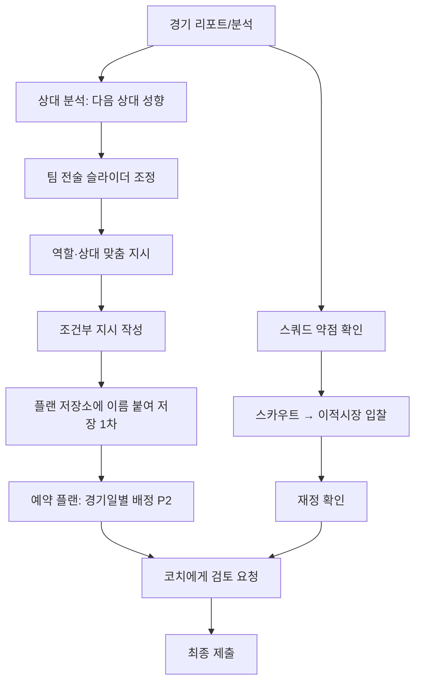

# 킥오프 FM(가칭) 게임 기획서 v2

> 모바일 축구 전략 게임 "실시간 FM 스타일" 경쟁 리그 기획서 (v1 + 피드백 3종 반영본)

## v2 변경 요약

1. **로드맵 재정의(12장)**: 팀 2~4명·3~6개월(가용 6~24 인월) 가정을 명시하고 Phase 0 로컬 웹 프로토타입 → Phase 1 소규모 CBT → Phase 2 출시 후보로 재편. **Phase 0 범위·게이트 절(12.3)** 신설, 가속 시즌 모드(3.6) 추가.
2. **MVP 협동 축소(5.0)**: "비동기 제안형 코치"(코치는 제안, 구단주만 실행·제출). 전체 협동 시스템(5.1~5.13)은 1차로 이동.
3. **친구 코치 문제(P0-2)**: 코치 전용 계정 임시 허용(Q17), 코치 관계 구단 분산 배치, 같은 그룹이 되면 "관전 전용 코치".
4. **플랜 결정 규칙 단일화(4.7)**: 예약 플랜 → 구단주/전술코치 확정본 → 기본 플랜(상대 무관 지시만). 초안 미사용, 상대 맞춤 지시는 상대가 바뀌면 초기화. 다른 섹션은 참조만.
5. **피라미드 재편성 알고리즘(6.4, 의사코드)**과 **시즌 경계 처리 절차(6.5, 순서 체크리스트)** 신설. 고정 피더 폐지, 봇은 승강하지 않고 매 시즌 재생성.
6. **이적 창 재정의**: "입찰 접수 기간 + 정산일"(중간 Day 11~15, 정규 Day 25~다음 Day 2). 이월 판정 = 잔액+예약액, 초과분은 정규창 한정 예산 → LP. KC 보상 자동 입금.
7. **지출 가능액 B = 잔액 − 예약액 − 잔여 연봉 부채 − 위약금**, B ≥ 0 검증, 잔액 부족 처리, 코치 소액 한도 팀 합산(7.2).
8. **경제 수치 교체(7.4)**: 배정금 ×0.72, 승·무 수당 ×0.85, 승격 보너스 30%, 강등 유예 110% + 초과 연봉 보조금 + 이적료 지출 25% 제한. 순유입 비율 정의 고정(7.5 예시 1.06).
9. **캡 우회 차단**: 캡 산입액 = max(계약 연봉, 0.8×S(현재 OVR)), 일시금 캡 산입, U23 계약 3시즌. 캡 천장 표를 22명 기준으로 재계산(7.9.2).
10. **AI 대행**: 감독 AI 단일 모듈, 기준을 "같은 티어 수동 중앙값 PPG 90~95%"로, 보수적 계약 정책(자동 재계약·결원 FA) 추가.
11. **엔진(8장)**: 모든 전술 효과를 8개 결정 지점의 logit 가산치로 통일(결정 지점별 ±0.35), R9 집중 마크·R10 공략 측면 정의, R8은 구조 파라미터로 재분류, 승부 요인 기여도를 합 보존 방식으로 수정, 사기 이중 반영 제거.
12. **컨디션(4.2)**: 소모 30·회복 평균 +17·효율 곡선 시작 90, 예시를 공식과 일치(4번째 경기 전 로테이션).
13. **MVP 범위 축소**: 화면 38 → 핵심 14 + 보조 2(11.1), 텍스트 중계(2D는 1차), 포메이션 6·역할 14·슬롯 A/B, 유저 경매 1차(시스템 매각으로 대체), CBT 수익화 없음, 운영툴 최소화, CBT KPI 5개.
14. **기타**: 조건부 지시 문법 분리·상대값 정의, 동률 추첨(하위 리그 가중 2배), 탱킹 자동 대체 폐지, 알림 우선순위, 스타 팩 수치 수정, 리플레이 판매는 자기 구단만, 핵심 질문 Q16~Q20 추가.

피드백 반영 내역 전체는 `docs/피드백_v1.md`, 수치 재검증은 `docs/feedback/economy_check.js`(v2 재검증 O-1~O-8).

| 항목 | 내용 |
|---|---|
| 문서 버전 | v2 (v1 통합본 + Reality Checker·Economy·Product 피드백 반영) |
| 작성일 | 2026-09-26 |
| 통합 출처 | A 게임 디자인 / B 코치 협동 / C 경제 / D UX / E 법률·운영 / F PM (v1) + 피드백 3종 (v2) |
| 통일 기준 | v1 파트 간 통일 내역은 **부록 B**. v2 변경은 위 요약과 `피드백_v1.md` |

### 문서 구성
| 순서 | 섹션 |
|---|---|
| 0 | 전제: 예산 = 게임 내 재화(KC), 단계 태그, 공통 상수, 용어 |
| 1~14 | 원래 요청의 섹션 1~14 (4.7 플랜 결정 규칙, 5.0 MVP 협동, 6.4 재편성 알고리즘, 6.5 시즌 경계 절차, 12.3 Phase 0 범위 신설) |
| 부록 A | 현금성 보상 별도 선택지와 법률·운영 검토 |
| 핵심 질문 | 임의로 확정하지 않은 결정 사항 (Q1~Q20) |
| 부록 B | v1 파트 간 통일 내역 (v2에서 바뀐 값은 본문 우선) |

---

## 0. 전제

### 0.1 "실제 사용이 가능한 예산"의 정의: 게임 내 재화로 설계

원래 요청의 "실제 사용이 가능한 예산"은 **게임 안에서만 쓰는 재화 KC(킥오프 크레딧)** 로 설계한다. 현금이나 현금성 가치와는 어떤 경로로도 연결하지 않는다.

| 구분 | 이 기획서에서의 처리 |
|---|---|
| 구단 예산, 승리 수당, 우승 수당, 리그 상금, 승격 보너스 | 모두 **KC**. 환전·양도·현금 인출 불가 (섹션 7) |
| 유료 재화 | **스타(★)**. 코스메틱·편의 전용, KC로 전환 불가 (섹션 7.13) |
| 현금성 보상 | **기본 설계에 포함하지 않음.** 법률·운영 검토가 필요한 별도 선택지로 **부록 A**에서만 다룬다 |

핵심 원칙:
- **돈으로 살 수 있는 재화는 경기력에 닿지 않고, 경기력에 닿는 재화는 돈으로 살 수 없다.**
- **본 게임 루프(매일 경기, 28일 시즌, 승격·강등)에서는 어떤 경로로도 현실 가치가 나오지 않아야 한다.** 현금성 보상을 넣는다면 본 게임과 분리된 이벤트·대회 구조로만 넣는다 (부록 A).

### 0.2 표기 규칙
- 이 문서의 모든 수치는 **제안 기본값**이다. 플레이테스트·시뮬레이션·CBT 텔레메트리 전까지 `[PH]`(Placeholder) 상태로 본다. 특히 `[PH]`로 표시한 값은 조정 가능성이 높다.
- 시각은 서버 현지 시각이며, 한국 서버 기준 KST다.
- 금액 단위는 M KC(백만 KC). `85.0M` = 8,500만 KC. 원화와 헷갈리지 않도록 ₩ 기호는 쓰지 않는다.
- 결정되지 않은 사항은 임의로 확정하지 않고 **핵심 질문**에 모았다. 결정 전까지 쓰는 값은 "임시 기본값"으로 표시한다.
- **v2 단계 태그**: 기능마다 도입 단계를 붙인다. `[P0]` 로컬 웹 프로토타입 / `[P1]` 소규모 CBT 빌드 / `[P2]` 출시 후보 / `[1차]` 출시 후 1차 업데이트 / `[2차]` 그 이후. 로드맵과 단계별 범위는 섹션 12. 이 문서에서 **"MVP"는 출시 후보(Phase 2) 시점의 기능 범위**를 뜻한다. Phase 1 CBT는 그 부분집합이다.
- 수치 검증 스크립트: `docs/feedback/economy_check.js` (v2 채택값 재검증은 출력의 `######## v2 재검증` 이후).

### 0.3 공통 상수 (전 섹션 공통, 통일 값)
| 항목 | 값 | 비고 |
|---|---|---|
| 시즌 길이 | **28일 고정 주기** (달력 월과 분리, 연 13시즌) | 월 길이(28~31일) 차이로 인한 경기 수 불균형 방지. 테스트용 **가속 시즌 모드**는 3.6 |
| 시즌 일정 | **Day 1~26 리그 26경기 / Day 27 시즌 리뷰 / Day 28 정산·재편성** | 하루 1경기. 시즌 경계 처리 순서는 **6.5 한 곳에서만 정의** |
| 리그당 팀 수 | **14팀** (인간 유저 + 봇) | 홈·원정 더블 라운드로빈 = 26경기 |
| 승격 / 강등 | 리그 내 **사람 팀 상위 2팀 승격 / 전체 순위 11~14위의 사람 팀 강등** | **2:1 피라미드**는 티어별 최대 리그 수(상위 1 : 하위 2) 규칙. 피더 연결은 고정하지 않고 시즌마다 재편성 알고리즘(6.4)으로 다시 계산. **루키 리그(최하위)는 강등 없음** |
| 킥오프 | **매일 21:00** | 슬롯 복수화는 핵심 질문 Q2 |
| 플랜 마감(잠금) | **20:50** (= D) | 20:50~21:00 서버 시뮬레이션. 마감 시 적용 플랜은 **4.7 플랜 결정 규칙** 하나로 정한다 |
| 코치 편집 동결 `[1차]` | 1단계 D-30분(20:20) / 2단계 D-10분(20:40) | MVP의 비동기 제안형 코치(5.0)에는 동결이 필요 없다 |
| 편집 소프트 락 `[1차]` | 90초 무입력 시 자동 해제 | 섹션 5.6.1 |
| 중계 | 21:00~21:12 (90분을 12분으로 압축). MVP는 **텍스트 중계** | 21:15 결과 확정·보고서 공개 |
| 스쿼드 | **최소 18명 / 최대 25명, 기준 스쿼드 22명** (포지션당 최대 5명) | 매치데이 엔트리 18명(선발 11 + 벤치 7). 경제·밸런스 계산은 22명(주전 11 + 로테이션 11) 기준 |
| 교체 | 최대 5명, 3회 창(하프타임 별도) | 실제 축구 규정 준용 |
| 이적 창 | **중간 창: 등록 Day 11 00:00~Day 13 12:00, 정산 Day 13·14·15 12:00 / 정규 창: 등록 Day 25 00:00~Day 28 12:00, 정산 Day 27·28·다음 시즌 Day 1·2 12:00** | 창 = "입찰 접수 기간" + "정산일". 매물 등록 마감 = 창의 마지막 정산 − 48시간 (4.3) |
| 영입 방식 | **블라인드 입찰, 최소 48시간**, 매일 12:00 일괄 정산 | MVP 채널은 시스템 이적시장 + FA. 유저 방출 선수 경매는 `[1차]`, 유저 간 직접 트레이드는 제외 (7.9) |
| 재화 | 게임 내 재화 **KC**, 유료 재화 **스타(★)**, 명예 점수 **LP** | 섹션 7 |
| 급여 | **연봉** = 시즌(28일)당 급여. 1시즌 = 게임 내 1년 | 매일 연봉/28 차감 |
| 선수 나이 | 1시즌 = 게임 내 1년 | 시즌 경계(6.5)에서 나이 +1 |

### 0.4 용어
| 용어 | 정의 |
|---|---|
| 티어 / 디비전 | 피라미드의 층. T1 프리미어 디비전, T2 디비전 1, T3 디비전 2, T4 디비전 3, …, 최하위 루키 리그 (섹션 6.1) |
| 리그 (리그 그룹) | 같은 순위표를 쓰는 14팀 단위. 같은 티어에 여러 리그가 있을 수 있다 |
| 구단주 | 구단을 만든 유저. 모든 결정의 최종 권한자 (섹션 5) |
| 코치 | 구단주가 초대한 최대 5명의 유저. MVP에서는 **제안만** 하고 실행 권한이 없다(5.0). 역할(TAC·SCT·SQD·ANL·FIN)은 MVP에서 표시용 라벨, `[1차]`에서 실행 권한이 붙는다 |
| 코치 전용 계정 | 자기 구단 없이 코치로만 참여하는 계정. 허용 여부는 **핵심 질문 Q17**(임시 기본값: 허용) |
| 수석코치 `[1차]` | 코치 1명에게 부여하는 **사람 칭호**. 구단주 부재 시 대리 권한 (섹션 5.5.3). AI 기능과 무관 |
| 감독 AI | 봇 구단 운영, AI 대행, "추천대로 제출", 자동 로테이션, 기본 라인업 보정을 모두 처리하는 **단일 AI 모듈**. 용도별로 강도 파라미터만 다르다 (3.5) |
| AI 대행 | 부재 구단의 훈련·로테이션·라인업·기본 전술과 **보수적 계약 정책**(자동 재계약·결원 FA 충원)을 감독 AI가 대신 운영하는 기능. 이적료 입찰·판매·방출은 하지 않는다 (섹션 3.5) |
| 전술 슬롯 | 포메이션 + 역할 + 팀 지시 묶음. MVP는 팀당 **A/B 2개**, C 슬롯은 `[1차]`. 슬롯별 숙련도 보유 (섹션 4.4) |
| 경기 플랜 | 매 경기 제출 단위: 라인업 + 시작 전술 슬롯 + 상대 맞춤 지시 + 조건부 지시 + 자동 교체 규칙 + 세트피스 설정 (섹션 4.5) |
| 확정본 | 구단주(또는 `[1차]` 이후 전술 코치 주담당)가 "확정 제출"한 경기 플랜. 저장만 한 초안은 확정본이 아니다 |
| 기본 플랜 | 구단주가 지정한 "상대 무관" 플랜. 상대 맞춤 지시를 담을 수 없다. 미지정 시 직전 경기 플랜에서 상대 맞춤 지시를 뺀 것 (4.7) |
| 예약 플랜 `[P2]` | 최대 7경기 앞까지 경기별로 미리 배정한 플랜. 플랜 저장소는 `[1차]` |
| 플랜 결정 규칙 | 마감 D에 어떤 플랜을 쓸지 정하는 **유일한 규칙**. 정의는 4.7에만 있고 다른 섹션은 참조만 한다 |
| 지출 가능액(B) | 입찰·계약·코치 금액 구간의 기준 예산. **B = KC 잔액 − 예약액 − 잔여 연봉 부채 − 확정 위약금** (7.2) |
| 이적창 한정 예산 | 시즌 경계에서 이월 상한을 넘은 KC. 정규 이적창의 이적료에만 쓸 수 있고 창이 끝나면 LP로 전환 (6.5, 7.2) |
| 가속 시즌 모드 | 테스트 전용. 하루에 여러 경기일을 진행해 28일 시즌을 1~2주로 압축 (3.6) |
| D | 플랜 마감 시각 20:50 |

---

## 1. 한 문장 게임 소개와 핵심 재미

### 1.1 한 문장 소개
> **"매일 밤 9시, 내가 짠 전술로 다른 유저의 팀과 붙는다 — 한 달이면 승격과 강등이 갈리는 모바일 축구 감독 리그."**

### 1.2 핵심 재미 (Fun Hypothesis)
게임이 성립하려면 **단 하나**가 반드시 재미있어야 한다:

> **"내가 상대를 읽고 바꾼 전술이, 경기 결과와 경기 후 리포트에서 '보인다'."**

이것이 성립하지 않으면(전술이 결과에 안 보이거나, 반대로 전술만으로 결과가 정해지면) 나머지 시스템은 의미가 없다. 섹션 8의 엔진 설계와 보고서가 이 가설을 직접 검증한다.

### 1.3 핵심 재미 요소 4가지
| # | 재미 | 플레이어가 하는 결정 | 보상 감각 |
|---|---|---|---|
| 1 | **상대 읽기** | 상대의 최근 전술·약점을 보고 오늘의 플랜 조정 | "내 카운터가 먹혔다" (보고서의 전술 기여 xG로 확인) |
| 2 | **선수단 운영** | 매일 경기라 체력·로테이션·영입 우선순위 결정 | 한정된 예산으로 약점 보완 |
| 3 | **한 달짜리 드라마** | 26경기 안에서 승격권/강등권 경쟁 | 마지막 주의 긴장감, 시즌 종료 승강 연출 |
| 4 | **함께 운영** | 최대 5명 코치가 제안하고 구단주가 결정 (MVP는 비동기 제안형, 역할별 실행 권한은 1차 → 섹션 5) | 친구와 같은 팀 응원, 내 제안이 채택되는 기여감 |

### 1.4 디자인 필러 (모든 결정의 판단 기준)
1. **전술은 의미가 있지만 전부는 아니다** — 전술 최대 효과는 상한이 있다 (섹션 8).
2. **매일 접속하지 않아도 경쟁할 수 있다** — 부재가 곧 패배가 되지 않는다 (섹션 3, 9).
3. **결과는 설명 가능하다** — 모든 경기 결과에 "왜"가 붙는다.
4. **돈으로 이길 수 없다** — 과금은 경기력에 영향 없음 (→ 섹션 7, 13).
5. **짧은 세션, 깊은 선택** — 5분 확인으로도 충분하고, 30분 분석하면 더 좋아진다.

---

## 2. 주요 타깃 유저와 플레이 경험

### 2.1 타깃 페르소나
| 구분 | 페르소나 | 특징 | 원하는 것 | 이 게임이 주는 것 |
|---|---|---|---|---|
| **1차 핵심** | "퇴근 후 감독" (25~40세, 축구 시청·FM 경험) | PC FM을 좋아하지만 시즌 하나에 수십 시간 쓸 여유 없음 | 전술 깊이 + 짧은 세션 | 하루 5~20분, 한 달 시즌, 전술이 보이는 엔진 |
| **1차 핵심** | "단톡방 축구 모임" (친구 2~6명) | 같이 응원하고 떠들 거리 필요 | 함께하는 목표 | 코치 초대 협동(구단 없이 코치로만 참여 가능, 임시 기본값 Q17), 매일 밤 9시 공동 관전 |
| 2차 | "전술 연구가" | 데이터·xG·상성 분석을 즐김 | 깊이, 최적화 여지 | 상세 경기 리포트, 상성 규칙, 상대 스카우팅 |
| 2차 | "라이트 축구팬" | 경기 결과 확인이 주 목적 | 간단함 | 추천 전술 프리셋, 자동 관리, 결과 알림 |
| 비타깃 | 액션 축구 게임 유저 | 직접 조작 선호 | — | 직접 조작 없음을 명확히 커뮤니케이션 |

### 2.2 플레이 경험 목표 (세션 유형별)
| 세션 | 시간 | 빈도 | 경험 | 예시 행동 |
|---|---|---|---|---|
| **확인형** | 1~5분 | 매일(선택) | "오늘도 준비됐다" | 알림 → 자동 추천 라인업 확인 → 체력 낮은 선수 1명 교체 → 끝 |
| **조정형** | 10~20분 | 주 3~4회 | "상대를 읽었다" | 상대 최근 5경기 스카우팅 → 압박 강도 조정 → 조건부 지시 추가 |
| **관전형** | 12분 | 매일 21:00(선택) | "같이 본다" | 텍스트 중계 동시 관전, 장면 카드를 외부 메신저로 공유 (팀 채팅은 1차) |
| **운영형** | 30분+ | 주 1회 / 이적 기간 | "팀을 만든다" | 이적 입찰, 훈련 계획, 전술 슬롯 A/B 재설계 |

### 2.3 감정 곡선 (시즌 단위)
```
긴장 ▲
     │                                          ★ Day 24~26 승강 경쟁 최고조
     │               ▲ Day 11~15 중간 이적창       ／
     │   ／＼       ／                        ／
     │ ／    ＼__／     ＼____／＼____／＼__／
     │ Day1 개막 기대감                                ▼ Day 27~28 리뷰·정산·승강 연출·리셋
     └────────────────────────────────────────────────────────▶ 시간
```

---

## 3. 하루 경기 일정부터 월간 시즌 종료까지의 플레이 흐름

### 3.1 하루 일정 (한국 서버 기준 KST)
| 시각 | 서버 이벤트 | 유저가 할 수 있는 일 | 알림(기본값, 끌 수 있음. 상세는 10.7) |
|---|---|---|---|
| 00:00 | **일일 처리**: 컨디션 회복, 훈련 효과 반영, 부상 경과, 전술 숙련도 감쇠, 연봉 일할 차감(연봉/28), 잔액 음수 점검(7.2) | — | 없음 |
| 00:00~20:50 | 플랜 편집 가능. MVP 코치는 제안 카드만 작성(5.0) | 라인업·전술·조건부 지시 수정, 스카우팅, 이적 입찰(창 기간) | — |
| 12:00 | **이적 입찰 정산** (정산일에만, 0.3 이적 창) | 결과 확인 | 입찰 결과 (입찰한 경우만, 18:00 알림에 합칠 수 있음) |
| 18:00 | — | — | 플랜 확인 요청 (확정본·예약 플랜이 없을 때만) |
| 20:20 | `[1차]` 코치 편집 동결 1단계 (D-30분) | 1차 협동 규칙(5.6.2) | 마감 임박 (확정본 없음 + 출전 불가 선수 포함 시만) |
| 20:40 | `[1차]` 코치 편집 동결 2단계 (D-10분) | 구단주·플랜 책임자만 편집 | — |
| **20:50** | **플랜 잠금(D)** → **4.7 플랜 결정 규칙**으로 적용 플랜 확정 + 자동 로테이션·유효성 보정 | 수정 불가 (열람만) | — |
| 20:50~21:00 | 전 경기 시뮬레이션 실행(경기별 작업 큐, 멱등 재처리), 결과는 비공개 저장 | — | — |
| **21:00~21:12** | 중계(90분 → 12분 압축). MVP는 **텍스트 해설 + 스코어 바 + 모멘텀 + 구역 바**, 2D 탑뷰는 `[1차]` (10.6) | 관전 | "킥오프!" (기본 OFF) |
| 21:15 | 결과 확정, 순위표·리포트 공개 | 경기 리포트 확인, 다음 경기 준비 | 결과 요약 |
| 21:15~24:00 | — | 리뷰, 다음 날 플랜 편집 가능 | — |

규칙:
- 경기 중 **실시간 개입은 없다**. 접속 여부에 따른 불공정을 막기 위해, 경기 중 변화는 **사전 제출한 조건부 지시**로만 일어난다 (섹션 4.5). 허용 여부 재검토는 핵심 질문 Q11.
- 결과는 20:50에 이미 결정되지만 21:00 중계 전에는 누구에게도(운영 툴 포함 권한 제한) 노출되지 않는다. 20:50 이전에 결과를 미리 계산하지 않는다.
- 중계를 놓쳐도 이후 언제든 **동일한 다시보기**(결정적 시드 재생)를 볼 수 있다.
- 플랜 편집 창은 **전날 경기 종료 후 ~ 당일 20:50 전체**다. 마감 직전에만 대응할 수 있는 구조가 아니므로 시간대가 맞지 않는 유저도 미리 준비할 수 있다.
- 알림은 경기일 기준 하루 최대 3개(코치 협동 알림 제외)이며, 우선순위와 합치기 규칙은 10.7을 따른다.

### 3.2 주간 흐름
| 요일 개념 | 내용 |
|---|---|
| 매 7일(Day 7, 14, 21) | **주간 리포트**: 팀 폼, 체력 추세, 전술 숙련도, 다음 7경기 상대 미리보기 |
| 매 7일 | 훈련 계획 갱신 권장 시점 (훈련 계획은 주 단위 설정, 매일 바꿀 필요 없음) |
| Day 11~15 | **중간 이적창**: 매물 등록·입찰 Day 11 00:00~, 매물 등록 마감 Day 13 12:00, 정산 Day 13·14·15 12:00 |

### 3.3 시즌(28일) 타임라인
| Day | 단계 | 경기 | 주요 이벤트 |
|---|---|---|---|
| 1 | 개막 | 1R | 기본 배정금·승격 보너스 입금(6.5 ⑫), 시즌 목표 설정(선택, 보상 여부 미결정), **정규 이적창 정산 Day 1·2 12:00** |
| 2 | — | 2R | 정규 이적창 마지막 정산 12:00 → 23:59 창 종료. Day 3 00:00 한정 예산 잔액 LP 전환(6.5 ⑬) |
| 3~10 | 전반기 | 3~10R | 일반 진행 (이적창 닫힘) |
| 11~15 | 중간 이적창 | 11~15R | 경기는 계속 진행. 매물 등록 마감 Day 13 12:00, 정산 Day 13·14·15 12:00 |
| 16~22 | 후반기 | 16~22R | Day 20 **재계약 기간 시작**(Day 20~27), AI 대행 구단은 "자동 재계약 예정" 미리보기 알림. Day 21 "승강 경쟁 구도" 알림 |
| 23~26 | 막판 | 23~26R | 승격권·강등권 팀에 "결정전" 연출, Day 25 00:00 정규 이적창 매물 등록·입찰 시작(정산은 Day 27부터), Day 26 최종전 동시 킥오프 → 21:15 **최종 순위·승강 판정** |
| **27** | 시즌 리뷰 | 경기 없음 (보상 없는 이벤트 친선전 선택) | 00:00 순위 상금·우승 수당 **자동 입금**, 시상, 시즌 리포트, 정규 이적창 첫 정산 12:00(다음 시즌 캡 기준) |
| **28** | 정산·재편성 | 경기 없음 | 00:00 이월 판정(한정 예산 분리), 계약 만료, 나이 +1, 캡 산입액 재계산, **리그 재편성 알고리즘**, 다음 시즌 편성 공개. 정산 12:00, 매물 등록 마감 12:00 |
| 다음 Day 1 | 새 시즌 | 1R | 위 Day 1 참조 |

**시즌 경계 처리의 정확한 순서는 6.5의 체크리스트가 유일한 정의다.** 이 표는 요약이다.

설계 근거:
- 14팀 더블 라운드로빈 = 26경기 → 26일 + 정리 2일 = 28일. 달력 월에 맞추면 매달 경기 수가 달라져 기록·보상 비교가 불가능하므로 **고정 28일 주기**를 쓴다 (연 13시즌).
- Day 27~28은 "숨 쉬는 구간"(비시즌 2일): 매일 경기 피로를 끊고 이적·재정비에 집중하게 한다.
- 이적 창은 "입찰 접수 기간"과 "정산일"로 나눠, 창 안에 등록된 모든 매물이 창 안의 정산일에 반드시 처리되게 했다(48시간 최소 입찰 보장).
- 밸런스 패치·경제 수치 변경은 시즌 경계에서만 적용한다 (섹션 7.8, 8.7).

### 3.4 핵심 루프
```markdown
## Moment-to-Moment (0~30초)
- 행동: 라인업 슬롯에서 선수 교환(탭-탭), 전술 슬라이더 조정
- 피드백: 즉시 "예상 영향" 칩 표시 (예: "압박 +1 → 체력 소모 +3, 상대 빌드업 방해 ↑")
- 보상: 준비 완료 체크, 팀 적합도 게이지 상승

## Session Loop (5~20분 / 하루)
- 목표: 오늘 상대에 맞춘 플랜 확정 제출
- 긴장: 체력 vs 최정예 라인업, 익숙한 전술 vs 상대 맞춤 전술(숙련도 손실)
- 해결: 21:00 결과 + "승부 요인" 리포트 → 다음 날 조정 근거

## Long-Term Loop (28일 시즌 / 수개월)
- 진행: 승격 → 상위 리그 → 더 높은 예산·더 강한 상대 (→ 섹션 6, 7)
- 유지 훅: 매 시즌 리셋되는 순위 경쟁, 선수 성장/노화, 코치 팀원과의 공동 목표, 명예의 전당
```

### 3.5 매일 접속하지 못하는 유저를 위한 보완책 (필수)
원칙: **"부재 = 자동으로 합리적인 운영"**. 매일 접속한 유저가 얻는 이점은 "상대 맞춤 최적화"에 한정되고, "관리 누락으로 인한 붕괴"는 없어야 한다.

| # | 보완책 | 규칙 | 해결하는 문제 | 단계 |
|---|---|---|---|---|
| 1 | **플랜 유지** | 확정본이 없으면 **4.7 플랜 결정 규칙**에 따라 예약 플랜 또는 기본 플랜(상대 무관 지시만)이 적용된다 | 미접속 = 몰수패 방지, 다른 상대용 지시의 오작동 방지 | P0 |
| 2 | **자동 로테이션** (기본 ON) | 선발 선수 경기 전 컨디션 < 70 [PH] 또는 부상/징계 시, 같은 역할 적합도 최고 벤치/스쿼드 선수로 자동 대체 | 체력 붕괴·결장 방지 | P0 |
| 3 | **예약 플랜** | 최대 7경기 앞까지 경기별 플랜을 미리 제출(상대 이름 기준). Phase 1 CBT에서 H5(비접속 보정)가 목표에 못 미치면 Phase 2에 넣는다 | 주말에만 접속하는 유저 | P2(조건부) |
| 4 | **조건부 지시** | 경기 중 상황별 자동 대응 최대 3개 (섹션 4.5) | 실시간 개입 불필요 | P0 |
| 5 | **AI 대행(자동 관리)** | 토글 시 감독 AI가 훈련·로테이션·라인업·기본 전술을 운영. **상대 맞춤 지시와 조건부 지시는 만들지 않는다**(템플릿 "지키기·추격" 2개만 사용). **보수적 계약 정책**: Day 27에 계약 만료 예정자 중 출전 상위 18명·31세 이하를 연봉 S(OVR)·2시즌·캡 이내로 자동 재계약(갱신 보너스 1건당 B의 3% 이하), 스쿼드 20명 미만이면 FA 시장에 캡 잔여 이내 최저 입찰가로 결원 포지션을 시즌당 최대 3명 자동 입찰. 이적료 입찰·판매·방출은 하지 않는다. 구단주와 코치 전원 7일 연속 미접속 시 강제 ON (6.3) | 장기 부재, 계약 만료 누적 붕괴 방지 | P1 |
| 6 | **코치 위임** | MVP: 코치가 제안 카드로 플랜을 준비하고 구단주가 한 번에 승인. 1차: 역할별 실행 권한 (→ 섹션 5) | 사람이 대신 운영 | P1 / 1차 |
| 7 | **입찰 기간 48시간** | 이적 입찰은 최소 48시간 열림, 정산은 매일 12:00 일괄 | 실시간 스나이핑 차단 | P1 |
| 8 | **보상 자동 입금** | 경기·시즌의 **KC 보상은 모두 발생 즉시 자동 입금**(보관·미수령 상태 없음). 코스메틱·LP·스타(★) 보상만 +1시즌 보관 | 접속 안 해도 보상 손실 없음, 이월 상한 우회 차단(7.2) | P1 |
| 9 | **경쟁력 있는 일일 보상 없음** | 출석 보상은 코스메틱/소량 편의만, 선수 능력치·예산에 누적 영향 금지 | 출석 격차 누적 방지 | P1 |
| 10 | **"다녀오셨군요" 요약** | 마지막 접속 이후 N일 경기 결과·순위 변동·부상·자동 실행 항목·추천 행동 3개를 한 화면에 | 복귀 부담 감소 | P1 |

경제 측 보완: **모든 경기 참가 구단에 패배 참가 수당 이상을 지급**한다(플랜 결정 규칙상 모든 구단이 항상 유효 플랜으로 경기하므로 사실상 무조건 지급, 7.4.1).

**감독 AI 단일 모듈**: 봇 구단, AI 대행, "추천대로 제출", 자동 로테이션, 기본 플랜의 라인업 보정은 **같은 감독 AI 모듈**을 쓰고 강도 파라미터만 다르다. 봇: 해당 티어 사람 팀 평균 전력의 85~95% / AI 대행: 아래 측정 목표 / 추천대로 제출: 부상·징계 대체 + 피로 로테이션만(상대 맞춤 없음). Phase 0 프로토타입의 봇 AI로 먼저 만들어 서버 단계에서 재사용한다.

**측정 목표(검증 기준)**: AI 대행 팀의 경기당 승점(PPG)이 **같은 티어에서 수동 운영하는 유저의 중앙값 PPG 대비 90~95%** [PH]. 90% 미만이면 AI 대행을 개선하고, 95%를 넘으면 수동 운영의 의미가 약하므로 AI 대행 성능을 낮춘다. 계약 정책 수락 기준: AI 대행 3시즌 연속 운영 시 주전 평균 OVR 하락 ≤ 1.0 (v2 모델 추정 +0.2, 스크립트 O-6). 자발적 AI 대행 사용은 허용하되 **"14일 이상 연속 사용"** 비율을 KPI로 관찰한다(12.6). 목표치 자체는 핵심 질문 Q13.

### 3.6 가속 시즌 모드 (테스트 전용)
28일 시즌은 학습 주기가 한 달이라 3~6개월 개발 기간 안에서 반복 수정이 어렵다. 그래서 테스트 빌드에만 **가속 시즌 모드**를 둔다. 정식 서비스에는 노출하지 않는다.

| 항목 | Phase 0 (로컬 프로토타입) | Phase 1 (CBT 가속 서버) |
|---|---|---|
| 진행 방식 | "다음 날로 넘기기" 버튼 1회 = 경기일 1일(일일 처리 → 전 경기 시뮬 → 결과). "N일 넘기기", "시즌 끝까지 넘기기" 제공 | 하루 4개 경기일 [PH] (예: 10:00 / 14:00 / 18:00 / 22:00 킥오프, 각 10분 전 마감). 28일 시즌 = 7일 |
| 1경기일 안의 처리 | 3.1의 하루 일정을 그대로 한 번 실행(00:00 일일 처리 포함) | 동일. 이적 정산은 "정산일 경기일"의 마감 2시간 전 |
| 시즌 경계 | 6.5 체크리스트를 버튼으로 실행 | 6.5 체크리스트를 경기일 2개(Day 27·28 상당)로 실행 |
| 경제 | 경기일 단위로 동일하게 적용(연봉/28 × 경기일) | 동일 |
| 검증 대상 | 핵심 재미(H2), 일일 루프 반복성, 로테이션 빈도, 경제 흐름 | H2~H7 (H1 "하루 1경기 습관"은 실시간 서버에서만 검증) |

- 실시간 CBT 서버와 가속 서버는 **데이터를 섞지 않는다**. KPI 중 리텐션(D7 등)은 실시간 서버에서만 집계한다.
- 가속 모드의 목적은 "시즌 한 바퀴의 설계 결함"을 빨리 찾는 것이다. 한 시즌의 감정 곡선(2.3)은 가속 모드로 검증할 수 없다.

---

## 4. 전술·선수단·경기 플랜 시스템

### 4.1 선수 모델
**능력치 14종 (1~20 정수)** — FM 계열 유저에게 익숙하되 모바일에서 읽을 수 있는 수로 압축.

| 그룹 | 능력치 | 주로 영향 주는 엔진 유닛 (섹션 8) |
|---|---|---|
| 기술 | 패스, 드리블, 결정력, 크로스, 태클 | 빌드업, 전진, 찬스메이킹, 마무리, 중원/박스 수비 |
| 정신 | 시야, 위치선정, 침착성, 활동량 | 찬스메이킹, 수비, 마무리, 압박 |
| 신체 | 속도, 체력, 피지컬(몸싸움+공중볼) | 역습, 라인 뒷공간, 체력 소모·회복, 공중전 |
| GK 전용 | 선방, 공중 장악, 킥 | 실점 억제, 세트피스 수비, 빌드업 |

기타 속성:
| 속성 | 범위 | 규칙 |
|---|---|---|
| 종합 능력(OVR) | 1~100 | 표시용. 주 포지션 가중합 ×5 (엔진은 OVR을 직접 쓰지 않음). 가격 공식(7.9.2)과 캡 산입액(7.7)의 기준 |
| 포지션 적합도 | 주 포지션 1.00 / 숙련 0.95 / 가능 0.88 / 부적합 0.75 | 효율 배수. UI 표기는 ◎ 주 포지션 / ○ 숙련 / △ 가능 / ✕ 부적합 (10.5.1) |
| 잠재력 | 숨김 값, 스카우트 등급으로 범위 공개 (예: "B~A") | 성장 상한 |
| 나이 | 16~38 | 시즌 경계에 +1. 성장 16~23, 정점 24~29, 하락 30+ [PH] |
| 컨디션 | 0~100 | 4.2 참조 |
| 사기 | -2 ~ +2 (5단계) | 연승/연패, 출전 시간, 계약 만족도. **엔진에는 prepMod 한 곳에서만 반영**(8.3, 8.4) |
| 계약 | 잔여 시즌 수 1~5 (**23세 이하 신규 계약은 최대 3시즌**) | 만료 시 재계약 또는 자유계약 방출. 재계약은 Day 20~27. 연봉·캡 산입·재계약 보너스·방출 위약금은 섹션 7 |

### 4.2 컨디션·체력 (하루 1경기 구조의 핵심 레버)
| 변수 | 제안 기본값 [PH] | 근거 |
|---|---|---|
| 90분 풀타임 소모 | **30 + 3 × max(압박, 0) − max(−압박, 0) + max(템포, 0) − max(−라인, 0) + 역할 가산**(윙백·박스투박스·프레싱 포워드 +3, 볼 위닝·와이드 MF +2, 공격형 풀백·윙어류·메짤라·섀도 +1, 트레콰르티스타·엔간체 −1) (엔진 0.4.0, 스타일 체력 공식) | 경기 전 컨디션이 하루에 약 13씩 떨어져 3경기 연속 출전 뒤 4번째 경기 전에 자동 로테이션 기준(< 70) 아래로 내려간다 |
| 일일 회복 (00:00) | **+14 + 체력 능력치 보정(0~6)**, 평균 +17 | 주전급 선수가 지속 가능한 출전 비율 = 17/30 ≈ 57%. 기준 스쿼드 22명(주전 11 + 로테이션 11)과 맞물린다 |
| 효율 배수 | 컨디션 **≥ 90: 1.00 / 90→60 선형 1.00→0.85 / < 60: 0.80** | 3번째 연속 경기부터 체감 손실이 생기게 시작점을 90으로 올림 |
| 부상 위험 | 기본 0.8%/경기, 컨디션 < 60이면 ×2 [PH] | 혹사 억제 |

예시(체력 보정 +3인 선수, 휴식 없이 연속 출전):

| 경기 | 경기 전 컨디션 | 효율 배수 | 경기 후 컨디션 | 비고 |
|---|---|---|---|---|
| 1 | 100 | 1.00 | 70 | — |
| 2 | 87 | 0.985 | 57 | — |
| 3 | 74 | 0.92 | 44 | 효율 손실이 체감되기 시작 |
| 4 | 61 | 0.855 | (출전 시 31) | **경기 전 < 70 → 자동 로테이션 대상**. 휴식하면 다음 날 78, 이틀 뒤 95 |

→ "3~4경기마다 로테이션 결정"이 공식에서 그대로 나온다. 수치를 바꾸면 이 표를 같은 공식으로 다시 계산한다.

### 4.3 스쿼드 규칙
| 규칙 | 값 | 비고 |
|---|---|---|
| 스쿼드 크기 | 18~25명, 포지션당 최대 5명. **기준 스쿼드 22명** | 18 미만 시 경기 전 자동으로 최저 능력 "임시 계약 선수" 충원 (다음 이적창까지) |
| 매치데이 엔트리 | 18명 (선발 11 + 벤치 7) | GK 최소 1명 벤치 포함 권장 (강제 아님, 경고 표시) |
| 교체 | 최대 5명, 3회 창 + 하프타임 | 조건부 지시/자동 교체로만 실행 |
| 징계 | MVP: **퇴장 → 다음 1경기 정지**만. 경고 누적 정지는 `[1차]` | 한 달 CBT 안에서 체감되지 않는 규칙을 줄임 |
| 이적 기간 | 0.3 이적 창 (중간 창·정규 창, 각각 입찰 접수 기간 + 정산일) | 창 밖에서는 아래 긴급 FA만 |
| 긴급 FA 영입 | 창 밖에서 스쿼드 18명 미만이 된 **원인이 부상(7일 이상)·징계·계약 만료**일 때만. 영입 가능 선수는 OVR ≤ 해당 티어 캡 천장(7.9.2) − 8, 계약은 해당 시즌 한정, 연봉 S(OVR) | 자발적 방출·매각으로 18명 미만이 되면 임시 계약 선수만 충원(이적창 우회 차단) |
| 영입 경로 (MVP) | **시스템 이적시장(NPC) + 자유계약(FA)**. 모두 블라인드 입찰 (섹션 7.9) | 유저 방출 선수 경매는 `[1차]`, 유저 간 직접 트레이드는 제외 (담합·부계정·RMT 위험 → 섹션 13) |
| 선수 매각 (MVP) | 경매 대신 **시스템 매각**: 매각가 = min(평가가치 × 0.6, 취득 비용 × 0.9). 영입 후 7일 이내 매각 불가 | 유저 간 가치 이동 통로가 없어 부계정 몰아주기가 원천 차단된다 |
| 유스 | `[1차]` | — |

**블라인드 입찰 규칙**: 매물은 등록 후 최소 48시간 입찰 접수 → 창 안의 정산일 12:00 일괄 정산 → 최고가 낙찰. **동률(상한가 동률 포함)은 추첨(시드 공개)으로 정하고, 하위 리그 팀에 가중치 2배**를 준다. 입찰가는 끝까지 비공개. 매물 등록 마감은 해당 창의 마지막 정산 − 48시간이다. 정산되지 않은 입찰은 창의 마지막 정산 직후 자동 취소되고 예약액이 풀린다. 입찰 금액 범위·연봉·한도는 섹션 7.9.

### 4.4 전술 시스템

#### (1) 포메이션 (엔진 0.4.0: 9종)
- **4-4-2, 4-4-2 다이아몬드, 4-3-3, 4-2-3-1, 3-5-2, 5-3-2, 4-1-4-1, 3-4-3, 5-4-1** (2026-09-27, `docs/실축구_전술설계.md` 3.4). 4-3-1-2(엔간체용)는 `[2차]`.
- 포메이션의 중앙 MF 수는 더 이상 규칙에 직접 쓰지 않는다(표시 전용). 중앙·측면·하프스페이스 인원은 **역할 형태값**으로 계산한다(8.6 R4·R7·R11).
- 슬롯별 허용 역할: 4백 FB = 수비형·공격형·인버티드, 3·5백 FB(윙백 자리) = 수비형 윙백·윙백.

#### (2) 역할 (엔진 0.4.0: 28개)
기존 14개 ID 는 유지하고 14개를 추가했다. 역할마다 유닛 가중치와 **형태값**(중앙 공격·수비, 측면 공격·수비, 하프스페이스 점유·커버, 러너, 2선 침투, 체력 가산, 경고 배수)을 가진다. 전체 표·엔진 효과는 `docs/실축구_전술설계.md` 3.1~3.3, 카탈로그 문구는 `RoleDef.effect`.

| 포지션 | 역할 |
|---|---|
| GK | 전통형 / 스위퍼 키퍼 |
| CB | 스토퍼 / 볼플레잉 / **커버** |
| FB·WB | 수비형 / 공격형(오버래핑) / **인버티드**(4백) / **윙백**(3·5백) |
| DM | 앵커 / **레지스타** / **볼 위닝** (박스투박스·딥 플레이메이커도 DM 슬롯 가능) |
| CM | 박스투박스 / **메짤라** / **딥 플레이메이커** (볼 위닝·공격형 플레이메이커·앵커도 CM 슬롯 가능) |
| AM | 어드밴스드 플레이메이커 / **트레콰르티스타** / **섀도 스트라이커** / **엔간체** (인사이드 포워드·폴스9도 AM 슬롯 가능) |
| W | 전통 윙어 / 인사이드 포워드 / **인버티드 윙어** / **와이드 미드필더** |
| ST | 포처 / 타깃맨 / 폴스9 / **프레싱 포워드** / **어드밴스드 포워드** |

MVP에서 선수별 개별 지시는 **상대 맞춤 지시(집중 마크 1명, 공략 측면)와 세트피스 키커 지정**으로 한정한다. 선수별 상세 지시는 `[2차]`.

#### (3) 팀 지시 (6개 슬라이더, 5단계: -2 ~ +2, 기본 0)
| 지시 | -2 | +2 | 트레이드오프 |
|---|---|---|---|
| 공격 성향 | 매우 수비적 | 매우 공격적 | 찬스 수 ↑ ↔ 역습 허용 ↑ |
| 압박 강도 | 자기 진영 대기 | 전방 압박 | 상대 빌드업 방해 ↑ ↔ 체력 소모·뒷공간 ↑ |
| 수비 라인 | 낮음 | 높음 | 공간 압축·오프사이드 ↔ 스루패스·역습 취약 |
| 폭 | 좁게 | 넓게 | 중앙 밀집 ↔ 측면 활용·크로스 |
| 템포 | 느리게 | 빠르게 | 점유 안정·시퀀스 수 ↓ ↔ 공격 횟수·턴오버 ↑ |
| 패스 방식 | 짧게 | 길게(직선적) | 점유·리셋 ↑ ↔ 압박 우회·턴오버 ↑ |

토글 2개: **역습 중시**(ON 시 공 탈취 직후 역습 전환 판정에 보정), **오프사이드 트랩**(수비 라인 ≥ +1에서만 선택 가능). 세트피스 전담 키커는 플랜의 세트피스 설정에서 지정한다.

UI는 같은 -2~+2 값을 5단계 스냅 슬라이더로 보여준다.

**실제 전술 스타일 9종 (엔진 0.4.0)**: 스타일 = 지시 묶음 + 권장 포메이션 + 권장 역할 (`TeamInstructions` 계약은 불변). 균형 · 게겐프레싱 · 포지셔널 플레이 · 로우 블록 · 미드 블록 역습 · 다이렉트 롱볼 · 윙 플레이 · 하이 라인 트랩 · 3백 윙백. 기존 프리셋 ID 는 유지(점유 = 포지셔널, 역습 = 미드 블록 역습, 전방압박 = 게겐프레싱). 적용 방식은 **"지시만 적용"(숙련도 유지)** 과 **"포메이션·역할까지 적용"(포메이션이 바뀌면 숙련도 × 0.5, 경고 필수)** 두 가지(2026-09-27 결정). 스타일별 요구 특성·강점·약점·기대 상성은 `docs/실축구_전술설계.md` 1·2.5장, 스쿼드 적합도는 서비스 `getStyleFits`.

#### (4) 전술 슬롯과 숙련도
- 팀은 **전술 슬롯 A/B**(MVP, C 슬롯은 `[1차]`)를 저장한다 (포메이션 + 역할 + 팀 지시).
- **전술 숙련도** 0~100 (슬롯별):
  - 경기 사용 +6, 훈련 초점 "전술" 선택 시 +2/일, 미사용 −2/일 [PH]
  - **포메이션 변경 시 숙련도 = 현재 값 × 0.5** (예: 80 → 40, 50 → 25). 팀 지시만 변경하면 하락 없음 (프리셋 적용도 팀 지시만 바꾸면 하락 없음)
  - 효과(섹션 8.4): 전술 긍정 효과에 **famCoef = 0.5 + 0.5 × 숙련도/100** 을 곱하고, 모든 경합에 **famMod = −0.05 × (1 − 숙련도/100)** logit을 더한다 (숙련도 100 = 손실 없음, 0 = 긍정 효과 50% + 전 경합 −0.05)
- **설계 의도**: 매일 상대에 맞춰 포메이션을 뒤집는 "만능 카운터 피킹"을 비용화. 대신 팀 지시 슬라이더 미세 조정은 자유 → "큰 틀은 유지, 디테일로 대응"이 최적 전략이 되도록.

### 4.5 경기 플랜 (매일 제출 단위)
경기 플랜 = **라인업 + 시작 전술 슬롯 + 상대 맞춤 지시 + 조건부 지시 + 자동 교체 규칙 + 세트피스 설정**

| 구성 요소 | 내용 | 제한 | 단계 |
|---|---|---|---|
| 라인업 | 선발 11 + 벤치 7 | 자동 추천 버튼 제공 | P0 |
| 시작 전술 | 슬롯 A/B 중 1개 | — | P0 |
| 상대 맞춤 지시 | ① 집중 마크 대상 1명(상대 선수) + 마커 1명(선택, 미지정 시 감독 AI가 DM/CB 중 선택) ② 공략 측면(왼쪽/오른쪽/없음) | 각 1개. 효과는 8.6 R9·R10. **상대가 바뀌면 초기화**(4.7) | P1 (P0 선택) |
| 상대 무관 지시 | 집중 마크 "자동 지정"(상대 최근 5경기 공격 기여 1위 선수) | 기본 플랜에 넣을 수 있는 유일한 마크 지시 | P1 |
| 조건부 지시 | **IF (조건 최대 2개 AND) THEN (행동 1개)**, 최대 3개, 위에서부터 우선 | 동일 지시는 경기당 1회 발동 | P0 (교체·퇴장 조건은 P1) |
| 자동 교체 | 컨디션 임계치(기본 55) 이하 시 같은 포지션 벤치로 교체 | 교체 창 소진 시 중단 | P0 |
| 세트피스 | 전담 키커 지정 (미지정 시 엔진이 최적 키커 자동 선택), 루틴 프리셋 (`[1차]`) | — | P1 |

플랜 저장소(이름·태그 저장)는 `[1차]`, 예약 플랜은 `[P2]`(조건부, 3.5 #3)다.

**조건부 지시 문법** — 조건 목록과 행동 목록은 서로 독립이다. **모든 조건(최대 2개 AND) × 모든 행동 조합을 허용**하며, 예외는 "하프타임 조정" 행동이 하프타임 조건과만 쓸 수 있다는 것 하나다.

| 조건 (최대 2개 AND, OR 없음) | 값 |
|---|---|
| 시간 | 하프타임 / N분 이후 (45·60·75, 15분 단위) |
| 스코어 | 리드 / 동점 / 열세, 점수 차 N 이상 |
| 퇴장 `[P1]` | 우리 팀 퇴장 발생 / 상대 퇴장 발생 |
| 컨디션 `[P1]` | 특정 선수 컨디션 < X |

| 행동 (지시당 1개) | 값 규칙 |
|---|---|
| 전술 슬롯 전환 | A/B (포메이션 전환 포함, 숙련도는 해당 슬롯 값 사용) |
| 공격 성향 조정 | **현재 값에 더한다**(±1 또는 ±2), 결과를 −2~+2로 자른다 |
| 선수 교체 `[P1]` | 특정 선수 OUT → 특정 선수 IN (남은 교체 창·인원 안에서만) |
| 하프타임 조정 | 템포 또는 압박을 현재 값에 ±1 (하프타임 조건 전용) |

예시 플랜:
```
시작 전술: A (4-3-3, 압박 +1, 라인 +1)
맞춤: 상대 10번 집중 마크(마커: 앵커 DM 6번), 공략 측면: 왼쪽(상대 오른쪽 풀백 속도 9)
IF 60분 이후 AND 1골 이상 리드 → 전술 B (5-3-2) 전환
IF 우리 팀 퇴장 → 공격 성향 −1 (현재 값에서 1 내림)
IF 75분 이후 AND 열세 → ST 9번 OUT, ST 19번(타깃맨) IN
```

**정보 대칭 규칙**: 모든 유저는 상대의 최근 5경기 포메이션·팀 지시 요약·경기 리포트를 볼 수 있다. **오늘 제출된 상대 플랜은 절대 볼 수 없다**. 제출 시각도 비공개(늦게 제출하는 이점 제거).

### 4.6 훈련 (주 단위 설정) `[P1]`
| 초점 | 효과 (일일) | 비용 |
|---|---|---|
| 균형 (기본) | 성장 기본, 회복 기본 | — |
| 전술 | 사용 중 슬롯 숙련도 +2 | 성장 −20% |
| 체력 관리 | 일일 회복 +4 | 성장 −30% |
| 개인 발전 | 지정 선수 3명 성장 +30% | 회복 −2 |
| 세트피스 | 세트피스 유닛 +3 (다음 3경기) | 성장 −10% |

훈련은 주 1회 설정으로 충분하도록 설계 (매일 접속 불필요). MVP는 **주간 초점 5종 선택과 휴식 지정**만 제공하고, 세부 훈련 강도 설계는 후속으로 둔다. Phase 0 프로토타입은 "균형" 고정으로 대체한다.

### 4.7 플랜 결정 규칙 (단일 정의)
**마감 D(20:50)에 각 구단의 경기에 쓸 플랜은 이 규칙 하나로만 정한다.** 3.5, 5장, 6.3, 10.4.4, 13.3은 이 절을 참조만 한다.

**① 적용 플랜 선택 (위에서부터 먼저 존재하는 것)**

| 순위 | 후보 | 조건 | 단계 |
|---|---|---|---|
| 1 | **예약 플랜** | 이 경기에 배정된 예약 플랜. 배정 후 같은 경기에 확정 제출을 하면 그 확정본이 예약 배정을 **대체**한다(확정 제출 시 예약 슬롯을 덮어쓰고 "예약 플랜이 교체됨"을 표시). 따라서 "예약 → 확정본" 순서는 항상 가장 최근의 명시적 결정을 고른다 | P2 |
| 2 | **구단주 / 전술 코치 확정본** | 이 경기에 대해 마지막으로 확정 제출된 버전. MVP는 구단주만 확정 제출할 수 있다. `[1차]` 전술 코치(TAC 주담당)도 확정 제출 가능하며, D-10분 이후 두 사람이 서로 다른 버전을 확정하면 **구단주 버전 우선**(플랜 책임자 버전은 로그에 "미채택") | P0 / 1차 |
| 3 | **기본 플랜 (상대 무관 지시만)** | 구단주가 지정한 기본 플랜. 없으면 직전 경기에 실제 사용된 플랜에서 상대 맞춤 지시를 뺀 것. 신규 구단의 첫 경기는 창단 시 고른 추천 전술 기반 시스템 기본 플랜 | P0 |

- **저장만 하고 확정하지 않은 초안은 쓰지 않는다.** (코치 초안이 의도치 않게 제출되는 일을 막는다)

**② 모든 경우에 적용하는 보정 (순서대로)**
1. **상대 맞춤 지시 검증**: 플랜의 상대 맞춤 지시가 오늘 상대를 기준으로 작성되지 않았거나 대상 선수가 오늘 상대 명단에 없으면 초기화한다. 기본 플랜에는 애초에 상대 맞춤 지시가 없다(자동 지정 마크는 상대 무관 지시라 유지).
2. **출전 불가 대체**: 부상·징계 선수는 항상 같은 역할 적합도 최고 선수로 대체한다.
3. **자동 로테이션**: 설정이 ON(기본)이면 경기 전 컨디션 < 70인 선발 선수를 대체한다. 확정본에도 적용되며, 확정 제출 화면에서 미리 알려준다.
4. **유효성 보정**: 11명 미만·GK 없음 등 치명 오류는 감독 AI가 최소 보정한다.
5. 조건부 지시가 참조하는 선수가 대체로 빠졌으면 해당 지시만 비활성화한다.

**③ 표시**: 홈 카드와 제출 화면은 "지금 마감되면 적용될 플랜"을 항상 이 규칙으로 계산해 보여준다(10.4.4).

---

## 5. 최대 5명 코치 협동 시스템과 권한 충돌 방지

> **v2 구성**: 5.0은 MVP(Phase 1 CBT ~ Phase 2)에 들어가는 **비동기 제안형 코치**다. 5.1~5.13은 H3(협동이 리텐션을 높인다) 검증 뒤 여는 `[1차]` 전체 협동 시스템이다. 개발자는 5.0만 MVP 범위로 읽는다.

### 5.0 MVP 협동: 비동기 제안형 코치 `[P1]`

#### 5.0.1 설계 목표와 좌석

**한 줄 요약**: 코치는 **제안**하고, 구단주만 **실행·제출**한다. 코치에게 실행 권한이 없으므로 소프트 락·버전 충돌·동결·에스크로·금액 구간·수습 기간이 모두 필요 없고, 사보타주 위험이 설계에서 사라진다.

| 좌석 | 인원 | 할 수 있는 것 |
|---|---|---|
| 구단주 | 1 | 모든 편집·확정 제출·입찰·매각. 제안 카드 승인 / 수정 후 승인 / 거부 |
| 코치 | 0~5 | 구단의 스쿼드·전술·플랜·재정·리포트 **열람**, **제안 카드 작성**, 다른 코치 제안에 찬성/반대(사유) 표시, 코멘트. **실행·확정 제출 권한 없음** |

- 역할(전술·스카우트·선수단·분석·재정)은 MVP에서 **표시용 라벨**이다. 제안 카드와 활동 로그에 역할이 표시되어 "누가 무엇을 맡았는지"를 보여 주지만 권한 차이는 없다.
- 5명 전원 무료(코치 좌석 판매 금지, 7.13).
- **코치 전용 계정**(자기 구단 없이 코치로만 참여)을 허용한다 [핵심 질문 Q17, 임시 기본값: 허용]. 초대 링크로 가입한 유저는 온보딩에서 "친구 구단의 코치로 시작"을 고를 수 있고, 나중에 언제든 자기 구단을 창단할 수 있다(9.1).

**플레이어 경험 목표**
- 구단주: "친구들이 준비해 준 안을 보고 내가 고른다. 내가 안 들어와도 팀은 4.7 규칙으로 돌아간다."
- 코치: "내 제안이 채택되어 이긴 경기가 기록으로 남는다."

#### 5.0.2 제안 카드 (MVP 기본형)
| 제안 종류 | 승인 시 동작 | 만료 |
|---|---|---|
| 플랜 변경 (라인업·전술 슬롯·팀 지시·조건부 지시·상대 맞춤 지시) | 구단주의 현재 플랜(확정본이 있으면 확정본)에 변경을 적용하고 **구단주 명의 확정 제출**로 저장 | 대상 경기 마감 D(20:50) |
| 이적 입찰 (시스템 시장·FA) | 구단주 명의로 입찰 등록. 실행 시점에 B ≥ 0 검증(7.2) | 24시간 또는 해당 창의 매물 등록 마감 중 이른 쪽 |
| 선수 매각(시스템 매각)·방출 | 구단주 명의로 실행 | 24시간 |
| 훈련 초점 변경 | 다음 00:00부터 적용 | 24시간 |

- 카드 필드: 종류, 변경 내용(전/후 값), 이유 1줄(필수, 80자), 근거 첨부(선택: 리포트·통계 스냅샷), 코치 반응(찬성/반대+사유), 만료 시각. 화면 표현은 10.8.3.
- **자동 처리 없음**: 구단주가 응답하지 않은 카드는 만료된다. 찬성 수는 참고 정보일 뿐 구속력이 없다.
- 같은 항목을 바꾸는 카드가 여럿이면 묶어서 표시한다("제안 2개가 압박 강도를 다르게 제안"). 구단주가 하나를 승인하면 나머지는 "대체됨"으로 닫힌다.
- 카드 스팸 방지: 코치 1인당 동시 미결 카드 5장, 동일 대상 중복 카드 불가.
- 승인 시점에 대상이 이미 바뀌었으면(예: 제안한 선수가 부상) 승인 버튼 대신 "다시 확인 필요"를 표시한다.

#### 5.0.3 MVP에서 쓰는 이해충돌·운영 규칙
| 규칙 | MVP 값 | 근거·출처 |
|---|---|---|
| 겸직 | 자기 구단 1개 + 다른 구단 코치 1자리. 코치 전용 계정은 코치 1자리 [PH] | 5.9 |
| 같은 리그 그룹 금지 | 자기 구단과 같은 리그 그룹(같은 순위표)인 구단의 코치가 될 수 없다. 코치 전용 계정은 해당 없음 | 5.9, 직접 경쟁자 정보 차단 |
| 분산 배치 | 루키 리그 배치(9.3)와 시즌 경계 재편성(6.4)에서 코치 관계가 있는 구단을 같은 티어의 다른 리그로 나눈다 | P0-2 대응 |
| 같은 그룹이 된 경우 | 그 시즌 동안 **관전 전용 코치**(제안·플랜·상대 분석 열람 불가). 다음 시즌 자동 복구 | 5.9 |
| 신규 코치 열람 제한 | 합류 후 24시간 동안 당일 플랜·상대 분석은 마감(20:50) 이후에만 열람 | 코치 스파이 대응(13.3). 실행 권한이 없어 수습 기간은 이것만 남긴다 |
| 활동 로그 | **변경 이력만** 기록(누가·언제·무엇을·전→후·승인자). 열람 로그는 `[1차]` | 5.7.3 축소형 |
| 탈퇴·추방 | 즉시 처리, 해당 코치의 미결 카드는 폐기. 재합류 쿨다운 72시간 | 5.6.4 축소형 |
| 소통 | 팀 채팅은 `[1차]`. MVP는 장면·플랜·제안 카드를 **외부 메신저 공유 링크**로 보낸다(링크는 로그인한 팀원만 열람) | 모더레이션 비용 제거 |
| 코치 보상 | 제안 채택 수·채택 후 경기 결과를 코치 프로필에 기록(명성 XP·배지는 `[1차]`). 구단 KC와 연결하지 않음 | 5.8 원칙 |

#### 5.0.4 MVP 권한 체크 모델 (TypeScript 개요)
```ts
type Seat = 'OWNER' | 'COACH' | 'COACH_SPECTATOR';   // SPECTATOR = 같은 그룹이 된 시즌의 관전 전용 코치
type RoleLabel = 'TAC' | 'SCT' | 'SQD' | 'ANL' | 'FIN'; // MVP에서는 표시용

interface MembershipMvp {
  clubId: string; userId: string; seat: Seat; roleLabel?: RoleLabel;
  joinedAt: string; hasOwnClub: boolean;               // false = 코치 전용 계정
}

type ProposalKind = 'PLAN_CHANGE' | 'TRANSFER_BID' | 'PLAYER_SELL' | 'PLAYER_RELEASE' | 'TRAINING';

interface ProposalMvp {
  id: string; clubId: string; authorId: string; kind: ProposalKind;
  payload: unknown;            // 승인 시 그대로 재검증 후 적용
  reason: string;              // 필수 80자
  reactions: { userId: string; choice: 'FOR' | 'AGAINST'; reason?: string }[];
  expiresAt: string;
  status: 'OPEN' | 'APPROVED' | 'REJECTED' | 'EXPIRED' | 'SUPERSEDED' | 'STALE';
}

function canExecute(m: MembershipMvp): boolean { return m.seat === 'OWNER'; }
function canPropose(m: MembershipMvp, now: string): boolean {
  return m.seat === 'COACH';                           // SPECTATOR는 불가
}
function canViewTodayPlan(m: MembershipMvp, now: string, deadline: string): boolean {
  if (m.seat === 'OWNER') return true;
  if (m.seat === 'COACH_SPECTATOR') return false;
  const inFirst24h = hoursBetween(m.joinedAt, now) < 24;
  return !inFirst24h || now >= deadline;              // 신규 코치는 마감 후에만
}
// 승인 = 구단주가 approve(proposalId) 호출 → 서버가 payload를 현재 상태로 재검증(B ≥ 0, 명단 유효성)
// → 통과 시 구단주 명의로 실행, 실패 시 STALE
```

#### 5.0.5 검증 기준과 1차 확장 조건
- MVP 협동으로 검증할 가설: H3(협동 팀 리텐션 우위), H4(구단주 최종 승인 구조가 협동의 재미를 해치지 않는가, 12.7).
- "망가졌다"의 정의: 코치 제안 채택률 < 20%(구단주가 무시) / 코치 1인당 주간 제안 0건 비율 > 50%(구경꾼화) / 코치 보유 팀의 구단주 이탈률이 솔로 팀보다 높음.
- **1차에서 역할별 실행 권한(5.1~5.12)을 여는 조건**: H3 통과 + 구단주 설문 "제안 처리가 번거롭다" 30% 이상 또는 "코치에게 맡기고 싶다" 40% 이상. 조건을 못 채우면 제안형을 유지하고 UX만 개선한다.

> **5.1~5.13은 `[1차]` 전체 협동 시스템 명세다.** MVP에는 5.0의 비동기 제안형 코치만 들어간다. 5.0.3 표에 적힌 규칙만 MVP에서 쓴다. 이 섹션의 모든 수치는 **제안 기본값**이며 플레이테스트 후 조정한다. 플랜 마감 시각(D = 20:50)과 동결 구간(20:20 / 20:40)은 0.3 공통 상수를 따른다.

### 5.1 설계 목표와 원칙 `[1차]`

| # | 원칙 | 규칙으로 옮기면 |
|------|------|----------------|
| 1 | **구단은 구단주의 것** | 모든 결정은 구단주가 거부·되돌리기·회수할 수 있다. 코치 권한은 구단주가 "빌려준" 것이다. |
| 2 | **코치는 손님이 아니라 담당자** | 각 역할은 "자기 이름으로 단독 실행"할 수 있는 영역을 반드시 1개 이상 가진다. 보기 전용 코치는 없다. |
| 3 | **충돌은 사전에 막고, 못 막으면 규칙으로 판정** | 동시 편집은 잠금·버전으로, 돈은 예약(에스크로)으로, 마감은 서버 시각으로 판정한다. "누가 먼저 눌렀나"를 사람이 다투지 않게 한다. |
| 4 | **구단주가 자리를 비워도 팀은 돌아간다** | 플랜은 4.7 규칙으로 항상 결정된다. 되돌릴 수 없는 거래의 자동 처리는 **구단주가 직접 켠 경우에만**(opt-in) 제한적으로 동작한다(5.5.2). |
| 5 | **의견 불일치 자체가 콘텐츠** | 반대 의견은 기록되고, 결과로 검증되며, 맞힌 쪽이 보상받는다. |

**플레이어 경험 목표**
- 구단주: "혼자라면 못 챙겼을 영역을 믿고 맡기되, 중요한 순간엔 내가 결정한다."
- 코치: "내 담당 영역의 성과가 숫자로 남고, 팀 승리에 내 몫이 보인다."

### 5.2 좌석 구조 `[1차]`

| 좌석 | 인원 | 설명 |
|------|------|------|
| 구단주 (Owner) | 1 | 팀 생성자. 양도 불가(양도·승계 여부는 핵심 질문 Q8). |
| 코치 (Coach) | 0~5 | 구단주가 초대. 각자 **주 역할 1개 + 보조 역할 최대 1개**. 5명 전원 무료(코치 좌석 판매 금지, 7.13) |
| 수석코치 (Head Coach) 칭호 | 0~1 | 코치 중 1명에게 부여하는 **추가 칭호**(역할 아님). 구단주 부재 시 대리 권한(5.5.3). AI 대행과 무관 |

- 역할은 5종(5.3). 코치 수가 5명 미만이면 비어 있는 역할의 권한은 **구단주에게 귀속**된다(= 구단주가 직접 수행).
- 한 역할에 주담당은 1명만 둘 수 있다. 보조 담당은 해당 역할의 권한 중 **"제안" 이하**만 가진다(단독 실행 불가).
  - 예: 코치 3명 팀 → A=전술(주)+분석(보조), B=스카우트(주)+재정(보조), C=선수단(주). 분석·재정의 "단독 실행" 권한은 구단주에게 남는다.
- 역할 변경은 구단주만 가능. 변경은 **다음 경기 플랜 마감(20:50) 이후**에 적용된다(마감 직전 역할 바꿔치기 방지). 예외: 코치 이탈 시 즉시 재배정 가능.

#### 초대·가입 흐름
1. 구단주가 초대 링크/코드 생성 (유효 48시간, 1회용).
2. 초대받은 유저가 수락 → 역할 확인 화면 → 겸직·이해충돌 검사(5.9) 통과 시 합류. 초대 링크로 처음 가입한 유저는 **구단 창단 없이 코치로만 시작**할 수 있다(코치 전용 계정, 핵심 질문 Q17 임시 기본값: 허용). 구단은 나중에 언제든 창단할 수 있다.
3. 합류 후 **수습 기간 24시간**:
   - 권한 매트릭스상 "단독 실행" 항목이 전부 "제안"으로 강등된다. (계정 탈취·트롤 초대 피해 제한)
   - **당일 경기 플랜과 상대 분석 리포트는 플랜 마감(20:50) 이후에만 열람**할 수 있다. (코치 스파이 대응, 13.3)

### 5.3 코치 역할 정의 `[1차]`

| 역할 | 코드 | 담당 영역 | 핵심 결정 (단독 실행 가능) | 성과 지표 (5.8 기록용) |
|------|------|-----------|---------------------------|------------------------|
| 전술 코치 | `TAC` | 포메이션, 선수 역할, 팀 지시, 경기별 플랜 작성·제출 | 경기 플랜 편집 및 확정 제출, 전술 슬롯 관리 | 담당 플랜 경기 승점률, 상대 전술 대응 성공률 |
| 스카우트 | `SCT` | 선수 탐색, 관찰 리포트, 영입 후보 목록, 소액 영입 입찰 | 스카우팅 배정, 관심 목록, **소액 구간** 입찰 | 영입 선수의 영입 후 평점·출전·가치 상승 |
| 선수단 관리 코치 | `SQD` | 선발/로테이션, 컨디션·부상 관리, 훈련, 계약 갱신 초안, 유스(1차 업데이트) | 훈련 계획, 로테이션 규칙, 유스 승격(1차) | 부상 경기 수, 평균 컨디션, 선수 성장치 |
| 경기 분석관 | `ANL` | 상대 분석 리포트, 경기 후 분석, 세트피스, 조건부 교체 규칙 | 세트피스 설정, 상대 리포트 게시, 조건부 규칙 편집 | 예측 적중률, 세트피스 득점/실점, 조건부 규칙 발동 후 득실 |
| 재정 코치 | `FIN` | 예산 배분, 연봉 상한, 소액 판매 응답, 시설·스폰서 선택(1차 업데이트) | 예산 카테고리 배분(±범위 내), 소액 판매 등록·응답 | 시즌 말 예산 잔액 대비 성적, 연봉 효율(승점/연봉) |

> 경기 플랜과 선발 명단이 겹치는 부분: **선발 11명·교체 명단은 TAC가 최종 편집**, SQD는 "출전 불가/제한" 태그(부상·피로 한도)를 걸 수 있고 TAC는 이 태그를 무시할 수 없다(무시하려면 구단주 승인). 두 코치의 경계가 가장 자주 부딪히는 곳이므로 태그라는 **데이터로 경계를 만든다**.

### 5.4 역할 × 기능 권한 매트릭스 `[1차]`

범례: **E** = 단독 실행 · **P** = 제안(승인 필요) · **V** = 보기 · **—** = 접근 불가
보조 담당은 해당 역할 열의 E를 P로 강등해 적용한다. `(1차)` 표시는 MVP 이후 기능이다.

| 기능 | 구단주 | TAC | SCT | SQD | ANL | FIN |
|------|:---:|:---:|:---:|:---:|:---:|:---:|
| **전술/플랜** |||||||
| 포메이션·팀 지시 편집 | E | E | V | P | P | V |
| 경기별 플랜 편집 | E | E | V | P | P | V |
| 경기별 플랜 확정 제출 | E | E | — | — | — | — |
| 선발 11·교체 명단 | E | E | V | P | P | V |
| 출전 제한 태그 (부상·피로) | E | V | V | E | V | V |
| 세트피스 설정 | E | P | V | V | E | V |
| 조건부 교체·전술 변경 규칙 | E | P | V | P | E | V |
| 상대 분석 리포트 게시 | E | P | P | P | E | V |
| **선수단** |||||||
| 훈련 계획 | E | P | V | E | P | V |
| 유스 승격 (1차) | E | P | P | E | V | V |
| 계약 갱신 (연봉 인상 소액 구간) | E | V | V | P | V | E |
| 계약 갱신 (큰 금액 구간) | E | V | V | P | V | P |
| 선수 방출 | E | P | V | P | V | P |
| **이적** |||||||
| 스카우팅 배정·관심 목록 | E | P | E | P | P | V |
| 영입 입찰 — 소액 구간 | E | P | E | P | V | E |
| 영입 입찰 — 중간 구간 | E | P | P | P | V | P |
| 영입 입찰 — 큰 금액 구간 | E | P | P | P | V | P |
| 선수 판매(경매 등록) — 소액 구간 (비주전) | E | P | P | P | V | E |
| 판매 — 주전(최근 5경기 3회 이상 선발) 또는 중간 이상 | E | P | P | P | V | P |
| **재정** |||||||
| 예산 카테고리 배분 (±10%p 이내) | E | V | V | V | V | E |
| 예산 카테고리 배분 (±10%p 초과) | E | V | P | P | V | P |
| 시설 업그레이드 (1차) | E | V | V | P | V | P |
| 스폰서·수익 옵션 선택 (1차) | E | V | V | V | V | E |
| **운영** |||||||
| 코치 초대·추방·역할 지정 | E | — | — | — | — | — |
| 수석코치 칭호 지정 | E | — | — | — | — | — |
| 제안 카드 생성 | E | E | E | E | E | E |
| 투표 개설 | E | E | E | E | E | E |
| 활동 로그 전체 보기 | E | V | V | V | V | V |
| 자기 행동 되돌리기 (5.7) | E | E | E | E | E | E |
| 타인 행동 되돌리기 | E | P | P | P | P | P |
| 구단 설정 (팀명·엠블럼·공개 여부) | E | — | — | — | — | — |

> MVP에는 유저 간 직접 트레이드가 없으므로, "판매"는 방출 선수 공개 경매(블라인드 입찰) 등록과 그 결과 수락을 뜻한다 (7.9).

#### 금액 구간 정의 (제안 기본값)

`지출 가능액(B)` = **KC 잔액 − 예약액 − 잔여 연봉 부채 − 확정 위약금** (정의는 7.2). 연봉으로 나갈 돈이 빠져 있으므로 시즌 초에 과지출할 수 없다.

| 구간 | 기준 | 처리 |
|------|------|------|
| 소액 | 1건 ≤ B의 5% | 담당 역할 E. 단, **코치 전원 합산 24시간 누적 한도 B의 10%** (SCT·FIN이 각각 한도를 쓰는 중복 방지) |
| 중간 | B의 5% 초과 ~ 20% 이하 | 제안 → 구단주 승인. 구단주가 자동 처리를 켠 경우에만 5.5.2 조건부 자동 처리 |
| 큰 금액 | B의 20% 초과, 또는 팀 최고 연봉 3인 관련 거래 | **구단주 승인 필수**. 자동 처리 없음 |

- 비율 기준을 쓰는 이유: 리그마다 예산 규모가 달라 절대값은 하위/상위 리그에서 의미가 뒤틀린다.
- 연봉은 "이적료 + 계약기간 총연봉의 50%"를 거래 규모로 환산한다(연봉 폭탄 계약으로 구간 회피 방지).
- 모든 입찰·계약은 실행 시점에 **B ≥ 0**이어야 한다(서버 검증, 7.2).
- 이 구간 규칙이 재정 코치의 지출 한도를 겸한다. 되돌릴 수 없는 거래 중 코치가 단독으로 할 수 있는 것은 **소액 구간뿐**이며, 방출·주전 판매·큰 금액 거래는 항상 구단주 승인 대상이다.

### 5.5 구단주 최종 결정권 유지 방식 `[1차]`

#### 5.5.1 구단주의 4가지 도구

| 도구 | 동작 | 제한 |
|------|------|------|
| **승인/거부** | 제안(P) 카드를 승인·거부. 거부 시 사유 선택 필수(프리셋 5종 + 자유 입력) | 없음 |
| **거부권(Veto)** | 코치가 E로 실행한 행동을 사후 취소 | 되돌리기 가능 창(5.7) 안에서만. 완료된 외부 거래는 불가 |
| **잠금(Pin)** | 특정 대상(선수, 포메이션, 예산 항목)을 "구단주 고정" → 모든 코치가 P로 강등 | 동시에 최대 5개 핀 |
| **권한 조정** | 역할 내 개별 기능을 E↔P↔V로 조정 (예: "우리 팀 스카우트는 소액 입찰도 제안만") | E로 올리는 건 매트릭스상 해당 역할 기본값까지만 |

> 구단주가 코치 권한을 역할 기본값 **이상**으로 올릴 수 없게 한 이유: "사실상 구단 전체 위임 → 대리 운영(계정 공유 우회)" 경로를 막기 위해.

#### 5.5.2 구단주 미응답 시 제안 자동 처리

**플랜 제안의 처리 시각 (하나로 통일)**

| 시각 | 처리 |
|------|------|
| ~20:20 | 구단주·플랜 책임자가 자유롭게 승인·거부. 코치는 찬성/반대 표시 |
| **20:20** (동결 1단계 시작) | 코치 과반이 찬성한 플랜 제안을 **자동 적용**(투표 기능과 함께 `[1차]`). 과반 미달 제안은 폐기하지 않고 남긴다 |
| 20:20~20:40 | 남은 제안은 **구단주·플랜 책임자만** 승인·거부할 수 있다. 새 제안 생성 불가 |
| **20:40** (동결 2단계 시작) | 남은 플랜 제안 **만료** |

**거래 제안의 미응답 처리 (기본값: 자동 처리 끔)**

| 제안 종류 | 되돌리기 | 응답 대기 | 미응답 시 |
|-----------|:---:|-----------|-----------|
| 중간 구간 거래 | **불가** | 24시간 | 기본: **자동 만료**. 구단주가 "중간 구간 자동 처리"를 켠 경우에만: 해당 역할 주담당 + 코치 과반 찬성(찬성 ≥ 반대+1, 최소 2명)이고 **구단주의 마지막 접속이 12시간보다 오래됐을 때** 실행 |
| 큰 금액 거래 | **불가** | 24시간 | **자동 만료** (실행 안 함) |
| 방출·주전 판매 | **불가** | 24시간 | 자동 만료 |
| 예산 배분 ±10%p 초과 | 가능(24시간) | 24시간 | 자동 만료 |

- 자동 처리는 **구단주가 직접 켜는 설정(opt-in)** 이다. 켜는 화면에 "되돌릴 수 없는 거래가 구단주 승인 없이 실행될 수 있음"을 명시한다.
- 자동 실행된 항목은 구단주 다음 접속 시 **요약 카드 최상단**에 노출된다. 되돌릴 수 없는 항목은 "되돌리기 불가" 배지를 붙인다.

#### 5.5.3 구단주 장기 부재와 수석코치

| 부재 기간 (마지막 접속 기준) | 상태 |
|-----------------------------|------|
| 0~48시간 | 정상 |
| 48시간~7일 | **대리 모드**: 수석코치가 중간 구간 제안의 승인자가 됨. 큰 금액·방출·코치 추방은 여전히 불가 |
| 7일 초과 | 대리 모드 유지 + 모든 코치에게 알림. 이후 처리(구단 운영권 이전 등)는 핵심 질문 Q8 |

- 구단주는 "부재 예고"(최대 14일)를 걸어 대리 모드를 미리 켤 수 있다.
- 수석코치 칭호가 없으면 대리 모드에서 중간 구간 제안은 코치 **만장일치**일 때만 실행.
- 코치가 활동 중인 구단은 구단주가 부재해도 AI 대행 강제 적용 대상이 아니다. AI 대행 강제(6.4)는 **구단주와 코치 전원이 미접속**일 때만 적용한다.
- 수석코치 대리 모드는 `[1차]` 기능이다. MVP(5.0)에서는 구단주 부재 시 코치 제안이 처리되지 않고 만료되며, 경기 플랜은 4.7 플랜 결정 규칙으로 정해진다.

### 5.6 충돌 상황별 규칙 `[1차]`

#### 5.6.1 동시 편집 (플랜·전술판·명단)

편집 단위를 **섹션**으로 나눈다: `포메이션` · `선발/교체` · `팀 지시` · `세트피스` · `조건부 규칙` · `상대별 지시`. (이적 입찰·예산 배분은 편집 잠금이 아니라 예산 예약(5.6.3)과 제안 카드로 충돌을 막는다.)

| 상황 | 규칙 |
|------|------|
| A가 섹션 편집 시작 | 해당 섹션에 **소프트 잠금**(A 이름·아바타 표시). 다른 사람은 보기 + "제안으로 복제" 버튼만 |
| A가 **90초** 무입력 | 잠금 자동 해제(해제 전 A에게 "계속 편집 중인가요?" 토스트), A의 미저장 변경은 A 개인 초안으로 보존 |
| 권한 높은 사람이 잠긴 섹션 진입 | 구단주는 "잠금 가져오기" 가능 (A에게 알림, A 변경분은 개인 초안으로 보존되며 A가 원클릭으로 제안 카드로 전환 가능). 코치끼리는 불가 |
| 잠금 없이 동시 저장 도달 (네트워크 지연) | 섹션별 `version` 번호 비교(낙관적 동시성). 1차: **섹션 단위 마지막 저장 우선**(먼저 저장된 버전은 버전 기록에 남아 원클릭 복원 가능). diff 병합 화면("내 것으로 덮기 / 상대 것 유지 / 제안 카드로 전환")은 `[2차]` |
| 서로 다른 섹션 동시 편집 | 허용. 저장 시 교차 검증(예: 세트피스 키커가 선발 명단에서 빠짐 → 경고 배지) |

**예시**
> 21:40(경기 종료 후 다음 날 플랜 준비 중), 전술 코치가 `선발/교체` 편집 중. 선수단 코치가 같은 섹션을 열면 "전술 코치 편집 중 (1분 전 입력)" 표시와 함께 보기 모드. 선수단 코치는 "8번 교체 제안" 카드를 만들어 전술 코치에게 보낸다.

#### 5.6.2 플랜 마감 직전 경합

플랜 마감 시각 `D` = **20:50**.

| 구간 | 편집 가능자 | 비고 |
|------|------------|------|
| ~ D-30분 (~20:20) | 매트릭스 기본 권한 | 제안·투표 자유 |
| D-30분 ~ D-10분 (20:20~20:40, **동결 1단계**) | 구단주 + 플랜 책임자(기본 TAC 주담당) + 해당 섹션 E 권한자 | 20:20에 과반 찬성 제안 자동 적용. 새 제안 카드 생성 불가, 남은 제안은 구단주·플랜 책임자만 처리. 미결 제안은 20:40에 만료(5.5.2) |
| D-10분 ~ D (20:40~20:50, **동결 2단계**) | 구단주 + 플랜 책임자 | 모든 코치 화면에 카운트다운 |
| D 이후 (20:50~) | 없음 (잠김) | 서버 시각 기준. D 이후 도착한 저장은 전부 거부 |

**제출 판정**: D 시점에 쓸 플랜은 **4.7 플랜 결정 규칙**이 유일한 기준이다(예약 플랜 → 구단주/전술 코치 확정본 → 기본 플랜, 구단주 버전 우선, 초안은 사용 안 함). 이 절은 그 규칙을 다시 정의하지 않는다.

> 매일 접속 못 하는 유저 보완: 4.7의 기본 플랜 단계 덕분에 "아무도 안 들어와서 기권"은 발생하지 않는다.

이 동결 구간은 **코치 사보타주 대응**(경기 직전 전술 망가뜨리기)도 겸한다: 20:40 이후에는 구단주와 플랜 책임자 외에 누구도 플랜을 바꿀 수 없다 (13.3).

#### 5.6.3 큰 금액 거래와 예산 동시 소진

| 상황 | 규칙 |
|------|------|
| 제안 생성 시 | 해당 금액을 **예산 예약(에스크로)** 상태로 묶는다. 예약분은 다른 입찰·제안에 사용 불가 |
| 두 코치가 같은 선수에 각각 제안 | 두 번째 제안은 생성 불가 → 기존 카드에 "공동 지지" 또는 "대안 조건" 댓글로 유도 |
| 예약 합계가 가용 예산 초과 | 신규 제안 차단, "예산 예약 현황" 표시 |
| 제안 만료·거부 | 예약 즉시 해제 |
| 소액 구간 쪼개기 (같은 선수·같은 판매 구단에 24시간 내 반복 입찰) | 합산하여 구간 재판정 |
| 실행 직전 확인 | `[2차]` 후보: 중간 이상 거래는 승인 후 10분 대기열을 거쳐 전송. 1차에서는 "승인 = 입찰 등록, 12:00 정산 전까지 철회 가능"으로 단순화 |
| 판매 후 자기 편 재구매, 동일 상대와 왕복 거래 | 이상 거래 탐지 대상 (섹션 13과 연결) |

**예시**
> 지출 가능액 B = 10.0M KC. 스카우트가 1.8M 입찰 제안(중간 구간 18%) → 1.8M 예약. 재정 코치가 동시에 8.5M 지출 제안 → "예약 후 잔액 8.2M 초과"로 생성 차단.

#### 5.6.4 코치 이탈

| 이탈 유형 | 즉시 처리 | 진행 중 항목 처리 |
|-----------|-----------|-------------------|
| 자진 탈퇴 | 권한 즉시 회수, 잠금 해제 | 본인이 만든 미결 제안 → 구단주에게 이관(만료 시한 유지). 본인 E로 진행 중인 입찰 → 계속 진행하되 이후 응답 권한은 구단주 |
| 구단주 추방 | 동일 | 동일(미결 제안은 구단주에게 이관되며 구단주가 거부하면 폐기). 추방된 코치의 되돌리기 가능 창 내 행동은 구단주 요약에 "일괄 되돌리기" 옵션 표시 |
| 비활동 (7일 미접속) | 구단주에게 "좌석 정리" 알림. 자동 추방 안 함 | 역할 E 권한은 구단주에게 임시 귀속 |
| 동결 구간 중 이탈 | 이탈은 즉시 처리하되 **플랜 책임자였다면** 플랜 책임은 구단주에게 즉시 이전 | 해당 코치가 확정 제출한 버전은 유효 |

- **재합류 쿨다운**: 같은 팀 재합류는 탈퇴/추방 후 72시간.
- **이탈 후 이적 제한**: 이탈 코치 본인이 구단주인 팀과 원래 팀 사이 이적(상대 경매 매물 입찰 포함)은 14일간 금지(정보 악용 방지).
- 코치가 이탈해도 **기록(5.8)은 본인 이력에 남는다**. 팀 쪽 로그에서는 "(전) 스카우트 ○○"로 표시.

#### 5.6.5 기타 충돌

| 상황 | 규칙 |
|------|------|
| 코치 간 E 권한이 같은 대상을 반대로 조작 (예: SQD가 출전 제한, TAC가 선발) | 태그가 우선. 명단 유효성 검사 실패 → 제출 차단 경고. 해소 경로: TAC가 제안 카드로 SQD/구단주에게 해제 요청 |
| 구단주 핀과 코치 E 행동 | 핀이 우선. 코치 행동은 자동으로 제안 카드로 전환 |
| 되돌리기 연쇄 (A 행동을 되돌렸더니 B의 후속 행동이 깨짐) | 5.7 의존성 규칙 |
| 투표 동률 | 구단주 표가 있으면 구단주 쪽. 구단주 미참여면 해당 역할 주담당 쪽. 그것도 없으면 현상 유지 |

### 5.7 되돌리기와 활동 로그 `[1차]`

#### 5.7.1 되돌리기 규칙

| 대상 | 되돌리기 가능 창 | 누가 | 비고 |
|------|------------------|------|------|
| 플랜·전술·명단·세트피스 편집 | 플랜 마감 D(20:50)까지 | 본인: 즉시 / 타인: 구단주 즉시, 코치는 제안 | 버전 스냅샷으로 복원 |
| 훈련·예산 배분 | 24시간 | 본인·구단주 | 이미 소진된 훈련 효과는 복원 안 됨, 설정만 복원 |
| 입찰 (정산 전) | 12:00 정산 전까지 | 본인·구단주 | 입찰 철회 |
| 거래 대기열(10분) | 대기열 내 | 승인자·구단주 | |
| 완료된 이적·방출·계약 | **불가** | — | 외부 상대가 있는 확정 거래는 되돌릴 수 없음을 제안 카드에 명시 |
| 코치 추방 | 불가 (재초대로 대체) | — | |

**의존성 규칙** `[2차]`: 되돌리려는 행동 X 이후에 X를 전제로 한 행동 Y가 있으면, 되돌리기 화면에서 Y를 함께 보여주고 "X만 / X+Y 함께" 중 선택. Y가 되돌리기 불가 항목이면 X도 불가. 1차에서는 "섹션 단위 마지막 저장 우선 + 버전 복원"만 제공한다.

#### 5.7.2 플랜 버전 관리
- 저장마다 스냅샷. 경기당 최근 **30개** 보관, 확정 제출 버전은 시즌 종료까지 보관.
- 버전 목록에서 두 버전 비교(diff: 바뀐 선수·지시만 하이라이트).

#### 5.7.3 활동 로그

| 필드 | 예 |
|------|----|
| 시각 (서버) | 2026-10-03 21:47:12 |
| 행위자 · 역할 | 김코치 · SCT(주) |
| 행동 | 입찰 제안 생성 |
| 대상 | 선수 #1182 (FW) |
| 변경 전 → 후 | — → 1.8M KC |
| 권한 경로 | P → 구단주 승인 / 자동 처리(과반) / E 직접 |
| 상태 | 실행됨 / 되돌려짐 / 만료 |

- 로그는 수정·삭제 불가. 구단주 포함 전원 동일 로그를 본다(코치는 전체 V). 열람 행동(플랜·상대 분석 조회)도 기록한다(13.4).
- 필터: 역할별, 사람별, 돈이 움직인 항목만, 되돌려진 항목만.
- 보관: 현재 시즌 + 직전 2시즌. 이후 요약만 보관.

### 5.8 코치의 동기: 보상과 기록 `[1차]`(명성·배지) / `[2차]`(이력서 공개)

**원칙**: 코치 보상은 **코치 개인 계정**에 쌓이며, 코치가 따로 운영하는 자기 구단의 **경쟁력(예산·선수)으로 전환되지 않는다**. (겸직 코치가 남의 팀 성과로 자기 팀을 키우는 것을 막고, 경쟁 공정성 유지)

#### 5.8.1 기록 (코치 이력서)

| 항목 | 모든 역할 공통 | 역할별 |
|------|---------------|--------|
| 경력 | 소속 팀, 기간, 소속 리그 등급, 승격/우승 참여 | — |
| 성과 | 재임 중 팀 승점률 | 5.3 표의 성과 지표 |
| 협업 | 제안 채택률, 투표 참여율, 반대 의견 적중 | — |

- 공개 프로필로 노출 → 구단주가 코치를 **스카우트**할 때 참고(코치 구인 게시판은 후속 업데이트 후보).
- 기록 집계는 재임 기간 **7일 이상** 또는 **경기 5회 이상** 참여부터(뜨내기 기록 부풀리기 방지).

#### 5.8.2 보상

| 보상 | 획득 조건 (제안 기본값) | 형태 |
|------|------------------------|------|
| 코치 명성(XP) | 제안 채택 +10, 담당 성과 지표 상위 25% +30/주, 시즌 승격 참여 +200, 우승 +400 | 코치 레벨 → 칭호·프로필 꾸미기 |
| 역할 배지 | 예: 스카우트 "원석 발굴"(영입가 대비 가치 2배 선수 발굴), 분석관 "예언자"(스코어 예측 5회 적중) | 영구 배지 |
| 시즌 코치 훈장 | 팀 시즌 보상 수령 시, 재임 조건 충족 코치 전원에게 동일 등급 훈장 | 코스메틱 |
| 이번 경기 MVP 코치 | 경기 후 구단주 1표 + 코치 상호 투표(자기 제외) | 주간 표시 + 명성 +20 |

> 구단 재화(KC)를 코치에게 분배하는 기능은 두지 않는다. 필요 시 "코치에게 구단 코스메틱 선물"(스타(★) 상품) 정도만 허용 → 핵심 질문 Q7.

### 5.9 겸직·이해충돌 제한 (MVP 적용 항목은 5.0.3)

| 규칙 | 제안 기본값 | 이유 |
|------|------------|------|
| 한 유저의 코치 겸직 수 | 자기 구단 1개 + **다른 구단 코치 1자리** | 정보 과부하·스파이 행위 제한 |
| 같은 리그 그룹(같은 순위표) 소속 금지 | 자기 구단과 코치 구단이 같은 그룹이면 합류 불가. 같은 사람이 같은 리그 그룹의 두 구단에 동시에 관여할 수 없음. **코치 전용 계정은 자기 구단이 없으므로 이 제한을 받지 않는다** | 직접 경쟁자 정보 획득 방지 |
| 배치로 인한 충돌 예방 | 루키 리그 배치 그룹핑(9.3)과 시즌 경계 재편성(6.4)은 **코치 관계(초대·수락 이력 포함)가 있는 구단을 같은 티어의 서로 다른 리그로 분산 배치**한다(가능한 한 지키는 제약) | 함께 가입한 친구끼리 서로 코치가 될 수 있게 함 |
| 그래도 같은 그룹이 된 경우 (예: T1 단일 리그) | 해당 시즌 동안 코치 자격을 **관전 전용 코치**로 격하(제안·플랜·상대 분석 열람 불가, 경기 관전만). 시즌이 끝나 다른 그룹이 되면 자동 복구. 선택 강요·자동 해제 없음 | 관계 유지 + 정보 차단 |
| 컵·교류전 등으로 두 팀이 맞붙는 경기 (후속) | 해당 경기 D-24시간~종료까지 코치 구단 쪽 **플랜·상대 분석 접근 차단** | 경기 단위 차단 |
| 자기 구단 ↔ 코치 구단 간 이적 | **금지** (코치 재임 중 + 이탈 후 14일. 상대 경매 매물 입찰 포함) | 자산 이전 방지 |
| 동일 기기·결제 수단·IP 대역 다수 계정의 상호 코치 | 합류 시 경고 + 운영 검토 대상 플래그 | 다계정 악용 (섹션 13) |
| 팀 내 역할 겸임 | 주 1 + 보조 1 (5.2) | 권한 집중 방지 |
| 서로가 서로의 코치 (A는 B팀 코치, B는 A팀 코치) | 허용하되 두 팀 간 거래 금지 + 같은 그룹 금지 규칙 동일 적용 | 담합 거래 차단 |
| 같은 코치 그룹이 걸친 구단끼리의 경기 | 자동 플래그(13.2 #4) | 담합·승부 조작 탐지 |

겸직 코치는 상단 구단 스위처로 자기 구단과 코치 구단을 전환한다 (10.8).

### 5.10 협력의 재미를 만드는 장치 `[1차]` (5.10.1 기본형은 MVP, 5.0.2)

#### 5.10.1 제안 카드

모든 P 행동은 제안 카드로 표현된다. 카드는 채팅이 아니라 **구조화된 객체**라서 규칙 엔진이 처리할 수 있다. (화면 표현은 10.8.3)

```
┌─────────────────────────────────────────┐
│ [이적] 스카우트 김코치 · 중간 구간 (18%)       │
│ FW 루카 벨로 영입 입찰 1.8M KC               │
│ 근거: 스카우팅 리포트 #42 (정확도 ★★★★)        │
│ 예상 영향: 주전 FW 대비 결정력 +6, 연봉 +12%   │
│ 예산 예약: 1.8M · 만료 11:42:10              │
│ 찬성 2  반대 1  보류 0                        │
│ [찬성] [반대(사유)] [조건 수정 제안]  [구단주: 승인/거부] │
└─────────────────────────────────────────┘
```

| 필드 | 필수 | 설명 |
|------|:---:|------|
| 종류·구간 | O | 시스템 자동 산정 |
| 내용(구체 변경) | O | 실행 시 그대로 적용될 데이터 |
| 근거 첨부 | 중간 이상 구간 O | 리포트, 통계 스냅샷, 이전 경기 링크 중 1개 이상 |
| 예상 영향 | 자동 | 가능한 범위에서 시스템이 계산해 표시 |
| 만료 | O | 5.5.2 표 기준 (플랜 관련은 20:40) |
| 반응 | — | 찬성/반대(사유 필수)/보류 |

**카드 스팸 방지**: 코치 1인당 동시 미결 카드 5장, 동일 대상 중복 카드 불가.

#### 5.10.2 투표

| 투표 유형 | 예 | 구속력 |
|-----------|----|--------|
| 플랜 A/B 선택 | "내일 경기 4-3-3 압박 vs 5-3-2 역습" | 구단주 미참여 시 20:20에 다수안 자동 적용(5.5.2 플랜 제안 처리 시각과 같음) |
| 여론 조사 | "여름 이적 우선순위: CB vs 윙어" | 비구속 (기록만) |
| 거래 승인 | 5.5.2 자동 처리의 근거 | 규칙에 의해 구속 |

- 투표 기간: 최소 1시간, 기본 6시간, 마감 전 동결 1단계(20:20)에서 강제 종료.
- 가중치: 1인 1표. 해당 영역 주담당은 동률 시 결정표. 구단주 표는 **최종**(투표 결과와 별개로 승인/거부 가능, 단 투표와 다르게 결정 시 "구단주 결정" 라벨이 기록됨).

#### 5.10.3 반대 의견 기록 → "선견지명"
- 반대 표에는 사유가 필수. 해당 결정의 결과가 나오면(경기 결과, 영입 선수 10경기 평점 등) 시스템이 자동 평가.
- 반대했는데 결과가 나빴다 → 반대자에게 "선견지명" 배지 진행도 +1.
- 목적: 반대가 "분위기 깨기"가 아니라 **베팅**이 되게 한다. 동시에 찬성해서 성공하면 채택률이 오르므로 무조건 반대도 손해.

#### 5.10.4 작전 회의 (경기 전 레디 체크)
마감 D-2시간(18:50)에 알림 → 작전 회의 화면에 역할별 체크리스트:

| 역할 | 체크 항목 | 미완료 시 |
|------|-----------|-----------|
| ANL | 상대 리포트 게시 | 플랜 화면에 "상대 정보 없음" 표시 |
| SQD | 출전 제한 태그 확인 | 직전 태그 유지 |
| TAC | 플랜 확정 제출 | 5.6.2 자동 제출 규칙 |
| SCT·FIN | (선택) 이적 시장 브리핑 | — |

- 전원 완료 시 "팀 준비 완료" 연출 + 전원 명성 +5. 달성률은 팀 협동 지표로 누적.

#### 5.10.5 경기 예측 미니게임
- 각 코치가 경기 전 스코어·점유율·MVP 선수 예측 → 경기 후 적중 점수. 주간 팀 내 랭킹.
- 경기 결과에 영향 없음. 목적은 **경기 시청 동기**와 분석관 역할 강화.

#### 5.10.6 경기 후 회고 카드
- 경기 후 분석관(없으면 시스템)이 "잘된 것 1 / 문제 1 / 다음 조치 1" 카드를 생성, 다른 코치가 댓글.
- "다음 조치"는 원클릭으로 제안 카드로 전환 가능 → 회고가 다음 경기 행동으로 이어지는 루프.

### 5.11 권한 체크 데이터 모델 (TypeScript 개요) `[1차]`

> MVP 모델은 5.0.4에 따로 있다. 아래는 1차 전체 시스템 기준이다.

```ts
// ===== 기본 열거 =====
type Role = 'TAC' | 'SCT' | 'SQD' | 'ANL' | 'FIN';
type Seat = 'OWNER' | 'COACH';
type AccessLevel = 'EXECUTE' | 'PROPOSE' | 'VIEW' | 'NONE'; // 순서 중요: EXECUTE > PROPOSE > VIEW > NONE

type Capability =
  | 'tactics.formation.edit' | 'plan.edit' | 'plan.submit' | 'lineup.edit'
  | 'lineup.restrictionTag' | 'setpiece.edit' | 'conditionalRule.edit' | 'opponentReport.publish'
  | 'training.edit' | 'youth.promote' | 'contract.renew' | 'player.release'
  | 'scouting.assign' | 'transfer.bid' | 'transfer.sell'
  | 'budget.allocate' | 'facility.upgrade' | 'sponsor.select'
  | 'coach.manage' | 'headCoach.assign' | 'proposal.create' | 'vote.create'
  | 'log.view' | 'undo.own' | 'undo.others' | 'club.settings';

type MoneyTier = 'SMALL' | 'MEDIUM' | 'LARGE';

// ===== 정책 (서버 설정, 데이터로 관리) =====
interface RolePolicy {
  // 역할 기본 매트릭스. 금액 구간별로 다른 기능은 tier 키로 분리
  matrix: Record<Role, Partial<Record<Capability, AccessLevel | Record<MoneyTier, AccessLevel>>>>;
  subRoleCap: AccessLevel;          // 보조 담당 상한 = 'PROPOSE'
  probationHours: number;           // 24
  probationCap: AccessLevel;        // 'PROPOSE'
}

interface MoneyPolicy {
  smallMaxRatio: number;            // 0.05
  mediumMaxRatio: number;           // 0.20
  dailySmallCapRatio: number;       // 0.10 (코치 전원 합산 24h 누적)
  wageWeightInDealSize: number;     // 0.5 (총연봉 환산 비율)
  splitDetectWindowHours: number;   // 24
  executionQueueMinutes: number;    // 10 (2차 후보)
  autoProcessMediumEnabled: boolean; // false (구단주 opt-in)
  autoProcessWaitHours: number;     // 24
  ownerRecentAccessBlockHours: number; // 12 (구단주가 최근 12h 내 접속했으면 자동 처리 안 함)
}

interface DeadlinePolicy {
  freeze1MinutesBefore: number;     // 30 (D=20:50 → 20:20)
  freeze2MinutesBefore: number;     // 10 (D=20:50 → 20:40)
  softLockIdleSeconds: number;      // 90
}

// ===== 구단 멤버십 =====
interface Membership {
  clubId: string;
  userId: string;
  seat: Seat;
  mainRole?: Role;                  // COACH만
  subRole?: Role;
  isHeadCoach: boolean;
  joinedAt: string;                 // ISO
  status: 'ACTIVE' | 'SUSPENDED_CONFLICT' | 'LEFT' | 'KICKED';
  // 구단주가 개별 조정한 값. 역할 기본값보다 높게 설정 불가 (서버 검증)
  overrides: Partial<Record<Capability, AccessLevel>>;
}

interface OwnerPin {
  clubId: string;
  target: TargetRef;                // 선수·포메이션·예산 항목 등
  createdAt: string;
}

interface TargetRef {
  kind: 'PLAYER' | 'PLAN_SECTION' | 'BUDGET_CATEGORY' | 'CONTRACT' | 'CLUB';
  id: string;
}

// ===== 권한 체크 입력/출력 =====
interface ActionRequest {
  clubId: string;
  actorId: string;
  capability: Capability;
  target: TargetRef;
  amount?: number;                  // 거래 규모 (이적료 + 연봉 환산)
  isKeyPlayer?: boolean;            // 주전·최고연봉 3인 여부 → 구간 상향
  now: string;                      // 서버 시각
}

type CheckResult =
  | { decision: 'ALLOW' }                                  // 즉시 실행
  | { decision: 'REQUIRE_PROPOSAL'; tier?: MoneyTier; approvers: Approver[] }
  | { decision: 'DENY'; reason: DenyReason };

type Approver = { kind: 'OWNER' } | { kind: 'HEAD_COACH' } | { kind: 'COACH_MAJORITY'; minVotes: number };

type DenyReason =
  | 'NO_ACCESS' | 'FROZEN_WINDOW' | 'LOCKED_BY_OTHER' | 'BUDGET_RESERVED_EXCEEDED'
  | 'DAILY_CAP_EXCEEDED' | 'CONFLICT_OF_INTEREST' | 'DUPLICATE_PROPOSAL' | 'OPEN_PROPOSAL_LIMIT';

// ===== 제안·투표·예약 =====
interface Proposal {
  id: string;
  clubId: string;
  authorId: string;
  request: ActionRequest;           // 승인 시 그대로 재검증 후 실행
  payload: unknown;                 // 실제 적용될 변경 데이터
  tier?: MoneyTier;
  evidence: string[];               // 리포트/스냅샷 ID
  reservationId?: string;
  votes: Vote[];
  expiresAt: string;
  status: 'OPEN' | 'APPROVED' | 'REJECTED' | 'EXPIRED' | 'AUTO_EXECUTED' | 'QUEUED' | 'EXECUTED' | 'CANCELLED';
  resolvedBy?: { userId?: string; rule?: 'AUTO_MAJORITY' | 'HEAD_COACH_PROXY' | 'DEADLINE_VOTE' };
}

interface Vote {
  userId: string;
  choice: 'FOR' | 'AGAINST' | 'ABSTAIN';
  reason?: string;                  // AGAINST면 필수
  at: string;
}

interface BudgetReservation {
  id: string;
  clubId: string;
  amount: number;
  proposalId: string;
  status: 'HELD' | 'RELEASED' | 'CONSUMED';
}

// ===== 편집 잠금 & 버전 =====
interface SectionLock {
  clubId: string;
  matchId: string;
  section: 'FORMATION' | 'LINEUP' | 'INSTRUCTIONS' | 'SETPIECE' | 'CONDITIONAL' | 'OPPONENT';
  holderId: string;
  lastInputAt: string;              // softLockIdleSeconds 경과 시 해제
}

interface PlanSectionVersion {
  matchId: string;
  section: SectionLock['section'];
  version: number;                  // 낙관적 동시성: 저장 시 baseVersion 일치해야 함
  authorId: string;
  data: unknown;
  savedAt: string;
  submitted: boolean;               // 확정 제출 여부
}

// ===== 활동 로그 (append-only) =====
interface ActivityLog {
  id: string;
  clubId: string;
  at: string;
  actorId: string;
  actorRoleSnapshot: { seat: Seat; mainRole?: Role; subRole?: Role };
  capability: Capability;
  target: TargetRef;
  before?: unknown;
  after?: unknown;
  path: 'DIRECT' | 'PROPOSAL_OWNER' | 'PROPOSAL_AUTO' | 'PROXY' | 'SYSTEM_FALLBACK';
  undoableUntil?: string;           // 없으면 되돌리기 불가
  dependsOn?: string[];             // 의존성 규칙용
  state: 'APPLIED' | 'UNDONE' | 'EXPIRED';
}
```

#### 권한 체크 순서 (서버 단일 함수 `checkAction`)

```ts
function checkAction(req: ActionRequest, ctx: ClubContext): CheckResult {
  // 1. 멤버십 상태: ACTIVE 아니면 DENY(NO_ACCESS / CONFLICT_OF_INTEREST)
  // 2. 이해충돌: 거래 상대가 겸직 구단·이탈 14일 구단이면 DENY(CONFLICT_OF_INTEREST)
  // 3. 시간 창: 플랜 관련 capability면 동결 단계 확인 → 권한자 아니면 DENY(FROZEN_WINDOW)
  // 4. 잠금: 섹션 잠금 보유자가 타인이면 DENY(LOCKED_BY_OTHER) (구단주는 takeover 경로 별도)
  // 5. 기본 레벨 = 구단주 ? EXECUTE : max(mainRole 레벨, min(subRole 레벨, subRoleCap))
  //    금액 기능이면 tier = classify(amount, isKeyPlayer, 분할합산) 후 tier별 레벨 사용
  // 6. 강등 적용: overrides(하향만) → 수습기간 cap → OwnerPin 대상이면 PROPOSE로 강등
  // 7. 금액 한도: 거래 규모 > B(7.2)면 DENY(BUDGET_RESERVED_EXCEEDED); SMALL이라도 팀 합산 24h 누적 초과 시 PROPOSE로 강등
  // 8. 결과: EXECUTE → ALLOW / PROPOSE → REQUIRE_PROPOSAL(approvers by tier & 구단주 부재 상태) / else DENY
}
```

- 클라이언트는 같은 함수를 UI 표시용(버튼 활성/비활성)으로만 호출하고, **실행 판정은 서버만** 한다.
- 제안이 승인되어 실행될 때 `checkAction`을 **실행 시점 상태로 한 번 더** 호출한다(승인 사이에 예산·명단이 바뀌었을 수 있음). 재검증 실패 시 제안은 `CANCELLED` + 사유 알림.
- 정책 값(`RolePolicy`, `MoneyPolicy`, `DeadlinePolicy`)은 코드 상수가 아니라 서버 설정 데이터로 두어 플레이테스트 중 배포 없이 조정한다.

### 5.12 튜닝 변수 요약 `[1차]`

| 변수 | 기본값 | 범위 | 조정 시 볼 지표 |
|------|--------|------|-----------------|
| 최대 코치 수 | 5 | 고정 (요청 사항) | — |
| 수습 기간 | 24h | 0~72h | 신규 코치의 첫 주 이탈률, 스파이 신고 건수 |
| 소액 구간 상한 | B의 5% | 2~10% | 구단주 승인 대기 건수/일 |
| 중간 구간 상한 | B의 20% | 10~30% | 큰 금액 거래 만료율 |
| 코치 전원 합산 24h 소액 누적 | B의 10% | 5~20% | 소액 거래 후회(되돌리기 요청) 비율 |
| 소프트 잠금 무입력 해제 | 90초 | 30~180초 | "잠겨서 못 고침" 불만, diff 충돌 빈도 |
| 동결 1/2단계 | D-30 / D-10분 (20:20 / 20:40) | 15~60 / 5~15분 | 마감 직전 편집 건수, 미채택 버전 비율 |
| 중간 구간 자동 처리 | 기본 끔. 켜면 24h 대기 + 구단주 최근 12h 미접속 조건 | 대기 24~48h | 자동 처리를 켠 구단주 비율, 자동 실행 후 불만 신고율 |
| 대리 모드 시작 | 48h 부재 | 24~96h | 구단주 부재 팀의 경기 플랜 품질 |
| 겸직 코치 자리 | 1 | 0~2 | 다계정 플래그 수 |
| 동시 미결 카드/인 | 5 | 3~10 | 카드 처리율, 구단주 알림 피로 |

**"망가졌다"의 정의 (플레이테스트 전 합의)**
- 구단주가 코치 행동을 거부·되돌리는 비율이 30% 초과 → 권한이 너무 넓다.
- 코치 1인당 주간 E 행동 0건인 코치 비율이 40% 초과 → 권한이 너무 좁다(구경꾼화).
- 마감 직전 10분 내 편집 충돌(diff 화면 발생)이 경기당 평균 1회 초과 → 잠금·동결 규칙 재설계.
- 코치 있는 팀의 구단주 이탈률이 솔로 팀보다 높음 → 협동이 부담으로 작동.

### 5.13 협동 기능 단계별 범위 (섹션 12와 동일)

| MVP (Phase 1 CBT ~ Phase 2) | 1차 업데이트 | 2차 이후 |
|-----|-------------|---------|
| **비동기 제안형 코치(5.0)**: 좌석 2종(구단주 실행 / 코치 제안), 역할은 표시용 라벨, 제안 카드 승인·거부·수정 후 승인(자동 처리 없음), 확정 제출은 구단주만, 변경 활동 로그(열람 로그 제외), 외부 메신저 공유 링크, 같은 리그 그룹 코치 금지 + 분산 배치, 코치 전용 계정(Q17 임시 기본값) | 역할별 실행 권한 매트릭스(5.4), 금액 구간(팀 합산 한도), 섹션 소프트 락 + 섹션 버전(마지막 저장 우선 + 복원), 동결 구간(20:20/20:40), 예산 예약, 수습 기간, 열람 로그, 팀 내 채팅, 구단주 권한 세부 조정, 수석코치 대리 모드, 투표(플랜 A/B), 작전 회의 레디 체크, 선견지명 배지, 예측 미니게임, 회고 카드, 거래 자동 처리(opt-in) | 되돌리기 의존성, 10분 실행 대기열, diff 병합 화면, 코치 이력서 공개·코치 평판, 코치 구인 게시판, 코치 전용 보상 트랙 |

---

## 6. 리그 구조, 승격·강등, 시즌 보상

### 6.1 리그 피라미드 (2:1 용량 구조)
| 티어 | 명칭(가칭) | 최대 리그 수 | 최대 팀 수 | 비고 |
|---|---|---|---|---|
| T1 | 프리미어 디비전 | 1 | 14 | 서버 최상위 |
| T2 | 디비전 1 | 2 | 28 | — |
| T3 | 디비전 2 | 4 | 56 | — |
| T4 | 디비전 3 | 8 | 112 | — |
| Tk | 디비전 k−1 | 2^(k−1) | 14 × 2^(k−1) | 증설 시 |
| 최하위 | 루키 리그 | **제한 없음** | 제한 없음 | 신규 유저 진입, **강등 없음**. 리그 수가 2:1 용량을 넘으면 티어 증설(6.4 7단계) |

- **2:1은 "티어별 최대 리그 수" 규칙**이다. 상위 리그 1개와 하위 리그 2개를 고정으로 잇는 피더 연결은 두지 않는다. 매 시즌 경계에서 **재편성 알고리즘(6.4)** 이 티어별 사람 팀 수로 리그 수와 편성을 다시 계산한다.
- 각 티어가 최대 리그 수로 꽉 찬 상태에서는 "상위 티어 강등 4 × 리그 수 = 하위 티어 승격 2 × 리그 수(2배)"로 인원이 정확히 맞는다. 봇이 강등권에 있거나 리그 수가 최대보다 적으면 인원이 줄거나 늘 수 있고, 알고리즘이 리그 수를 조정해 흡수한다.
- **출시 티어 수**: 경제 수치표(섹션 7)는 5티어 기준이다. 실제 출시 티어 수는 **사람 팀 수로 모든 티어의 사람 비율 60% 이상을 유지할 수 있는 최대 티어 수(최대 5)** 로 정한다 [핵심 질문 Q16 임시 기본값]. 5티어 미만이면 T1부터 차례로 쓰고, 최하위 티어는 T5(루키) 수치를 쓴다 [PH].
- **Phase 1 CBT**: **2티어(상위 리그 1개 + 루키 리그 N개)** 로 시작한다. 상위 리그는 루키 리그 중 전 시즌 성적 상위 팀으로 채운다. 같은 알고리즘을 쓰되 증설·통합은 운영 스크립트로 수동 실행한다.
- 규모 예: 동시 활동 10,000팀 ≈ 715리그 → 10티어 (1+2+…+512 = 1,023리그 용량).

### 6.2 승격·강등 규칙
| 규칙 | 값 |
|---|---|
| 승격 | 리그 내 **사람 팀 중 상위 2팀**(거부 불가). 단 Q16 임시 제한: 전체 순위 4위 이내일 것, 봇 비율이 40%를 넘는 리그는 **전체 순위 1·2위인 사람 팀만** 승격 |
| 강등 | **전체 순위 11~14위에 든 사람 팀** (최하위 루키 리그 제외). 봇이 차지한 강등 자리는 강등 인원에서 빠진다(다른 사람 팀으로 채우지 않음) |
| 봇 | 승격·강등하지 않는다. 매 시즌 재편성 때 새로 생성된다 (6.6) |
| 승강 플레이오프 | MVP 제외. 승격 직후 강등률이 높으면 1차 검토(7.4.2, 기타 미결정) |
| 순위 결정 | ① 승점(승3/무1/패0) ② 득실차 ③ 다득점 ④ 승자승 ⑤ 승자승 득실 ⑥ 시즌 누적 xG 차 ⑦ 추첨(시드 공개) |
| 배치 | 강등·승격·잔류 팀 모두 새 티어의 풀에 넣고 6.4 5단계(스네이크 배치)로 다시 나눈다 |

### 6.3 비활성 팀 처리
"미접속"은 **구단주와 코치 전원이 접속하지 않은 상태**를 뜻한다(코치가 활동 중인 구단은 해당 없음).

| 상태 | 조건 | 처리 |
|---|---|---|
| 자동 운영 | 당일 확정본 없음 | **4.7 플랜 결정 규칙**(예약 플랜 → 확정본 → 기본 플랜) + 자동 로테이션 |
| AI 대행 강제 | **7일 연속 미접속** | AI 대행 강제 ON (3.5 #5: 감독 AI 운영 + 보수적 계약 정책, 상대 맞춤·조건부 지시 없음). 리그 무결성: 공짜 승점 방지 |
| 휴면 | **14일 이상 미접속 상태로 시즌 종료** | 시즌 경계(6.5 ⑨)에서 피라미드에서 제외, 빈자리는 재편성 알고리즘이 처리, 구단 데이터 보존 |
| 복귀 | 휴면 후 접속 | 이탈 당시 티어 **−1**(최하 루키 리그) 풀에 다음 시즌부터 배치 [임시 기본값, 핵심 질문 Q10]. 시즌 중 복귀는 다음 시즌 경계까지 프리시즌 모드(6.6) |

### 6.4 리그 재편성 알고리즘 (시즌 경계, 단일 정의)
시즌 경계 체크리스트 6.5의 ⑨단계에서 실행한다. 출시 5티어 고정 운영, 티어 증설, Phase 1 CBT 2티어 운영을 **모두 같은 알고리즘**으로 처리한다.

```ts
// 입력: 각 리그 최종 순위표(①), 구단별 사람/봇 여부, 활동 상태, 복귀·신규 대기열
// 출력: 다음 시즌 티어별 리그 편성(사람 팀 + 봇)
const LEAGUE_SIZE = 14;
const maxLeagues = (tier: number, bottom: number) => tier === bottom ? Infinity : 2 ** (tier - 1);

function reorganize(prev: Season, queue: JoinQueue): NextSeason {
  // 1단계: 승강 판정 (사람 팀만 이동, 봇은 폐기)
  for (const lg of prev.leagues) {
    const humans = lg.table.filter(t => !t.isBot);
    const botRatio = 1 - humans.length / LEAGUE_SIZE;
    const promoteLimitRank = botRatio > 0.4 ? 2 : 4;                   // Q16 임시 제한
    lg.promoted = lg.tier > 1 ? humans.filter(t => t.rank <= promoteLimitRank).slice(0, 2) : [];
    lg.relegated = lg.tier < prev.bottomTier ? humans.filter(t => t.rank >= 11) : [];
  }
  // 2단계: 풀 구성 — 티어별 사람 팀 목록
  const pool: Map<number, Team[]> = new Map();
  for (const t of prev.humanTeams) {
    if (isDormant(t)) continue;                                        // 6.3 휴면 제외
    const next = t.tier - (isPromoted(t) ? 1 : 0) + (isRelegated(t) ? 1 : 0);
    push(pool, next, t);
  }
  for (const r of queue.returnees) push(pool, Math.min(r.lastTier + 1, prev.bottomTier), r); // Q10: −1
  for (const n of queue.newcomers) push(pool, prev.bottomTier, n);

  // 3단계: 용량 초과 처리 (위 티어부터). 넘치면 승격 후보를 우선순위대로만 받고 나머지는 원래 티어에 잔류
  for (let tier = 1; tier < prev.bottomTier; tier++) {
    const cap = LEAGUE_SIZE * maxLeagues(tier, prev.bottomTier);
    const teams = pool.get(tier)!;
    if (teams.length > cap) {
      const overflow = rankPromotedByMerit(teams.filter(isPromoted)).slice(cap - teams.length); // 승점률→득실차→다득점
      for (const t of overflow) { move(pool, t, tier, tier + 1); t.flags.add('PROMOTION_DEFERRED'); }
    }
  }
  // 7단계(먼저 판정): 최하위 티어 증설 — 루키 리그 수가 2:1 용량을 넘으면 새 루키 티어 생성
  let bottom = prev.bottomTier;
  const rookieLeagues = Math.ceil(pool.get(bottom)!.length / LEAGUE_SIZE);
  if (rookieLeagues > 2 ** (bottom - 1) && expansionAnnounced(prev)) {   // Day 21 예고 필수(7.8)
    const keep = rankBySeasonMerit(pool.get(bottom)!).slice(0, LEAGUE_SIZE * 2 ** (bottom - 1));
    const rest = pool.get(bottom)!.filter(t => !keep.includes(t));
    pool.set(bottom, keep); pool.set(bottom + 1, rest); bottom += 1;    // 경제표: T1 고정, 아래로 ÷1.55 (7.4)
  }
  // 4단계: 티어별 리그 수 = ceil(사람 팀 수 / 14)  (3단계 덕분에 최대 리그 수 이하가 보장됨)
  // 5단계: 스네이크 배치 — 전 시즌 승점률 순으로 정렬해 리그에 지그재그 배분
  //        제약(가능한 한): 코치 관계 구단 분산(5.9), 연관 계정 분산(13.2), 같은 가입 배치 묶음 유지(루키, 9.3)
  // 6단계: 빈자리 = 14 × 리그 수 − 사람 팀 수 → 리그마다 고르게 봇으로 채움(리그 간 봇 수 차이 ≤ 1)
  //        봇 전력 = 해당 티어 사람 팀 평균 전력의 85~95% [PH], 전술 성향은 분포에 맞춰 다양하게(6.6)
  return buildLeagues(pool, bottom);
}
```

| 단계 | 규칙 | 이유 |
|---|---|---|
| 1 승강 판정 | 사람 팀만 순위로 판정. 봇은 승격·강등하지 않고 시즌마다 새로 만든다 | 봇이 사람의 자리를 차지하거나 강등 인원을 왜곡하지 않게 |
| 2 풀 구성 | 휴면 제외, 복귀(티어 −1)·신규(루키) 추가 | 6.3, 9.2 |
| 3 용량 초과 | 티어 최대 팀 수를 넘으면 승격 후보를 리그 간 성적 순으로 받고 나머지는 "승격 보류"로 잔류 | 루키 리그 수가 무제한이라 생기는 초과를 흡수 |
| 4 리그 수 | ceil(사람 팀 수 / 14) | 리그당 사람 비율 최대화 (리그가 2개 이상이면 사람 비율 50% 이상 보장) |
| 5 배치 | 스네이크 배치 + 분산 제약 | 전력 균형, 친구 코치 허용, 담합 억제 |
| 6 봇 채움 | 빈자리만 봇, 리그 간 봇 수 차이 ≤ 1 | 봇 편중 방지 |
| 7 증설 | 루키 리그 수가 2^(k−1)을 넘으면 새 루키 티어 생성. Day 21에 예고하고 Day 28에 실행. 기존 루키 티어는 디비전이 되고, 경제 수치는 **T1 고정, 아래로 ÷1.55**로 확장해 새 시즌부터 적용 | 증설 규칙과 5티어 운영을 같은 알고리즘으로 |
| 통합(축소) | 4단계가 자동 처리한다(사람 팀이 줄면 리그 수가 줄어듦). 별도 "8팀 미만 통합" 규칙은 없다 | 고정 피더를 깨뜨리던 v1 규칙 제거 |

### 6.5 시즌 경계 처리 절차 (단일 정의)
시즌 경계의 모든 처리는 **아래 순서로만** 실행한다. 3.3·7장·9장은 이 표를 참조한다. 각 단계는 멱등(재실행해도 같은 결과)으로 구현하고 단계별 로그를 남긴다.

| # | 시각 | 처리 | 참조 |
|---|---|---|---|
| ① | Day 26 21:15 | 최종 순위 확정 (6.2 순위 결정 규칙) | 6.2 |
| ② | Day 26 21:15 | 승강 판정(6.4 1단계) 및 공개. **다음 시즌 티어가 확정**되므로 다음 시즌 배정금·캡·이월 상한도 이때 확정 | 6.4 |
| ③ | Day 27 00:00 | 순위 상금·우승 수당 **자동 입금** (KC 보상 보관 없음) | 7.4.2, 3.5 #8 |
| ④ | Day 27 00:00 | 정규 이적창 정산 기준을 **다음 시즌 캡**으로 전환(강등 팀은 새 캡의 110% 유예). 지출 가능액 B는 오프시즌 정의(7.2) 사용 | 7.2, 7.4.2 |
| — | Day 27·28 12:00 | 정규 이적창 정산 (0.3) | 7.9 |
| ⑤ | Day 27 18:00 | AI 대행 구단 자동 재계약 실행(3.5 #5). 재계약 기간(Day 20~27) 23:59 마감 | 3.5 |
| ⑥ | Day 28 00:00 | **이월 판정**: R = KC 잔액 + 예약액(미정산 입찰). 상한 C = 다음 시즌 기본 배정금 × 20%. R ≤ C면 전액 일반 잔액. R > C면 C만 일반 잔액, **R − C는 이적창 한정 예산**(정규창 이적료에만 사용). 예약 입찰은 한정 예산에서 먼저 충당한 것으로 보고, 철회·유찰 시 한정 예산으로 돌아간다 | 7.2 |
| ⑦ | Day 28 00:00 | 계약 만료 처리 (만료 선수 → FA 풀) | 4.1 |
| ⑧ | Day 28 00:00 | 나이 +1, 성장·노화 반영 | 4.1 |
| ⑨ | Day 28 00:00 | 캡 산입액 재계산(7.7), 휴면 처리(6.3), **리그 재편성 알고리즘(6.4)**, 봇 생성 | 6.4, 7.7 |
| ⑩ | Day 28 06:00 | 다음 시즌 편성·일정 공개 | — |
| — | Day 28 12:00 | 정산, 정규창 매물 등록 마감 | 0.3 |
| ⑪ | 다음 Day 1 00:00 | 기본 배정금 입금, 승격 보너스 입금, 강등 팀 **초과 연봉 보조금** 계정 설정, 신규 지원금 | 7.4 |
| — | 다음 Day 1·2 12:00 | 정규창 정산. Day 2 12:00 정산 직후 남은 입찰 자동 취소 | 0.3 |
| ⑫ | 다음 Day 3 00:00 | **이적창 한정 예산 잔액 → LP 전환**(1M KC = 1 LP). 강등 시즌 이적료 지출 제한 기간 시작(7.4.2) | 7.2 |

- 이 순서 덕분에 ① 상금이 이월 판정 전에 들어오고 ② 예약금으로 상한을 피할 수 없으며 ③ 정규창에서 잉여를 쓸 수 있고 ④ 승강이 반영된 다음 시즌 기준으로 상한이 계산된다.
- 밸런스 패치·경제 수치 변경·티어 증설은 ⑥ 이전에 공지(최소 7일 전)하고 ⑪부터 적용한다.

### 6.6 봇(AI 구단) 규칙과 시즌 중 합류
빈 슬롯은 봇으로 채운다. 봇은 리그 건전성을 위한 **대체재**이지 경쟁자가 아니다. 봇 허용 범위(리그당 최대 비율, 출시 티어 수, 봇 비율 높은 리그의 승격 제한)는 **핵심 질문 Q16**이다.

| 규칙 | 내용 |
|---|---|
| 봇 운영 | 감독 AI(3.5)로 운영. 봇마다 전술 성향을 다르게 분포시켜(점유·역습·전방압박·잠그기·측면) "상대 읽기"가 성립하게 한다 |
| 봇 전력 | 해당 티어 사람 팀 평균 전력의 85~95% [PH] 범위에서 무작위 |
| 봇 승강 | 승격·강등하지 않는다. 시즌 경계마다 폐기·재생성 |
| 신규 유저 인수 (Day 1~20) | 루키 리그의 봇 팀을 **인수**: 봇의 현재 성적 승계, 선수단은 스타터 스쿼드(9.1)로 교체, 봇의 KC 잔액은 0으로 초기화. 인수 대상은 순위 중위권 봇 우선 |
| 인수할 봇이 없을 때 | 새 루키 리그를 **봇 14팀으로 개설**하고 지난 라운드는 봇끼리 즉시 시뮬레이션한 뒤 합류자가 차례로 인수한다. 이 리그에는 6.2의 봇 비율 승격 제한이 적용된다 |
| 합류 예산 | 기본 배정금 × (잔여 일수 / 28) + 신규 지원금 5.0M(계정·기기당 1회) | 
| Day 21~28 합류 | 인수하지 않고 **프리시즌 모드**: 봇 상대 연습 리그(보상 없음·순위 없음) + 다음 시즌 루키 리그 확정 배정 |

### 6.7 시즌 보상 구조 (구조와 상대 크기. 금액은 섹션 7.4)
| 보상 종류 | 구조 | 상대 크기 (섹션 7.4 수치 기준) |
|---|---|---|
| 티어 기본 배정금 | 상위 티어일수록 큼 | 티어 한 단계 ↑ 당 약 ×1.55 |
| 순위 상금 | 같은 리그 내 순위 차등 | 1위 100% / 2~3위 75% / 4~6위 50% / 7~10위 30% / 11~14위 15% (1위 = 배정금의 20%) |
| 우승 | 트로피 + 우승 수당 | 순위 상금과 별도, 배정금의 10% |
| 승격 보너스 | 1회성 | **새 티어 배정금의 30%** |
| 강등 완충 | 1시즌 한정 | **초과 연봉 보조금**(상한 (이전 티어 배정금 − 새 티어 배정금) × 50%) + 캡 110% 유예 + 무위약 방출권 2장. 대신 강등 시즌 이적료 지출은 새 배정금의 25%로 제한 |
| 비경제 보상 | 트로피 진열장, 시즌 칭호, 엠블럼 테두리, 명예의 전당(1티어 우승) | 경기력 영향 없음 |
| 개인 기록 | 득점왕·도움왕·올해의 선수(리그별) | 선수 가치/사기 소폭 |

설계 원칙:
- 보상 격차가 너무 크면 상위 티어 고착 → 티어 간 배율을 고정하고 **성과 수입 비중을 약 42% 이하**로 유지한다. 정의: 성과 수입 비중 = (경기 수당 + 순위 상금 + 우승 수당) ÷ (기본 배정금 + 경기 수당 + 순위 상금 + 우승 수당). 승격 보너스·이월금·강등 보조금은 분자·분모 모두에서 뺀다. v2 수치로 우승 팀 약 41% (7.4.1).
- 리그별 구단 예산(샐러리캡 등)은 섹션 7이 정의하며, "상위 티어 = 더 큰 예산 + 더 강한 경쟁"이 기본 방향이다.

### 6.8 컵 대회 (후속)
- MVP 제외. 후속안: 서버 전체 토너먼트, 리그 경기와 겹치지 않게 Day 27 결승, 조기 라운드는 별도 킥오프 슬롯 필요 → 일정 부담 검토 필요.

---

## 7. 구단 예산과 보상 경제의 기본 구조

> 이 섹션의 수치는 모두 **제안 기본값**이다. v2 수치는 `docs/feedback/economy_check.js`의 "v2 재검증" 출력(O-1~O-8)으로 다시 계산했다. 출시 전 84일(3시즌) 몬테카를로와 CBT 텔레메트리로 확정한다. 리그 구조(섹션 6)가 바뀌면 같은 공식으로 수치만 다시 계산한다.

### 7.0 경제 계산 기준
| 항목 | 값 | 비고 |
|---|---|---|
| 시즌 길이 | 28일 | Day 1~26 리그 경기, Day 27~28 비시즌(리뷰·정산) |
| 경기 수 | 하루 1경기, 시즌 26경기 | 14팀 더블 라운드로빈 |
| 리그당 팀 수 | 14팀 | 빈자리는 AI 구단(봇)으로 채움 |
| 피라미드 | 출시 5티어 기준: T1 프리미어(최대 1개 리그) - T2 디비전 1(2) - T3 디비전 2(4) - T4 디비전 3(8) - T5 루키 리그(제한 없음) | 2:1 용량 구조, 재편성 알고리즘 6.4 |
| 승강 | 사람 팀 상위 2팀 승격, 전체 11~14위 사람 팀 강등 (루키 리그 강등 없음) | 6.2 |
| 선수단 규모 | 최소 18명, 최대 25명, **기준 22명(주전 11 + 로테이션 11)** | 캡·가격 계산 기준. 로테이션 11명은 주전보다 OVR 6 낮다고 가정 |
| 재화 단위 | KC(킥오프 크레딧), 표기는 `85.0M` = 8,500만 KC | ₩ 기호는 쓰지 않음 |
| 이적 채널 (MVP) | 시스템 이적시장 + FA + 시스템 매각 | 유저 방출 선수 경매는 `[1차]` |

### 7.1 "실제 사용 가능한 예산"의 정의: 게임 내 재화로 확정

원 요청의 "실제 사용 가능한 예산"은 **게임 안에서만 쓰는 재화(KC)** 로 설계한다. 현금이나 현금성 가치와는 연결하지 않는다.

| 구분 | 무엇인가 | 현금으로 살 수 있나 | 현금으로 바꿀 수 있나 | 경쟁력에 영향 |
|---|---|---|---|---|
| **구단 운영 예산 (KC)** | 이적료, 연봉, 스카우트, 시설(1차)에 쓰는 돈. 원 요청의 "실제 사용 가능한 예산"에 해당 | **불가** | **불가** | 있음. 그래서 플레이로만 얻음 |
| **샐러리캡** | 재화가 아니라 **지출 한도**. KC가 많아도 캡 산입액 합계는 이 선을 넘을 수 없음 | 해당 없음 | 해당 없음 | 공정성 장치 |
| **프리미엄 재화 (스타 ★)** | 유료 구매 재화. 코스메틱과 편의 기능 전용 | 가능 | 불가 | **없음**. KC로 바꿀 수 없음 |
| **레거시 포인트 (LP)** | 이월 상한을 넘겨 쓰지 않은 KC가 바뀌는 명예 점수. 트로피룸과 구단 역사 꾸미기 전용 | 불가 | 불가 | 없음 |
| **이벤트 토큰** | 기간 한정 이벤트 재화. 이벤트 종료 후 7일이 지나면 소멸 | 불가 | 불가 | 없음. 보상은 코스메틱 위주 |
| **현금성 보상** | **별도 선택지. 본 설계에 포함하지 않음** (법률·운영 검토는 부록 A) | - | - | 7.12에 경제 영향만 적음 |

> 핵심 원칙: **돈으로 살 수 있는 재화는 경기력에 닿지 않고, 경기력에 닿는 재화는 돈으로 살 수 없다.**

### 7.2 재화 명세

#### 구단 운영 예산 (KC)
- **목적**: "지금 영입할까, 아껴 둘까", "스타 1명에 몰아줄까, 주전 여러 명을 고르게 쓸까" 같은 선택을 만든다.
- **유형**: 소프트 재화. 구단 단위로 보유하며 계정 간 이동은 불가.
- **소스**: 시즌 기본 배정금, 경기 수당(승/무/패), 순위 상금, 우승 수당, 승격 보너스, 강등 초과 연봉 보조금(연봉 전용 계정), 시스템 매각 대금, 신규 지원금. **KC 보상은 모두 발생 즉시 자동 입금**한다(보관·미수령 상태 없음).
- **싱크**: 선수 연봉, 시스템 이적시장 이적료, FA 계약금, 계약 갱신 보너스, 방출 위약금, 스카우트 파견비, 시설 유지비·업그레이드(1차), 이적세(1차 경매), 쓰지 않은 이적창 한정 예산의 LP 전환.
- **순유입 비율(정의 고정)** = (기본 배정금 + 경기 수당 + 순위 상금 + 우승 수당 + 승격 보너스 + 강등 보조금) ÷ (연봉 + 시스템 이적료 + FA 계약금 + 이적세 + 갱신 보너스 + 위약금 + 스카우트 + 시설). **이월금, 시스템 매각 대금, 유저 간 경매 대금은 분자·분모 모두에서 뺀다**(경제 밖으로 나가는 돈이 아니라 이동이거나 과거 잉여이기 때문). **목표: 중위권 팀 1.05~1.10.**
- **이월**: 시즌 경계에서 다음 시즌 기본 배정금의 **20%까지만 일반 잔액으로 이월**. 초과분은 **이적창 한정 예산**이 되어 정규 이적창(~다음 시즌 Day 2)의 이적료에만 쓸 수 있고, 남으면 Day 3 00:00에 LP로 전환한다. 판정 대상은 **잔액 + 예약액**이다(예약으로 상한을 피할 수 없음). 절차는 6.5 ⑥·⑫.
- **전환 경로**: KC에서 LP로 가는 한 방향만 존재(1M KC = 1 LP). 스타(★)와 KC 사이의 전환은 양방향 모두 없음.
- **악용 위험**: 부계정 몰아주기, 시장 조작, 탱킹, 이월 상한 우회, 캡 우회. 대응은 7.7과 섹션 13.2.

#### 지출 가능액 B와 잔액 부족 처리
| 구분 | 정의 |
|---|---|
| **시즌 중 (Day 3~26)** | **B = KC 잔액 − 예약액(미정산 입찰·승인 대기 제안) − 잔여 연봉 부채(현재 등록 선수 연봉 합 × 남은 일수 ÷ 28) − 확정 위약금** |
| **오프시즌 창 (Day 27 ~ 다음 Day 2)** | B = KC 잔액(한정 예산 포함) + 다음 시즌 확정 수입(Day 1 이전이면 배정금·승격 보너스) − 예약액 − 이번 시즌 남은 연봉 − **다음 시즌 연봉 부채(등록 선수 연봉 합 × 28 ÷ 28)** − 확정 위약금. 단 한정 예산은 이적료에만 쓰므로 **연봉 계약(FA 연봉·재계약 인상)은 한정 예산을 뺀 B로 검증**한다 |
| 사용 규칙 | 입찰·FA 계약·재계약·스카우트는 **실행 시점에 B ≥ 해당 금액**일 때만 허용(서버 검증). 입찰은 등록 시 예약되고 정산 때 다시 검증한다 |
| 코치 금액 구간 `[1차]` | 5.4의 소액·중간·큰 금액 비율은 이 B를 기준으로 한다. 소액 누적 한도는 코치 전원 합산 |

예: T3 5위형 구단(연봉 60.0M, 이월 12.2M). Day 1: 잔액 73.2 → B = 73.2 − 60.0 = **13.2M**(+ 한정 예산은 이적료 전용). Day 14: 잔액 약 54.1, 남은 15일 연봉 부채 32.1 → B ≈ **22.0M**. v1 정의(잔액 − 예약액)로는 Day 1에 73.2M을 모두 쓸 수 있었다.

**잔액 부족(잔액 < 0) 처리**: B ≥ 0 규칙 때문에 정상 흐름에서는 생기지 않는다. 캡 유예·긴급 영입 연봉 등으로 00:00 일일 처리 뒤 잔액이 0 미만이면:
1. 즉시 입찰·FA 계약·재계약 인상 금지, 홈·재정 화면에 경고.
2. 72시간 안에 매각·방출로 해소하지 못하면 **연봉이 가장 높은 비주전(최근 5경기 선발 2회 이하) 선수부터 시스템 매각**(MVP) 또는 경매 최저가(평가가치 70%) 자동 등록(1차)을 잔액이 0 이상이 될 때까지 진행한다.
3. 경기 출전·연봉 지급은 멈추지 않는다(음수 잔액에서도 연봉은 차감하고 매각 대금으로 메운다).

#### 프리미엄 재화 (스타 ★)
- **목적**: 구단 정체성 표현과 편의 기능.
- **소스**: 인앱 구매(Phase 2 이후), 소량 무료 지급(시즌 패스 무료 트랙과 업적으로 시즌당 약 150★).
- **싱크**: 코스메틱 상점, 시즌 패스 프리미엄 트랙, 구단명·엠블럼 변경.
- **금지**: KC, 선수, 능력치, 정보, 시간 단축 구매.

### 7.3 경제 흐름도

```
[리그 경기] --수당(즉시 입금)--> [KC 일반 잔액] --지출--> [연봉 / 시스템 이적료 / FA 계약금 / 스카우트 / 시설(1차)]
[시즌 결과] --상금·우승 수당(Day 27 즉시 입금)·승격 보너스(Day 1)--> [KC]
[강등]     --초과 연봉 보조금--> [연봉 전용 계정] --> 새 캡 초과 연봉·방출 위약금만 차감, 남으면 소멸
[선수 매각] --시스템 매각 대금 = min(평가가치×0.6, 취득 비용×0.9)--> [KC]   (1차: 유저 경매, 이적세 5%+5%)
[시즌 경계] --잔액+예약액 중 이월 상한(다음 배정금 20%) 이내--> [다음 시즌 KC]
            --초과분--> [이적창 한정 예산] --정규창 이적료--> 소멸
                                           --남은 금액(Day 3)--> [레거시 포인트 LP] (경기력 영향 없음)
[인앱 결제] --> [스타 ★] --> [코스메틱 / 시즌 패스 / 편의]    (KC로 가는 경로 없음)
```

닫힌 루프 점검:

| 소스 | 최종 배출 경로 |
|---|---|
| 기본 배정금, 경기 수당, 상금 | 연봉(가장 큰 싱크), 시스템 이적료, FA 계약금, 시설비 → 소멸 |
| 시스템 매각 대금 | 취득 비용보다 항상 적게 돌려받는다(최대 90%) → 매각-재구매 루프는 순손실 |
| 쓰지 않고 남은 돈 | 이월 상한 이내는 다음 시즌, 초과분은 정규창에서 쓰거나 LP로 전환(경제에서 빠짐) |
| 강등 보조금 | 초과 연봉과 방출 위약금에만 차감, 남으면 소멸(이월 계산에서도 제외) |

### 7.4 티어별 예산·보상 수치표 (제안 기본값, v2)

단위는 M KC. 티어가 하나 오를 때마다 약 1.55배 커진다. 티어 증설 시에는 **T1을 고정하고 아래로 ÷1.55씩 확장**하며, 새 수치는 시즌 경계(6.5 ⑪)부터 적용한다. 10티어가 되면 최하위 캡이 약 2.9M(주전 천장 OVR 약 44)이 되므로 증설 전에 OVR 40~65 NPC 공급 곡선(7.9.1)을 갖춘다.

#### 7.4.1 시즌 예산과 경기 수당
| 티어 | 시즌 기본 배정금 | 샐러리캡 (캡 산입액 총액) | 승리 수당 | 무승부 수당 | 패배 참가 수당 | 26경기 전승 시 수당 | 이월 상한 (배정금 20%) |
|---|---|---|---|---|---|---|---|
| T1 프리미어 디비전 | 144.0 | 150.0 | 2.55 | 1.02 | 0.40 | 66.3 | 28.8 |
| T2 디비전 1 | 93.5 | 98.0 | 1.70 | 0.68 | 0.30 | 44.2 | 18.7 |
| T3 디비전 2 | 61.0 | 64.0 | 1.11 | 0.43 | 0.20 | 28.9 | 12.2 |
| T4 디비전 3 | 39.5 | 41.0 | 0.72 | 0.30 | 0.12 | 18.7 | 7.9 |
| T5 루키 리그 | 25.0 | 26.0 | 0.47 | 0.17 | 0.08 | 12.2 | 5.0 |

v1 대비: 배정금 × 0.72, 승리·무승부 수당 × 0.85, 패배 수당·캡 유지. (v1은 배정금만으로 캡의 133%가 들어와 모든 팀이 캡을 채우고도 배정금의 41~90%가 남았다.)

성적별 시즌 수입(배정금 + 수당 + 상금, 스크립트 O-2):

| 티어 | 최하위 (4-5-17) | 9위 (9-7-10) | 5위 (12-6-8) | 2위 (18-4-4) | 우승 (20-4-2) | 우승 팀 성과 비중 |
|---|---|---|---|---|---|---|
| T1 | 170.4 (캡의 1.14배) | 186.7 | 198.3 (1.32배) | 217.2 | 243.1 (1.62배) | 40.8% |
| T3 | 72.8 (1.14배) | 79.7 | 84.6 (1.32배) | 92.7 | 103.6 (1.62배) | 41.1% |
| T5 | 29.8 (1.15배) | 32.7 | 34.8 (1.34배) | 38.2 | 42.7 (1.64배) | 41.5% |

설계 근거:
- **캡 ≈ 배정금의 104~105%**: 배정금만으로는 캡을 다 채울 수 없고, **최하위 팀도 수당·상금을 더하면 캡의 1.14배**가 들어와 캡을 채우고 재계약 여유가 남는다. 잉여는 성적에 비례하지만 우승 팀도 캡의 1.62배 수준이다.
- **무승부 수당 = 승리의 약 40%**: 원정에서 "지지 않는 플랜"도 의미 있는 선택이 되게 하면서, 약속 무승부의 경제적 이득을 줄인다(13.3).
- **패배 참가 수당**: **모든 경기 참가 구단에 지급**한다. 4.7 규칙상 모든 구단이 항상 유효 플랜으로 경기하므로 매일 접속하지 못하는 유저의 최저 수입이 보장된다.
- **성과 수입 비중 ≤ 약 42%** (정의는 6.7): 우승 팀도 수입의 약 59%는 기본 배정금에서 나온다.
- **1차 업데이트에서 시설·유스 싱크를 넣을 때** 그만큼 배정금을 되돌린다(T3 기준 +14.0M, 다른 티어는 ×1.55 비례). 출시 전 값이므로 "소스 삭감" 반발은 생기지 않는다.

#### 7.4.2 순위 상금·우승 수당·승격 보너스·강등 완충

순위 상금은 **해당 티어 기본 배정금 대비 비율**로 정의해 티어별로 자동 계산한다. Day 27 00:00에 자동 입금한다.

| 최종 순위 | 순위 상금 (배정금 대비) | T1 | T2 | T3 | T4 | T5 |
|---|---|---|---|---|---|---|
| 1위 | 20% | 28.8 | 18.7 | 12.2 | 7.9 | 5.0 |
| 2~3위 | 15% | 21.6 | 14.03 | 9.15 | 5.93 | 3.75 |
| 4~6위 | 10% | 14.4 | 9.35 | 6.1 | 3.95 | 2.5 |
| 7~10위 | 6% | 8.64 | 5.61 | 3.66 | 2.37 | 1.5 |
| 11~14위 | 3% | 4.32 | 2.81 | 1.83 | 1.19 | 0.75 |
| **우승 수당** (1위 추가 지급) | 10% | 14.4 | 9.35 | 6.1 | 3.95 | 2.5 |

| 이동 | 승격 보너스 (새 배정금의 30%, 다음 Day 1) | 초과 연봉 보조금 상한 (1시즌) | 샐러리캡 유예 | 강등 시즌 이적료 지출 한도 |
|---|---|---|---|---|
| T2 → T1 | 43.2 | - | - | - |
| T3 → T2 | 28.05 | - | - | - |
| T4 → T3 | 18.3 | - | - | - |
| T5 → T4 | 11.85 | - | - | - |
| T1 → T2 강등 | - | 25.25 | 새 캡의 110%까지 1시즌 | 23.4 (새 배정금 25%) |
| T2 → T3 강등 | - | 16.25 | 동일 | 15.25 |
| T3 → T4 강등 | - | 10.75 | 동일 | 9.9 |
| T4 → T5 강등 | - | 7.25 | 동일 | 6.25 |

- **승격 보너스 = 새 티어 배정금의 30%** (v1 15%): 새 티어 캡에 맞춰 선수를 보강할 초기 자금. 승격팀은 정규창 한정 예산(전 시즌 잉여)도 함께 쓸 수 있다(스크립트 O-4: T4→T3 2위 승격팀의 첫 시즌 이적 여력 약 34.4M). 승격팀의 첫 정규창에는 **시스템 시장 영입 한도를 8명 → 12명**으로 늘린다.
- **초과 연봉 보조금**: 강등 팀에 "연봉 전용 계정"을 만든다. 상한 = (이전 티어 배정금 − 새 티어 배정금) × 50%. **새 캡을 넘는 연봉분과 실제 발생한 방출 위약금만큼만 일할로 자동 차감**하고, 쓰지 않은 금액은 Day 28에 소멸하며 이월 계산에서도 뺀다. (v1의 "연봉·위약금 전용 낙하산"은 돈이 대체 가능해 배정금이 이적료로 풀리는 문제가 있었다.)
- **캡 유예 110%**(v1 120%): 강등 시즌에는 새 캡의 110%까지 허용한다. 다음 시즌 시작 전까지 캡 이하로 줄이지 못하면 초과분만큼 **선발 가능 인원이 제한**된다(캡 초과 선수부터 출전 불가). 추가로 **무위약 방출권 2장**을 준다(해당 선수는 FA 풀로 이동).
- **강등 시즌 이적료 지출 한도**: 새 배정금의 25%. 감축 매각 대금을 하위 리그 시장에 한꺼번에 재투입하는 것을 막는다.
- **루키 리그 신규 구단**: 첫 시즌에 신규 지원금 5.0M을 추가 지급한다. **계정당 1회 + 기기당 1회**. 시즌 중 합류 구단의 배정금은 잔여 일수 비례(6.6).
- **승강 안정성 추정(스크립트 O-5·O-8, 모델 오차 ±2~3%p)**: v2 수치(배정금 축소 + 보너스 30% + 유예 110%)에서 **승격 직후 강등률 약 42~44%**(무작위 기준선 28.6%), **강등팀 즉시 재승격률 약 29%**(v1 약 32~34%). 강등 과보호는 줄었지만, 승격팀 약세는 "4팀 승격·4팀 강등" 구조에서 나오는 것이라 보너스를 60~80%로 올려도 38~39%까지만 내려간다. KPI "승격 직후 강등률 ≤ 33%"(12.5)는 목표로 두되, CBT에서 45%를 넘으면 승강 플레이오프(1차 검토, 기타 미결정)를 앞당긴다.

### 7.5 한 티어의 시즌 수입/지출 계산 예시 (v2, MVP 기준)

**상황**: T3 디비전 2, 중위권 구단. 12승 6무 8패로 5위. 전 시즌 이월금 8.0M. MVP라 시설·유스·경매가 없다. (스크립트 O-3)

| 순유입 비율 분자 (수입) | 계산 | 금액 (M) |
|---|---|---|
| 시즌 기본 배정금 | T3 | 61.0 |
| 승리 수당 | 12 × 1.11 | 13.32 |
| 무승부 수당 | 6 × 0.43 | 2.58 |
| 패배 참가 수당 | 8 × 0.20 | 1.60 |
| 순위 상금 | 5위, 배정금의 10% | 6.10 |
| **분자 합계** | | **84.60** |

| 순유입 비율 분모 (싱크) | 계산 | 금액 (M) |
|---|---|---|
| 선수 연봉 | 22명, 캡 64.0M의 94% | 60.0 |
| 시스템 이적료 | NPC 1명 | 12.0 |
| FA 계약금 | 1명 | 2.0 |
| 계약 갱신 보너스 | 주전 2명 재계약 | 3.0 |
| 방출 위약금 | 1명, 잔여 연봉의 50% | 1.0 |
| 스카우트 파견비 | 2회 × 1.0 | 2.0 |
| **분모 합계** | | **80.0** |

**순유입 비율 = 84.60 / 80.0 = 1.06** (목표 1.05~1.10 안).

| 시즌 종료 정산 (6.5 ⑥) | 금액 (M) |
|---|---|
| 잔액 = 이월 8.0 + 분자 84.60 + 시스템 매각 대금 4.2(평가가치 7.0 × 0.6) − 분모 80.0 | **16.80** |
| 다음 시즌 일반 잔액으로 이월 (상한 12.2) | **12.20** |
| 이적창 한정 예산 | **4.60** → 정규창에서 쓰거나, 남으면 Day 3에 LP |

읽는 법:
- 잉여가 이월 상한을 조금 넘었다. 초과분은 **정규 이적창에서 쓰거나 LP로 전환**된다. 창 밖에서 급히 쓸 곳을 찾을 필요는 없다(v1의 "시즌 막바지에 쓸 곳을 찾자"는 일정상 불가능했다).
- 같은 T3에서 **최하위(4승 5무 17패)** 도 72.8M을 받아 캡 64.0M을 채우고 약 8.8M이 남는다. 재건은 가능하지만 큰 영입은 어렵다.
- **T3 우승 팀(20승 4무 2패)** 수입은 103.6M이다. 최하위보다 약 42% 많지만 연봉은 같은 캡에 묶인다. 차이는 이적료와 이월(상한 12.2M)로만 나타난다.

### 7.6 84일(3시즌) 아키타입 추정 (수기 추정, 스크립트 O-7)

가정: 연봉은 캡의 94%, 시즌 잉여 중 이월 상한까지 이월하고 나머지는 정규창 한정 예산(이적료로 쓰거나 LP). 순위·전적을 행마다 명시한다. **몬테카를로(아키타입별 1만 회, 84일) 전까지는 "수기 추정"** 이다.

| 아키타입 | 접속 패턴 | 시즌별 위치·전적 | 시즌 수입 (M, 보너스 포함) | 연봉 (M) | 시즌 말 이월 (M) | 정규창 한정 예산 (M) | 판정 |
|---|---|---|---|---|---|---|---|
| 캐주얼 | 주 3~4회, 나머지는 AI 대행(보수적 계약 정책 적용) | T4 9위(9-7-10) × 3시즌 | 51.7 / 51.7 / 51.7 | 38.5 | 7.9 (상한) | 5.2 / 13.1 / 13.1 | AI 대행은 이적료 입찰을 하지 않으므로 한정 예산 대부분이 LP로. 계약 만료 붕괴는 없음(3.5 #5, O-6: 3시즌 후 주전 OVR +0.2) |
| 코어 | 매일 플랜 제출 | T4 2위(18-4-4) 승격 → T3 5위(12-6-8) → T3 5위 | 60.1 / 102.9(보너스 18.3) / 84.6 | 38.5 / 60.2 / 60.2 | 12.2 | 9.3 / 42.7 / 24.4 | 정상. 승격 시즌 이적 여력이 가장 크다 |
| 그라인더 | 매일 + 코치 5명 | T3 우승(20-4-2) → T2 우승 → T1 5위 | 103.6 / 186.9(보너스 28.1) / 241.5(보너스 43.2) | 60.2 / 92.1 / 141.0 | 18.7 / 28.8 / 28.8 | 24.8 / 84.7 / 100.5 | 한정 예산이 크다. 시스템 시장 상한 130%·시즌 8명 한도(7.9)가 전력 전환을 제한하는지 관찰 |
| 과금 유저 | 코어와 동일 + 월 3~5만 원 과금 | 코어와 동일 | 코어와 동일 | 코어와 동일 | 코어와 동일 | 코어와 동일 | 경기력 격차 0% (KC·전력 경로 없음) |

### 7.7 공정성 장치

| 장치 | 규칙 (제안 기본값) | 막는 문제 |
|---|---|---|
| **하드 샐러리캡** | 등록 선수 **캡 산입액** 총합 ≤ 티어 캡. 초과하면 영입·재계약 자체가 불가 | 돈으로 전력을 사재기 |
| **캡 산입액** | **캡 산입액 = max(계약 연봉, 0.8 × S(현재 OVR))**. 시즌 경계(6.5 ⑨)마다 재계산. 재계산으로 캡을 넘으면 그 시즌 동안 영입·연봉 인상 계약만 막고 출전 제한은 없다 | 장기 저연봉 유망주로 캡 우회(v1 기준 T3 캡의 최대 61%) → 예시 선수의 캡 절감이 4.38M에서 1.15M으로 감소 |
| **연봉 하한** | FA·재계약의 연봉 제안은 **S(OVR) × 0.9 이상** | 연봉을 낮추고 일시금을 올리는 우회 |
| **일시금의 캡 산입** | FA 계약금·갱신 보너스는 **계약 시즌 수로 나눠 매 시즌 캡에 산입** | 캡 밖 일시금으로 캡 여유 확보 |
| **유망주 계약 기간** | 23세 이하 신규 계약은 최대 3시즌 | 성장분 장기 고정 |
| **티어별 배정금 리셋** | 매 시즌 기본 배정금을 새로 지급하고, 전 시즌 잔액은 배정금 20%까지만 일반 이월 | 장기 누적에 따른 부익부 |
| **이월 판정 = 잔액 + 예약액, KC 보상 자동 입금** | 예약 입찰·미수령 보상으로 상한을 피할 수 없다 (6.5 ⑥) | 이월 상한 우회(v1 기준 T1 우승팀 4.4배) |
| **한정 예산 + LP 전환** | 초과분은 정규창 이적료에만, 남으면 LP | 인플레이션, 시즌 간 격차 누적 |
| **선수단 인원 상한** | 최대 25명, 포지션당 최대 5명 | 유망주 사재기, 시장 매점 |
| **시스템 시장 입찰 상한·한도** | 입찰 상한 평가가치의 130%, 시즌당 8명(승격팀 첫 정규창 12명) | 잉여 KC가 NPC 유망주 경쟁 입찰로 몰려 전력으로 새는 통로 |
| **시설 레벨 상한의 티어 연동 (1차)** | T5는 Lv2, T4는 Lv3, T3는 Lv4, T2 이상은 Lv5까지. 매 시즌 유지비 | 하위 리그 스머프 |
| **성과 수입 비중 상한** | 약 42% 이하 (정의 6.7) | 한 시즌 성적이 다음 시즌 격차로 고착 |
| **AI 대행 참가 수당** | 미접속일에도 AI 대행 경기가 치러지고 패배 참가 수당 이상을 보장 | 매일 접속 못 하는 유저의 경제적 낙오 |
| **코치 금액 권한 구간 (1차)** | 코치 단독 지출은 소액 구간(1건 ≤ B의 5%, **코치 전원 합산** 24시간 누적 ≤ B의 10%)만 (섹션 5.4). MVP 코치는 실행 권한 없음 | 코치 권한 남용 |

### 7.8 인플레이션 제어

이 경제는 **재화 인플레이션**보다 **전력 인플레이션**(선수 능력치 누적 상승) 위험이 더 크다. 둘을 나눠 관리한다.

| 위험 | 제어 장치 | 경보 기준 (텔레메트리) |
|---|---|---|
| KC 잔액 누적 | 이월 상한 20%, 한정 예산, LP 전환 | 티어별 이월액 중앙값이 상한의 80%를 3시즌 연속 초과하면 싱크 추가 검토 |
| 시스템 시장 가격 상승 | 평가가치 기반 최저가, 입찰 상한 130% | **시스템 시장 낙찰가 / 평가가치 7일 중앙값 > 1.2** |
| 경매 가격 상승 (1차) | 가격 밴드 70~150% | 경매 낙찰가 / 평가가치 7일 이동 중앙값 > 1.3 |
| 캡 우회 | 캡 산입액 재계산 | 티어별 "캡 산입액 합 / 시장 연봉(S(OVR)) 합" 중앙값 < 0.85 |
| 선수 능력치 상승 | 노화(30세 이후 하락), 은퇴, 캡 산입액 재계산 | 티어별 평균 OVR이 시즌당 +1.5 이상 상승 |
| 수입/지출 비율 이탈 | 수당 계수 조정 | **발생주의 순유입 비율**(아래)이 1.15를 넘거나 0.90 미만 |
| 싱크 외면 | 참여율 20% 미만인 싱크는 재설계 | 싱크별 시즌 참여율 |

**발생주의 순유입 비율**: v1의 "7일 이동 수입/지출 비율"은 배정금이 Day 1에 한꺼번에 들어와 Day 8~26 내내 0.36이 나와 매 시즌 거짓 경보가 울린다. 그래서 수입을 **배정금 ÷ 28 × 경과일 + 수당 + 상금(Day 27)** 으로, 지출을 **연봉 일할 + 실제 이적료 등 싱크**로 잡고, 7.2의 순유입 정의(이월·매각 대금 제외)로 **Day 8 이후 시즌 누계**를 본다.

튜닝 원칙:
- 소스를 깎기보다 싱크를 더한다. (v2의 배정금 축소는 출시 전 조정이라 예외)
- 수치 변경은 **다음 시즌 시작 시점(시즌 경계)에만** 적용하고, 최소 7일 전에 공지한다.
- 모든 변경에는 예상 영향과 롤백 계획을 붙인다.

### 7.9 이적 가격 규칙

#### 7.9.1 시장 구조

모든 영입 채널은 **블라인드 입찰**이다: 입찰가 비공개, 매물은 등록 후 최소 48시간 입찰 접수, 창 안의 정산일 12:00 일괄 정산, 최고가 낙찰, **동률은 추첨(하위 리그 가중치 2배)** (섹션 4.3). 창 밖에서는 긴급 FA만 가능하다(4.3).

| 채널 | 방식 | KC 흐름 | 단계 |
|---|---|---|---|
| 시스템 이적시장 | 창 기간에 갱신되는 NPC 선수 풀. **평가가치를 최저 입찰가, 130%를 상한**으로 하는 블라인드 입찰. 구단당 시즌 8명(승격팀 첫 정규창 12명) | 낙찰가 전액 소멸 (순수 싱크) | MVP |
| 자유계약(FA) | 블라인드 입찰 48시간. 계약금 + 연봉 제안(연봉 ≥ S(OVR) × 0.9). 입찰 비교는 "계약금 + 연봉 × 계약 시즌 수 × 0.5" | 계약금 소멸 | MVP |
| 시스템 매각 | 영입 후 7일이 지난 선수를 시스템에 매각. 매각가 = min(평가가치 × 0.6, 취득 비용 × 0.9) | 매각 대금 입금 (항상 취득 비용보다 적음) | MVP |
| 유저 방출 선수 경매 | 판매자가 특정 구매자를 지정할 수 없음. 공개 매물 + 블라인드 입찰(평가가치 70~150%) | 낙찰가의 10%가 이적세로 소멸(구매·판매 측 각 5%) | `[1차]` |
| 유저 간 직접 트레이드 | 제외. 후속 검토 (핵심 질문 Q15) | - | - |

- **NPC 공급 곡선**: 시스템 시장은 티어별 캡 천장(7.9.2) −10 ~ +3 OVR 구간의 선수를 수요에 맞춰 공급한다. 티어 증설로 최하위 천장이 내려가면 OVR 40~65 선수 공급을 늘린다.
- 경매를 1차로 미루는 이유: 13.2의 부계정 몰아주기·시장 조작·연관 계정 입찰 대응이 거의 모두 유저 간 경매에서 생긴다. MVP에서 이 통로를 없애면 대응 비용도 함께 사라진다.

#### 7.9.2 가격 공식

```
기준 연봉        S(OVR) = 0.3M x 1.10^(OVR - 50)
시스템 평가가치 V = S(OVR) x 5 x 나이계수 x 잠재력계수 x 계약잔여계수
캡 산입액        = max(계약 연봉, 0.8 x S(현재 OVR)) + (계약금·갱신 보너스 ÷ 계약 시즌 수)
```

| 변수 | 값 |
|---|---|
| 나이계수 | 21세 이하 1.3 / 22~27세 1.0 / 28~30세 0.8 / 31세 이상 0.5 |
| 잠재력계수 | 잠재 OVR과 현재 OVR의 차이 1당 +3% (최대 +45%) |
| 계약잔여계수 | 3시즌 이상 1.0 / 2시즌 0.85 / 1시즌 0.6 / 만료 예정 0.3 |

**티어 캡이 지탱하는 전력** (기준 스쿼드 22명 = 주전 11명 @OVR o + 로테이션 11명 @o−6, 스크립트 B):

| 티어 | 캡 (M) | 캡이 지탱하는 주전 OVR (천장) | 주전 1인 기준 연봉 (M) | 22명 평균 OVR (약) | 강등 유예 110% 시 천장 |
|---|---|---|---|---|---|
| T1 | 150.0 | 85.4 | 8.76 | 82.4 | 86.4 |
| T2 | 98.0 | 80.9 | 5.70 | 77.9 | 81.9 |
| T3 | 64.0 | 76.4 | 3.71 | 73.4 | 77.4 |
| T4 | 41.0 | 71.7 | 2.37 | 68.7 | 72.7 |
| T5 | 26.0 | 67.0 | 1.52 | 64.0 | 68.0 |

- v1의 "티어 평균 OVR" 표는 18명 기준이라 실제 스쿼드(22명)로 계산하면 캡을 넘었다(T3: 76 × 22명 = 78.8M > 64.0M). v2는 22명 기준 "천장"으로 다시 정의했다. 인접 티어 천장 차는 약 4.5 OVR이다.
- 스타 선수 기준: OVR 90 = 13.58M (T1 캡의 9%).

#### 7.9.3 거래 규칙

| 규칙 | 기본값 | 목적 |
|---|---|---|
| 시스템 시장 입찰 범위 | 평가가치의 100~130% | 잉여 KC의 전력 전환 제한 |
| 시즌당 시스템 시장 영입 한도 | 8명 (승격팀 첫 정규창 12명) | 시장 독점 방지 |
| 동률 판정 | 추첨(시드 공개), 하위 리그 팀 가중치 2배 | 상한가 동률이 항상 하위 리그로 가는 v1 문제(스머핑 동기) 해소 |
| 시스템 매각가 | min(평가가치 × 0.6, 취득 비용 × 0.9), 영입 후 7일 이내 불가 | 매각-재구매 루프 차단 |
| 방출 위약금 | 잔여 계약 연봉의 50% | 무분별한 선수 교체 억제, 싱크 |
| 이적 창구 | 0.3 이적 창. 그 외 기간 잠금(긴급 FA 제외, 4.3) | 막판 전력 몰아넣기와 우승 경쟁 왜곡 방지 |
| 스나이핑·속도 이점 제거 | 입찰가 비공개 + 최소 48시간 + 12:00 일괄 정산 | 공정한 가격 발견, 매크로 차단 |
| 경매 규칙 `[1차]` | 최저 70% / 상한 150%, 이적세 5%+5%, 시즌당 6명, 재판매 금지 7일(상한가 낙찰 선수는 1시즌), 연관 계정 입찰 불가 | 부계정·세탁 방지 |

### 7.10 싱크 목록과 목표 참여율

| 싱크 | 빈도 | 규모 (T3 기준) | 목표 참여율 | 단계 |
|---|---|---|---|---|
| 선수 연봉 | 매일 자동 차감 (시즌 연봉 / 28) | 55~64M | 100% (강제) | MVP |
| 시스템 이적료 | 이적 창 기간 | 8~25M | 60% 이상 | MVP |
| FA 계약금 | 이적 창·긴급 FA | 1~4M | 40% 이상 | MVP |
| 계약 갱신 보너스 | 재계약 기간(Day 20~27) | 선수당 1~3M | 70% 이상 | MVP |
| 스카우트 파견 | 수시 | 회당 1.0M | 30% 이상 | MVP |
| 방출 위약금 | 방출 시 | 잔여 연봉의 50% | 해당자만 (참여율 목표 없음) | MVP |
| 이적창 한정 예산 LP 전환 | 다음 시즌 Day 3 | 남은 한정 예산 전액 | 자동 | MVP |
| 이적세 | 경매마다 | 낙찰가의 10% | 40% 이상 | 1차 |
| 시설 유지비·업그레이드 | 시즌 시작 시 / 수시 | 4~15M | 50% 이상 | 1차 |

### 7.11 텔레메트리 요구사항

- 구단별·일별 KC 획득·지출을 소스·싱크별로 분리해 기록 (한정 예산·보조금 계정 별도)
- 티어·재적 기간별 이월액·한정 예산·LP 전환액 중앙값과 P90
- 티어별 **발생주의 순유입 비율**(7.8, Day 8 이후 시즌 누계)
- 싱크별 참여율, 캡 산입액 / 시장 연봉 비율
- 시스템 시장 낙찰가 / 평가가치 비율 분포 (1차: 경매 포함)
- 승격 직후 강등률, 강등팀 즉시 재승격률 (12.6 KPI)
- 과금 영향: 과금자와 무과금자의 승률·평균 OVR 차이를 **플랜 제출률·접속일·티어를 맞춘 성향 점수 매칭**으로 비교 (원 지표는 참여도가 높은 과금자가 이기는 선택 편향이 섞인다)
- 경보: 발생주의 순유입 비율이 1.15를 넘거나 0.90 미만 → 밸런스 리뷰 소집 / 매칭 후 과금자 승률 차 ≥ 2%p이면서 p < 0.01 → 원인 조사

### 7.12 현금성 보상: 별도 선택지 (경제 영향만)

현금성 보상은 **별도 선택지**다. 법률·운영 검토는 **부록 A**에서 다룬다. 경제 관점의 영향은 다음과 같다.

- KC나 선수에 현금 가치가 암시되는 순간 부계정, 대리 운영, 현금 거래(RMT), 승부 조작의 기대 이익이 크게 커진다. 섹션 13 대응 비용도 함께 커진다.
- 도입한다면 **KC 경제와 완전히 분리**해야 한다. 예: 최상위 티어 시즌 순위나 별도 토너먼트에만 연동하고, KC·선수·계정 자산과는 교환 경로를 두지 않는다.
- 본인 인증 계정만 대상으로 하는 것을 경제 쪽 최소 조건으로 제안한다.

### 7.13 수익화: 경쟁 공정성 유지

**단계**: Phase 0·1(CBT)에서는 **수익화를 전부 제외**한다(광고 없음, IAP 없음). 코스메틱은 무료로 해금해 선호도만 측정한다. 상점(스타 팩 + 코스메틱 단품)은 **Phase 2(출시 후보)** 에서 연다.

#### 7.13.1 원칙

1. **경기 결과에 영향을 주는 것은 팔지 않는다.** 선수, 능력치, KC, 정보 우위, 시간 단축이 모두 여기에 해당한다.
2. 과금은 **표현(코스메틱)**, **기록과 추억(자기 구단 리플레이·아카이브)**, **공동체(구단 꾸미기·코치 그룹 연출)** 에 쓰게 한다.
3. 무작위 상품은 MVP에서 판매하지 않는다. 후속으로 도입하면 확률 공개, 천장(피티), 동일 상품 직접 구매 경로를 필수로 둔다 (법적 표시 의무는 부록 A-6).
4. 가짜 긴박감, 재화 환산을 흐리는 가격 표기 같은 다크 패턴을 쓰지 않는다. 스타(★) 가격 옆에 원화 환산가를 함께 표시하고, 구매 화면에 "구매 후 남는 ★"을 보여 준다. 코스메틱 가격은 100★ 단위로 맞춘다.
5. 시즌 단위 상품은 "**28일 시즌 단위, 연 13회**"를 상점과 결제 화면에 명시한다(월 구독으로 오인 방지).

#### 7.13.2 판매 가능 / 금지 목록

| 판매 가능 | 이유 |
|---|---|
| 유니폼, 엠블럼, 경기장 외관, 관중 연출, 골 세리머니 | 경기 시뮬레이션과 무관한 순수 표현 |
| 구단 테마, 감독실·트로피룸 꾸미기 | 표현. LP와 연결되는 명예 콘텐츠 |
| 시즌 패스 프리미엄 트랙 (코스메틱 전용) | 무료 트랙과 KC 보상이 **동일**하고, 추가분은 코스메틱만 |
| **자기 구단 경기**의 하이라이트 영상 장기 보관, 공유용 영상 편집 | 기록과 추억. 상대 전술 분석 화면·데이터는 제외. 무료 보관 기간은 **현재 시즌 + 1시즌** |
| 구단명·엠블럼 변경권 | 편의. 단, 시즌 중 1회 제한(상대 분석 회피 방지) |
| 코치 그룹 전용 채팅 스티커, 코치 명함 꾸미기 (1차) | 협동 모드의 공동체 표현 |

| 판매 금지 | 이유 |
|---|---|
| KC 직접 구매, 스타(★)를 KC로 전환 | 돈으로 전력을 사는 가장 직접적인 경로 |
| 선수, 선수 팩, 스카우트 결과 선공개 | 전력과 정보 우위 |
| 훈련 가속, 부상 회복, 체력 회복 | 시간 단축이 곧 전력 우위 |
| 상대 분석 리포트, 상대 전술 열람, 확장 통계, **다른 구단 경기 리플레이 장기 보관** | 정보 우위. 전략 게임의 핵심 공정성을 훼손 |
| 추가 경기 플랜 슬롯·전술 슬롯, 조건부 지시 슬롯 확장, 경기 중 추가 지시 횟수 | 전술 선택 폭 자체가 경쟁력 (편의 상품 경계는 핵심 질문 Q6) |
| 샐러리캡 증액, 이월 상한 증액 | 공정성 장치를 무력화 |
| 강등 보험, 승점 보호 | 리그 결과 조작 |
| 코치 슬롯(5명) 추가 구매 | 협동 운영 인원이 곧 운영 역량. 5명까지 전원 무료 |
| 이적 우선권, 경매 선입찰권 | 시장 공정성 훼손 |

#### 7.13.3 상품 구조 (제안 기본값)

| 상품 | 가격 (KRW, 제안) | 내용 | 비고 | 도입 단계 |
|---|---|---|---|---|
| 스타 팩 | 1,200원(100★) / 5,900원(520★, +5.8%) / 11,000원(**980★**, +6.9%) / 33,000원(**2,940★**, +6.9%) | 코스메틱 상점 재화 | 대량 구매 보너스는 최대 +7%로 제한 (1,200원 = 100★ 기준) | P2 |
| 코스메틱 단품 | 300~2,500★ (100★ 단위) | 유니폼 세트, 경기장 테마 등 | 모든 상품은 직접 구매 가능. 가챠 없음 | P2 (CBT는 무료 해금) |
| 시즌 패스 | 9,900원 / 시즌(28일, 연 13회) | 프리미엄 트랙 코스메틱 30단계. **KC 보상은 두 트랙 모두 0(임시 기본값, Q5)** | 패스 경험치는 **승리가 아니라 참여**(플랜 제출, 경기 관람, 코치 협업)로 획득 | 1차 |
| 코치 그룹 번들 | 1인 구매로 코치 전원에게 적용되는 코스메틱 | 선물 기능 | 선물은 스타(★) 상품만, **같은 코치 그룹 안에서만, 수신자당 시즌 3회, 1회 300★ 이하, 결제 후 7일 경과분만** | 1차 |
| 구단주 멤버십 | 5,900원 / 28일 주기 구독 [PH] | 자기 구단 리플레이 90일 보관, 주기당 300★, 전용 프로필 테두리 | 경쟁 요소 없음. 정보 상품 제외. 월 구독으로 할 경우 ★ 지급일을 시즌 Day 1에 맞춘다(기타 미결정) | 2차 |

수익 구성 목표(전 상품 도입 후): 시즌 패스 약 40%, 코스메틱 단품 약 35%, 멤버십 약 25%. 과금 경기력 격차는 7.11의 매칭 비교로 관찰하고 0%를 목표로 둔다. MVP는 매출이 아니라 리텐션 검증이 목적이다 (섹션 12).

---

## 8. 축구 경기 시뮬레이션이 전술 선택을 의미 있게 반영하는 방식

### 8.1 설계 목표와 영향 비중
**목표**: 전술은 "보이는 차이"를 만들지만, 선수 전력과 운을 뒤집는 데는 한계가 있다.

| 요소 | 목표 영향 비중 (경기 결과 분산 기여) | 상한 규칙 |
|---|---|---|
| 선수 전력 (능력치·포지션 적합) | **~50%** | — |
| 전술 (상성 + 스쿼드-전술 적합도 + 상대 맞춤 지시) | **~20%** | **모든 전술 효과는 결정 지점(8.2)의 logit 가산치로만 작동하고, 결정 지점마다 합계를 [−0.50, +0.50]로 자른다** (엔진 0.4.0, 기본 상한 0.50). 경기 단위 전술 xG 차 P95 ≤ 0.8은 CI 모니터링 지표 |
| 준비 상태 (컨디션·숙련도·사기) | **~15%** | prepMod = 사기(±0.04) + 숙련도 페널티(−0.05~0), 범위 **[−0.09, +0.04]**. 컨디션은 유닛 레이팅(효율 배수)에만 반영 |
| 무작위성 | **~15%** | 결정적 시드 RNG |

측정 방법: 몬테카를로(시나리오당 10,000경기)로 각 요소를 고정/변동시켜 기대 득실차의 분산 분해(Shapley 근사). 아래 **보정 목표**를 CI 자동 테스트로 걸어 둔다. Phase 0 프로토타입의 개발자 패널에서 먼저 맞춘다(12.3).

| 보정 목표 (수락 기준) | 목표값 [PH] |
|---|---|
| 평균 총 득점 | **2.6 ~ 3.0** (엔진 0.4.0: 추가시간 도입으로 +0.1 상향, 2026-09-27 결정). 0.4.0 결과: 리그 3.01, 균형 미러 2.54 (둘 다 근소 미달, docs/시뮬레이션_검증.md 5장) |
| 무승부 비율 | 22 ~ 28% |
| 동일 전력·동일 전술 | 승/무/패 ≈ 37/26/37 (홈 이점 제외) |
| 홈 이점 (0.4.0) | 홈 승 42~47 / 무 22~28 / 원정 승 27~33%, 홈 − 원정 득점 +0.2~0.4 (결과 44.4 / 24.9 / 30.7, +0.33) |
| 실제 리그 통계 (0.4.0, LEAGUE_REALISM) | 유효슈팅·xG·점유 분포·골 시간대·세트피스·PK·코너·오프사이드·경고·퇴장·스코어라인·선제골/전반 리드 결과 (docs/실축구_전술설계.md 4.1 표). 결과 35개 중 34 PASS |
| 스타일 상성 (0.4.0, STYLE_MATRIX) | 9×9 행렬 설계 부호 일치 ≥ 75%, 스타일 평균 (승−패) ≤ +8%p, 스타일마다 ±6%p 상대 ≥ 2 (결과 63.9% / +8.0 / 0 — 미달) |
| 포메이션 공평성 (0.4.0) | 중립 지시·기본 역할 경기당 승점 1.25~1.50, 4-4-2 vs 4-3-3 \|승−패\| ≤ 6%p (결과 1.25~1.46 PASS / 8.8 미달) |
| 동일 전력, 최선 카운터 vs 최악 매치업 | 승률 차 **15 ~ 30%p** (교차검증 기준, 2026-09-27 결정. 이전 목표 10 ~ 15%p). 무승부 제외 승률로 환산하면 유리 상성 측 약 **60 ~ 70%** (12.7 H2와 같은 기준). 0.4.0 은 9 스타일로 측정: **10.0%p / 57.1% (미달)** |
| 전력 OVR 10점 차 (약 2티어 차, 7.9.2) | 강팀 승률 60 ~ 68% |
| 전력 차 10점 + 약팀이 최선 카운터 | 강팀 승률 50 ~ 60% (여전히 우세: 강팀 승 > 약팀 승, 전력 10점 차 우위 ≥ 전술 최선−최악 승률 차) |
| 전력 차 25점 이상 | 강팀 승률 ≥ 85% (전술로 뒤집기 불가) |
| 경기당 슈팅 | 팀당 **11.5 ~ 14** (0.4.0, 실제 리그 12~13.5 근사) |
| 규칙별 단독 기여 | 규칙 1개만 켰을 때 경기 xG 차 기여의 P95 ≤ 0.5 (R7 ≤ 0.30), 모든 규칙 합 P95 ≤ 0.8 (0.4.0 결과 최대 0.383 · R7 0.128 · 합 0.509) |
| 템포 차에 따른 약팀 승률 변화 | ≤ 2%p (템포는 분산만 바꾸는 구조 파라미터, 8.6) |

Phase 0에서는 상한 값을 **0.25 / 0.35 / 0.50**(기본 0.50)으로 바꿔 가며 플레이테스트 그룹을 나눠 체감(설문)과 행동(리포트 열람 후 전술 변경률)을 비교한다(12.3). 결과에 따라 상한 기본값을 확정한다.

### 8.2 엔진 모델 개요: "구역 전진 경합 체인"
경기를 **점유 시퀀스(possession)** 의 연속으로 본다. 각 시퀀스는 3개 구역을 통과하려는 공격 팀과 저지하려는 수비 팀의 **경합(contest)** 으로 진행된다. 엔진은 선수 좌표를 만들지 않는다(중계 표현은 10.6).

```
[Z0 자기 진영] --DP1 빌드업 vs 압박--> [Z1 중원] --DP2 전진 vs 중원 저지--> [Z2 공격 3분의1]
   --DP3 찬스 유형 선택(+측면)--> --DP4 찬스메이킹 vs 박스 수비(유형별)--> [찬스] --DP5 마무리 vs GK--> 골/무득점
실패 시 DP8 리셋/턴오버 분기 → 높은 위치 턴오버면 DP6 역습 전환 판정 → 역습이면 DP7 역습 경합 → DP5
```

**결정 지점(Decision Point, DP)** — 모든 확률은 logit으로 계산하고, 전술은 여기에만 개입한다.

| DP | 판정 | 기본 logit 구성 | 전술 가산치(tac) 예 |
|---|---|---|---|
| DP1 | Z0→Z1 빌드업 성공 | BASE + K × (BU − PRS) | R1, R2 |
| DP2 | Z1→Z2 전진 성공 | BASE + K × (PRG − MID) | R7, R9 |
| DP3 | 찬스 유형 선택 (다항 로짓) | ln(기본 가중) + 역할·스타일 보정 | R2, R3, R4 (유형별 가산치, 유형마다 ±상한) |
| DP4 | 찬스메이킹 성공 (유형별) | BASE + K × (CRE − BOX) + 유형별 매치업 | R3, R4, R6, R9, R10 |
| DP5 | 슈팅 → 골 | logit(xG_유형) + 0.03 × (FIN_슈터 − GK) | R6(침투 성공 보정), R9 |
| DP6 | 턴오버 → 역습 전환 | BASE_CTR + K × (PACE_A − PACE_D) | 역습 토글, R1, R5 |
| DP7 | 역습 경합 성공 | BASE_CNT + K × (PACE_A − PACE_D) | R5, 수비 라인 높이 |
| DP8 | 실패 시 리셋 vs 턴오버 | BASE_RST + K × (CTRL − PRS) | 패스 방식, R7 |

- 경기는 5분 단위 **18개 세그먼트**. 세그먼트 경계마다 체력 감소, 조건부 지시·자동 교체 평가.
- 총 점유 시퀀스 수 ≈ 100 × 템포 계수(양 팀 템포 평균 −2..+2 → 0.85..1.15). 템포 계수는 양 팀에 똑같이 적용되는 **경기 길이 파라미터**다.

### 8.3 입력 계산: 유닛 레이팅
**1) 선수 유효 능력**
```
eff(attr) = attr(1~20) × 5 × positionFit × conditionMult
```
(사기는 여기서 빼고 prepMod 한 곳에서만 반영한다. v1은 eff와 prepMod 두 곳에 반영했다.)

**2) 팀 유닛 레이팅(0~100)** = 역할별 가중치로 선수 유효 능력 가중 평균. 가중치는 데이터 파일(`roleWeights.json`)로 관리.

| 유닛 | 의미 | 주 기여 역할 (예시 가중치) |
|---|---|---|
| BU 빌드업 | Z0→Z1 공격 | CB(패스 .3, 침착 .2), GK 킥 .1, DM(패스 .2, 시야 .2) |
| PRG 전진 | Z1→Z2 공격 | CM(패스, 시야, 드리블), FB 오버래핑(속도, 드리블) |
| CRE 찬스메이킹 | Z2→찬스 | AM·W·ST(시야, 패스, 드리블, 크로스) |
| FIN 마무리 | 슈팅→골 | ST·W·AM(결정력 .5, 침착 .3, 위치선정 .2) |
| PRS 압박 | 상대 BU 저지 | 전방 5~6명(활동량 .4, 속도 .3, 태클 .3) |
| MID 중원 저지 | 상대 PRG 저지 | DM·CM(태클, 위치선정, 활동량) |
| BOX 박스 수비 | 상대 CRE 저지 | CB·FB(태클, 위치선정, 피지컬), GK 위치 |
| CTRL 점유 장악 | 리셋/점유 비율 | 중앙 MF 수 × (패스, 시야) |
| AER_A / AER_D | 공중전 공/수 | 타깃맨·CB 피지컬, GK 공중장악 |
| PACE_A / PACE_D | 뒷공간·역습 | 전방 속도 / 수비 라인 속도 |
| SIDE_A[L/R] / SIDE_D[L/R] | 측면 공격/수비 (R10) | 해당 측 W·FB(속도, 드리블, 크로스) / 상대 해당 측 FB·W(속도, 태클, 위치선정) |
| GK | 선방 | GK 선방 .7, 위치 .3 |
| SPA / SPD | 세트피스 공/수 | 키커 크로스, 공중전 |

**3) 스타일 벡터**: 팀 지시 6개 + 토글 2개 → `Style { mentality, press, line, width, tempo, directness, counter, offsideTrap }`

**4) 스쿼드-전술 적합도(Fit)**: 전술이 요구하는 유닛 최소치 대비 부족분만큼 해당 규칙의 가산치에 배수를 곱한다(가산치 안에서만 작동).
| 지시 | 요구 조건 | 미충족 시 |
|---|---|---|
| 압박 +2 | PRS ≥ 65 | R1 가산치 × (PRS/65), 체력 소모는 그대로 |
| 라인 +2 | PACE_D ≥ 60 | DP4 스루패스·DP7에 수비 측 −0.10 추가(같은 DP 상한 안) |
| 패스 짧게 −2 | BU ≥ 60 | DP8 리셋 가산치 × (BU/60) |
| 폭 +2 | 측면 역할 크로스/속도 평균 ≥ 60 | R4 가산치 × 비율 |

### 8.4 결정 지점 확률 공식
```
logit_DP = BASE[DP] + K × (A − D) + tac_DP + prepMod + homeMod
p        = clamp(sigmoid(logit_DP), 0.05, 0.95)

tac_DP   = clamp( Σ_i r'_i , −cap, +cap )   // cap 기본 0.50             // 이 DP에서 발동한 규칙들의 합 (공격 측 유리 = +)
r'_i     = r_i × (r_i > 0 ? famCoef(행동 팀) : 1)        // 긍정 효과에만 숙련도 계수(0.5~1.0)
prepMod  = moraleMod(−0.04..+0.04, 단계당 0.02) + famMod(= −0.05 × (1 − 숙련도/100))
```
| 상수 | 제안 기본값 | 근거 |
|---|---|---|
| K | **0.017** / 레이팅 1점 (v2 초안 0.045) | 0.045 는 OVR 10점 차 강팀 승률 88%. 0.017 에서 64% (8.1 목표 60~68%) |
| BASE[DP1] | +1.10 (≈75%) | 대부분 빌드업은 성공 |
| BASE[DP2] | **−0.45** (≈39%, 초안 +0.20) | 초안 값은 팀당 슈팅 21·총 득점 4.9 |
| BASE[DP4] | **−1.00** (≈27%, 초안 −0.40) | 같은 이유 |
| BASE_CTR[DP6] | **−1.70** (≈15%, 초안 −1.40) | 높은 위치 턴오버 중 역습 전환 비율 |
| BASE_CNT[DP7] | **−0.30** (≈43%, 초안 0.00) | — |
| BASE_RST[DP8] | Z0 −0.40 (리셋 40%) / Z1 −0.62 (35%) | v1 분포와 같음 |
| tac 상한 | 결정 지점마다 **[−0.50, +0.50]** (A/B 0.25 / 0.35 / 0.50) | 전술 과잉 방지의 핵심 상한. DP3은 유형마다 적용. 상한별 동일 전력 최선−최악 승률 차 10.6 / 13.9 / 17.4%p (docs/시뮬레이션_검증.md) |
| prepMod | [−0.09, +0.04] | 8.1 표와 일치 |
| homeMod | +0.11 (홈, 엔진 0.4.0. 0.3.0 은 0.04) | 실제 리그 홈 승 ≈ 44% 에 맞춤 (REAL_HOME) |

실패 시 분기(DP8): Z0·Z1 실패는 리셋 또는 턴오버, Z2(DP4) 실패는 차단 후 코너 15% / 프리킥 5% / 턴오버 80%(크로스 유형은 25 / 5 / 70, 엔진 0.2.0 보정). 시퀀스당 리셋 최대 2회.

턴오버 위치 = 수비 팀의 공격 시작 구역(미러링). Z1 이상에서 일어난 턴오버는 DP6(역습 전환)을 판정하고, 역습이면 DP7 한 번으로 찬스 여부를 정한다(찬스 유형 "역습").

### 8.5 찬스 유형과 xG
DP3에서 찬스 유형을 **다항 로짓**으로 고른다: `P(유형) ∝ exp(ln(기본 가중) + 역할 보정 + tac_유형)`. 역할 보정(윙어 → 크로스 등)은 선수 구성에서 나오는 값이고, 상성·지시에서 나오는 값은 tac_유형으로 들어가 유형마다 ±0.35로 잘린다.

| 찬스 유형 | 기본 가중 | 기본 xG | 역할 보정 요인 | DP4 유형별 매치업 |
|---|---|---|---|---|
| 크로스 헤더 | 0.25 | 0.08 | 윙어, 오버래핑 FB, 타깃맨 | + K × (AER_A − AER_D) |
| 스루패스 1대1 | 0.20 | 0.28 | 침투형 ST | + K × (PACE_A − PACE_D) |
| 컷백 | 0.20 | 0.18 | 인사이드 포워드, 윙어 드리블 | — |
| 중거리 | 0.20 | 0.04 | 공격형 MF | DP4 BASE +0.60 (쉽게 슈팅까지 감) |
| 개인 돌파 | 0.15 | 0.12 | 드리블 높은 선수 | + K × (드리블 − 상대 태클) |
| 역습 | (DP7 전용) | 0.22 | — | — |
| 코너킥 | (DP4 실패 파생) | 0.035 | SPA vs SPD | — |
| 직접 프리킥 | (파생) | 0.06 | 키커 | — |
| 페널티킥 | 박스 내 찬스 중 2.5% | 0.76 | 상대 태클 낮음 | — |

골 판정(DP5):
```
logit(pGoal) = logit(xG_유형) + 0.03 × (FIN_shooter − GK) + tac_DP5 + prepMod
pGoal        = clamp(sigmoid(...), 0.01, 0.85)
```
슈터는 찬스 유형에 따라 역할 가중치로 선택(크로스 → 타깃맨/CB 세트피스, 스루패스 → 침투형 ST 등). 선수별 기록(슈팅, 키패스, 태클)과 **엔진이 실제로 판정한 이벤트(오프사이드, 역습, 우회 전진)** 를 이벤트로 남긴다. 리포트는 이 이벤트만 센다.

> **엔진 0.4.0 (2026-09-27) 갱신**: 아래 R1~R10 표는 0.3.0 기준이다. 0.4.0 은 규칙 크기를 팀 유닛 평균뿐 아니라 **역할 형태값과 특정 선수 매치업**(최고 러너 vs 최저 CB 등)으로 정하고, **R7 을 역할 유효 인원 기반으로 재설계**, **R11 하프스페이스 · R12 측면 1:1(윙백 뒤) · R13 타깃맨 롱볼** 을 추가했다. 규칙별 정의는 `docs/실축구_전술설계.md` 2.2, 확정 수치는 `src/engine/data/constants.ts`, 검증은 `docs/시뮬레이션_검증.md` 가 원본이다. 구조 보정(추가시간·후반 개방도·경기 흐름·홈 이점 0.11·경고)은 전술 상한 밖이다.

### 8.6 전술 상성 규칙 (tacMod 생성기)
상성은 "스타일 조합 + 해당 스쿼드 능력"이 동시에 충족될 때만 발동한다 → **같은 전술이라도 선수에 따라 효과가 다르다**. **모든 규칙은 표의 결정 지점에 logit 가산치로만 들어간다.** 확률 자체를 바꾸거나 경합을 건너뛰는 규칙은 없다.

| # | 상성 규칙 | 발동 조건 | 효과 (결정 지점: logit 가산치) | 파훼법 |
|---|---|---|---|---|
| R1 | **전방 압박이 짧은 빌드업을 공략** | 수비 press ≥ +1, 공격 directness ≤ 0 (롱볼은 압박 우회) | DP1: 공격 −0.50 × press 단계 (최대 −1.0), DP8: 공격 −0.24 × press 단계. 두 값 모두 × clamp(0.5 + (PRS − BU)/20, 0.25, 1). DP6: 압박 팀의 역습 전환 +0.60 | 패스 길게 / 볼플레잉 CB |
| R2 | **롱볼·침투로 압박 우회** (역효과: 내려앉은 블록) | 공격 directness ≥ +1 & 수비 line ≥ +1 (속도 차는 배수 clamp(1 + (PACE_A − PACE_D)/20, 0.5, 1.5)) | DP1: 공격 +0.50 × directness (최대 +1.0, 성공 시 "롱볼 전진" 이벤트). DP3: 스루패스 +0.80. 수비가 스위퍼 키퍼면 × 0.5. **수비 line ≤ −1 이면** DP1·DP2 공격 −0.16 × directness × \|line\| | 라인 내리기 / 스위퍼 키퍼 |
| R3 | **낮은 블록이 점유 축구를 질식** (비용: 중원 헌납) | 수비 line ≤ −1 & mentality ≤ 0, 공격 directness ≤ −1 | DP4: 공격 −1.0(중거리·크로스 유형 제외). DP3: 중거리·크로스 +0.80. **수비 line ≤ −1 이면 항상** DP2 공격 +0.16 × \|line\| | 폭 +, 타깃맨 (AER_A > AER_D면 DP4 크로스 +0.50) |
| R4 | **폭으로 좁은 수비 벌리기** | 공격 width ≥ +1, 수비 width ≤ −1 또는 3백·다이아몬드 | DP4: 크로스·컷백 유형 +0.90. DP3: 크로스·컷백 +0.80 | 5백 / 수비형 FB |
| R5 | **공격 성향: 찬스 ↑ ↔ 역습 허용 ↑** | 이득: 공격 mentality ≥ +1 (항상). 처벌: 공격 mentality ≥ +1 & 수비 counter = ON | 이득: DP4 공격 +0.24 × mentality. 처벌: DP6 수비 팀의 역습 전환 +1.40, DP7 +1.00 × clamp((PACE_A − PACE_D)/10, 0, 1). 공격 팀에 앵커 DM이 있으면 처벌 × 0.6 | 성향 낮추기 / 앵커 DM |
| R6 | **오프사이드 트랩 vs 침투형** | 수비 offsideTrap, 공격 침투형 ST | DP4 스루패스 유형: 공격 −1.0 (침투형 ST 위치선정·침착 ≥ 15면 −0.60). 이 규칙이 켜진 실패는 "오프사이드" 이벤트로 기록. DP5(스루패스 성공 후): 공격 +0.40 (침투형 ≥ 15일 때) | 가짜 9번 / 템포 느리게 |
| R7 | **중원 수적 우위** | 중앙 MF 수 차이 ≥ 1 | DP2: +0.16 × 차이(최대 ±0.32, 대칭). DP8: 우위 팀 리셋 +0.20 (열세 팀 −0.20) | 포메이션 변경 |
| R9 | **집중 마크** (상대 맞춤 지시) | 플랜에 대상 T와 마커 M 지정 | T가 공격 유닛 가중치 0.15 이상으로 참여하는 DP2·DP4, 그리고 T가 슈터인 DP5: 수비 측 −0.60 × markFit (공격 측 logit에서 뺌). markFit = clamp(0.5 + ((M 태클 + M 위치선정) − (T 드리블 + T 위치선정)) / 20, 0, 1). **비용**: M의 다른 유닛 기여 × 0.8(위치 이탈), M 체력 소모 +4 | 대상 선수 역할 변경 / 마커를 끌어내는 측면 공격 |
| R10 | **공략 측면** (상대 맞춤 지시) | 플랜에 공략 측면(왼쪽/오른쪽) 지정 | Z2 진입 시 측면 분배를 기본 35/30/35(좌/중/우)에서 지정 측 55 / 중앙 25 / 반대 20으로 바꾼다. 지정 측 DP4: 공격 +0.70 × tanh((SIDE_A[측] − SIDE_D[측]) / 10) (**잘못 고르면 음수**) | 해당 측 수비형 FB / 5백 |

- **R8(v1 "템포와 이변")은 규칙 목록에서 뺐다.** 템포에 따른 시퀀스 수 변화는 양 팀에 똑같이 적용되는 경기 길이 파라미터(0.85~1.15)이며 기대 득실 차를 만들지 않는다. 분산 효과는 8.1의 CI 지표(약팀 승률 변화 ≤ 2%p)로 관리한다. 템포가 턴오버에 주는 영향은 DP8에 −0.10 × tempo 가산치로 넣는다(상한 안). LINE_FIT(라인 +2 & PACE_D < 60)은 DP4 스루패스·DP7 에 공격 측 +0.60.
- 한 DP에서 여러 규칙이 발동하면 합산 후 **[−cap, +cap](기본 ±0.50)로 자른다**. 규칙 수치는 2026-09-27 "동일 전력 전술 영향 15~30%p" 결정에 맞춰 v2 초안의 약 4~5배로 보정했다(엔진 0.3.0, docs/시뮬레이션_검증.md). 단일 규칙 원기여가 상한을 넘으면 상한이 곧 효과 크기다. 긍정 효과에는 숙련도 계수(0.5~1.0)가 곱해진다. 모든 전술에 명확한 파훼법이 있는 가위바위보 구조이므로 단일 메타 고착을 설계로 억제한다 (13.3 메타 고착).
- 상대 맞춤 지시(R9·R10)는 상대가 바뀌면 초기화된다(4.7). AI 대행과 기본 플랜은 R10을 쓰지 않고, R9는 "자동 지정"만 쓸 수 있다.

**상성 예시 시나리오**
> A팀(4-3-3, 압박 +2, 라인 +2, 짧은 패스) vs B팀(4-4-2, 패스 길게 +2, 침투형 ST 속도 17, 역습 ON)
> - A의 압박(R1)은 B의 BU가 낮아 DP1에서 B에 −0.20. 그러나 B가 롱볼로 우회(R2)해 DP1에 +0.20 → 합 0.00. 압박 효과가 상쇄된다
> - A 라인이 높아 DP3 스루패스 가중 +0.15, DP4 스루패스 매치업(PACE 차)도 B에 유리 → A가 점유 62%에도 xG는 1.4 vs 1.3
> - 리포트: "상대의 롱볼 전진(R2)이 우리 압박을 상쇄했다 (롱볼 전진 11회, 기여 xG −0.21). 제안: 라인 +2 → 0 또는 스위퍼 키퍼"

### 8.7 TypeScript 구현 알고리즘 개요
```ts
// ---- 타입 ----
type Zone = 0 | 1 | 2;
type DP = 'DP1' | 'DP2' | 'DP3' | 'DP4' | 'DP5' | 'DP6' | 'DP7' | 'DP8';
type ChanceType = 'CROSS' | 'THROUGH' | 'CUTBACK' | 'LONG' | 'SOLO' | 'COUNTER' | 'CORNER' | 'FK' | 'PK';
interface Style { mentality: number; press: number; line: number; width: number;
  tempo: number; directness: number; counter: boolean; offsideTrap: boolean; }
interface OpponentOrders { markTarget?: string; marker?: string; attackSide?: 'L' | 'R'; }
interface TeamState { id: string; lineup: PlayerState[]; bench: PlayerState[]; style: Style;
  orders: OpponentOrders; tacticSlot: 'A' | 'B'; familiarity: number; morale: number;
  subsLeft: number; subWindowsLeft: number; triggers: Trigger[]; units: Units; }
interface DecisionLog { minute: number; team: string; dp: DP; zone?: Zone; chance?: ChanceType;
  logitNoTac: number;                  // BASE + K(A−D) + prep + home (전술 제외)
  raw: Record<string, number>;         // 규칙별 원기여 r'_i (숙련도 계수 적용 후)
  tac: number;                         // clamp 후 적용된 전술 합
  p: number; success: boolean; }

const rng = mulberry32(seedFrom(matchId));   // seed = HMAC_SHA256(serverSecret, matchId + engineVersion)

// ---- 메인 루프 ----
function simulateMatch(home: TeamState, away: TeamState): MatchResult {
  const log: DecisionLog[] = []; const events: MatchEvent[] = [];
  const totalSeq = Math.round(100 * tempoFactor(home.style, away.style) * jitter(rng, 0.08)); // 0.85~1.15, 양 팀 공통
  const seqPerSeg = distribute(totalSeq, 18, rng);           // 5분 × 18 세그먼트
  let attacker = coinFlip(rng) ? home : away; let startZone: Zone = 0;
  for (let seg = 0; seg < 18; seg++) {
    for (const t of [home, away]) recomputeUnits(t);          // 체력·교체·지시 변화 반영
    for (let s = 0; s < seqPerSeg[seg]; s++) {
      const defender = attacker === home ? away : home;
      const r = runSequence(attacker, defender, { minute: seg * 5, startZone }, log);
      ({ attacker, startZone } = nextPossession(r, home, away));
    }
    applyFatigue(home, seg); applyFatigue(away, seg);        // 90분 기준 30 소모를 18등분 + 압박·역할·집중 마크 보정
    evaluateTriggers(home, seg, events); evaluateTriggers(away, seg, events);   // 조건부 지시(4.5)
    autoSubstitute(home, events); autoSubstitute(away, events);
  }
  return buildResult(log, events);
}

// ---- 공통: 모든 결정 지점은 이 함수 하나로 확률을 계산한다 ----
function decide(dp: DP, att: TeamState, def: TeamState, ctx: Ctx, log: DecisionLog[]): boolean {
  const [A, D] = pairFor(dp, att, def, ctx);                 // DP별 유닛 쌍
  const raw = applyRules(dp, att, def, ctx);                 // R1~R10 중 이 DP에 해당하는 것 → { R1: -0.2, ... }
  for (const k in raw) if (raw[k] > 0) raw[k] *= famCoef(att.familiarity);
  const sum = Object.values(raw).reduce((a, b) => a + b, 0);
  const tac = clamp(sum, -cap, cap);   // cap 기본 0.50                       // ★ 전술 상한: 모든 전술 효과가 여기를 지난다
  const logitNoTac = BASE[dp] + K * (A - D) + prepMod(att) + homeMod(att);
  const p = clamp(sigmoid(logitNoTac + tac), 0.05, 0.95);
  const success = rng() < p;
  log.push({ minute: ctx.minute, team: att.id, dp, zone: ctx.zone, chance: ctx.chance, logitNoTac, raw, tac, p, success });
  return success;
}

function runSequence(att, def, ctx, log): SeqResult {
  let zone: Zone = ctx.startZone; let resets = 0;
  while (zone < 2) {                                           // Z0·Z1 전진
    if (decide(zone === 0 ? 'DP1' : 'DP2', att, def, { ...ctx, zone }, log)) { zone++; continue; }
    if (resets < 2 && decide('DP8', att, def, { ...ctx, zone }, log)) { resets++; zone = Math.max(0, zone - 1) as Zone; continue; }
    return turnover(att, def, zone, ctx, log);                // DP6 → DP7
  }
  ctx.side = pickSide(att.orders.attackSide, rng);             // R10 측면 분배
  ctx.chance = pickChanceType(att, def, ctx, log);              // DP3 다항 로짓(유형별 tac 상한)
  if (decide('DP4', att, def, { ...ctx, zone }, log)) return shoot(att, def, ctx, log);   // DP5
  const f = zone2FailBranch(ctx.chance, rng);                   // corner / freekick / turnover
  if (f !== 'turnover') return resolveSetPiece(att, def, f, log);
  return turnover(att, def, zone, ctx, log);
}

function turnover(att, def, zone, ctx, log): SeqResult {
  if (zone >= 1 && decide('DP6', def, att, ctx, log)) {        // 역습 전환 판정은 공을 뺏은 팀 기준
    if (decide('DP7', def, att, ctx, log)) return shoot(def, att, { ...ctx, chance: 'COUNTER' }, log);
  }
  return { outcome: 'turnover', zone };
}
```
구현 메모:
- 한 경기 ≈ 100 시퀀스 × 최대 6 결정 → 수 ms. 20:50~21:00 창에서 **경기별 작업 큐 + 멱등 재처리**로 처리한다. CBT 정시 처리 목표는 99%(12.6).
- **엔진 버전 고정**: 경기 레코드에 `engineVersion` 저장. 밸런스 패치는 **시즌 경계에만** 적용. 예외: 명백한 엔진 버그 익스플로잇은 사전 공지 후 시즌 중 긴급 핫픽스 허용 (13.3).
- 모든 상수(BASE, K, 규칙 수치, 역할 가중치, 상한)는 데이터 파일로 분리 → 기획자가 코드 수정 없이 튜닝. 엔진·봇 AI·일정 로직은 UI와 분리된 순수 TS 패키지(`/engine`, `/sim`)로 만들어 Phase 0 → 서버로 그대로 옮긴다.
- 시뮬레이션 결과는 결정 로그(DecisionLog) 전체를 저장하고, 중계는 로그를 12분에 맞춰 재생(클라이언트는 결과를 계산하지 않음 = 조작 불가).

### 8.8 경기 후 설명 방식
**핵심 아이디어**: 결정 지점마다 "전술이 없었을 때의 logit"(logitNoTac)과 규칙별 원기여를 저장하므로, 추가 시뮬레이션 없이 **합이 보존되는(가산 가능한) 규칙별 기여도**를 계산할 수 있다. 이 "승부 요인" 리포트는 핵심 재미 가설(1.2)을 직접 검증하므로 **Phase 0부터 포함**한다.

**1) 결정 지점 하나의 전술 기여 분해**
```
p0     = sigmoid(logitNoTac)                     // 전술 없음
p1     = sigmoid(logitNoTac + tac)               // 실제 (0.05~0.95 clamp는 p1에 포함)
Δp_tac = p1 − p0                                 // 이 결정 지점의 전술 총효과
S      = Σ r'_i                                  // clamp 전 원기여 합
a_i    = (S == 0) ? 0 : r'_i × (tac / S)         // clamp를 규칙별로 비례 배분 → Σ a_i = tac
g      = (tac == 0) ? p0 × (1 − p0) : Δp_tac / tac   // 평균 기울기
Δp_i   = a_i × g                                 // 규칙 i의 확률 기여 → Σ Δp_i = Δp_tac (정확히 보존)
```
v1의 `p_actual − sigmoid(logit − contrib_i)`는 clamp와 숙련도 계수 때문에 규칙끼리 더해지지 않았다. v2는 clamp 후 전술 총효과를 원기여 비율로 나누므로 규칙별 기여의 합이 항상 전술 총효과와 같다.

**2) xG 환산**
```
규칙 i의 xG 기여 = Σ_결정지점 Δp_i × VALUE[DP, 구역, 유형]
VALUE[DP] = E[이후 기대 xG | 이 결정 성공] − E[이후 기대 xG | 이 결정 실패]
```
- VALUE는 **엔진 버전별로 몬테카를로 10만 시퀀스**를 돌려 "상태별 기대 xG(내 공격 xG − 상대 역습 xG)"를 구하고 그 차이로 산출해 데이터 파일로 저장한다(v1의 ZONE_VALUE [PH] 산출법). 예상 규모: DP1 ≈ 0.04, DP2 ≈ 0.07, DP4 ≈ 0.13 xG.
- DP3(유형 선택)의 기여 = Σ_유형 Δ선택확률 × (유형별 기대 xG), DP5는 Δp가 곧 xG 기여다.

**3) 요소별 영향 막대(블록 4)** — 결정 지점마다 순서 고정 분해로 계산하고 경기 전체로 합한다. 추가 시뮬레이션이 필요 없다.
```
p_base = sigmoid(BASE)                                   // 동일 전력·무전술·무준비
전력   = sigmoid(BASE + K(A−D)) − p_base
준비   = sigmoid(BASE + K(A−D) + prep + home) − sigmoid(BASE + K(A−D))
전술   = p1 − sigmoid(logitNoTac)                        // = Δp_tac
각 항 × VALUE → xG 환산.  운 = (실제 득점 − 실제 xG) 의 득실 차
```
분해 순서(전력 → 준비 → 전술)는 고정하고 리포트에 명시한다. 네 막대의 합 = 실제 득실 차 − 기준선(동일 전력 기대 득실 0).

**리포트 구성 (한 화면, 위에서 아래로)**
| 블록 | 내용 | 예시 | 단계 |
|---|---|---|---|
| 1. 결과 요약 | 스코어, xG, 점유율, 슈팅 | 1 : 2 (xG 1.8 : 0.9) | P0 |
| 2. **운 지표** | 실제 득점 − xG 차를 3단계로 | "결정력/운이 따르지 않은 경기 (xG 우세에도 패배)" | P0 |
| 3. **승부 요인 카드 Top 3** | 규칙별 xG 기여 절댓값 상위 3개, 템플릿 문장 | "우리의 폭 넓은 공격(R4)이 상대 3백 측면을 흔들었다: 찬스 +4회, 기여 xG +0.36" | P0 |
| 4. 요소별 영향 막대 | 전력 / 준비 / 전술 / 운 의 xG 환산 기여 | 전력 −0.3, 준비 −0.1, 전술 +0.4, 운 −0.9 | P0 (정의 확정 후) |
| 5. 구역 흐름 | Z0/Z1/Z2 통과율 vs 리그 평균 ("구역 통과율") | 빌드업 통과 62% (리그 평균 74%) | P0 |
| 6. 타임라인 | 골, 전술 전환(조건부 지시 발동), 교체, 컨디션 저하 | "60' 조건부 지시 발동: 전술 B 전환" | P0 |
| 7. 선수 평점 | 6.0~10.0, 주요 스탯 | — | P1 |
| 8. 다음 경기 제안 (최대 2개) | 가장 큰 음의 기여 규칙의 파훼법 | "상대 압박에 빌드업 턴오버 9회: 패스 방식 '길게' 또는 볼플레잉 CB 검토" | P0 |

설명 원칙:
- 숫자 없이 문장만 주지 않는다. 모든 요인 카드에는 **횟수 + 리그 평균 대비 + xG 환산**을 붙인다.
- **엔진이 실제로 판정한 이벤트만 센다**(오프사이드는 R6이 켜진 DP4 실패, 롱볼 전진은 R2가 켜진 DP1 성공). 패스맵·패스 네트워크·존별 점유처럼 엔진이 만들지 않는 데이터는 쓰지 않는다.
- "운"을 숨기지 않는다. 전술이 좋아도 질 수 있음을 명시해 "전술이 무의미하다"는 오해와 "엔진이 조작됐다"는 불신을 동시에 줄인다.
- 제안은 1~2개로 제한(정답 제시 과잉 → 탐구 재미 훼손 방지).
- 시즌 누적 "기대 승점 vs 실제 승점"도 함께 보여준다. 한 경기의 운은 크지만 26경기 누적에서는 실력으로 수렴함을 보여주기 위함이다 (13.3 난수 불만).
- 문장 템플릿은 Phase 0 사용자 테스트로 다듬는다.

---

## 9. 신규 유저가 진입하기 쉬운 온보딩과 공정한 경쟁 방안

### 9.1 온보딩 흐름 (첫 30분 / 첫 7일)
| 단계 | 시점 | 내용 | 학습 목표 |
|---|---|---|---|
| 0 | 가입 직후 | **초대 링크로 가입한 경우** "친구 구단의 코치로 시작 / 내 구단 만들기" 선택. 코치로 시작하면 1~2단계를 건너뛰고 구단 둘러보기 + 제안 카드 1장 만들기 튜토리얼로 간다(구단은 나중에 창단 가능, Q17 임시 기본값) | 친구 모임이 첫날부터 함께 |
| 1 | 0~1분 | 구단 이름·엠블럼·홈 색상 선택 (소유감) | — |
| 2 | 1~3분 | **스타터 스쿼드** 지급 (아래 기준) + 추천 전술 3종 중 선택 → 이것이 첫 기본 플랜이 된다(4.7) | 전술 = 스타일 선택 |
| 3 | 3~8분 | **튜토리얼 경기 1**(봇, 21:00 대기 없음, 승리 확정 설계: 봇 약체) → 텍스트 하이라이트 | 첫 성공 보장 |
| 4 | 8~12분 | 리포트 카드 1장 해설: "당신의 압박이 턴오버 8회를 만들었다" | 전술이 결과에 보인다 |
| 5 | 12~18분 | **튜토리얼 경기 2**: 상대가 롱볼로 압박 우회(R2) → 파훼법 1개 제시 후 재도전 | 상성 개념 |
| 6 | 18~20분 | 오늘 21:00 첫 리그 경기 플랜 확정 제출 (자동 추천 + 1개만 수정해보기) + "제출 안 해도 기본 플랜으로 경기한다" 안내 | 정기 경기 루프, 부재 안전 |
| 7 | Day 1~7 | 신입 미션 7개 (조건부 지시 1개 설정, 로테이션 1회, 스카우팅 1회, 이적 입찰 1회, 코치 초대 또는 제안 1회 등). 보상은 코스메틱·소량 편의만(경기력 격차 유발 금지, 섹션 7) | 시스템 단계적 해금 |

튜토리얼 경기는 **2회**(봇 상대)다. 5단계의 "재도전"은 같은 튜토리얼 경기 2의 반복이다. Phase 0 프로토타입은 튜토리얼 대신 1페이지 안내 + 첫 경기 가이드 툴팁으로 대체한다.

**스타터 스쿼드 기준** [PH]:
| 항목 | 값 |
|---|---|
| 인원 | 22명 (GK 2 / CB 4 / FB 4 / DM·CM 5 / AM·W 4 / ST 3) |
| 전력 | 주전 OVR 약 65, 로테이션 약 59 (T5 캡 천장 67.0보다 약간 낮게, 7.9.2) |
| 연봉 합계 | 약 21~22M = T5 캡 26.0M의 80~85% (영입 여유 확보) |
| 계약 | 2시즌 11명 / 3시즌 11명으로 분산 (한 시즌에 한꺼번에 만료되지 않게) |
| 나이 | 19~31세 고르게, 23세 이하 유망주 4명 포함 |
| 공정성 | 모든 유저 동일 총합(OVR 합·연봉 합), 선수 이름·세부 능력치 분포만 무작위 |

**정보 단계적 공개**: 첫 3일은 팀 지시 슬라이더 3개(성향·압박·라인)만 노출, 나머지는 "고급 설정"에 접힘. 4일 차 이후 또는 수동 해제 시 전체 노출.

### 9.2 시즌 중 합류 규칙
시즌 중 합류(봇 인수, 인수할 봇이 없을 때 새 루키 리그 개설, 합류 예산 = 배정금 × 잔여 일수/28 + 신규 지원금)는 **6.6**이 유일한 정의다. Day 21~28 합류는 프리시즌 모드다.

### 9.3 루키 리그와 신규 보호
| 장치 | 규칙 |
|---|---|
| 루키 리그 배정 | 계정 생성 후 첫 1~2시즌은 루키 리그 (피라미드 최하위, 강등 없음) |
| 배치 그룹핑 | 같은 시기 가입자끼리 묶음 → 숙련 유저의 부계정 쏠림 완화. **단, 코치 관계(초대·수락 이력)가 있는 구단은 같은 가입 배치 안에서 서로 다른 리그로 나눠 배치**한다. 같은 리그 그룹이면 서로 코치가 될 수 없기 때문이다(5.0.3) |
| 속성 승격 없음 | 루키 리그에서 우승해도 1티어 건너뛰기 없음 (정상 승격만) — 급성장보다 학습 곡선 우선. 시즌 중 조기 승격도 MVP에는 없음(스머핑 대응으로 1차 검토, 13.3) |
| 전술 연습실 `[1차]` | 봇 상대 즉시 시뮬레이션 **하루 5회** [PH], 결과는 스코어+요약만(상대 실제 플랜 역산·무한 최적화 방지) |
| 신규 지원금 | 루키 리그 신규 구단 첫 시즌 5.0M KC, 계정·기기당 1회 (7.4.2) |

### 9.4 공정한 경쟁 방안
| 영역 | 규칙 |
|---|---|
| **과금** | 경기력(능력치·예산·체력 회복·스카우팅 정확도·정보)에 영향 주는 판매 상품 없음. 코스메틱·자기 구단 기록 보관 편의만 (→ 섹션 7.13, 13) |
| **리그 예산 상한** | 티어별 샐러리캡(캡 산입액 재계산 포함)·배정금 리셋·이월 상한 (섹션 7.4, 7.7) → 과거 누적 자산으로 하위 리그 학살 방지 |
| **정보 대칭** | 모든 팀이 같은 스카우팅 정보(최근 5경기) 열람. 상대 당일 플랜·제출 시각 비공개 |
| **접속 빈도 공정성** | 3.5의 보완책 + 측정 목표(AI 대행 PPG = 같은 티어 수동 운영 중앙값의 90~95%) |
| **엔진 공정성** | 서버 권위 시뮬레이션, 결정적 시드(경기 후 검증 가능), 모든 전술 효과는 결정 지점별 상한 안(8.4), 밸런스 패치는 시즌 경계에만 |
| **봇 공정성** | 같은 리그 내 봇 전력 분산은 좁게(85~95%), 리그 간 봇 수 차이 ≤ 1(6.4), 봇 비율이 높은 리그의 승격 제한(6.2, Q16) |
| **이적 공정성** | 블라인드 입찰 + 동률 추첨(하위 리그 가중치 2배) + 48시간 입찰 기간 + 시스템 시장 상한 130% |
| **다계정·담합** | 섹션 13에서 상세. 게임 디자인 측 전제: MVP에 유저 간 경매·직접 트레이드 없음 |

### 9.5 매일 접속하지 못하는 유저 보완 (섹션 3.5 요약 + 온보딩 관점)
- 온보딩 6단계에서 **"자동 로테이션"과 "기본 플랜"을 반드시 한 번 체험**시킨다(Phase 2에 예약 플랜이 들어가면 함께) → 바쁜 유저가 첫 주에 "매일 들어와야 하는 게임"으로 오해하고 이탈하는 것을 방지.
- 첫 주 미션은 **7일 동안 아무 때나** 완료 가능(일일 미션 형식 금지).
- 3일 이상 미접속 복귀 시 "다녀오셨군요" 요약 + 추천 행동 3개(예: "컨디션 55인 CB 교체", "기본 플랜을 이번 상대에 맞게 수정").

---

## 10. 모바일에 맞는 화면과 조작 흐름

> 경기 시각(21:00), 플랜 마감(20:50), 플랜 결정 규칙(4.7), 코치 권한 체계(섹션 5), 조건부 지시 문법(섹션 4.5)은 다른 섹션의 정의를 따른다. 여기서는 그것이 화면에 어떻게 보이는지를 설계한다. 각 요소의 도입 단계는 `[P0]`/`[P1]`/`[P2]`/`[1차]` 태그로 표시하고, 태그가 없으면 MVP다.

### 10.1 UX 설계 원칙

| # | 원칙 | 의미 | 화면에서 지키는 방식 |
|---|---|---|---|
| P1 | **하루 3분이면 충분하다** | 매일 짧게 들어와도 경쟁력을 유지할 수 있어야 함 | 홈 첫 화면에 "오늘 할 일" 체크리스트, 추천값을 한 번에 적용하는 "추천대로 제출" 버튼 |
| P2 | **깊이는 선택이다** | 심화 조작은 원하는 사람만 들어가면 됨 | 모든 편집 화면은 1단계(프리셋) → 2단계(슬라이더) → 3단계(조건부 지시·상대 맞춤 지시) 순으로 점점 깊어지는 구조 |
| P3 | **한 손, 엄지 중심** | 출퇴근길 세로 화면에서 한 손으로 플레이 | 주요 버튼은 화면 하단 40% 안쪽, 상단은 읽기 전용 정보 위주 |
| P4 | **제출 안 해도 안전하다** | 미접속이 큰 손해가 되지 않게 | 항상 "지금 마감되면 적용될 플랜"(4.7 규칙으로 계산)을 화면에서 보여줌. 확정본이 없으면 기본 플랜(상대 무관 지시만)이 적용됨을 명시 |
| P5 | **결정권은 구단주에게, 참여는 모두에게** | MVP 코치는 제안하고 구단주가 결정(1차부터 역할별 실행) | 코치 화면의 편집 버튼은 "제안하기"로 바뀜. 1차에는 편집 중인 사람 표시 추가 |
| P6 | **결과는 이유와 함께** | 전술이 결과에 영향을 줬다는 걸 느끼게 | 경기 후 리포트에 "내 전술 설정 → 경기 지표" 연결 문장 표시 (8.8) |
| P7 | **되돌릴 수 있다** | 실수에 대한 부담 감소 | 확인 모달 대신 5초 "되돌리기" 토스트, 플랜 버전 기록 |

### 10.2 내비게이션 구조

#### 전역 구조

```
┌────────────────────────────────┐
│ 상단 바: 구단 엠블럼 · 리그 배지 · 예산(KC) · 🔔 · 코치 접속 아바타 │  ← 읽기 전용 정보 (탭하면 상세)
├────────────────────────────────┤
│                                │
│          콘텐츠 영역            │
│                                │
├────────────────────────────────┤
│ [홈] [스쿼드] [전술] [경기] [클럽] │  ← 하단 탭 5개 (엄지 영역)
└────────────────────────────────┘
```

겸직 코치(5.9)는 상단 바의 구단 엠블럼을 탭해 자기 구단과 코치 구단을 전환한다(구단 스위처).

#### 하단 탭 구성

| 탭 | 역할 | 하위 화면 | 배지 표시 조건 |
|---|---|---|---|
| **홈** | 오늘 할 일, 다음 경기, 마감 카운트다운 | 오늘 카드, 코치 제안함 요약, 최근 결과 | 미제출 플랜 / 처리 안 한 제안 |
| **스쿼드** | 선수단 조회·관리·영입 | 선수 목록, 선수 상세, 이적시장, 스카우트, 훈련, 유스(후속) | 부상·징계·계약 만료 임박 |
| **전술** | 포메이션, 선발, 팀 전술, 경기 플랜 | 라인업 편집(+선수 역할·상대 맞춤 지시 시트, 제출 시트), 팀 전술(+세트피스 키커 한 줄), 조건부 지시, 플랜 저장소 `[1차]` | 다음 경기 플랜 미확정 |
| **경기** | 중계, 결과, 분석 | 경기 센터(라이브, 텍스트형), 경기 리포트(+하이라이트 재생 버튼), 상대 분석 요약은 홈 카드·리포트에 통합 | 경기 진행 중(빨간 점) |
| **클럽** | 리그·재정·코치·설정 | 리그(순위표·일정·시즌 결산), 재정, 코치·활동 기록, 상점 `[P2]`, 설정 | 코치 초대 응답, 시즌 결과 |

#### 내비게이션 규칙

- **탭 깊이 최대 3단계**: 탭 → 목록 → 상세. 그보다 깊은 편집은 바텀시트로 처리해 뒤로가기 부담을 줄임.
- **탭 상태 유지**: 다른 탭에 갔다 와도 스크롤 위치와 편집 중인 내용이 그대로 남음.
- **딥링크**: 모든 알림은 해당 화면 + 해당 항목으로 바로 연결 (예: "부상 발생" 알림 → 라인업 편집 화면에서 해당 선수 자리 강조).
- **글로벌 액션 버튼(플로팅 버튼) 사용 안 함**: 탭별로 주요 행동이 다르므로, 각 화면 하단의 고정 버튼(스티키 CTA)으로 통일.
- **뒤로가기**: 안드로이드 뒤로가기/iOS 스와이프 뒤로가기 모두 지원. 저장 안 된 편집이 있으면 "임시 저장됨" 토스트만 띄우고 막지 않음(자동 임시 저장).

### 10.3 한 손 조작 원칙

| 항목 | 규칙 |
|---|---|
| 엄지 영역 | 화면을 위/중간/아래 3구역으로 나눠, **자주 쓰는 행동은 아래**, 확인용 정보는 위. 제출·저장 버튼은 항상 하단 고정 |
| 터치 영역 | 최소 48×48dp, 버튼 사이 간격 8dp 이상. 피치 위 선수 토큰은 최소 44dp |
| 바텀시트 우선 | 선택지(역할, 지시, 필터)는 화면 중앙 모달 대신 아래에서 올라오는 시트. 시트 높이는 절반/전체 2단계 |
| 스와이프 제스처 | 목록 항목 좌/우 스와이프 = 빠른 행동(예: 제안 카드 오른쪽=승인, 왼쪽=보류). **단, 모든 스와이프 행동은 버튼으로도 가능** |
| 길게 누르기 `[P2]` | 선수 토큰 길게 누르기 = 드래그 시작. 길게 누르기에만 기능을 숨기지 않음(상세 메뉴 버튼 병행). P0·P1은 탭-탭 교환만 |
| 입력 최소화 | 키보드 입력은 구단명·채팅·코멘트에만. 수치는 슬라이더/스텝, 조건은 칩 선택 |
| 한 손 모드(설정) `[1차]` | 켜면 상단 콘텐츠를 아래로 내려 표시(화면 위쪽 1/3을 비움), 탭 영역도 커짐 |
| 가로 모드 | 경기 센터와 라인업 편집(태블릿)만 가로 지원. 나머지는 세로 고정 |

### 10.4 플레이 흐름

#### 10.4.1 하루 짧은 루틴 (목표 3~5분)



| 단계 | 화면 | 사용자가 하는 일 | 예상 시간 | 스킵 가능 |
|---|---|---|---|---|
| 1 | 푸시 알림 | "오늘 21:00 vs 한강FC · 플랜 마감 20:50" 탭 | 5초 | - |
| 2 | 홈 > 오늘 카드 | 상대 요약(포메이션·최근 폼), 우리 팀 경고 3줄 확인 | 30초 | - |
| 3 | 라인업 편집 | 경고 선수 자리에 뜬 "추천 교체" 칩 탭 → 교체 | 30초~1분 | 경고 없으면 스킵 |
| 4 | 전술 프리셋 | "균형 / 점유 / 역습 / 잠그기" 중 선택, 또는 "기본 플랜 유지" | 20초 | 가능 |
| 5 | 제출 | 하단 "플랜 확정 제출" 버튼. 제출 후에도 마감(20:50) 전까지 수정 가능 | 5초 | 미제출 시 4.7 규칙으로 자동 적용 |
| 6 | 코치 제안함 | 대기 중인 제안 카드 스와이프로 승인/보류 | 30초~1분 | 가능 |
| 7 | 어제 경기 요약 | 스코어, 핵심 장면 3개, "전술 한 줄 평가" | 30초 | 가능 |
| | | **합계** | **약 2.5~4.5분** | |

**"추천대로 제출" 버튼 규칙**
- 추천 = 현재 유효 플랜 + 부상/징계 선수 자동 대체 + 피로도 기준 로테이션 (감독 AI, 3.5의 자동 로테이션과 같은 규칙). 누르면 그 결과가 확정본으로 제출된다.
- 버튼 옆에 추천이 바꾼 내용을 한 줄로 표시: "변경 2건: 박OO → 이OO (부상), 김OO 휴식".
- 추천 로직이 경쟁 공정성에 주는 영향(추천이 너무 강하면 심화 운영의 가치 하락)은 핵심 질문 Q13.

#### 10.4.2 경기 직후 루틴 (1~2분)

1. 알림 "경기 종료 2:1 승 · 승리 수당 +1.3M KC" → 경기 리포트
2. 리포트 상단: 결과, 순위 변동(▲2), 받은 수당
3. "전술이 만든 장면" 카드 2~3개 (예: "오프사이드 트랩 → 상대 스루패스 오프사이드 6회", 엔진이 판정한 이벤트만 사용, 8.8)
4. 선수 평점 상·하위 3명 → 탭하면 선수 상세
5. 하단 CTA: "내일 플랜 준비하기" (라인업 편집으로 이동, 내일 상대 미리 로드)

#### 10.4.3 심화 운영 흐름 (15~30분, 주 1~3회 가정)



| 단계 | 화면 | 주요 행동 | 누가 주로 하나(협동 시 예) |
|---|---|---|---|
| 1 | 경기 리포트 | 승부 요인 카드, 요소별 영향 막대, 구역 통과율, 실점 원인 태그 확인 (패스 네트워크·존별 점유는 엔진이 만들지 않으므로 제공하지 않음) | 경기 분석관 |
| 2 | 상대 분석 요약 | 다음 상대의 최근 5경기 포메이션·지시 요약·약점 한 줄 | 경기 분석관 |
| 3 | 팀 전술 | 슬라이더 조정, 변경 전/후 예상 성향 비교 | 전술 코치 |
| 4 | 라인업 > 선수 역할 | 역할 변경, 집중 마크·공략 측면 지정 | 전술 코치 |
| 5 | 조건부 지시 | "75분 이후 지고 있으면 공격 성향 +2만큼" 등 작성 | 전술 코치 / 경기 분석관 |
| 6 | 플랜 저장소 `[1차]` / 예약 플랜 `[P2]` | 이름 붙인 플랜 저장, 경기일(Day)별 경기에 배정 | 구단주 |
| 7 | 스쿼드 > 약점 리포트 | 포지션별 뎁스 부족 표시 | 선수단 관리 코치 |
| 8 | 스카우트 → 이적시장 | 후보 찜, 입찰 | 스카우트 |
| 9 | 재정 | 입찰 후 예산 잔액·예약액, 이번 시즌 예상 수입 | 재정 코치 |
| 10 | 제안함 → 제출 | 코치 제안 카드 승인(= 반영 후 확정 제출) | 구단주 |

**예약 플랜 배정** `[P2, 조건부]`: 최대 7경기 앞까지 플랜을 미리 배정할 수 있어, 바쁜 주에는 한 번만 들어와도 됨(P4, 3.5 #3).

#### 10.4.4 미접속 대비 화면 표현

| 상황 | 화면 표시 |
|---|---|
| 18:00(마감 약 3시간 전), 확정본 없음 | 홈 카드: "제출 안 하면 **기본 플랜 '균형'**(상대 맞춤 지시 제외)이 적용돼요" + 4.7 규칙으로 계산한 적용 라인업 미리보기 |
| 자동 적용 플랜에 출전 불가 선수 포함 | 경고 배지 + "자동 대체 규칙: 같은 역할 적합도 최고 선수" 표시 |
| 며칠 만에 복귀 | "놓친 경기 요약" 화면: 결과 목록 + 순위 변화 + 처리 안 된 제안 수 + 자동 실행된 항목, 한 화면에서 끝 |

### 10.5 핵심 인터랙션 설계

#### 10.5.1 선발 편성 (탭-탭 기본, 드래그 `[P2]`)

**화면 구성**: 상단 60% 피치(세로 방향, 우리 골대가 아래), 하단 40% 벤치/후보 트레이(가로 스크롤).

| 동작 | 결과 | 피드백 |
|---|---|---|
| 선수 토큰 길게 누르기(300ms) | 드래그 시작 | 약한 진동, 토큰 확대, 놓을 수 있는 자리 강조 |
| 피치 위 다른 선수 위에 놓기 | 두 선수 자리 교환 | 교환 애니메이션 |
| 벤치 선수를 피치 선수 위에 놓기 | 선발 ↔ 벤치 교체 | 되돌리기 토스트 5초 |
| 빈 포지션 위에 놓기 | 해당 자리에 배치 | - |
| 트레이 밖/원위치에 놓기 | 취소 | - |
| **탭 → 탭 (기본 방식, P0부터)** | 첫 번째 탭으로 선택, 두 번째 탭으로 교환 | 모든 사용자·스크린리더용. 설정 없이 항상 동작 |
| 토큰 한 번 탭 | 선수 미니 카드(컨디션, 역할, 적합도) 바텀시트 | - |

**드래그 중 보이는 정보**
- 각 자리에 **포지션 적합도**를 색 + 기호로 표시: ◎ 주 포지션 / ○ 숙련 / △ 가능 / ✕ 부적합 (4.1의 1.00/0.95/0.88/0.75). 색만으로 구분하지 않음.
- 토큰 하단에 컨디션 막대, 우측 상단에 경고 아이콘(부상 위험 🩹, 경고 누적 🟨).
- 드래그하는 선수가 놓일 경우 팀 전체 예상 변화(예: "왼쪽 수비 속도 ▼") 한 줄 미리보기.

**포메이션 변경**: 피치 상단의 포메이션 칩(4-3-3 ▾) 탭 → 바텀시트 목록. 변경 시 기존 선수를 가장 가까운 자리로 자동 재배치하고, 자리가 애매한 선수는 노란 테두리로 표시. 포메이션 변경 시 "숙련도 80 → 40(현재 값 × 0.5)"처럼 실제 값으로 경고한다(4.4).

**리스트 보기 전환**: 피치 보기 ↔ 리스트 보기(포지션 순 행 목록, 각 행에 "교체" 버튼) 토글. 작은 화면·접근성 사용자용.

#### 10.5.2 팀 전술 슬라이더

**설계 방침**: 연속값 대신 **5단계 스냅 슬라이더**(-2 ~ +2, 0 = 보통). 모바일에서 미세 조정은 스트레스이고, 5단계면 차이를 이해하기 쉬움. 엔진 값과 표기가 같다(4.4).

| 슬라이더 | -2 | 0 | +2 |
|---|---|---|---|
| 공격 성향 | 매우 수비적 | 보통 | 매우 공격적 |
| 수비 라인 높이 | 매우 낮음 | 보통 | 매우 높음 |
| 압박 강도 | 기다림 | 보통 | 전방 압박 |
| 공격 템포 | 느림 | 보통 | 빠름 |
| 경기 폭 | 좁게 | 보통 | 넓게 |
| 패스 방식 | 짧게 | 혼합 | 길게 |

**인터랙션 규칙**
- 슬라이더 옆 **미니 피치 미리보기**: 라인 높이·폭을 바꾸면 선수 점 배치가 즉시 움직임.
- **상충 표시**: 조합이 선수단 능력과 맞지 않을 때 경고 문구. 예: 라인 높이 +2 + 수비수 평균 속도 낮음 → "뒷공간 노출 위험 높음"(8.3 스쿼드-전술 적합도). 금지하지 않고 알려주기만 함(선택의 자유 + 결과의 이유 제공).
- **체력 소모 게이지**: 압박·템포 조합에 따른 예상 체력 소모를 하단 게이지로 표시.
- **프리셋 칩**: 상단에 "균형 · 점유 · 역습 · 전방압박 · 잠그기" 칩. 프리셋을 고른 뒤 슬라이더를 건드리면 "사용자 지정(점유 기반)"으로 표시. 프리셋은 팀 지시만 바꾸므로 숙련도 손실이 없다.
- **변경 비교**: 하단 "변경 사항 2개" 버튼 → 이전 값/새 값 비교 목록.
- 온보딩 첫 3일은 공격 성향·압박·라인 3개만 노출(9.1).

#### 10.5.3 조건부 지시 입력

**형태**: "만약 [조건] 이면 [행동]"을 칩으로 조립하는 문장형 빌더. 자유 텍스트 입력 없음.

```
┌ 조건부 지시 2 / 3 ─────────────────┐
│ 만약  [75분 이후] 그리고 [1골 차로 지고 있음]        │
│ 이면  [공격 성향 +2만큼]                            │
│                                         │
│ 요약: "75분 이후 한 골 차로 지고 있으면          │
│        공격 성향을 2단계 올립니다(최대 +2)."     │
│ ⚠ 지시 1과 겹침: 같은 시간대 공격 성향 변경        │
└─────────────────────────────────────┘
```

조건 칩과 행동 칩은 **서로 다른 줄**에서 고른다(4.5의 두 표와 같다). 모든 조건 × 모든 행동 조합이 가능하고, "하프타임 조정" 행동 칩은 하프타임 조건을 고른 경우에만 활성화된다.

| 조건 칩 (최대 2개 AND) | 행동 칩 (1개) |
|---|---|
| 시간: 하프타임 / N분 이후 (45·60·75) | 전술 슬롯 A/B로 전환 |
| 스코어: 이기고 / 비기고 / 지고 있음, 점수 차 | 공격 성향 +1 / +2 / −1 / −2 **만큼** (현재 값에 더하고 −2~+2로 자름) |
| 퇴장 발생(우리/상대) `[P1]` | 선수 교체 OUT → IN `[P1]` |
| 특정 선수 컨디션 X 이하 `[P1]` | 하프타임 조정: 템포/압박 ±1 (하프타임 조건 전용) |

**규칙**
- 슬롯 수 MVP 3개. 우선순위는 목록 순서(위/아래 버튼으로 순서 변경).
- 조건은 최대 2개 AND까지(OR 없음, 단순성 유지). 행동은 지시당 1개. 같은 지시는 경기당 1회만 발동.
- 컨디션 기반 일괄 교체("같은 포지션 체력 최고")는 조건부 지시가 아니라 플랜의 **자동 교체 규칙**(임계치 기본 55)으로 설정한다(4.5).
- 작성 즉시 **자연어 요약**과 **충돌 검사**(같은 시점에 반대되는 행동, 이미 교체된 선수 재교체 등) 표시.
- 조건 칩을 탭하면 바텀시트에서 값 선택.
- "템플릿으로 시작" 버튼: 자주 쓰는 지시 5개(지키기, 추격, 퇴장 대응, 체력 관리, 동점 시 공세).
- 엔진은 세그먼트(5분) 경계에서 조건을 평가하고, 교체는 남은 교체 창·인원 안에서만 실행한다(8.2, 4.3).

#### 10.5.4 플랜 제출 (플랜 저장소 `[1차]`)

- 플랜 = 라인업 + 시작 전술 슬롯 + 상대 맞춤 지시 + 조건부 지시 + 자동 교체 규칙 + 세트피스 묶음(4.5). MVP는 경기마다 플랜 1개 + 기본 플랜 1개. `[1차]` 이름·태그(예: "강팀용", "로테이션")를 붙여 저장하는 플랜 저장소, 플랜 카드의 "마지막 사용 결과 3경기".
- 기본 플랜 지정: 제출 시트의 "이 플랜을 기본 플랜으로" 토글. 상대 맞춤 지시는 자동으로 빠진다는 안내를 함께 표시.
- 제출 버튼은 **2단 상태**: `초안 저장됨`(초안은 마감 시 쓰이지 않음, 4.7) → `확정 제출 완료(20:50까지 수정 가능)`. 마감 후에는 잠금 아이콘과 함께 읽기 전용. `[1차]` 코치 협동 팀은 20:20·20:40 동결 단계를 카운트다운으로 표시(5.6.2).
- 제출 직전 검사: 출전 불가 선수, 비어 있는 포지션, 조건부 지시 충돌. 문제가 있으면 버튼 위에 경고 줄을 띄우되 제출은 막지 않음(단, 11명 미만 등 치명 오류는 막음).

### 10.6 경기 중계 표현 방식

#### 표현 레이어

| 레이어 | 내용 | MVP |
|---|---|---|
| 스코어 바 | 스코어, 경기 시간, 점유율, 슈팅 | O |
| 구역 바 | Z0/Z1/Z2 3칸 바에 현재 공이 있는 구역과 공격 방향 표시 (엔진의 구역 상태 그대로) | O |
| 텍스트 해설 | 한 줄 해설 피드. 전술 관련 해설 강조 (예: "전방 압박에 걸려 상대 빌드업 차단"), 결정 로그 이벤트에서 템플릿으로 생성 | O |
| 모멘텀 그래프 | 시간대별 공격 흐름 막대(위=우리, 아래=상대) | O |
| 전술 발동 표시 | 조건부 지시가 발동되면 배너: "지시 2 발동: 75' 공격 성향 ▲2" | O |
| 2D 탑뷰 피치 | 이벤트 기반 연출(구역 + 찬스 유형별 애니메이션 템플릿). 엔진은 좌표를 만들지 않으므로 **별도 연출 생성기** 작업 항목(약 2~4 인월) | `[1차]` (재개 조건: 라이브 시청 완료율 60% 이상 + "보는 재미" VOC 상위 3위) |
| 주요 장면 다시보기 | 라이브 중 골·빅찬스를 반복 재생 | `[1차]` |
| 3D/애니메이션 중계 | - | 후속(검토) |

#### 시청 모드

| 모드 | 소요 시간 | 설명 |
|---|---|---|
| 라이브 | **12분** (21:00~21:12) | 정해진 시각에 모든 유저가 동시에 봄. 친구·코치와 같은 화면 |
| 하이라이트 | 약 1~2분 | 주요 장면 8~12개를 텍스트·구역 바로 연속 재생 (1차부터 탑뷰) |
| 결과만 | 즉시 | 스코어 + 리포트로 바로 이동 |
| 나중에 보기 | 자유 | 결정적 시드 다시보기. 스포일러 보호: 알림·홈·순위표에서 결과를 가리고 "결과 보기" 버튼만 노출(설정) |

#### 경기 중 개입

- MVP에서는 **경기 중 실시간 전술 변경 없음**: 사전 플랜과 조건부 지시로만 운영. 접속 여부로 유불리가 생기지 않게 하기 위함 (3.1, 12.3).
- 라이브 화면의 개입 행동은 **응원 리액션, 장면 핀(나중에 분석용으로 표시), 장면 카드 외부 공유** 뿐. 코치 채팅은 `[1차]`.
- 하프타임 개입 허용 여부는 핵심 질문 Q11.

#### 경기 센터 코치 채팅 `[1차]`

- 화면 하단 접힌 채팅 바(한 줄). 올리면 절반 시트. 팀 내부 코치만 볼 수 있음.
- 해설 피드의 특정 장면을 길게 눌러 "이 장면 공유" → 채팅에 장면 카드로 첨부.

### 10.7 알림 설계

#### 원칙
- **하루 최대 3개**(경기일 기준, 코치 협동 알림 제외). 유저가 알림 유형별로 켜고 끔. 초과분은 앱 내 알림함에만 쌓음.
- **우선순위**: ① 경기 결과 > ② 마감 임박 > ③ 이적 입찰 결과 > ④ 플랜 확인 요청 > ⑤ 시즌 이벤트·복귀 유도. 3개를 넘으면 낮은 순위부터 알림함으로 보낸다.
- **합치기 규칙**: 12:00 입찰 결과는 18:00 플랜 확인 알림이 나갈 예정이면 그 알림에 한 줄로 합친다("입찰 1건 낙찰 · 오늘 플랜 미확정"). 부상·징계는 결과 알림에 합친다. 이적 정산일에도 경기일 알림은 최대 3개를 넘지 않는다.
- 조용한 시간(기본 23:00~08:00) 동안 푸시 보류, 앱 내 알림함에만 쌓음.
- 모든 알림은 딥링크 + 알림 한 줄만 읽어도 판단 가능한 문장.

#### 알림 목록

| 유형 | 시점 | 예시 문구 | 기본값 | 딥링크 |
|---|---|---|---|---|
| 플랜 확인 요청 | 18:00 (확정본·예약 플랜 없을 때만) | "오늘 21:00 vs 한강FC. 제출 안 하면 기본 플랜이 적용돼요" | ON | 홈 오늘 카드 |
| 마감 임박 | 20:20, 마감 30분 전 (미제출 + 출전 불가 선수 포함 시만) | "선발 중 1명이 부상이에요. 자동 대체될 예정" | ON | 라인업 편집(해당 자리) |
| 경기 시작 | 21:00 킥오프 | "킥오프! 라이브 보기" | OFF | 경기 센터 |
| 경기 결과 | 21:15 결과 확정 | "2:1 승리 · 3위 ▲2 · 수당 +1.3M KC" (스포일러 보호 시 "경기 종료") | ON | 경기 리포트 |
| 부상·징계 | 발생 시 (경기 결과에 합쳐 발송) | - | 결과에 합침 | 선수 상세 |
| 이적 | 12:00 입찰 정산 결과 (정산일, 입찰한 경우만. 18:00 알림에 합칠 수 있음) | "입찰 결과: 낙찰 1건 · 유찰 1건" (경쟁 입찰가는 공개하지 않음) | ON | 이적시장 항목 |
| 코치 제안 | 제안 도착 (묶음: 1시간 단위, 마감 2시간 전에는 즉시) | "전술 코치 2건 제안" | ON(구단주) | 홈 제안함 섹션 |
| 제안 처리 결과 | 승인/거절 시 | "구단주가 제안을 승인했어요" | ON(코치) | 해당 화면 |
| 작전 회의 | 18:50 (마감 2시간 전, 코치 팀만, 1차 업데이트) | "오늘 경기 준비 체크 3/5" | ON(코치) | 작전 회의 |
| 편집 충돌 | 내 편집이 다른 사람과 충돌 시 | - | 앱 안에서만 | - |
| 시즌 이벤트 | 승격/강등 확정, 시즌 종료 | "이번 시즌 디비전 1 승격 확정!" | ON | 시즌 결산 |
| 복귀 유도 | 3일 미접속 | "3경기 동안 2승 1무. 제안 4건 대기 중" | ON | 놓친 경기 요약 |

### 10.8 코치 협동 UI

> 권한 종류와 충돌 규칙 자체는 섹션 5에서 정한다. 여기서는 그 규칙이 **화면에 어떻게 보이는지**만 설계한다. **MVP(5.0)에 필요한 화면 요소는 10.8.3 제안 카드, 10.8.4의 활동 기록·역할 배지·최종 제출 표시·1인 모드**다. 10.8.1 프레즌스와 10.8.2 소프트 락은 `[1차]`.

#### 10.8.1 누가 무엇을 하고 있는지 (프레즌스) `[1차]`

| 위치 | 표시 |
|---|---|
| 상단 바 | 지금 접속 중인 코치 아바타(최대 3개 + "+2") |
| 탭/화면 제목 옆 | 그 화면을 보고 있는 사람 아바타 작은 점 |
| 편집 영역 | 편집 중이면 해당 섹션 테두리에 그 사람 색상 + "전술코치 민수 편집 중" 라벨 |

#### 10.8.2 동시 편집 처리 (소프트 락) `[1차]`

- 편집 단위는 5.6.1의 **플랜 섹션 6개**: 포메이션 / 선발·교체 / 팀 지시 / 세트피스 / 조건부 규칙 / 상대별 지시. 이적 입찰·예산 배분은 잠금 대신 예산 예약과 제안 카드로 처리(5.6.3).
- 누군가 섹션을 편집하기 시작하면 그 섹션은 다른 사람에게 **읽기 전용 + "편집 중" 표시**. 다른 사람은 대신 "제안하기" 가능.
- 락은 **90초 동안 입력이 없으면 자동 해제**, 해제 전 편집자에게 "계속 편집 중인가요?" 토스트. 미저장 내용은 편집자 개인 초안으로 보존.
- 구단주는 "편집 넘겨받기" 가능 → 기존 편집자의 미저장 내용은 개인 초안으로 보존되고, 편집자가 원클릭으로 제안 카드로 전환할 수 있음(내용 손실 없음).
- 동결 1단계(20:20)·2단계(20:40)에는 편집 불가 사용자의 화면에 잠금 아이콘과 카운트다운을 표시.

#### 10.8.3 제안 카드

권한이 없는 영역을 바꾸고 싶거나, 구단주 승인이 필요한 변경은 제안 카드로 보냄 (데이터 구조와 만료 규칙은 5.10.1, 5.5.2).

```
┌ 제안 · 전술코치 민수 · 12분 전 ─────────┐
│ 대상: 오늘 경기 플랜 (vs 한강FC)             │
│ 변경 3건                                   │
│  · 압박 강도   0 → +1                       │
│  · 수비 라인   0 → -1                       │
│  · 선발  박OO → 이OO (RW)                  │
│ 이유: "상대 왼쪽 풀백이 느려요. 뒤 공간 노림"   │
│ 💬 2  ·  👍 스카우트 지현                   │
│ [거절]   [수정 후 승인]   [승인]            │
└────────────────────────────────────┘
```

| 요소 | 규칙 |
|---|---|
| 변경 목록 | 전/후 값 비교(diff). 카드에서 탭하면 미리보기 화면(적용된 모습) |
| 이유 | 필수 입력 1줄(최대 80자). 코치 역할 참여감을 높이는 핵심 |
| 반응 | 다른 코치의 찬성(👍)/반대(사유 필수)와 💬 댓글. MVP: 찬반은 참고용이며 구단주가 응답하지 않으면 만료. `[1차]`: 5.5.2 처리 시각에 따라 20:20 과반 찬성 제안 자동 적용 |
| 처리 | 승인 / 수정 후 승인 / 거절(사유 선택: 이번 경기엔 안 맞음, 다른 제안과 겹침 등) |
| 만료 | MVP: 플랜 제안은 마감 D(20:50), 거래 제안은 24시간 또는 창 매물 등록 마감 중 이른 쪽(5.0.2). `[1차]`: 플랜 제안 20:40, 거래 제안은 5.5.2. 회색 표시 |
| 겹치는 제안 | 같은 항목을 바꾸는 제안이 여럿이면 카드끼리 묶어 "제안 2개가 압박 강도를 다르게 제안" 표시 |
| 빠른 처리 | 제안함 목록에서 오른쪽 스와이프=승인, 왼쪽=보류(거절은 버튼으로만: 실수 방지) |

#### 10.8.4 기타 협동 화면 요소

- **활동 기록**: "민수 제안: 압박 강도 0→+1 (승인: 구단주)" 형태의 시간순 기록. MVP는 변경 이력만, 열람 기록·되돌리기 버튼은 `[1차]`.
- **역할 배지**: 코치 이름 옆에 역할 아이콘(전술·스카우트·선수단·분석·재정). 권한 없는 버튼은 숨기지 않고 비활성 + "재정 코치 권한 필요" 안내 → 누가 할 수 있는지 알 수 있게.
- **최종 제출 표시**: 플랜 카드에 "최종 제출: 구단주 20:12 (민수 제안 반영)". `[1차]` "위임 제출: 전술코치 민수"(TAC 주담당 확정 제출 권한, 5.4).
- **1인 모드**: 코치가 없으면 협동 UI 요소는 모두 숨김(빈 아바타·빈 제안함 노출 안 함).

### 10.9 접근성

**MVP 기본선**: 색+기호 병기, 명도 대비 AA, 탭-탭 교환, 스크린리더 레이블, OS 글자 크기 반영(레이아웃이 깨지지 않는 범위). 아래 표의 색각 팔레트·200% 글자 크기 최적화·저데이터 모드·한 손 모드는 `[1차]`.

| 영역 | 규칙 |
|---|---|
| 색상 | 적합도·컨디션·승패는 색 + 기호/텍스트로 함께 표시. 명도 대비 WCAG 2.1 AA(본문 4.5:1) 이상. 색각 이상 팔레트 옵션 |
| 글자 크기 | OS 글자 크기 설정 반영(최대 200%). 큰 글자에서는 피치 보기 대신 리스트 보기 기본 |
| 스크린리더 | 모든 선수 토큰에 레이블("오른쪽 윙어, 박OO, 컨디션 82%, 적합도 주 포지션"). 드래그 대신 탭-탭 교환과 "이동할 자리 선택" 메뉴 제공 |
| 슬라이더 | 스크린리더 증감 동작 지원, 값 읽기("압박 강도 +1, 높음") |
| 중계 | 텍스트 해설 피드가 단독으로 경기 이해 가능하도록 작성(MVP는 텍스트 중계가 기본). 2D 피치(1차)는 보조 |
| 모션 | OS "동작 줄이기" 설정 시 드래그 애니메이션·골 연출 축소, 자동 재생 끔 |
| 햅틱/사운드 | 개별 끄기 가능. 햅틱에만 의존하는 정보 없음 |
| 시간 제한 | 소프트 락 만료, 되돌리기 토스트 시간은 설정에서 늘릴 수 있음 |
| 네트워크 `[1차]` | 저데이터 모드: 선수 사진 대신 이니셜, 2D 연출 끔 |
| 테마 | 라이트 / 다크 / 시스템 설정 따르기 |
| 언어 | 축구 용어는 처음 나올 때 "?" 아이콘으로 짧은 설명(예: "하프스페이스") |

### 10.10 다른 섹션과의 의존 관계

| 이 섹션의 UI 요소 | 근거 섹션 |
|---|---|
| 경기 시각·마감 시각·예약 플랜·적용 플랜 표시 | 3 (플레이 흐름), 0.3 공통 상수, 4.7 플랜 결정 규칙 |
| 슬라이더 항목·단계 수, 조건부 지시 조건·행동 목록, 슬롯 수 | 4 (전술 시스템), 8 (시뮬레이션) |
| 편집 섹션 단위, 권한, 위임 제출, 동결 | 5 (코치 협동) |
| 수당·예산 표시 단위와 명칭 | 7 (경제) |
| "추천대로 제출" 강도, 미접속 자동 플랜 | 9 (온보딩·공정성), 13 (악용 대응), 핵심 질문 Q13 |

---

## 11. 핵심 화면 목록과 각 화면의 기능

### 11.1 MVP 화면: 핵심 14개

v1의 MVP 화면 38개(O 26 + △ 12)는 소규모 팀의 클라이언트 공수를 대부분 차지했다. v2는 겹치는 화면을 합쳐 **MVP 핵심 화면 14개 + 시스템 보조 화면 2개(로그인·설정)** 로 줄였다. 상점은 Phase 2에만 붙는다.

| # | ID | 화면명 | 합쳐진 v1 화면 | 주요 기능 | 첫 단계 |
|---|---|---|---|---|---|
| 1 | S01 | 구단 창단 / 코치로 시작 | S02(튜토리얼은 가이드 오버레이로) | 구단명·엠블럼·홈 컬러, 스타터 스쿼드, 추천 전술 3종(= 첫 기본 플랜), 초대 가입 시 "코치로 시작" | P0(간이) |
| 2 | H01 | 홈(오늘) | H03 제안함, C02 시즌 현황, M02 상대 분석 요약 | 다음 경기 카드(상대 요약·약점 한 줄), 마감 카운트다운, **"지금 마감되면 적용될 플랜"**(4.7), 오늘 할 일, "추천대로 제출", 코치 제안함 섹션, 시즌 진행 막대, 어제 결과 한 줄, P0 "다음 날로 넘기기" 버튼 | P0 |
| 3 | H02 | 놓친 경기 요약 | — | 미접속 기간 결과·순위 변화·자동 적용된 플랜·AI 대행 자동 계약·만료된 제안·추천 행동 3개 | P1 |
| 4 | Q01 | 선수 목록 | Q07 훈련·로테이션(상단 카드), Q04 약점 경고 배지 | 포지션/컨디션/계약 정렬·필터, 경고 배지, 주간 훈련 초점 선택 | P0 |
| 5 | Q02 | 선수 상세 | — | 능력치, 적합 포지션·역할, 컨디션 추이, 최근 평점, 계약·연봉·캡 산입액, 시스템 매각 / 방출 | P0 |
| 6 | Q05 | 이적시장 | Q06 스카우트(탭) | 시스템 시장·FA 검색·필터, 블라인드 입찰(상한 표시), 내 입찰·예약액, 다음 정산 시각, **지출 가능액 B**, 스카우트 파견 | P1 |
| 7 | T01 | 라인업 편집 | T02 역할·상대 맞춤 지시(선수 바텀시트), T08 제출 확인(제출 시트) | 피치 보기(탭-탭 교환)·리스트 보기, 포메이션 칩, 적합도, 추천 교체 칩, 자동 로테이션 토글, 집중 마크·공략 측면 지정, 제출 시트(검사 결과·기본 플랜 지정·확정 제출) | P0 |
| 8 | T03 | 팀 전술 | T05 세트피스(키커 한 줄) | 슬롯 A/B, 프리셋 칩, 6개 슬라이더, 토글 2개, 상충 경고, 체력 게이지, 숙련도, 변경 비교 | P0 |
| 9 | T04 | 조건부 지시 | — | 조건 줄·행동 줄 칩 빌더, 템플릿, 자연어 요약, 충돌 검사 | P0 |
| 10 | M03 | 경기 센터 (텍스트형) | M04 하이라이트(재생 모드) | 스코어 바, 구역 바, 텍스트 해설, 모멘텀, 지시 발동 배너, 장면 핀·외부 공유, 결과만 보기 | P0(즉시 재생) / P1(21:00 라이브) |
| 11 | M05 | 경기 리포트 | M06 상세 분석 일부(구역 통과율·지시 발동 기록) | 결과 요약, 운 지표, 승부 요인 Top 3, 요소별 막대, 구역 흐름, 타임라인, 평점, 다음 경기 제안, 하이라이트 재생 버튼 | P0 |
| 12 | C01 | 리그 | M01 일정, C03 시즌 결산, C08 다른 구단(행 탭 → 요약 시트) | 순위표(승격/강등 구역 색+기호, 사람/봇 표시), 일정 탭, 시즌 종료 시 결산(승강 결과·보상·이월/한정 예산/LP 내역) | P0 |
| 13 | C04 | 재정 | — | KC 잔액·예약액·**B**, 한정 예산(오프시즌), 수입/지출 내역, 캡 산입액 사용률, 시즌 예상 | P0(최소) |
| 14 | C05 | 코치·활동 기록 | C06 활동 기록 | 코치 초대(링크/코드), 역할 라벨, 내보내기, 변경 활동 기록. P0는 로컬 **역할 전환**(구단주 ↔ 코치)으로 제안 → 승인 시연 | P0(시연) / P1 |
| 보조 | S00 | 스플래시/로그인 | — | 소셜 로그인, 약관 동의, 연령 확인(부록 A-7) | P1 |
| 보조 | S04 | 설정 (최소) | — | 알림 유형별 ON/OFF, 조용한 시간, 스포일러 보호, 테마 | P1 |
| P2 | C10 | 상점 | — | 스타(★) 팩, 코스메틱 단품 (공정성 원칙은 7.13) | P2 |

### 11.2 후속 화면 (1차 이후)

| ID | 화면명 | 목적 | 단계 |
|---|---|---|---|
| S03 | 알림함 | 앱 내 알림 모아보기 (MVP는 푸시 + 홈 카드) | 1차 |
| Q03 | 선수 비교 | 영입·선발 판단 보조 | 1차 |
| Q04 | 스쿼드 약점 리포트 | 포지션별 뎁스·노쇠화 경고 (MVP는 Q01 배지) | 1차 |
| Q08 | 유스 아카데미 | 장기 육성 | 1차 |
| T06 | 플랜 저장소 | 플랜 재사용 | 1차 |
| T07 | 예약 플랜 배정 | 미리 여러 경기 준비. Phase 1 H5 결과에 따라 **P2로 앞당김**(T01 제출 시트의 "다음 N경기에도 배정") | P2(조건부) / 1차 |
| M06 | 상세 분석 | 슈팅 맵, 실점 원인 태그, 결정 지점별 기록 | 1차 |
| C07 | 코치 채팅 | 팀 내부 소통 | 1차 |
| C08 | 다른 구단 보기(전체 화면) | 경쟁자 탐색 | 1차 |
| C09 | 명예의 전당/기록 | 장기 동기 | 2차 |

### 11.3 텍스트 와이어프레임

#### W1. 홈(오늘) — H01

```
┌──────────────────────────────────┐
│ ⚽ 성수유나이티드  🏆 디비전 2 · 5위  💰 B 13.2M 🔔² │
│                        코치 ●민수 ●지현        │
├──────────────────────────────────┤
│ ┌ 다음 경기 ──────────────────────┐  │
│ │  오늘 21:00   vs 한강FC (4위)          │  │
│ │  상대: 4-2-3-1 · 전방 압박 강함          │  │
│ │  약점: 오른쪽 풀백 속도 9               │  │
│ │  ⏱ 플랜 마감(20:50)까지 2시간 14분      │  │
│ │  마감 시 적용: 기본 플랜 "균형"           │  │
│ │  ⚠ 확정 제출 안 하면 상대 맞춤 지시 없이 경기 │  │
│ └──────────────────────────────────┘  │
│                                    │
│ 오늘 할 일                            │
│  ☐ 부상 1명 교체 필요 (박OO, RW)    ›  │
│  ☐ 코치 제안 2건 (민수: 압박 +1)     ›  │
│  ☑ 어제 경기 리포트 확인               │
│                                    │
│ ┌ 어제 결과 ───────────────────────┐  │
│ │  2 : 1 승 vs 마포시티   ▲2위  +1.11M  │  │
│ │  "오프사이드 트랩 → 상대 오프사이드 6회"  │  │
│ └──────────────────────────────────┘  │
│  시즌 Day 14/28 ▓▓▓▓▓▓▓░░░░░░  승격선까지 승점 3 │
│ ┌──────────────┐ ┌───────────────┐ │
│ │ 직접 수정하기   │ │ 추천대로 제출 ✓ │ │  ← 엄지 영역, 주요 CTA는 오른쪽
│ └──────────────┘ └───────────────┘ │
│   추천 변경: 박OO→이OO(부상), 김OO 휴식     │
├──────────────────────────────────┤
│  [홈]   [스쿼드]   [전술•]   [경기]   [클럽]   │
└──────────────────────────────────┘
```

#### W2. 라인업 편집 — T01 (탭-탭 교환 중 상태)

```
┌──────────────────────────────────┐
│ ‹ 라인업     [4-3-3 ▾]  슬롯 A  숙련도 82   │
├──────────────────────────────────┤
│        상대 골대 ↑                    │
│   ┌──────────────────────────┐     │
│   │  (11)◎      (9)◎      (7)◎    │     │  ← 7번 자리: 부상 선수 🩹
│   │  손OO       황OO      박OO🩹   │     │
│   │                                │     │
│   │      (8)◎   (6)○   (10)◎       │     │
│   │                                │     │
│   │  (3)◎   (4)◎   (5)◎   (2)○    │     │
│   │                                │     │
│   │            (1)◎                │     │
│   └──────────────────────────┘     │
│   ◎주 포지션 ○숙련 △가능 ✕부적합         │
│  ─ 선택됨: 이OO(RW) → 교체할 자리를 탭하세요 ─ │
│    예상 변화: 오른쪽 공격 속도 ▲         │
├──────────────────────────────────┤
│ 벤치 (7)                      [리스트 보기] │
│ ┌────┐┌────┐┌────┐┌────┐┌────┐ →   │
│ │이OO*││정OO ││최OO ││강OO ││윤OO │     │
│ │RW 87││CM 91││CB 74││ST 95││GK 100│    │  ← 경기 전 컨디션 숫자
│ └────┘└────┘└────┘└────┘└────┘     │
│  ⓘ 추천 교체: 박OO → 이OO  [적용]          │
│  자동 로테이션(컨디션 < 70) [ON]            │
│ ┌──────────────────────────────┐   │
│ │   플랜 확정 제출 (마감 20:50)  ▴시트     │   │
│ └──────────────────────────────┘   │
└──────────────────────────────────┘
```

#### W3. 경기 센터(라이브, 텍스트형) — M03

```
┌──────────────────────────────────┐
│ ● LIVE  67'   성수 1 : 1 한강    점유 54% │
│          슈팅 9 : 7   xG 1.1 : 0.8       │
├──────────────────────────────────┤
│ 구역  [Z0 우리 진영][Z1 중원][Z2 ▶▶ 공격] │  ← 엔진 구역 상태 그대로
│ 모멘텀  ▂▃▅▇▅▃▂▁▂▃▅▆▇█ (우리 ↑)          │
│        ▁▂▁▁▂▃▅▆▃▂▁▁▁▁ (상대 ↓)          │
├──────────────────────────────────┤
│ ┌ 📋 지시 1 발동 · 60' ─────────────┐ │
│ │ 동점 상황 → 공격 성향 ▲1             │ │
│ └──────────────────────────────────┘ │
│ 67' 이OO, 오른쪽 돌파 후 크로스 — 차단      │
│ 60' [전술] 공격 성향을 올립니다. 풀백 전진  │
│ 57' 한강FC 동점골. 스루패스 1대1           │
│ 52' [전술] 전방 압박으로 공 탈취 → 역습     │
│                                    │
├──────────────────────────────────┤
│ [📌 장면 핀]  [👏 응원]  [↗ 장면 공유]  [⏩ 결과로] │
└──────────────────────────────────┘
```

---

## 12. MVP에 포함할 기능과 후속 업데이트 기능

### 12.1 제약 조건과 범위 원칙

v1은 팀 규모·기간 가정 없이 모든 좋은 아이디어를 "MVP" 한 칸에 넣었고, 추정 공수가 엔지니어링만 약 35~50 인월이었다. v2는 아래 가정을 먼저 두고 범위를 역산한다. 가정 확정은 **핵심 질문 Q19**.

| 제약 | 가정 (임시) | 범위에 주는 영향 |
|---|---|---|
| 팀 규모 | **2~4명** (엔지니어 중심, 기획 겸임) | 동시 진행 영역을 2~3개로 제한 |
| 기간 | **3~6개월** → 가용 공수 약 **6~24 인월** | 이 기간의 목표는 **Phase 0 + Phase 1(CBT 1회전)** 이다. Phase 2는 Phase 1 게이트 통과 후 별도 산정 |
| 기술 스택 | TypeScript 단일 스택: 엔진·봇 AI·일정 로직은 순수 TS 패키지(`/engine`, `/sim`), 클라이언트 React + TS(모바일 우선 웹), 서버 Node/TS + 관계형 DB + 작업 큐 | Phase 0 코드를 서버에 그대로 옮긴다. 스토어 앱 래핑·IAP는 Phase 2 |
| 서버 운영 역량 | 전담 인력 없음 | 정시 처리 목표를 CBT에서 99%로 완화, 경기별 작업 큐 + 멱등 재처리 |
| 아트 | 최소(아이콘·엠블럼 조합) | 2D 탑뷰·하이라이트 연출은 1차 |

범위 원칙:
| 원칙 | 내용 | 적용 예시 |
|------|------|-----------|
| 재미 먼저, 서버는 나중 | 핵심 재미 가설(1.2)을 서버·클라이언트를 다 만들기 전에 로컬 프로토타입으로 검증한다 | Phase 0 게이트를 통과해야 서버 개발 착수 |
| 핵심 루프 우선 | 플랜 제출 → 경기 → 결과·분석 → 다음 플랜 수정. 이 고리를 끊는 기능만 넣는다 | 승부 요인 리포트는 P0, 2D 탑뷰는 1차 |
| 차별점은 최소 형태로 | 코치 협동은 차별점이지만 가장 비싸고 버그가 많은 영역이다 | MVP는 비동기 제안형 코치(5.0), 역할별 실행 권한은 1차 |
| 공정성 장치는 설계로 | 탐지·운영보다 "애초에 통로가 없게" | 유저 간 경매 1차, 코치 실행 권한 없음, 캡 산입액 재계산 |
| 수익화는 출시 후보부터 | Phase 0·1은 리텐션·재미 검증만 | CBT는 광고·IAP 없음, 코스메틱 무료 해금 |
| 운영은 로그부터 | 탐지 대시보드보다 로그 스키마를 먼저 | MVP 운영툴 = 로그 + 조회 스크립트 + 재처리·보상 조정 명령 |

### 12.2 로드맵: Phase 0 → Phase 1 → Phase 2

| 단계 | 기간 (가정) | 규모 | 목적 | 대략 공수 | 통과 게이트 (다음 단계 착수 조건) |
|------|------|------|------|------|------|
| **Phase 0: 로컬 웹 프로토타입** | 4~6주 | 내부 + 외부 플레이테스터 8~12명 | 재미·엔진 검증 (H2, 일일 루프 반복성) | 약 3~5 인월 | 12.3의 게이트 전부 |
| **Phase 1: 소규모 CBT** | 빌드 약 2.5~3개월 + 운영 1~1.5개월 | 실시간 서버 2,000명 이상 + 가속 서버 200~500명 | 실시간 일일 루프(H1), 협동 최소형(H3·H4), 비접속 보정(H5), 경제 흐름 | 약 8~14 인월 | CBT KPI 5개(12.6)가 경고선 이상 + H1 통과 |
| **Phase 2: 출시 후보** | Phase 1 뒤 별도 산정 (약 2~3개월) | 소프트 런칭 1개 권역 | 전체 피라미드, 상점·IAP, 스토어 대응, 조건부 기능(예약 플랜) | 별도 산정 | 소프트 런칭 2시즌 KPI 게이트 |
| 1차 업데이트 | 출시 후 1~3개월(2~3시즌) | — | 전체 협동 시스템, 2D 중계, 경매, 플랜 저장소, 시설·유스 | — | KPI 결과로 순서 조정 |

- Phase 0 + Phase 1 합계 약 11~19 인월로, 가정한 가용 공수(6~24 인월) 안에 들어가도록 잘랐다. 팀이 2명이면 Phase 1을 가속 서버 CBT 위주로 줄이고 실시간 CBT는 1시즌만 돌린다.
- **학습 주기 단축**: 28일 시즌은 학습 주기가 한 달이다. Phase 0은 "다음 날로 넘기기", Phase 1은 가속 서버(3.6)로 시즌을 1~2주로 압축해 H2~H7을 먼저 보고, **H1(하루 1경기 습관)만 실시간 서버로** 검증한다.

### 12.3 Phase 0 프로토타입 범위 (로컬 웹, 재미·엔진 검증)

**전제**: 모바일 우선 웹 프로토타입(React + TS + Vite), 로컬 목 백엔드(브라우저 저장소), 목 API는 CBT 서버 모양(`submitPlan`, `advanceDay`, `getReport`, `propose`, `approve`)으로 맞춘다. **"다음 날로 넘기기" 버튼**이 하루 일정(3.1) 한 번을 실행한다.

**검증할 질문**
- Q-A (H2, 핵심 재미): 상대를 보고 바꾼 전술이 결과와 리포트에서 **보이는가**?
- Q-B (일일 루프): "리포트 → 다음 날 플랜 수정 → 결과"를 26번 반복해도 지루하지 않은가? 체력·로테이션 결정이 매일 의미 있게 생기는가?
- Q-C (보조): 최소 경제 흐름과 제안 → 승인 흐름이 이해되는가?

**포함 (필수)**
| 기능 | 내용 | 관련 절 |
|---|---|---|
| 14팀 리그·순위표·시즌 진행·승강 결과 표시 | 더블 라운드로빈 26경기 일정, 순위표(승격/강등 구역 표시), Day 1~28 진행, 시즌 종료 화면에서 승격·강등 라벨과 보상 표시, "새 시즌 시작"(나이 +1, 봇 재생성). 실제 티어 이동은 없음 | 6.2, 11 C01 |
| "다음 날로 넘기기" | 일일 처리 → 전 경기 시뮬 → 결과 화면. "N일 넘기기", "시즌 끝까지 넘기기" | 3.6 |
| 스쿼드/선발 | 선수 생성기(능력치 14종·포지션 적합도·나이), 스타터 스쿼드 22명, 선수 목록·상세, 라인업 탭-탭 교환 + 리스트 보기 | 4.1, 9.1, 11 Q01·Q02·T01 |
| 포메이션·역할·전술 슬라이더 | 포메이션 6종, 역할 14개, 6개 슬라이더(−2~+2), 토글 2개, 프리셋 5종, 슬롯 A/B + 숙련도(포메이션 변경 시 × 0.5) | 4.4, 11 T03 |
| 조건부 지시 | 최대 3개. 조건: 시간 + 스코어, 행동: 슬롯 전환 / 공격 성향 조정(상대값) | 4.5, 11 T04 |
| 경기 플랜 제출·마감·기본 플랜 자동 적용 | 확정 제출 / 초안 구분, "넘기기"를 누르는 순간을 마감으로 처리, 확정본이 없으면 **기본 플랜(상대 무관 지시만)** 자동 적용 + 자동 로테이션. 홈에 "지금 마감되면 적용될 플랜" 표시 | 4.7 (예약 플랜 단계 제외) |
| 시뮬레이션 + 텍스트 중계 + 경기 리포트 | 엔진(8.2~8.7, 결정적 시드), 텍스트 해설·구역 바·모멘텀 즉시 재생(스킵 가능), 리포트 블록 1·2·3·5·6·8(xG, 운 지표, **승부 요인 Top 3**, 구역 흐름, 타임라인, 다음 경기 제안). 블록 4는 8.8 정의로 추가 | 8, 11 M03·M05 |
| 컨디션·로테이션 | 소모 30·회복 +17 평균·효율 곡선(4.2), 자동 로테이션(< 70), "추천대로 제출", 부상(단순형), 퇴장 1경기 정지 | 4.2, 4.3 |
| 최소 경제 | 시즌 예산(기본 배정금), 연봉 일할 차감, 승리/무승부/패배 수당, 순위 상금·우승 수당, 재정 화면(잔액·수입/지출 내역·캡 사용률), 시즌 경계 이월 판정(상한 20%, 초과분 표시) | 7.4, 11 C04 |
| 최소 코치 권한 체크 | 로컬에서 **역할 전환**(구단주 ↔ 코치) 토글. 코치 모드에서는 편집 대신 제안 카드 작성, 구단주 모드에서 승인 → 반영 후 확정 제출 / 거부. 5.0.4 권한 모델 그대로 사용 | 5.0, 11 C05 |
| 봇 13팀 + 감독 AI | 전술 성향이 서로 다른 봇(점유·역습·전방압박·잠그기·측면). 감독 AI 모듈을 여기서 처음 만든다 | 3.5, 6.6 |
| 상대 분석 요약 | 홈 카드: 다음 상대의 최근 5경기 포메이션·지시 요약·약점 한 줄 | 4.5, 11 H01 |
| 개발자 패널 | 몬테카를로 배치(웹 워커 1만 경기) + 8.1 보정 목표 체크, 결정 지점별 tac 기여 보기, **전술 상한 0.25 / 0.35 / 0.50 전환**, 시드 고정 재시뮬. 테스터 빌드에서는 숨김 | 8.1 |
| 로컬 저장·로그 | IndexedDB 저장, 세이브 내보내기/가져오기, 행동 로그(플랜 변경, 리포트 열람, 세션 시간, 제안·승인) JSON 내보내기 | — |

**선택 (여유가 있으면)**: 상대 맞춤 지시(R9 집중 마크·R10 공략 측면, 8.6 정의 완료) / 간이 FA 영입(두 번째 시즌에 "할 게 없다"는 피드백이 나오면) / 주간 훈련 초점.

**제외**
| 기능 | 이유 |
|---|---|
| 실시간 일정 (21:00 킥오프, 20:50 마감, 동결) | 버튼 진행으로 대체. 실시간 리듬(H1)은 Phase 1 실시간 서버의 검증 대상 |
| 2D 탑뷰 중계·하이라이트 연출 | 연출 생성기 비용이 크다(10.6). 전술 체감은 리포트가 맡는다 |
| 이적 경매 (및 시스템 시장·FA 블라인드 입찰) | 경매는 1차 기능이고, 입찰 흐름은 Phase 1에서 서버와 함께 만든다 |
| 로그인·결제·알림 | 로컬 1인 환경. 검증 질문과 무관 |
| 리그 피라미드 이동, 봇 인수, 재편성 알고리즘 | 다수 유저·서버 전제 |
| AI 대행, 비활성 팀 처리, 예약 플랜, 플랜 저장소 | 버튼 진행 환경에서 의미 없음 |
| 튜토리얼 경기, 신입 미션, 운영툴, 상점 | 1페이지 안내 + 첫 경기 툴팁으로 대체 |

**통과 게이트**
| 게이트 | 기준 [PH] |
|---|---|
| 엔진 보정 | 몬테카를로에서 8.1 보정 목표 전부 충족 (규칙별 단독 기여 P95 포함) |
| 플레이 완주 | 테스터 8~12명이 한 시즌(26경기)을 1~2주에 걸쳐 플레이, **시즌 완주 60% 이상** |
| 전술 체감 | 설문 "내 전술이 결과에 영향을 줬다" 동의 **65% 이상** |
| 리포트 → 행동 | 리포트 열람 후 다음 경기 전술을 바꾼 경기 비율 **50% 이상** |
| 로테이션 결정 | 테스터 1인당 시즌 중 수동 로테이션 결정(자동 로테이션 제외) 중앙값 10회 이상 |
| 경제 흐름 | 시뮬레이션 시즌에서 중위권 순유입 비율 1.05~1.10, 최하위도 캡을 채울 수 있음 |
| 협동 시연 | 테스터의 80% 이상이 도움 없이 "코치로 제안 → 구단주로 승인" 흐름을 완료 |

실패 시: 엔진·리포트 게이트를 못 넘으면 UI 작업보다 엔진 수정을 먼저 하고 Phase 1에 착수하지 않는다. 상한 A/B(0.25/0.35/0.50) 결과로 8.4 상한 기본값을 정한다.

**개발 순서**: ① 엔진 + 몬테카를로 패널(보정 먼저) → ② 리포트 → ③ 리그 진행 버튼 + 최소 경제 → ④ 편성·전술 UI → ⑤ 기본 플랜·로테이션 → ⑥ 역할 전환 제안 시연 → ⑦ 로그 내보내기.

### 12.4 영역별 단계 범위

| 영역 | Phase 0 (프로토타입) | Phase 1 (CBT) | Phase 2 (출시 후보) = MVP 완성 | 1차 업데이트 | 2차 이후 |
|------|-----|-----|-----|-------------|---------|
| **경기 엔진** | 결정 지점 엔진(8.2~8.7), 결정적 시드, 텍스트 중계, 승부 요인 리포트, 몬테카를로 패널 | 서버 이식, 21:00 라이브 텍스트 중계, 다시보기, 경기별 작업 큐 | 리포트 블록 7(평점) 다듬기 | 2D 탑뷰 연출 생성기·하이라이트, 상세 분석(M06) | 3D/고품질 하이라이트, 환경 변수, 실시간 관전 중 제한 개입(Q11) |
| **전술** | 포메이션 6, 역할 14, 슬라이더 6 + 토글 2, 슬롯 A/B, 숙련도, 조건부 지시(시간·스코어) | 상대 맞춤 지시(R9·R10), 조건부 지시 교체·퇴장·컨디션 조건, 세트피스 키커 | 예약 플랜(조건부: Phase 1 H5 미달 시) | 포메이션 10·역할 22, 슬롯 C, 플랜 저장소, 세트피스 루틴, 전술 프리셋 공유(팀 내부) | 전술 공유 마켓(비거래형), 선수별 상세 지시 |
| **선수단** | 선수 생성기, 스타터 22명, 컨디션·부상·퇴장 정지 | 계약·재계약(Day 20~27)·방출, 캡 산입액, 나이 성장·노화, 주간 훈련 초점 | — | 유스 아카데미, 경고 누적 징계, 팀 케미스트리 | 은퇴·코치 전환, 성격 이벤트 |
| **리그** | 14팀 1리그, 순위표, 시즌 진행, 승강 라벨 | **2티어**(상위 1 + 루키 N), 사람 팀 기준 승강, 봇·봇 인수, 재편성 알고리즘(증설·통합은 운영 스크립트), 가속 서버 | 출시 티어 수(Q16) 피라미드, 자동 증설, 휴면·복귀 | 컵 대회, 명예의 전당, 승강 플레이오프 검토 | 권역 간 대회, 커스텀 리그 |
| **경제** | 배정금·연봉·수당·상금·이월 판정 표시 | v2 수치표, 지출 가능액 B, 한정 예산·LP, 시스템 시장 + FA 블라인드 입찰, 시스템 매각, 스카우트, 강등 보조금 | 발생주의 텔레메트리 경보 | 유저 방출 선수 경매(이적세), 시설·스폰서(배정금 복원) | 구단 가치 평가, 직접 트레이드 검토(Q15), 현금성 보상은 법률 검토 통과 시 별도 트랙 |
| **협동** | 로컬 역할 전환 제안 → 승인 시연 | **비동기 제안형 코치(5.0)**, 코치 전용 계정(Q17), 분산 배치, 외부 공유 링크 | — | 전체 협동 시스템(5.1~5.12): 역할별 실행, 금액 구간, 락·버전, 동결, 예약, 채팅, 투표, 대리 모드 등 | 코치 이력서·평판, 구인 게시판, 코치 보상 트랙 |
| **부재 보호** | 기본 플랜 + 자동 로테이션 | AI 대행(감독 AI + 보수적 계약 정책), 놓친 경기 요약 | 예약 플랜(조건부) | — | — |
| **온보딩** | 1페이지 안내 + 툴팁 | 튜토리얼 경기 2회, 추천 전술 3종, 정보 단계적 공개 | 신입 미션 7개 | 전술 연습실, 전술 코칭 팁, 코치 초대 유도 퀘스트 | 멘토 매칭 |
| **수익화** | 없음 | **없음** (코스메틱 무료 해금, 선호도 측정) | 코스메틱 상점(스타 팩 + 단품, 가챠 없음) | 시즌 패스(KC 0, Q5), 코치 그룹 번들 | 구단주 멤버십(자기 구단 리플레이·코스메틱) |
| **운영툴** | 로컬 로그 내보내기 | **로그 스키마(13.4) + 수동 조회 스크립트(SQL/어드민 1화면) + 경기 재처리·보상 조정·리그 재배정 명령**, 공지 발송 | 제재(경고·정지), CS 연동 최소 | 탐지 대시보드(담합·비활성·연관 계정), 밸런스 모니터링, A/B 플래그 | 자동 제재 파이프라인, 이상 거래 ML 탐지, 시즌 시뮬레이터 |
| **클라이언트** | 핵심 화면 약 11개(11.1의 P0 표시) | 핵심 14 + 보조 2 | + 상점 | 11.2 후속 화면 | — |

### 12.5 MVP 제외 항목과 이유

| 제외 항목 | 제외 이유 | 다시 넣는 조건 |
|-----------|----------|---------------|
| 전체 협동 시스템(역할별 실행 권한, 락·버전, 동결, 에스크로, 금액 구간, 수습, 열람 로그, 되돌리기 의존성, 10분 대기열, 팀 채팅) | 가장 비싸고(약 5~8 인월) 버그가 많은 영역. 제안형만으로 H3를 먼저 검증할 수 있다 | H3 통과 + 5.0.5의 확장 조건 |
| 2D 탑뷰 중계·하이라이트 | 엔진이 좌표를 만들지 않아 별도 연출 생성기(약 2~4 인월)가 필요 | 라이브 시청 완료율 60% 이상 + "보는 재미" VOC 상위 3위 |
| 패스맵·패스 네트워크·존별 점유 | 엔진이 만들지 않는 데이터. 보이는 것과 계산이 달라지는 위험 | 엔진이 해당 데이터를 생성하도록 확장될 때 |
| 유저 방출 선수 경매 | 13.2 악용 대부분의 통로. 탐지·운영 비용이 함께 따라온다 | 연관 계정 탐지 로그가 1시즌 이상 쌓인 뒤 1차 |
| 플랜 저장소 | "플랜" 계열 개념이 7개로 신규 유저 인지 부하가 큼 | 1차. 예약 플랜은 H5 결과에 따라 Phase 2 |
| 포메이션 10종·역할 22개·슬롯 C | 콘텐츠·밸런스 부담, 보정 조합 폭증 | 메타 다양성 지표가 안정된 뒤 데이터 추가 |
| 경고 누적 징계 | 한 달 CBT에서 체감되지 않음 | 1차 |
| 수익화(CBT) | 스토어·환불·등급분류·원화 표기까지 끌고 온다 | Phase 2 |
| 운영 탐지 대시보드 | 소규모 팀에서 3~4 인월. 데이터가 쌓이기 전에는 규칙을 정할 수 없음 | CBT 로그로 규칙 정의 후 1차 |
| 접근성 고급 옵션(한 손 모드·저데이터·색각 팔레트) | 기본선으로 충분 | 1차 |
| 3D 경기 연출 | 제작 비용이 가장 크고 핵심 루프 검증과 무관 | 2D 도입 후 같은 조건 |
| 경기 중 실시간 개입 | 매일 접속 못 하는 유저를 불리하게 만듦(작성 기준 위배), 정시 일괄 처리 서버 부하 증가 | 조건부 지시로 충분하지 않다는 데이터 + 비접속 유저 보정 장치 설계 완료 시 (Q11) |
| 컵 대회 | 리그만으로 월간 루프가 성립하는지 먼저 확인 | D30 리텐션 목표 달성 + 시즌 중반 이탈 구간 확인 시 |
| 유스 아카데미·시설·스폰서 | 신규 유저 복잡도, 경제 변수 증가 | 경제 밸런스 2시즌 연속 안정 후 (배정금 복원과 함께, 7.4.1) |
| 시즌 패스 | 보상 구조가 경제와 얽힘 | 경제 밸런스 2시즌 연속 안정 후 |
| 유저 간 직접 트레이드 | 부계정 몰아주기·담합·RMT의 가장 쉬운 통로 (13.2) | 연관 계정 탐지 정밀도 확보 + 법무 검토(부록 A L9) 후, 핵심 질문 Q15 |
| 권역 간 대회, 전술 공유 마켓, 실존 선수 라이선스 | v1과 같음 | v1과 같음 (Q4 등) |
| 현금성 보상 | 사행성·경품 규제, 세무, 연령 제한 등 법률 검토 필수 | 법률·운영 검토 통과 후 별도 트랙으로만 (부록 A) |
| 자동 제재 파이프라인 | 오탐 시 경쟁 게임 신뢰를 크게 훼손. MVP는 탐지→사람 검토 | 수동 제재 데이터로 탐지 규칙 정밀도 90%+ 확인 후 |

### 12.6 CBT 성공 지표(KPI)

CBT(Phase 1)에서 **판정에 쓰는 KPI는 5개**로 줄인다. 나머지는 관찰 지표다. 수치는 장르 벤치마크 기반의 **초기 가정 목표**다.

**판정 KPI (5개)**
| 지표 | 정의 | 목표(가정) | 경고선 | 서버 |
|------|------|-----------|--------|------|
| D7 리텐션 | 설치 후 7일째 접속 | 25% | 15% | 실시간 |
| 일일 수동 플랜 제출률 | 활성 팀 중 경기 전 플랜을 직접 확정 제출(추천대로 제출 포함)한 비율 | 50% | 30% | 실시간 |
| 리포트 열람률 | 경기 후 24시간 내 리포트 열람 | 70% | 50% | 실시간·가속 |
| 전술 영향 체감 | 설문 "내 전술이 결과에 영향을 준다" 동의 | 65% | 45% | 실시간·가속 |
| 시즌 완주율 | 시즌 시작 팀 중 Day 26까지 확정 제출 또는 기본 플랜으로 참가하고 마지막 주에 1회 이상 접속한 팀 비율 | 60% | 40% | 실시간 |

**관찰 지표** (판정에 쓰지 않음)
| 구분 | 지표 | 목표(가정) |
|------|------|-----------|
| 리텐션 | D1 / D30, 다음 시즌 재참여율 | 45% / 12%, 75% |
| 협동 | 코치 보유 팀 비율, 코치 14일 유지율, 제안 채택률, 협동 팀 D30 우위(H3) | 20~30%, 50%, 40%, +8%p |
| 공정성 | 운 불만 비율, 비접속 불이익(주 3일 이하 접속 팀 승점 격차), **AI 대행 14일 이상 연속 사용 팀 비율** | 15% 미만, 25% 이내, 10% 미만 |
| 리그 | **승격 직후 강등률**, **강등팀 즉시 재승격률**, 비활성 팀 비율 | ≤ 33%(경고 45%), ≤ 25%, 15% 미만 |
| 경제 | 발생주의 순유입 비율(7.8), 한정 예산 LP 전환 비율 | 1.05~1.10, 관찰 |
| 메타 | 상위 리그 최다 포메이션 점유율 | 30% 미만 |
| 기술 | 정시 경기 처리 성공률(예정 시각 +5분 내) | **CBT 99%** (출시 99.9%) |

**표본 크기 근거 (H3)**: D30 리텐션 12% 대 20%(+8%p) 차이를 유의수준 5%, 검정력 80%로 확인하려면 코치 보유 팀과 솔로 팀이 각각 약 **330팀**씩 필요하다(2표본 비율 검정 근사). 코치 보유 비율을 20%로 보면 **실시간 CBT 최소 약 1,700팀**이 필요하므로 목표를 **2,000팀 이상**으로 둔다. 코치 보유 비율이 15% 아래면 H3는 CBT에서 판정하지 않고 소프트 런칭으로 넘긴다.

### 12.7 검증 가설

| # | 가설 | 검증 단계·방법 | 통과 기준 | 실패 시 대응 |
|---|------|----------|----------|------------|
| H1 | 하루 1경기 + 사전 플랜 제출은 "짧지만 매일 오는" 습관을 만든다 | **Phase 1 실시간 서버만**. 일일 플랜 제출률·세션 길이 | 수동 제출률 50%+, 평균 세션 5~15분 | 경기 빈도(하루 2경기/주말 휴식) A/B, 알림 타이밍 조정 |
| H2 | 전술 선택이 결과에 체감될 만큼 영향을 준다 | **Phase 0** 몬테카를로 + 플레이테스트, Phase 1 로그 + 설문 | 최선 카운터 vs 최악 매치업 승률 차 10~15%p(8.1), 체감 동의 65%+, 리포트 후 전술 변경 50%+ | 상한 A/B(0.25/0.35/0.50) 결과로 조정, 리포트 문장 개선 |
| H3 | 코치 협동(제안형)은 리텐션을 높인다 | Phase 1. 코치 보유 팀 vs 솔로 팀 D30 비교(가입 시점·실력 통제) | +8%p 이상 | 초대 UX 개선, 코치 전용 계정 흐름 개선, 1차 실행 권한 앞당김 검토 |
| H4 | 구단주 최종 승인 구조가 협동의 재미를 해치지 않는다 | Phase 1. 제안 채택률, 코치 이탈 사유 설문 | 제안 채택률 40%+, "권한 부족" 이탈 사유 20% 미만 | 1차 역할별 실행 권한 앞당김 |
| H5 | 비접속 보정(기본 플랜·자동 로테이션·AI 대행)으로 가끔 접속 유저도 경쟁할 수 있다 | Phase 1. 접속 빈도별 승점·강등률 | 주 3일 접속 팀 강등률이 매일 접속 팀의 1.5배 이내 | **Phase 2에 예약 플랜 포함**, AI 대행 품질 향상 |
| H6 | 한 달(28일) 시즌 길이가 적절하다 | Phase 1 가속 서버로 설계 결함 확인 → 실시간 서버 주차별 이탈 곡선 | 3~4주차 이탈이 1~2주차의 1.3배 이내 | 3주 시즌 또는 시즌 중간 이벤트(컵) 도입 |
| H7 | 승격·강등이 동기부여가 되고 좌절을 과도하게 만들지 않는다 | Phase 1 가속 서버 2~3시즌 + 실시간 1시즌. 강등 팀 재참여율, 승격 직후 강등률 | 강등 팀 재참여 60%+, 승격 직후 강등률 45% 이하 | 강등 완충(보조금 확대, 하위 리그 보상 상향. 강등 보험 판매는 금지), 승강 플레이오프 |

---

## 13. 예상되는 악용·밸런스 문제와 대응책

> 경제 악용(13.2)과 경제 외 악용·밸런스 문제(13.3)를 한 섹션으로 다룬다.

### 13.1 대응 원칙과 제재 단계

| 원칙 | 설명 |
|------|------|
| 탐지 → 사람 검토 → 제재 | MVP에서는 자동 제재 없이 탐지 규칙이 후보를 올리고 운영자가 판단한다. 오탐은 경쟁 게임에서 가장 비싼 실수다 |
| 설계로 먼저 막기 | 탐지보다 "애초에 이득이 없게" 만드는 설계가 우선이다 (예: 담합으로 얻을 수 있는 승점·KC 자체를 줄임, 직접 트레이드 없음) |
| 모든 권한 행동은 로그 | 코치·구단주의 모든 변경과 열람은 누가/언제/무엇을/이전 값과 함께 기록한다 (5.7.3) |
| 투명한 제재 기준 | 제재 사유와 단계를 공개하여 "운영 임의 판단" 불신을 줄인다 |

**제재 단계 (경제 악용 공통)**: 1차 경고와 부정 이득 회수 → 2차 이적시장 1시즌 이용 정지 → 3차 해당 시즌 기록 무효와 계정 정지. 연관 계정이 확인되면 모두 동일하게 적용한다. 경제 외 악용은 13.3 표의 유형별 대응을 따른다.

### 13.2 경제 악용

| # | 악용 유형 | 시나리오 | 대응책 | 탐지 지표 |
|---|---|---|---|---|
| 1 | **부계정 선수 몰아주기** | 부계정 루키 리그 구단이 신규 지원금과 수당으로 선수를 모은 뒤 헐값에 본계정으로 넘김 | MVP: **유저 간 이적 통로 자체가 없음**(시스템 시장·FA·시스템 매각만, 7.9.1). 1차 경매 도입 시: ① 유저 간 직접 트레이드 없음(공개 매물 + 블라인드 입찰만) ② 최저 입찰가 70%, 입찰 상한 150% ③ 이적세 10% ④ 경매 참여 조건: 계정 생성 14일 이상 + 1시즌 완주 ⑤ 동일 기기·결제수단·네트워크 계정끼리는 서로의 경매에 입찰 불가 ⑥ 신규 지원금은 계정·기기당 1회 | 판매자-낙찰자 반복 쌍, 최저가 근처 낙찰의 연속 발생, 연관 계정 그래프 |
| 2 | **탱킹 (고의 강등)** | 하위 리그에서 쉽게 이기려고, 또는 낙하산 자금을 노려 일부러 짐 | ① 낙하산 < 승격·잔류 가치(낙하산은 연봉·위약금 전용) ② (삭제: LP 감소는 억지력이 약해 연출로만) ③ **자동 대체 없음, 탐지 → 운영 검토만**(13.1): 기준은 "컨디션 보정 후 가용 최적 라인업 대비 선발 강도"이며, 강등이 확정 가능한 시즌 막판(Day 20 이후)·강등권 근처 등 조건과 결합될 때만 플래그(정상 로테이션·유망주 기용 오판 방지) ④ 포지션 미스매치 라인업(GK를 공격수로 기용 등) 제출 시 경고 + 명백한 치명 오류만 유효성 보정(4.7 ②-4) ⑤ 강등 시즌 이적료 지출 제한(새 배정금 25%)·초과 연봉 보조금화·캡 유예 110%(7.4.2). LP 감소는 연출 요소로만 ⑥ 하위 티어 보상이 작아 머물러도 경제적 이득이 없음 | 시즌 후반 라인업 강도 급락, 강등 확정 전 연패 패턴 |
| 3 | **스머프 (상위 실력자의 하위 리그 체류)** | 승격을 일부러 피하고 루키 리그에서 우승 상금을 반복 수령 | ① 사람 팀 상위 2팀 자동 승격(거부 불가) ② 동률 입찰은 추첨(하위 리그 가중치 2배, "하위 리그 무조건 우선" 폐지) ② 시설 레벨 상한 티어 연동(1차) ③ 루키 리그 보상 규모 자체가 작음 | 동일 티어 연속 3시즌 상위 3위 |
| 4 | **담합·승부 조작** | 친분 있는 두 구단이 약한 플랜을 제출해 무승부나 특정 결과를 만듦 | ① 같은 코치 그룹이 걸친 구단끼리의 경기는 자동 플래그 ② 한 사람은 같은 리그 그룹의 두 구단에 동시에 관여할 수 없음(5.9) ③ 이상 결과 쌍은 수동 검토, 확정 시 해당 경기 수당·상금 회수 | 특정 상대에게만 라인업 강도 저하 |
| 5 | **시장 조작 (가격 부풀리기·매점)** | 부계정으로 자기 선수 경매가를 끌어올리거나, 유망주 FA·NPC를 싹쓸이 | ⓪ 시스템 시장 입찰 상한 130%·시즌 8명, 낙찰가/평가가치 경보(7.8) ① (1차 경매) 연관 계정 입찰 금지 ② 경매 입찰 상한 150%, 상한가 낙찰 선수 재판매 금지 1시즌 ③ 선수단 25명, 포지션당 5명 상한 ④ 시즌당 경매 영입 6명 한도 ⑤ NPC 선수 풀 공급량을 수요에 맞춰 자동 조정 | 낙찰가/평가가치 비율, 유망주 보유 집중도 |
| 6 | **부익부 고착** | 우승 팀이 수당·상금으로 격차를 계속 벌림 | ① 매 시즌 배정금 리셋, 이월 상한 20%(판정 = 잔액 + 예약액, KC 보상 자동 입금, 초과분은 정규창 한정 예산 → LP) ② 하드 샐러리캡 + 캡 산입액 = max(계약 연봉, 0.8 × S(현재 OVR)), 일시금 캡 산입, U23 계약 3시즌 이내 ③ 성과 수입 비중 약 40% 상한 ④ 노화·재계약 연봉 상승 ⑤ 승격 보너스로 신규 승격 팀 보강 지원 | 티어 내 상위 3팀의 연속 시즌 점유율, 우승 팀 재우승률 |
| 7 | **다계정 수당 파밍** | 여러 계정으로 수당·신규 지원금만 수확 | ① KC는 구단 귀속이라 계정 간 이동 불가 ② 이전 가능한 통로는 경매뿐이며 1번 대응책으로 차단 ③ 신규 지원금 계정·기기당 1회 | 기기·결제 연관 계정 수 |
| 8 | **방치 구단 착취** | 휴면 구단을 상대로 쉽게 승점을 쌓음 | ① 미제출 시 4.7 플랜 결정 규칙(기본 플랜) + 자동 로테이션 ② 7일 연속 미접속 시 AI 대행 강제 ON ③ 14일 이상 미접속 상태로 시즌 종료 시 휴면(피라미드 제외), 복귀 시 6.3 복귀 배치 | 연속 미접속 일수 |
| 9 | **재정 코치 권한 남용** | 코치가 이적료로 예산을 소진하거나 헐값에 판매 | MVP: 코치 실행 권한 없음(5.0). 1차: ① 코치 단독 지출은 소액 구간만(1건 ≤ B의 5%, **코치 전원 합산** 24시간 누적 ≤ 10%, B = 잔액 − 예약 − 잔여 연봉 − 위약금, 5.4·7.2) ② 주전·중간 이상 판매와 방출은 구단주 승인(자동 처리는 구단주 opt-in, 5.5.2) ③ 예산 예약(에스크로) ④ 모든 재정 행위 로그 공개 | 코치별 지출 로그 |
| 10 | **결제 환불 악용** | 코스메틱을 쓴 뒤 결제만 환불 | 환불 시 해당 스타(★) 회수, 잔액이 부족하면 코스메틱 잠금. 경기력과 무관하므로 경쟁 영향 없음 | 환불률 |

### 13.3 경제 외 악용·밸런스 문제

| 유형 | 악용·문제 시나리오 (예시) | 탐지 신호 | 대응책 | 단계 |
|------|--------------------------|----------|--------|------|
| **승부 담합 (고의 패배)** | 같은 디비전의 A·B 유저가 친구 사이. 시즌 막판 B가 강등 확정되자 A와의 경기에서 골키퍼를 필드 선수로, 전원 체력 20%로 출전시켜 A의 우승을 돕는다 | 평소 대비 급격한 라인업 품질 하락(선발 평균 능력치 z-score), 특정 상대전에서만 발생, 두 계정 간 친구·길드·같은 기기/IP 관계, 결과 확인 없이 플랜만 제출 | 1) 설계: 명백히 비정상 라인업(포지션 불일치 GK 등)은 제출 시 경고 + 자동 보정(13.2 #2) 2) 탐지 후보 → 운영 검토 3) 확정 시 해당 경기 결과 무효·몰수패 처리, 양측 시즌 보상 회수, 반복 시 정지 | MVP |
| **약속 무승부** | 두 팀 모두 무승부면 승격권 확보. 둘 다 극단적 수비 전술 + 공격 인원 최소화 | 양 팀 동시 극단 수비, 슈팅 수 극단적 저조, 해당 조합 이력 | 최종 2라운드 동일 조건 경기 모니터링, 무승부 수당을 승리 대비 약 40%로 낮게 유지(7.4.1). **제재 기준**: 탐지 신호 3개 이상(양 팀 동시 극단 수비, 유효 슈팅 합 ≤ 2, 두 계정 간 관계 증거) + 운영자 2인 합의일 때만 양측 해당 경기 몰수패. 결과 통지 후 7일 이의 제기, 제3 운영자 재검토. 증거가 부족하면 경고만 | 1차 |
| **코치 스파이** | 라이벌 팀 구단주가 부계정으로 상대 팀 코치로 들어가 경기 전날 전술·라인업을 빼낸다 | 코치 계정이 같은 디비전 다른 팀의 구단주/코치와 기기·IP·결제 정보 공유, 코치 가입 직후 전술 화면만 조회, 해당 팀의 상대 팀이 조회 직후 대응 전술 변경 | 1) 설계: 같은 리그 그룹 팀 간 코치 겸임 금지(5.9) 2) MVP 코치는 실행 권한이 없고, 합류 24시간 동안 당일 플랜·상대 분석은 마감(20:50) 이후에만 열람(5.0.3). 코치 관계 구단은 분산 배치, 같은 그룹이 되면 관전 전용 코치 3) (1차) 구단주가 코치별 열람 로그 확인 가능 4) 확정 시 코치 계정 제재 + 이득 본 팀 조사 | MVP |
| **코치 권한 남용 (사보타주)** | 불만을 품은 선수단 담당 코치가 탈퇴 직전 주전 선수 방출, 전술 담당이 경기 직전 전술을 엉망으로 바꾼다 | 짧은 시간 내 대량 변경, 탈퇴 직전 변경, 경기 직전 대규모 전술 변경 | 1) 설계: MVP는 코치 실행 권한이 없어 사보타주가 원천 불가(5.0). 1차: 방출·주전 판매·중간 이상 거래 등 **되돌릴 수 없는 큰 행동은 구단주 승인 필수**, 코치 단독은 소액 구간만(5.4) 2) 동결 1단계(20:20)·2단계(20:40): 마감 직전에는 구단주·플랜 책임자만 편집, 구단주 버전 우선(5.6.2) 3) 되돌리기 창 안의 변경은 구단주 원클릭 롤백, 추방 시 "일괄 되돌리기"(5.6.4, 5.7) 4) 추방된 코치의 미결 제안은 구단주에게 이관되어 거부 시 폐기 | MVP |
| **구단주 계정 공유/탈취** | 구단주가 비밀번호를 코치에게 공유 → 코치가 구단주 권한 사용, 또는 탈취 후 선수 매각 | 새 기기 로그인 + 즉시 고가치 행동, 비정상 지역 로그인 | 중요 행동 시 2단계 인증, 새 기기 로그인 후 24시간 고가치 행동 지연, 코치 권한·수석코치 대리 모드를 공식 제공해 공유 동기 제거 | MVP(기본)/1차(2FA) |
| **비활성 팀** | 시즌 2주차에 이탈한 유저의 팀이 매일 부실한 라인업으로 경기 → 같은 리그 팀들이 "공짜 승점"을 얻어 순위 왜곡 | 연속 미접속 일수, 플랜 미수정 일수 | 1) 미접속 시 **4.7 플랜 결정 규칙**(기본 플랜, 상대 맞춤 지시 제외) + 자동 로테이션 2) 7일 미접속 시 AI 대행 강제 ON(감독 AI + 보수적 계약 정책, 3.5 #5), 14일 이상 미접속 상태로 시즌 종료 시 휴면(피라미드 제외) 3) 휴면 팀은 재편성 알고리즘(6.4)에서 빠지고 리그 수가 자동 조정 4) 복귀 시 복귀 보호(이탈 당시 티어 −1 이내, 6.3) | MVP |
| **메타 고착** | 특정 포메이션(예: 4-2-3-1 고압박)이 상위 리그 60% 이상 점유, 다른 전술은 "틀린 답"이 됨 | 디비전별 포메이션·전술 조합 점유율과 승률, 전력 통제 후 상성 매트릭스 | 1) 설계: 모든 전술에 명확한 카운터 존재(가위바위보 구조, 8.6) + 체력 소모 등 비용 부여 2) 매 시즌 밸런스 패치는 **시즌 사이에만** 적용(시즌 중 변경 금지) 3) 패치 노트에 변경 근거 데이터 공개 4) 점유율 50% 초과 시 우선 검토 | MVP(모니터링)/1차(패치 사이클) |
| **엔진 익스플로잇** | 특정 슬라이더 조합(예: 수비 라인 최저 + 템포 최대)이 엔진 버그로 비정상 승률 | 특정 설정 조합의 기대 대비 과도한 승률, 커뮤니티 제보 | 긴급 핫픽스는 시즌 중에도 허용(사전 공지), 악용 기간 결과는 원칙적으로 유지하되 명백한 버그 악용자는 개별 검토, 버그 제보 보상 | MVP |
| **매크로/봇** | 스크립트로 여러 팀 플랜 자동 제출, 이적시장 매물 초단위 스나이핑, 보상 수집 자동화 | 인간 불가능한 반응 속도, 일정한 요청 간격, 비공식 클라이언트/API 호출, 한 기기 다수 계정 | 서버 측 요청 빈도 제한, 클라이언트 무결성 검사, 이적시장은 즉시 구매 없이 **최소 48시간 블라인드 입찰 + 정산일 12:00 일괄 정산**으로 속도 이점 제거(7.9), 단계적 제재 | MVP(레이트 리밋)/1차(무결성) |
| **계정 거래** | 상위 디비전 팀을 외부 사이트에서 현금 거래 → 경쟁 공정성 훼손, 사기 분쟁 CS 폭증 | 구단주 계정의 로그인 기기·지역·결제수단 일괄 변경, 외부 거래 사이트 모니터링 | 약관상 금지 명시(부록 A-10), 구단주 이전 기능 미제공(코치에게 구단 양도는 1차에서 공식 절차로 검토, 핵심 질문 Q8), 명백한 거래 확인 시 해당 팀 순위 기록 무효 + 계정 정지, 거래 피해 CS는 지원하지 않음을 공지 | MVP(약관)/1차(탐지) |
| **난수(운) 불만** | "슈팅 20 대 3인데 졌다", "조작 아니냐" | VOC 키워드, 경기 후 1분 내 이탈, 리포트 화면 체류 | 1) 설계: 결과 분산 목표 범위 명시(8.1, 12.7 H2), 한 경기 운은 크게·시즌 전체 운은 작게(26경기 누적 시 실력 수렴) 2) 경기 리포트에 xG·찬스 품질·운 지표 표시로 "운이었음"을 설명(8.8) 3) 시드 기반 결정론 처리로 운영 재현 가능, 요청 시 검증 4) 시즌 누적 "기대 승점 vs 실제 승점" 표시 | MVP |
| **시간대 불공정** | 경기 시각이 한국 21시로 고정되어 다른 시간대 유저나 야간 근무자는 경기 직전 대응이 불가능 | 접속 시간대 분포 vs 경기 시각, 시간대별 승률·이탈 | 1) 권역별 서버·리그 분리(같은 리그는 같은 경기 시각권) 2) 플랜 편집 창을 마감(20:50) 직전만이 아니라 **전날 경기 종료 후~당일 20:50 전체**로, 기본 플랜 자동 적용(4.7), 예약 플랜(P2 조건부) 3) 조건부 지시로 실시간 대응 필요성 축소 4) 1차: 리그 가입 시 경기 슬롯(예: 12:30 / 19:00 / 21:00) 선택 → 같은 슬롯끼리 리그 편성 (핵심 질문 Q2) | MVP(1~3)/1차(4) |
| **상대 정보 비대칭** | 한쪽은 상대 플랜을 보고 마지막에 카운터 전술로 바꾸고, 다른 쪽은 미리 제출 후 접속 못함 | - (설계 문제) | 상대의 **당일 플랜과 제출 시각은 비공개**, 공개 정보는 과거 5경기 기록만(4.5). 마지막 순간 변경의 이점을 줄이기 위해 조건부 지시와 상대 성향 대응 옵션 제공 | MVP |
| **리그 배정 조작(스머핑)** | 상위 유저가 새 계정으로 루키 리그에 들어가 신규 유저를 학살 | 신규 계정의 비정상적 전술 숙련도(첫 경기부터 최적 설정), 루키 리그 압도적 득실차 | MVP: 같은 시기 가입자 배치 그룹핑(9.3), 기기·결제 정보 연계 계정 판별, 루키 리그 보상 상한(작은 보상 규모). 1차: 루키 리그 성적 극단적 상위 팀의 **시즌 중 조기 승격** 검토(MVP 규칙은 정상 승격만) | MVP/1차 |
| **팀 내 괴롭힘·분쟁** | 구단주가 코치를 모욕, 코치끼리 채팅 분쟁 | 신고, 금칙어 필터 | 신고·차단·코치 탈퇴 즉시 가능, 탈퇴 코치는 불이익 없음, 반복 신고 구단주는 코치 초대 제한. 미성년 계정 보호 옵션(부록 A-7) | MVP |

### 13.4 MVP에 필요한 로그와 운영툴 연결

| 로그 | 활용 |
|------|------|
| 플랜 제출 이력(제출자, 시각, 변경 전후 값, 4.7 규칙 적용 결과) | 담합·사보타주·스파이 조사, 롤백 |
| 경기 시드 + 입력 스냅샷 + 결정 로그(DecisionLog) | 결과 재현, 운 불만 검증, 엔진 버그 재현 |
| 코치 제안·승인 로그 (MVP: 변경만, 1차: 열람 포함) | 스파이 탐지, 구단주 확인용 화면 |
| 계정 기기·IP·로그인·결제 연관 이력 | 다계정·계정 거래·탈취 판별, 연관 계정 입찰 차단 |
| 디비전별 전술 점유율·승률 집계 | 메타 모니터링, 패치 근거 |
| KC 소스·싱크별 원장(한정 예산·보조금 계정 포함), 입찰·낙찰 기록 | 부계정 몰아주기·시장 조작 탐지, 부정 이득 회수 (7.11) |

---

## 14. 게임의 차별점과 짧은 피치 문구

### 14.1 차별점
| 비교 축 | 기존 모바일 축구 매니지먼트 장르 일반 | 이 게임 |
|---|---|---|
| 시즌 길이 | 수개월(주 단위 경기) 또는 짧은 반복 시즌 | **28일 = 1시즌**, 매일 1경기, 한 달마다 승강 드라마 |
| 전술의 의미 | 능력치/부스터가 결과를 지배하거나, 전술 효과가 불투명 | **상성 규칙 + 상한 + 규칙별 xG 기여 리포트**로 "보이는 전술" |
| 과금 | 능력치 부스트·회복 아이템 판매가 흔함 | **경기력 영향 과금 없음** |
| 함께하기 | 길드/클럽 단위 느슨한 협동 | **한 구단을 최대 5명 코치가 함께 준비** (MVP 제안형, 1차 역할별 실행 → 섹션 5) |
| 바쁜 유저 | 매일 접속·에너지 관리 강요 | 기본 플랜·조건부 지시·AI 대행(예약 플랜은 P2 조건부) → **주 2~3회 접속으로도 경쟁 가능** |
| 신뢰성 | 결과 조작 의심이 흔한 장르 | 서버 권위 + 결정적 시드 다시보기 + "운 지표" 공개 |

### 14.2 피치 문구
- **메인**: "매일 밤 9시, 당신의 전술이 킥오프한다."
- **서브 1**: "한 달이면 한 시즌. 이번 달엔 승격이다."
- **서브 2**: "돈으로 사는 승리는 없다. 읽고, 바꾸고, 이긴다."
- **서브 3 (협동)**: "감독은 당신, 코치는 친구들. 다섯 명이 만드는 한 팀."
- **스토어 한 줄**: "진짜 축구 전술이 통하는 모바일 감독 게임 — 매일 한 경기, 매달 승강전."

---

## 부록 A. 현금성 보상 별도 선택지와 법률·운영 검토 포인트 (한국 기준)

> **면책 고지**
> 이 부록은 기획 단계에서 쟁점을 정리한 **검토용 체크리스트**이며 **법률·세무 자문이 아닙니다.**
> 법령·고시·판례·앱마켓 정책은 자주 바뀝니다. 조항 번호, 세율, 시행일, 해석은 출시 전에 **게임 전문 변호사, 세무사, 개인정보 전문가**가 반드시 확인해야 합니다.
> 본문의 "법무 검토 필요", "세무 검토 필요" 표시는 작성 시점에 단정할 수 없는 부분입니다.

---

### A-0. 기본 전제 (본 기획서의 기본 설계)

| 항목 | 기본 설계 | 비고 |
|---|---|---|
| 구단 예산, 승리 수당, 우승 수당, 리그 상금 | **게임 내 재화 KC(킥오프 크레딧)** | 환전·양도·현금 인출 불가 (섹션 7) |
| 게임 내 재화 획득 경로 | 경기 결과, 시즌 보상, 업적 | 유료 구매 재화(스타 ★)와 **지갑을 분리** (A-1 참고) |
| 현금성 보상 | **기본 설계에 포함하지 않음** | 이 부록에서 "별도 선택지"로만 다룸 |

핵심 원칙: **본 게임 루프(매일 경기, 28일 시즌, 승격·강등)에서는 어떤 경로로도 현실 가치가 나오지 않아야 한다.** 현금성 보상을 넣는다면 본 게임과 **분리된 이벤트·대회 구조**로만 넣는다.

---

### A-1. 게임 내 재화 vs 현금성 보상 구분 기준

#### A-1-1. 판단 기준표

아래 항목 중 하나라도 "예"라면 현금성(재산적 가치) 쪽으로 해석될 위험이 커집니다.

| # | 판단 질문 | 게임 내 재화 (안전) | 현금성 보상 (위험) |
|---|---|---|---|
| 1 | 운영사가 현금·상품권·포인트로 바꿔주는가? | 아니오 | 예 |
| 2 | 유저 간 양도·거래가 가능한가? | 불가 | 가능 (특히 제한 없는 거래) |
| 3 | 외부에서 시세가 형성될 수 있는가? | 계정 귀속, 거래 불가 → 시세 없음 | 거래소·커뮤니티에서 시세 형성 |
| 4 | 기프티콘·쿠폰·제휴 포인트로 교환되는가? | 아니오 | 예 (사실상 환전으로 볼 여지) |
| 5 | 유료 결제로 얻은 재화와 섞여 있는가? | 무상 재화와 유료 재화 지갑 분리 | 혼합 (유료 투입 → 우연 → 가치 산출 구조 우려) |
| 6 | 결과에 우연성이 크게 개입하는가? | 실력·전략 중심, 보상은 게임 내 사용만 | 우연 + 유료 투입 + 현실 가치 산출 = 사행성 핵심 쟁점 |
| 7 | 서비스 종료 시 환불·보상 대상이 되는가? | 무상 재화는 대상 아님을 약관 명시 | 대상으로 해석될 여지 |

#### A-1-2. 권장 재화 구조

| 재화 | 획득 | 사용처 | 양도 | 환전 |
|---|---|---|---|---|
| KC (무상) | 경기 수당, 시즌 보상 | 선수 영입, 연봉, 스카우트, 시설(1차) | 불가 | 불가 |
| 스타 ★ (유상) | 결제 | 외형 꾸미기, 편의 기능 (경쟁력 무관) | 불가 | 불가 (단, 법정 청약철회·환불 규정은 적용) |
| 레거시 포인트(LP) / 트로피 | 이월 상한 초과 KC 전환, 우승, 시즌 기록 | 트로피룸, 프로필 표시, 명예의 전당 | 불가 | 불가 |

> 유료 재화로 경쟁력(선수 능력치, 영입 예산)을 살 수 없게 하는 것은 공정성뿐 아니라 **사행성 논란을 줄이는 법적 방어선**이기도 합니다.

---

### A-2. 현금성 보상의 가능한 형태별 비교

#### A-2-1. 형태별 장단점·리스크

| 형태 | 예시 | 장점 | 단점 | 주요 리스크 | 위험도 |
|---|---|---|---|---|---|
| **A. 운영사 주최 오프라인/온라인 대회 상금** | 시즌 챔피언 초청전, 연말 e스포츠형 결승 | 마케팅 효과 큼, e스포츠 대회 관행과 유사, 본 게임과 분리 가능 | 운영비·세무 처리 부담, 부정행위 검증 필요 | 참가비 유료 시 도박성 논란, 미성년자 참가, 원천징수, 팀 상금 분배 분쟁 | 중 |
| **B. 실물 경품 (추첨)** | 시즌 참여자 추첨으로 유니폼·굿즈 | 비용 통제 쉬움, 유저 반응 좋음 | 배송 개인정보 수집, 경품 제세공과금 처리 | 게임물 이용 결과로 경품 지급 시 게임산업법상 경품 제공 제한 쟁점, 표시광고 규정 | 중 |
| **C. 실물 경품 (순위 보상)** | 프리미어 디비전 우승팀에 한정판 굿즈 | 실력 보상이라 명분 명확 | 유료 결제로 순위 영향이 있으면 위험 증가 | 게임 결과와 경품 연결 → 사행성·경품 규정 검토 필수 | 중~높음 |
| **D. 제휴 보상** | 스포츠 브랜드·구단 쿠폰, 경기 관람권 | 비용을 제휴사가 부담, 브랜드 신뢰 | 제휴사 계약·개인정보 제공 이슈 | 개인정보 제3자 제공 동의, 쿠폰의 현금성(재판매 가능성), 광고 표시 | 중 |
| **E. 기프티콘·상품권 교환** | 게임 재화 N개 → 편의점 기프티콘 | 유저 체감 가치 높음 | 사실상 환전 구조 | **게임 재화의 환전·환전 알선으로 해석될 위험 매우 높음** | **매우 높음 (비권장)** |
| **F. 현금·가상자산 직접 지급 (P2E형)** | 승리 시 토큰, 거래소 상장 | 초기 유입 효과 | 국내 등급분류 거부 사례 다수로 알려짐 | 사행성 게임물 판정, 등급분류 불가, 서비스 불가 가능성 | **매우 높음 (배제)** |
| **G. 크리에이터·커뮤니티 공모전 상금** | 전술 분석 콘텐츠 공모, 포메이션 공유 대회 | 게임 결과와 무관한 창작 활동 보상 → 상대적 안전 | 심사 공정성 관리 필요 | 저작권 귀속 약관, 원천징수 | 낮음 |

#### A-2-2. 설계 시 위험을 낮추는 공통 장치

| 장치 | 내용 |
|---|---|
| 참가비 무료 | 현금성 대회는 **유료 참가비를 받지 않는다.** (참가비 + 우연 + 상금 = 도박성 쟁점) |
| 유료 요소 차단 | 대회 모드는 **표준화된 선수단/예산**으로 진행하거나, 유료 결제가 경쟁력에 영향을 주지 않음을 보장 |
| 본 게임과 분리 | 시즌(28일) 리그 순위를 그대로 현금 상금에 연결하지 않고, 별도 **초청·예선 대회**로 분리 |
| 운영사 직접 지급 | 유저 간 이전 없이 운영사가 수상자에게 직접 지급 |
| 사전 공지 | 상금 규모, 세금 공제, 자격, 분배 방식, 실격 사유를 대회 규정으로 사전 공지 |
| 실력 비중 | 경기 엔진의 무작위성은 존재하되 대회는 다전제·리그 방식으로 **실력 비중을 높임** |

---

### A-3. 한국 게임산업진흥법상 쟁점 (경품·환전·사행성)

> 관련 법령: 「게임산업진흥에 관한 법률」(이하 게임산업법), 동법 시행령, 게임물관리위원회 규정, 형법(도박 관련). **개별 조항 번호는 법무 검토 필요.**

| 쟁점 | 개요 | 본 게임에서의 적용 포인트 | 검토 상태 |
|---|---|---|---|
| **사행성 게임물** | 우연적 방법으로 결과가 결정되고 재산상 이익 또는 손실을 주는 게임물은 사행성 게임물로 분류되어 등급분류 대상에서 제외될 수 있음 | 경기 시뮬레이션에 확률 요소 존재 → **결과에 현실 가치가 붙으면** 사행성 판단 위험 | 법무 검토 필요 |
| **경품 제공 제한** | 게임물 관련 사업자가 게임 이용 결과로 경품 등을 제공하여 사행성을 조장하는 것을 제한하는 취지의 규정이 있음 (예외 범위는 고시·시행령 등으로 정해질 수 있음) | 순위·승리에 따른 실물 경품, 제휴 쿠폰 지급 시 해당 여부 판단 필요 | 법무 검토 필요 |
| **게임 결과물 환전·환전 알선·재매입** | 게임 이용으로 획득한 유·무형 결과물을 환전, 환전 알선, 재매입하는 행위를 업으로 하는 것을 금지하는 취지의 규정이 있음 | 게임 재화 → 기프티콘/포인트 교환 기능, 운영사의 재화 재매입은 **도입 금지 권장** | 법무 검토 필요 |
| **도박 관련 형사 리스크** | 참가비(재물) 걸고 우연성 있는 승부로 재물 득실 → 도박 쟁점 | 유료 참가비 현금 대회, 유저 간 내기(배팅) 기능 금지 | 법무 검토 필요 |
| **유저 간 현금 거래(RMT)** | 판례·해석상 게임 아이템 거래 자체의 적법성 논의가 있으나, 사행성·환전 규정과 연결될 수 있음 | 약관으로 전면 금지 + 기술적 차단 (A-10) | 법무 검토 필요 |
| **e스포츠 대회 성격** | 「이스포츠(전자스포츠) 진흥에 관한 법률」 등 e스포츠 대회 관련 법제 존재 | 운영사 주최 대회를 e스포츠 대회로 구성할 때 적용 가능성 | 법무 검토 필요 |

**설계상 결론**: 현금·현실 가치가 **"유료 투입"과 "우연적 결과"에 동시에 연결되는 구조**를 만들지 않는 것이 핵심이다.

---

### A-4. 게임물 등급분류

| 항목 | 내용 | 비고 |
|---|---|---|
| 등급분류 필요성 | 국내 유통 게임물은 원칙적으로 등급분류 필요 | 게임물관리위원회(GRAC) |
| 모바일 오픈마켓 | Google Play, App Store 등 **자체등급분류사업자**를 통한 자율 등급분류 경로가 일반적 | 등급 기준·절차 확인 필요 |
| 현금성 보상 추가 시 | 사행성 요소 판단으로 등급분류 거부·취소, 등급 재분류 필요 가능성 | **대회·경품 기능을 업데이트로 추가할 때도 재검토** |
| 내용 수정 신고 | 등급분류 이후 게임 내용이 변경되면 신고·재분류가 필요할 수 있음 | 기준·범위는 법무 검토 필요 |
| 청소년이용불가 등급 | 자체등급분류로 처리 가능한 범위에 제한이 있을 수 있음 | 법무 검토 필요 |
| 사후 관리 | 위원회의 사후 모니터링, 등급 표시 의무 | 스토어 페이지·게임 내 등급 표시 |

**권장**: MVP는 현금성 보상 없이 **전체이용가 또는 12세 이용가 수준**을 목표로 등급분류를 받고, 현금성 대회는 별도 기능 추가 시점에 법무 검토와 함께 재분류 필요 여부를 확인한다.

---

### A-5. 상금 관련 세금·원천징수

> **세무 검토 필요.** 아래는 일반적으로 알려진 처리 방식이며, 세율·필요경비율·과세최저한은 개정될 수 있습니다.

| 항목 | 일반적 처리 (참고) | 기획상 조치 |
|---|---|---|
| 소득 구분 | 대회 상금·경품은 통상 **기타소득**으로 분류되는 경우가 많음 | 소득 구분 세무 확인 |
| 원천징수 | 지급자(운영사)가 지급 시 원천징수 후 신고·납부 | 수상자 인적사항(주민등록번호 등) 수집 필요 → 개인정보 이슈 (A-9) |
| 필요경비 | 다수가 순위를 경쟁하는 대회 입상 상금 등은 필요경비 인정 특례가 있는 것으로 알려져 있음 | 적용 요건 **세무 검토 필요** |
| 과세최저한 | 소액 기타소득은 과세최저한 이하 비과세 가능 | 금액 기준 세무 확인 |
| 실물 경품 | 시가 기준 과세, **제세공과금을 누가 부담하는지** 사전 공지 필요 | "제세공과금 운영사 부담" 또는 "수상자 부담" 명시 |
| 비거주자·외국인 | 다른 세율·조세조약 적용 가능 | 글로벌 서비스 시 별도 검토 |
| 팀 상금 | 누구의 소득인지(대표 1인 vs 각 코치) 명확해야 원천징수 가능 | A-8 분배 규칙과 연동 |
| 운영사 회계 | 상금·경품 비용 처리, 제휴 비용 정산 | 회계·세무 검토 |

**예시 (구조 설명용, 수치는 가정)**
- 대회 1위 팀 상금 100만 원(가정) → 사전 분배 설정: 구단주 40%, 코치 4명 각 15%
- 운영사가 **각 수령인별로** 원천징수 후 지급, 각자 지급명세 발행
- 세율·필요경비율은 세무사 확인 후 확정

---

### A-6. 확률형 아이템 정보 표시 의무 (수익화에 확률형을 넣는 경우)

> 본 기획서의 수익화 원칙상 **경쟁력에 영향을 주는 확률형 상품은 판매하지 않으며, MVP에는 확률형 상품 자체가 없다(섹션 7.13).** 외형(유니폼, 엠블럼, 경기장 꾸미기)에 한해 확률형을 도입하는 경우에도 아래 의무를 준수해야 함.

| 항목 | 내용 | 비고 |
|---|---|---|
| 법적 의무화 | 게임산업법 개정으로 **확률형 아이템 정보 표시가 법적 의무**가 됨 (2024년 시행으로 알려짐) | 시행일·세부 기준 법무 확인 |
| 표시 대상 | 확률형 아이템의 종류, 획득 확률 등 | 유료 재화로 직접·간접 구매하는 경우 포함 여부 확인 |
| 표시 위치 | 게임 내 구매 화면, 홈페이지, 광고물 등 | 세부 위치 기준은 시행령·고시 확인 |
| 간접 구매 | 유료 재화 → 무상 재화 경유 → 확률형 구매 구조도 대상이 될 수 있음 | 재화 지갑 분리 설계와 연동 |
| 천장(보장) 시스템 | 천장 조건도 정확히 표시 | 표시 오류는 제재·소비자 분쟁 원인 |
| 확률 변경 | 변경 시 사전 공지·기록 보관 | 변경 이력 로그 보관 |
| 전자상거래·표시광고 | 확률 허위·기만 표시 시 소비자 보호 법령 제재 가능 | 공정거래위원회 사례 존재 |
| 내부 통제 | 서버 확률 테이블과 공지 확률 자동 대조 검증 | QA 체크리스트에 포함 |

**설계 권장**
- 선수 영입은 **스카우트 리포트 + 입찰(게임 내 재화)** 방식으로 하고, 유료 확률형 선수 뽑기는 도입하지 않음
- 확률형 외형 상품을 넣는다면 **직접 구매 옵션**을 함께 제공

---

### A-7. 미성년자 이슈

| 쟁점 | 내용 | 기획상 조치 |
|---|---|---|
| 개인정보 수집 동의 | 만 14세 미만 아동의 개인정보 처리 시 **법정대리인 동의** 필요 | 가입 시 연령 확인, 14세 미만 가입 제한 또는 법정대리인 동의 절차 |
| 미성년자 결제 | 민법상 미성년자 법률행위 취소 가능성 → 결제 환불 분쟁 | 앱마켓 결제 정책 준수, 월 결제 한도, 보호자 안내 |
| 현금성 대회 참가 | 상금 수령·세금 처리·계약 체결에 법정대리인 동의 필요 가능성 | **현금성 대회는 성인(만 19세 이상 또는 법무 확인 기준) 한정 권장** |
| 경품 수령 | 배송지·인적사항 수집, 원천징수 정보 | 보호자 동의 또는 성인 한정 |
| 게임시간 선택제 | 강제적 셧다운제는 폐지되었으나 **보호자 요청 시 이용시간 제한(선택제)** 관련 의무 존재 여부 확인 | 법무 검토 필요 |
| 코치 초대 | 성인과 미성년자가 한 팀에서 소통 → 채팅 안전, 그루밍 우려 | 채팅 신고·차단, 미성년 계정 DM 제한 옵션 |
| 매일 정해진 경기 시간 | 심야 경기 시간대 설정 시 청소년 보호 관점 비판 가능 | 경기 시간대를 심야로 두지 않고, 플랜 사전 제출형 유지 |
| 등급 | 채팅·거래·경품 요소가 등급에 영향 | A-4와 연동 |

---

### A-8. 코치 5명 공동 운영 팀의 상금 분배 분쟁

> 기본 설계(게임 내 재화 KC)에서는 분배 문제가 **게임 내 명예·기록 공유**로 끝나지만, 현금성 상금을 도입하면 **실제 금전 분쟁**이 됩니다.

#### A-8-1. 예상 분쟁 유형

| 유형 | 사례 | 위험 |
|---|---|---|
| 기여도 분쟁 | "전술은 내가 다 짰는데 균등 분배냐" | 커뮤니티 분쟁, CS 폭증 |
| 중도 이탈·추방 | 시즌 중 코치 추방 후 팀 우승 → 추방된 코치의 몫 주장 | 민사 분쟁 가능성 |
| 구단주 독점 | 구단주 1인이 수령 후 분배 약속 불이행 | 운영사에 책임 전가 시도 |
| 계정 공유·대리 | 실제 플레이어와 수령자가 다름 | 부정 수상, 세무 문제 |
| 미성년 코치 | 미성년 코치 몫의 수령·동의 | 법정대리인 문제 |
| 다계정 코치 | 한 사람이 여러 코치 계정으로 몫을 늘림 | 부정행위 |

#### A-8-2. 권장 규칙

| 규칙 | 내용 |
|---|---|
| **사전 분배율 등록** | 대회 참가 신청 시 분배 비율을 팀원 전원이 **전자 동의**(로그 보관). 기본값은 균등 분배 |
| 등록 마감 후 변경 불가 | 대회 시작 후 분배율 변경·코치 추가 불가 (로스터 잠금) |
| **운영사 직접 개별 지급** | 대표 1인 일괄 수령 방식 대신 각 수령인에게 직접 지급 + 개별 원천징수 |
| 자격 요건 | 전원 본인인증, 성인 여부, 1인 1계정 확인. 요건 미달 코치의 몫 처리 규칙 사전 명시 |
| 이탈 처리 | 대회 중 이탈·추방 시 해당 몫 처리 방식(소멸/재분배) 사전 명시 |
| 최소 기여 요건 | 대회 기간 중 최소 활동(예: 플랜 제출 N회, 가정치) 미달 시 수령 제외 가능 조항 — 기준은 투명하게 |
| 분쟁 불개입 원칙 | 운영사는 **등록된 분배율대로 지급**하며 팀 내부 합의 분쟁에는 개입하지 않음을 약관·대회 규정에 명시 (소비자 보호 법령상 유효성 법무 검토 필요) |
| 기록 보관 | 권한 로그, 플랜 제출 로그, 동의 기록 보관 → 분쟁 시 증빙 |

---

### A-9. 개인정보·약관 고려사항

#### A-9-1. 개인정보

| 처리 상황 | 수집 항목 (예시) | 고려 사항 |
|---|---|---|
| 기본 서비스 | 계정 식별자, 닉네임, 기기 정보, 플레이 로그 | 최소 수집, 보유기간 명시, 처리방침 공개 |
| 코치 초대 | 초대 대상 식별자, 팀 내 역할·권한 로그 | 초대받은 사람의 동의, 팀원 간 공개 범위 설정 |
| 팀 채팅 | 채팅 내용 | 신고 처리 목적 보관 기간, 모니터링 고지 |
| 현금성 상금 | 실명, 주민등록번호(원천징수), 계좌 | **고유식별정보·금융정보 → 법령 근거·별도 동의·암호화** |
| 실물 경품 | 이름, 연락처, 주소 | 목적 달성 후 파기, 배송업체 위탁 고지 |
| 제휴 보상 | 제휴사에 전달하는 정보 | **제3자 제공 동의**(별도, 선택), 가명 쿠폰코드 방식 우선 |
| 본인인증 | 본인확인기관 인증 결과 (CI/DI 등) | 연령 확인·1인 1계정 목적 명시 |
| 해외 서버·클라우드 | 국외 이전 | 국외 이전 고지·동의 요건 확인 |

- 적용 법령: 「개인정보 보호법」 중심 (정보통신서비스 특례가 통합된 이후의 체계 기준으로 **법무 검토 필요**)
- 글로벌 출시 시 GDPR, 각국 아동 개인정보 규정 별도 검토

#### A-9-2. 약관·운영정책 필수 항목

| 항목 | 내용 |
|---|---|
| 재화의 법적 성격 | 게임 내 재화는 **게임 이용권의 일부**이며 재산권이 아니고, 환전·양도 불가임을 명시 |
| 유료 재화 | 청약철회·환불 기준 (「전자상거래 등에서의 소비자보호에 관한 법률」 및 앱마켓 정책 준수) |
| 무상 재화 | 환불·보상 대상 아님, 시즌 리셋·조정 가능성 고지 |
| 서비스 종료 | 종료 사전 공지 기간, 유료 재화 환불 처리 |
| 코치 권한 | 구단 소유권은 구단주에게 있고 코치는 권한 위임을 받은 이용자임을 명시 |
| 계정 도용·공유 | 공유 금지, 코치 초대로 공동 운영 기능 대체 |
| 부정행위 | 매크로, 다계정, 승부 조작(의도적 패배), 담합 제재 |
| 대회 규정 (별도) | 자격, 상금, 세금, 분배, 실격, 분쟁 처리, 운영사 면책 범위 |
| 약관 변경 | 사전 공지 및 동의 절차 |
| 불공정 약관 | 운영사 일방 면책 조항은 「약관의 규제에 관한 법률」상 무효 가능 → **표준약관(게임 이용 관련 공정위 표준약관) 참고, 법무 검토 필요** |

---

### A-10. 유저 간 계정·재화 현금 거래 금지 조항 권고

#### A-10-1. 약관 조항 권고안 (초안 예시, 법무 검토 필요)

> **제○조 (계정 및 게임 내 재화의 거래 금지)**
> ① 회원은 계정, 구단, 선수, 게임 내 재화 및 기타 게임 내 콘텐츠(이하 "게임 콘텐츠")를 타인에게 유상 또는 무상으로 양도, 대여, 판매, 담보 제공하거나 이를 위한 광고·알선을 할 수 없습니다.
> ② 회원은 게임 콘텐츠를 현금, 상품권, 가상자산 또는 이에 준하는 재산적 가치와 교환하거나 교환을 알선할 수 없습니다.
> ③ 회원은 코치 초대 기능을 이용하여 구단 운영 권한을 대가를 받고 제공하거나, 대가를 지급하고 경기 결과를 조작해서는 안 됩니다.
> ④ 회사는 제1항 내지 제3항 위반이 확인되는 경우 운영정책에 따라 게임 콘텐츠 회수, 이용 제한, 계정 해지 등의 조치를 할 수 있으며, 그 기준을 운영정책에 사전에 공개합니다.
> ⑤ 회사는 회원 간 제1항 내지 제3항의 거래로 발생한 손해에 대하여 책임을 지지 않습니다. 다만, 회사의 고의 또는 과실이 있는 경우에는 그러하지 아니합니다.

#### A-10-2. 기술·운영 차단 장치

| 위험 | 차단 장치 |
|---|---|
| 재화 이전 | 유저 간 재화 송금 기능 없음 |
| 선수 거래를 통한 우회 이전 | MVP는 유저 간 직접 트레이드 없음(공개 매물 + 블라인드 입찰만). 경매는 평가가치 70~150% 범위 제한, 비정상 가격 탐지, 신규 계정 거래 제한(섹션 7.9, 13.2). 직접 트레이드를 후속 도입할 때도 같은 장치 적용 |
| 의도적 패배(승부 조작) | 경기 플랜 이상 탐지 (주전 전원 제외, 비정상 포메이션 반복), 동일 상대 반복 패배 모니터링 |
| 구단 판매 | 구단주 변경 기능 제한, 변경 시 쿨다운·기록 보존 |
| "코치 자리" 판매 | 코치 권한 변경 로그, 외부 거래 사이트 모니터링, 신고 채널 |
| 대리 운영 | 로그인 패턴 이상 탐지, 코치 초대 기능으로 합법적 대안 제공 |

---

### A-11. 결론: 권장 선택지

#### A-11-1. 선택지 비교

| 선택지 | 내용 | 법적 리스크 | 운영 부담 | 권장 |
|---|---|---|---|---|
| **① 게임 내 재화 전용 (기본)** | 모든 예산·수당·상금을 환전 불가 게임 재화로 | 낮음 | 낮음 | **MVP 기본안** |
| **② ① + 명예 보상** | 트로피, 명예의 전당, 한정 외형 (거래 불가) | 낮음 | 낮음 | **MVP 권장** |
| **③ ② + 운영사 주최 초청 대회 (무료 참가, 성인 한정)** | 시즌 상위 팀 초청, 표준화 조건 경기, 소정 상금·실물 트로피 | 중 | 중 | 후속 업데이트, **법무·세무 검토 후** |
| **④ 제휴 실물 보상** | 스포츠 브랜드 굿즈, 관람권 | 중 | 중 | 후속, 제휴 계약·개인정보 검토 후 |
| ⑤ 게임 재화 → 기프티콘·포인트 교환 | 상시 교환 | 매우 높음 | 높음 | **비권장** |
| ⑥ 현금·가상자산 직접 보상 (P2E) | 승리 보상 현금화 | 매우 높음 | 매우 높음 | **배제** |

#### A-11-2. 단계별 로드맵

| 단계 | 적용 | 전제 조건 |
|---|---|---|
| MVP | ① + ② | 약관·운영정책에 A-10 조항 반영, 재화 지갑 분리 |
| 후속 1 | ③ 초청 대회 | 법무 의견서, 세무 처리 절차, 대회 규정, 분배 규칙(A-8), 성인 인증, 등급 재검토 |
| 후속 2 | ④ 제휴 보상 | 제휴 계약, 제3자 제공 동의, 쿠폰 재판매 방지 |

---

### A-12. 반드시 전문가 확인이 필요한 질문 목록

#### 법무 (게임 전문 변호사)

| # | 질문 |
|---|---|
| L1 | 경기 시뮬레이션의 확률 요소가 있는 상태에서, 운영사 주최 **무료 참가 대회에 현금 상금**을 지급하는 것이 게임산업법상 경품 제공 제한 또는 사행성 규정에 해당하는가? 해당하지 않으려면 어떤 조건이 필요한가? |
| L2 | 시즌 리그 순위를 기준으로 **실물 경품**을 지급하는 경우와, 별도 초청 대회 수상자에게 지급하는 경우의 법적 평가 차이는? |
| L3 | 제휴사 쿠폰·관람권 제공이 "게임 이용 결과로 제공하는 경품"에 해당하는가? 금액·방식에 따른 허용 범위는? |
| L4 | 게임 재화 → 외형 아이템 교환은 문제없고, 게임 재화 → 제휴 쿠폰 교환은 환전·환전 알선 규정에 해당하는가? 경계는 어디인가? |
| L5 | 현금성 대회 기능을 출시 후 업데이트로 추가하는 경우 **등급 재분류 또는 내용 수정 신고**가 필요한가? 자체등급분류 경로로 처리 가능한가? |
| L6 | 확률형 외형 상품 도입 시 표시 의무의 구체적 범위(간접 구매, 천장, 표시 위치)와 최신 시행령·고시 기준은? |
| L7 | 현금성 대회 참가 연령 기준을 몇 세로 해야 하는가? 미성년자 참가 허용 시 필요한 동의·절차는? |
| L8 | 팀 상금 분배에서 "운영사는 등록된 분배율대로 지급하고 내부 분쟁에 개입하지 않는다"는 조항이 약관규제법상 유효한가? |
| L9 | 유저 간 선수 트레이드 기능이 게임 결과물의 양도·환전 규정과 관련해 문제 될 소지가 있는가? |
| L10 | 해외 유저가 대회에 참가하는 경우 적용 법률과 운영사 의무는? |

#### 세무 (세무사)

| # | 질문 |
|---|---|
| T1 | 대회 상금·실물 경품의 소득 구분, 원천징수 세율, 필요경비 인정 특례 적용 요건은? |
| T2 | 팀 상금을 코치별로 개별 지급할 때와 대표 1인 지급 후 내부 분배할 때 세무상 차이와 운영사 의무는? |
| T3 | 제세공과금을 운영사가 부담하는 경우의 처리 방식 (대납분의 추가 과세 여부 등)은? |
| T4 | 과세최저한 이하 소액 상금의 처리와 지급명세서 제출 의무는? |
| T5 | 비거주자(해외 유저) 상금 지급 시 원천징수와 조세조약 적용은? |

#### 개인정보·운영

| # | 질문 |
|---|---|
| P1 | 원천징수를 위한 주민등록번호 수집의 법적 근거와 필요한 동의·보관·파기 절차는? |
| P2 | 제휴 보상 시 제3자 제공 없이 쿠폰코드 방식으로 처리할 수 있는 범위는? |
| P3 | 만 14세 미만 가입 허용 여부와 법정대리인 동의 절차 구현 방식은? |
| P4 | 팀 채팅 로그 보관 기간과 모니터링 고지 방식은? |
| P5 | 앱마켓(Google Play, App Store)의 대회·경품·상금 관련 정책과 충돌하는 부분은 없는가? |

---

> **재고지**: 이 부록은 기획 검토용 자료이며 법률·세무 자문이 아닙니다. 현금성 보상 도입 여부는 위 질문에 대한 전문가 의견을 받은 후 결정해야 합니다.

---

## 핵심 질문

원래 요청의 기준에 따라 아래 항목은 임의로 확정하지 않았다. 각 항목의 "임시 기본값"은 결정 전까지 기획·프로토타입을 진행하기 위한 가정일 뿐이며 확정이 아니다. v2에서 바뀐 행은 "v2" 열에 표시했다.

| # | 질문 | 왜 중요한가 | 선택지 | 결정 전 임시 기본값 | v2 |
|------|------|-----------|--------|------------------|------|
| Q1 | "실제 사용 가능한 예산"은 게임 내 재화로만 한정하는가, 현금성 보상 트랙을 둘 것인가? | 사행성·경품 규제, 세무, 연령 제한, 계정 거래 유인까지 바뀐다 | A) 게임 내 재화만 B) + 법률 검토 후 현금성 대회 상금(별도 이벤트) C) 핵심 루프에 포함 | **A**. B는 법률·운영 검토(부록 A-12) 후 별도 트랙 | — |
| Q2 | 정기 경기 시각은 어떻게 정하는가? 슬롯을 복수화하는가? | 일일 루프 리듬, 서버 부하, 시간대 공정성 | A) 권역별 하루 1회 고정 B) 슬롯 선택(12:30/19:00/21:00) C) 하루 2경기 | **A**(21:00 킥오프, 20:50 마감), 1차에서 B 검토. 가속 모드는 테스트 전용(3.6) | 가속 모드 추가 |
| Q3 | 출시 권역·서버 구조와 지원 플랫폼은? | 시간대 공정성, 현지화, 법률 범위 | A) 한국 단일 B) 한·일 C) 글로벌 권역별 / 모바일 웹·스토어 앱·태블릿 | **A 한국 단일(KST)**. Phase 0~1 모바일 우선 웹, Phase 2 스토어 앱 래핑 | 단계별 플랫폼 |
| Q4 | 실존 선수·구단 라이선스를 쓸 것인가? | 마케팅 효과 vs 비용·일정 | A) 완전 가상 B) 선수 라이선스 C) 리그·구단까지 | **A** | — |
| Q5 | 수익화의 주축은? 시즌 패스에 KC를 넣는가? | 공정한 수익화의 경계 | A) 코스메틱 + 시즌 패스 B) 구독 C) 선수 뽑기 / 시즌 패스 KC: 0 · 양 트랙 동일 소량 | **A**(C 배제). 시즌 패스 KC는 **두 트랙 모두 0**(Economy E-21 권장, 확정 전 임시). CBT는 수익화 없음 | 임시값 0으로 좁힘 |
| Q6 | 편의 상품은 어디까지 허용하는가? | "편의"와 "실질 우위"의 경계 | A) 코스메틱만 B) 시간 절약형 편의 C) 정보형 포함 | **A**(MVP). 플랜·전술·조건부 지시 슬롯, 코치 좌석, 다른 구단 리플레이 보관 판매 금지 | 리플레이 범위 |
| Q7 | 한 계정이 다른 팀 코치를 겸임할 수 있는가? 코치 보상을 구단 재화와 연결하는가? | 협동 활성화 vs 스파이·담합 | 겸임: 불가 · 같은 리그 그룹 아닌 1곳 · 제한 없음 / 보상: 명성·배지 · 소량 재화 · 코스메틱 선물 | **같은 리그 그룹이 아닌 1곳**, 코치 관계 구단 분산 배치, 같은 그룹이 되면 관전 전용 코치. 보상은 기록·명성·코스메틱(KC 연결 없음) | 분산 배치·관전 전용 |
| Q8 | 구단주 장기 이탈(예: 30일) 시 구단은 동결·해체·승계 중 무엇으로? | 구단주 결정권 vs 계정 거래 우회로 | 동결 · 해체 · 승계 | MVP: 코치 제안은 만료, 플랜은 4.7 규칙, 7일 미접속(코치 포함) 시 AI 대행. 1차: 수석코치 대리 모드. 30일 이후 처리는 미정 | MVP 기준 갱신 |
| Q9 | 시즌 길이·리그 규모·선수 나이 진행 속도는? | 경기 수·승강 인원 연쇄 결정 | A) 14팀 26경기 + 2일(28일) B) 16팀 30경기 C) 20팀 19경기 + 컵 | **A, 1시즌 = 1년** | — |
| Q10 | 비활성 팀 처리, 복귀·합류 배치와 예산은? | 순위 왜곡 vs 복귀 보호 | 복귀: 티어 −1 · −2 · 루키 / 합류 예산: 전액 · 잔여 일수 비례 | 7일 미접속 AI 대행, 14일 미접속으로 시즌 종료 시 휴면, **복귀 티어 −1**, 합류 예산 **잔여 일수 비례 + 신규 지원금, 봇 잔액 0 초기화**(E-20) | 합류 예산 임시값 |
| Q11 | 경기 중 실시간 개입을 허용하는가? | "실시간 FM" vs 비접속 보호 | A) 사전 플랜 + 조건부 지시만 B) 제한 횟수 개입 C) 완전 실시간 | **A**, B는 2차 이후 검토 | — |
| Q12 | 대상 연령 등급과 소통 기능 범위는? 코치 초대는 친구만인가? | 모더레이션 비용, 미성년 보호 | A) 팀 내 채팅만 B) + 리그 채팅 C) 공개 / 초대: 링크·코드 · 공개 구인 | MVP: **채팅 없음(외부 메신저 공유 링크)**, 1차 팀 내 채팅. 초대는 링크/코드만. 등급 전체이용가~12세 목표 | MVP 채팅 제외 |
| Q13 | 부재 보호의 강도는? | 매일 접속 가치 vs 부재 보호 | AI 대행 목표: 동일 티어 수동 중앙값 대비 85 · 90~95 · 100% / 추천 범위 / 수당 | **같은 티어 수동 운영 중앙값 PPG의 90~95%**, 상대 맞춤·조건부 지시 생성 안 함, 보수적 계약 정책, 추천 = 부상·징계 대체 + 피로 로테이션, 수당 100%. 자발적 사용 허용 + 14일 연속 사용 비율 관찰 | 기준 변경 |
| Q14 | 경제 세부 파라미터: 이월 20%·LP 반감 수용, 시설 효과 상한, 1차 배정금 복원 폭 | 남은 돈 소멸 반감, 1차 싱크 추가 시 균형 | 이월 초과분: 한정 예산→LP · 유스 투자 / 시설 효과 상한 / 복원 폭 | B 정의는 **확정(7.2)**. 이월 20% + 정규창 한정 예산 + LP, 시설 효과 최대 +10%(1차), 1차 배정금 복원 T3 +14.0M(×1.55 비례) | B 정의 해소 |
| Q15 | 유저 간 직접 트레이드를 도입할 것인가? | 재미 vs 부계정·RMT | A) 도입 안 함 B) 조건부 C) 제한 없음 | **A**. 유저 방출 선수 경매도 1차로 이동(MVP는 시스템 매각) | 경매 1차 |
| **Q16** | **봇 허용 범위**: 리그당 최대 봇 비율, 출시 티어 수, 봇 비율이 높은 리그의 승격 제한 | 원래 요청은 "유저 대 유저". 초기에는 봇 비중이 커서 제품 성격이 바뀔 수 있다 | 출시 티어 수: 고정 5 · 인원 기반 / 승격 제한: 없음 · 전체 순위 조건 | 출시 티어 수 = **모든 티어 사람 비율 60% 이상 유지 가능한 최대 수(최대 5)**, CBT 2티어. 승격은 전체 4위 이내, 봇 비율 40% 초과 리그는 전체 1·2위만 | 신규 (P1-8) |
| **Q17** | **코치 전용 계정(구단 없이 코치만) 허용 여부** | 핵심 타깃(친구 모임)의 협동 진입. 허용하면 부계정 코치 스파이 경로도 늘어난다 | 허용 · 불허(모두 구단 창단) · 초대 가입자만 한시 허용 | **허용**(초대 링크 가입자는 "코치로 시작" 선택 가능, 코치 1자리). CBT 데이터로 확정 | 신규 (P0-2) |
| **Q18** | **잔액 부족(연봉 미지급) 처리 강도** | 강제 매각은 반감, 느슨하면 부채 악용 | 72시간 유예 후 비주전 자동 매각 · 긴급 대출 · 출전 제한 | 즉시 입찰 금지 + **72시간 유예 후 연봉 높은 비주전부터 시스템 매각**(7.2) | 신규 (P0-3/E-01) |
| **Q19** | **팀 규모·기간·기술 스택 가정** | MVP 범위가 가용 공수에서 역산된다 | 2~4명 · 5명 이상 / 3~6개월 · 9개월+ / TS 단일 스택 · 엔진 별도 언어 | **2~4명, 3~6개월(6~24 인월), TS 단일 스택**, 이 기간 목표 = Phase 0 + Phase 1 | 신규 (F-01) |
| **Q20** | **CBT 목표 인원과 가속 서버 운영** | H3 표본 크기, 운영 부담 | 실시간 2,000+ · 5,000+ / 가속 서버 병행 여부 | **실시간 2,000팀 이상(H3 표본 역산, 12.6) + 가속 서버 200~500명** | 신규 (P1-9/F-05) |

### 기타 세부 미결정 사항 (핵심 질문 외)

| 항목 | 현안 | 출처 |
|---|---|---|
| 승강 플레이오프 도입 여부 | MVP 제외. v2 모델에서 승격 직후 강등률 약 42~44%로 추정되어, CBT에서 45% 초과 시 1차로 앞당김 | A Q5, E-08 |
| 전술 상한 기본값(0.25/0.35/0.50) | 0.35 임시, Phase 0 A/B로 확정 | F-15 |
| 컨디션 수치(소모 30, 회복 +17) | 주전 출전 비율 55~65% 목표로 Phase 0에서 조정 | P1-3 |
| 전술 연습실 하루 5회 | 1차, 구단당 5회 | A Q10 |
| MVP 중계 그래픽 수준 | 텍스트 + 구역 바 + 모멘텀, 2D는 1차 | A Q12, D Q10, F-07 |
| 시즌 목표 설정 보상, 신입 미션 보상 크기 | 경기력 격차 없는 소량 또는 없음 | A Q13 |
| 조건부 지시 슬롯 수 | 3개, 4.5 문법 | A Q14, D Q5 |
| 예약 플랜 도입 시점 | Phase 1 H5 결과에 따라 Phase 2 또는 1차 | D Q2, F-11 |
| 알림 하루 최대 개수와 묶음 주기 | 3개, 우선순위·합치기 규칙(10.7), 코치 제안 1시간 묶음 | D Q11, P2-3 |
| 스포일러 보호 기본값 | 기본 OFF | D Q12 |
| 구단주 멤버십 주기(28일 구독 vs 월 구독) | 28일 주기 임시, 월 구독이면 ★ 지급일을 Day 1에 맞춤 | E-15 |
| 코치 수에 따른 매칭 보정 | 보정 없음 | B Q3 |
| 가격대와 지역화 | 7.13.3 제안가 | C Q10 |

---


## 부록 B. 파트 간 통일 내역

> v2 주: 아래는 v1 통합 시점의 통일 내역이다. v2에서 바뀐 값(이적 창, 승강 판정, 코치 권한 단계, 플랜 결정 순서, 경제 수치, 포메이션 수, 중계 표현 등)은 **본문과 피드백_v1.md가 우선**한다.

파트 A(게임 디자인)·B(코치 협동)·C(경제)·D(UX)·E(법률)·F(PM) 사이에서 서로 다르게 적혀 있던 값을 아래와 같이 통일했다. 본문은 모두 통일 값으로 고쳤다.

| # | 항목 | 기존 값들 (출처 파트) | 통일 값 | 이유 |
|---|---|---|---|---|
| 1 | 시즌 주기 | 28일 고정, Day 27 리뷰·Day 28 정산 (A) / 30일, 27~30일차 비시즌 (C) / 월간 시즌 약 4주, CBT 4주 (F) | **28일 고정 주기**: Day 1~26 리그 26경기, Day 27 리뷰, Day 28 정산·승강. 비시즌 2일(Day 27~28) | 14팀 더블 라운드로빈 26경기 + 정리 2일. 달력 월에 맞추면 경기 수·보상 비교가 불가능 |
| 2 | 30일 가정의 환산 (경제) | 연봉 일할 "시즌 주급/30", 시즌 패스 "시즌(30일)", 90일(3시즌) 시뮬레이션, "30일차/90일차 이월" (C) | 연봉 일할 **/28**, 시즌 패스 **시즌(28일)**, **84일(3시즌)** 시뮬레이션, "1시즌 말(28일차)/3시즌 말(84일차) 이월" | 시즌 = 28일 통일에 따른 환산. 시즌 단위 수입·지출 수치는 26경기 기준이라 그대로 유지 |
| 3 | 리그 규모·승강 | 14팀, 1·2위 승격 / 11~14위 강등, 2:1 피더, 루키 리그 강등 없음 (A) / 14팀, 상위 2팀 승격 / 하위 4팀 강등, 1:2 구조 (C) / 4~5 디비전 (F) | **14팀, 1·2위 자동 승격, 11~14위 강등, 2:1 피라미드, 루키 리그 강등 없음** | 지시된 통일 값. 표현("하위 4팀", "1:2")을 순위 기준으로 명확화 |
| 4 | 티어 구조·명칭 | 가변 티어, 프리미어 디비전 / 디비전 1·2·3 / 루키 리그 (A) / 5티어 고정, T1 프리미어 / T2 챔피언십 / T3 리그 1 / T4 리그 2 / T5 입문 리그 (C) / "입문 리그" (F) / "3부", "2부 리그" (D) / "1부 리그" (E) | **출시 5티어(T1 프리미어 디비전, T2 디비전 1, T3 디비전 2, T4 디비전 3, T5 루키 리그), 인원 증가 시 A 규칙으로 증설**. 경제 수치는 T번호 기준, 증설 시 같은 공식(×1.55)으로 재계산 | 리그 구조 담당(A) 명칭과 경제 담당(C)의 수치표를 함께 쓰기 위해 T번호에 A 명칭을 붙임 |
| 5 | 경기 시각·마감 | 킥오프 21:00, 마감 20:50 (A) / 킥오프 21:00, 마감 20:30 [가정] (D) / 마감 D (B) / "경기 30분 전" 마감 표현 (F) | **21:00 킥오프, 20:50 플랜 마감(D)** | 20:50~21:00에 전 경기 시뮬레이션 실행 |
| 6 | 코치 편집 동결 2단계 | D-30분 / D-10분, D 미정 (B) / "경기 시작 30분 전 전술 잠금(구단주만 해제)" (F) / 미결 제안 "마감 T-30분" (B) | **동결 1단계 D-30분(20:20), 2단계 D-10분(20:40)**. 사보타주 대응도 이 동결로 처리, 플랜 제안 자동 처리 기준은 20:20 | 마감 20:50 기준으로 B의 규칙을 시각으로 확정. F의 별도 30분 잠금은 동결 규칙과 중복·충돌 |
| 7 | 편집 소프트 락 | 90초 (B) / 2분 [가정] (D) | **90초** | 지시된 통일 값. B의 튜닝 범위(30~180초) 안 |
| 8 | 편집 단위 | 섹션 6개: 포메이션·선발/교체·팀 지시·세트피스·조건부 규칙·상대별 지시 (B) / 블록: 라인업·팀 전술·조건부 지시·세트피스·이적 입찰·재정 설정 (D) | **B의 플랜 섹션 6개**. 이적 입찰·예산 배분은 잠금 대신 예산 예약·제안 카드 | 권한 체크 모델(5.11 `SectionLock`)과 일치. 돈 관련 충돌은 에스크로가 담당 |
| 9 | 넘겨받기 시 미저장분 | 개인 초안으로 보존 (B) / 제안 카드로 자동 전환 (D) | **개인 초안으로 보존 + 편집자가 원클릭으로 제안 카드 전환 가능** | 두 안을 결합해 내용 손실 없이 원치 않는 카드 생성 방지 |
| 10 | 이적 창 | 정규 Day 27~다음 Day 2, 중간 Day 13~15 (A) / 시즌 1~20일차 + 비시즌 27~30일차, 21~26일차 잠금 (C) / 중간 이적 마감일은 1차 (F) | **정규 Day 27~다음 시즌 Day 2, 중간 Day 13~15 (MVP 포함)**. 그 외 기간은 스쿼드 18명 미만 시 FA 긴급 영입만 | 지시된 통일 값. 막판 전력 몰아넣기 방지 목적(C)도 충족 |
| 11 | 입찰 방식·기간 | 블라인드 입찰 48시간, 12:00 정산 (A) / 시스템 시장 고정가 구매, FA 블라인드 24시간, 경매 "종료 5분 전 입찰 시 5분 연장", "상한 도달 즉시 낙찰" (C) / "짧은 입찰 창(예: 10분)" (F) / "입찰에서 밀렸어요" 알림 (D) / 입찰 되돌리기 "상대 응답 전" (B) | **모든 채널 블라인드 입찰, 최소 48시간, 매일 12:00 일괄 정산**. 시스템 시장은 평가가치를 최저 입찰가로 하는 블라인드 입찰, 경매는 70~150% 범위·상한 동률은 동률 규칙, 연장 규칙 삭제. 알림은 "낙찰/유찰"만, 입찰 철회는 12:00 정산 전까지 | 지시된 통일 값. 입찰가 비공개이므로 스나이핑·초단위 매크로 이점이 사라져 C·F의 별도 장치가 불필요 |
| 12 | 유저 간 직접 트레이드 | MVP 제외 (A·C·F) / "판매 제의 응답", "왕복 거래" 등 구단 간 직접 거래 전제 표현 (B) / 트레이드 가격 제한 장치 (E) | **MVP 제외**. B의 "판매"는 방출 선수 경매 등록으로, 코치 이해충돌의 "이적 금지"는 상대 경매 매물 입찰 금지로 해석. E의 장치는 후속 도입 시 적용 | 지시된 통일 값 |
| 13 | 재화 명칭 | KC(킥오프 크레딧), 스타 ★, 레거시 포인트 LP (C) / "클럽 크레딧", "프리미엄 재화", "명예 포인트" (E) / "구단 자금" (F) / "예산 2.4M", "+120K" (D) | **게임 내 재화 KC, 유료 재화 스타(★), 명예 점수 LP**. 금액 표기 M KC | 지시된 통일 값 + C의 LP 명칭 채택 |
| 14 | 금액 예시 규모 | 홈 예산 "2.4M", 승리 수당 "+120K" (D) / 코치 예시 "가용 예산 1,000만, 입찰 180만" (B) | D: 디비전 2 기준 **잔액 24.5M, 승리 수당 +1.3M KC**. B: **B = 10.0M, 입찰 1.8M, 지출 제안 8.5M** | C의 T3 수치표(배정금 85.0M, 승리 1.30M)와 규모를 맞춤. B의 비율(18%)은 유지 |
| 15 | 급여 용어 | "주급"(실제로는 시즌 총액, C·F) / "연봉" (A·B·D) | **연봉 = 시즌(28일)당 급여**(1시즌 = 게임 내 1년), 샐러리캡 = 시즌 연봉 총액 | "시즌 주급 총액"은 오해 소지. 1시즌 = 1년 설정과 맞음 |
| 16 | 스쿼드 최대 인원 | 18~25명 (A·F) / 18~30명, 포지션당 5명 (C) | **18~25명, 포지션당 최대 5명** | 스쿼드 규칙 담당(A)과 MVP(F) 값. C의 포지션 상한은 유지 |
| 17 | 티어 보상 배율·순위 배당 | 티어 ×1.3~1.5, 순위 1위 100%/2위 75%/3위 60%/…/14위 20%, 승격 보너스 "순위 배당의 약 0.5배", 낙하산 "순위 배당보다 작게" (A) / 티어 ×1.55, 순위 20/15/10/6/3%, 승격 보너스 새 배정금 15%, 낙하산 배정금 차 50% (C) | **C의 수치**(티어 약 ×1.55, 순위 1위 100%/2~3위 75%/4~6위 50%/7~10위 30%/11~14위 15%, 승격 보너스 15%, 낙하산 공식). A 6.5는 상대 크기를 C 기준으로 수정 | A가 "금액은 섹션 7 확정"으로 위임. C의 공식이 성과 비중 40% 상한 등 검증 근거를 가짐 |
| 18 | 이적세 적용 | 선수 판매 대금 "이적세 10% 차감"(판매자) + 구매 측 5% 별도 (C 7.5 예시·흐름도) / "구매·판매 측 각 5%" (C 7.9.3) | **구매·판매 측 각 5%(합 10%)**. 7.5 예시의 판매 대금을 14.25M으로, 수입 합계 135.95M·잔액 19.45M·LP 2.45로 재계산 | C 내부 불일치. 거래 규칙 표(7.9.3)를 기준으로 통일 |
| 19 | 비활성 팀 처리 | 14일 미접속 → AI 강제, 2시즌 연속 미접속 → 휴면, 복귀 티어 −2 (A) / 7일 연속 미접속 → 시즌 종료 후 AI 구단 전환, 복귀 시 T5 보호 슬롯 (C) / 7일 AI 대행 강화, 14일 이상 → 시즌 종료 후 휴면 리그, 복귀 한 디비전 하락 이내 (F) | **당일 미제출 → 직전 플랜 + 자동 로테이션 / 7일 연속 미접속 → AI 대행 강제 / 14일 이상 미접속으로 시즌 종료 → 휴면(피라미드 제외, 데이터 보존) / 복귀 티어 −1(임시, 핵심 질문 Q10)** | F의 임시 기본값(Q10)을 골격으로 A의 처리 방식(피라미드 제외·데이터 보존)을 결합. 복귀 티어는 미확정이라 핵심 질문으로 유지 |
| 20 | "미접속" 판정 기준 | 구단 단위 기준 명시 없음 (A·C·F) / 구단주 부재 시 코치·수석코치가 운영 (B) | **구단주와 코치 전원 미접속**일 때만 AI 대행 강제·휴면 적용 | 코치가 운영 중인 구단에 AI 대행이 강제되면 협동 규칙(B)과 충돌 |
| 21 | AI 자동 관리 명칭 | "AI 수석코치 자동 관리" (A) / "AI 대행" (C·F) / "AI 감독 대행" (F) / 사람 코치 칭호 "수석코치" (B) | AI 기능은 **"AI 대행"**, **"수석코치"는 사람 코치 칭호**로만 사용 | 같은 단어가 AI 기능과 사람 칭호에 겹쳐 권한 규칙 해석이 모호 |
| 22 | 코치 금액 권한 | 금액 구간: 소액 ≤ B 5% 단독 / 중간 ≤ 20% 제안 / 큰 금액 구단주 필수 (B) / 재정 코치 1회 지출 잔액 15% 이하, 판매는 구단주 승인 필수 (C) / 되돌릴 수 없는 행동은 모두 구단주 승인 (F) | **B의 금액 구간**(소액만 단독, 코치 1인 24시간 누적 B의 10%). 방출·주전 판매·중간 이상은 구단주 승인 | 협동 담당(B) 규칙이 가장 구체적이고 권한 체크 모델과 연결됨. "보기 전용 코치 없음" 원칙 유지 |
| 23 | 신규 코치 제한 | 수습 24시간, 단독 실행 → 제안 강등 (B) / 첫 48시간 관찰자, 전술 열람은 경기 종료 후만 (F) | **수습 24시간: 단독 실행 → 제안 강등 + 당일 플랜·상대 분석은 마감(20:50) 이후에만 열람** | B의 기간과 F의 스파이 대응(열람 제한)을 결합 |
| 24 | 코치 변경 롤백·추방 시 제안 | 되돌리기 창: 플랜 D까지, 훈련·예산 24시간, 확정 거래 불가 / 추방 시 미결 제안 구단주 이관 (B) / 모든 변경 24시간 내 원클릭 롤백 / 추방 시 미승인 제안 자동 폐기 (F) | **B의 되돌리기 창 + 추방 시 "일괄 되돌리기"**, 미결 제안은 구단주 이관 후 거부 시 폐기 | 확정 거래는 외부 상대가 있어 24시간 롤백 불가. 이관 후 거부로 폐기와 같은 효과 |
| 25 | 코치 반응의 구속력 | 👍/💬는 의견 수렴용, 투표로 자동 결정 안 됨 (D) / 구단주 미응답 시 코치 과반 찬성으로 자동 처리 (B) | **B의 자동 처리 규칙 적용**. 구단주가 응답하면 구단주 결정 우선 | 구단주 부재 시 팀이 돌아가야 한다는 원칙(5.1) |
| 26 | 플랜 제안 만료 시각 | 대상 경기의 마감이 지나면 만료 (D) / D-10분(20:40)에 자동 만료 (B) | **20:40(동결 2단계 시작)** | 동결 규칙과 일치 |
| 27 | 팀 지시 슬라이더 | -2~+2, 6축(공격 성향·압박·라인·폭·템포·패스 방식) (A) / 1~5 표기, 5축(공격 성향 없음) (D) / 5~6축(라인·압박·템포·폭·빌드업 방식·수비 방식) (F) | **-2~+2(0 = 보통), A의 6축 + 토글 3개**. UI도 같은 값 표기 | 엔진 입력(Style 벡터)과 UI 값을 일치시켜 리포트·제안 카드 문구 혼선 제거 |
| 28 | 조건부 지시 문법 | 시간 15분 단위(45/60/75), 행동 1개 (A) / "70분 이후", 한 지시에 행동 2개(템포 +2 + 교체), 슬라이더 ±1~2·프리셋 전환 (D) / 1차에 "하프타임 조건부 지시 확장(스코어·시간·퇴장)" (F) | **조건 최대 2개 AND, 행동 1개, 시간 45/60/75, 행동 = 슬롯 전환·공격 성향 ±1/±2·교체·(하프타임) 템포/압박 ±1. 스코어·시간·퇴장·컨디션 조건은 MVP 포함**. 예시의 70분은 75분으로 수정 | 엔진 평가 단위(5분 세그먼트, 4.5)와 일치. F의 1차 항목은 MVP에 이미 포함 |
| 29 | 포지션 적합도 표기 | 주 1.00 / 숙련 0.95 / 가능 0.88 / 부적합 0.75 (A) / ◎ 최적 / ○ 가능 / △ 어색 / ✕ 불가 (D) | **◎ 주 포지션 / ○ 숙련 / △ 가능 / ✕ 부적합** | 엔진에는 "불가"가 없음(0.75로 배치 가능). 기호는 D 유지 |
| 30 | 플랜·전술 명칭 | 전술 슬롯 A/B/C (A) / "플랜 A/B/C", "플랜 A(지난 경기) 자동 적용" (D) / 경기 플랜 1개 + 대체 플랜 1개 (F) | **전술 슬롯 A/B/C**(포메이션·역할·지시), **경기 플랜**은 이름 붙여 플랜 저장소에 저장, 미제출 시 **직전 플랜** 적용, 예약 플랜 최대 7경기 | 같은 "A/B/C"가 두 개념에 쓰여 혼동. A의 숙련도 시스템이 슬롯 단위 |
| 31 | 개별 선수 지시 | 상대 맞춤 지시(집중 마크 1명)만 (A) / "개별 지시 토글", 예시 역할 "풀백/윙백/인버티드" (D) / 개인 선수 상세 지시는 2차 (F) | **MVP는 집중 마크 1명·세트피스 키커 지정만, 선수별 상세 지시는 2차**. 풀백 역할 예시는 A의 수비형/오버래핑/인버티드 | 엔진(A)과 로드맵(F)에 맞춤 |
| 32 | 포메이션 수 | 10종 (A) / 8~10종 (F) | **10종** | A의 목록 확정 |
| 33 | 중계 길이 | 21:00~21:12, 12분 (A) / 라이브 약 15~20분 [가정] (D) | **12분 (21:00~21:12), 21:15 결과 확정** | 하루 일정·결과 공개 시각과 일치 |
| 34 | 튜토리얼 경기 수 | 2회 (A) / 3회 (F) / 화면 1개 (D) | **2회** (화면 S02에서 2회 진행) | A의 온보딩 흐름에 단계별 학습 목표가 정의됨 |
| 35 | 알림 시각·기본값 | 12:00 "오늘 상대", 20:00 "마감 50분 전", 킥오프 알림 기본 (A) / 3시간 전 플랜 확인, 30분 전 마감 임박, 킥오프 OFF, 하루 최대 3개 (D) | **12:00 입찰 결과(이적 기간·입찰 시), 18:00 플랜 확인(미제출 시), 20:20 마감 임박(조건부), 21:00 킥오프(기본 OFF), 21:15 결과**, 하루 최대 3개 | D의 알림 체계를 마감 20:50에 맞춰 시각으로 확정. 하루 3개 원칙 유지 |
| 36 | 전술 영향 리포트 단계 | 승부 요인 리포트가 핵심 재미 검증 수단 (A) / "경기 후 전술 영향 분석 리포트"는 1차 (F) | **MVP 포함** | 핵심 재미 가설(1.2)을 MVP에서 검증해야 함 |
| 37 | 계약·훈련 MVP 여부 | 계약 잔여 1~5시즌, 주간 훈련 초점 (A) / 계약 갱신·방출 권한, 훈련 계획이 SQD 핵심 권한 (B) / 계약 보너스·방출 위약금·계약잔여계수 (C) / 훈련·로테이션 화면 X (D) / 계약 기간·재계약 1차, 훈련 연계 숙련도 2차 (F) | **계약(단순형)과 주간 훈련 초점 5종은 MVP**. 유스 아카데미는 1차. D의 Q07 화면은 △ | 계약은 이적 가격 공식·연봉 싱크, 훈련은 전술 숙련도·체력 회복 엔진 입력과 코치 역할(SQD)의 핵심 권한이라 빼면 다른 시스템이 깨짐 |
| 38 | 시설·스폰서·유스 | 시설 레벨·유지비·유스 아카데미 업그레이드를 싱크로 사용 (C) / 시설·스폰서 권한 (B) / 유스 후속 (A·D) / 시설·스폰서·유스 1차 (F) | **1차 업데이트**. C의 7.5 예시는 유지하되 MVP 싱크 보완을 핵심 질문 Q14로 | MVP 범위 담당(F)과 A·D 일치 |
| 39 | 수익화 도입 단계 | 스타 팩·단품·시즌 패스·멤버십·번들 단계 미정 (C) / 코스메틱 상점 MVP, 시즌 패스 1차, 구독 2차 (F) / 상점 화면 X (D) | **MVP: 스타 팩 + 코스메틱 단품 / 1차: 시즌 패스·코치 그룹 번들 / 2차: 구단주 멤버십**. 상점 화면 C10은 △ | MVP 범위 담당(F) 기준 |
| 40 | 편의·정보 상품 경계 | 추가 플랜 슬롯·정보 우위 판매 금지 (C) / 1차 "스쿼드 추가 플랜 슬롯 등 편의 상품 검토", 2차 구독 "통계 확장" (F) | **플랜·전술·조건부 지시 슬롯, 확장 통계는 판매 금지(현안)**. 구독은 리플레이 보관·코스메틱만. 최종 경계는 핵심 질문 Q6 | "경기력 영향 과금 없음" 필러(1.4)와 C의 금지 목록 |
| 41 | 강등 완충 수단 | "강등 보호권" (F H7) / 강등 보험 판매 금지 (C) | **낙하산 확대·하위 리그 보상 상향**으로 완충, 강등 보험·보호권은 판매·지급하지 않음 | 리그 결과 조작 방지(C 판매 금지 목록) |
| 42 | 전술 상성 검증 기준 | 최선 카운터 vs 최악 매치업 승률 차 10~15%p (A) / 유리 상성 승률 55~62% (F H2) | **승률 차 10~15%p, 무승부 제외 승률로 환산 시 유리 상성 약 55~62%**로 두 지표를 같은 기준으로 정의 | 무승부 26% 기준으로 환산하면 두 값이 같은 범위. 정의를 명시해 혼선 제거 |
| 43 | 스머핑 조기 승격 | 루키 리그 우승 시 1티어 건너뛰기 없음, 정상 승격만 (A) / 입문 리그 극단 상위 팀 시즌 중 조기 승격 (F, 1차) | **MVP는 정상 승격만, 조기 승격은 1차 검토 항목** | A의 학습 곡선 원칙 유지, F 단계 표기와도 일치 |
| 44 | 코치 겸직 범위 표현 | 자기 구단 + 다른 구단 코치 1자리, 같은 리그 그룹 금지 (B) / "같은 리그의 두 구단에서 코치 겸직 불가" (C) / "다른 디비전 팀 1곳까지" (F) | **자기 구단 + 같은 리그 그룹이 아닌 구단 코치 1자리** | F의 "다른 디비전"은 같은 티어의 다른 리그를 막는 것처럼 읽혀 B와 충돌 |
| 45 | 신규 지원금 제한 | 계정당 1회 (C 7.4.2) / 기기당 1회 (C 13장) | **계정당 1회 + 기기당 1회** | C 내부 불일치. 두 제한을 모두 적용해 부계정 파밍 차단 |
| 46 | 협동 기능 단계 | 섹션 잠금 MVP, 투표·대리 모드·배지·예측·회고·이력서 후속 (B) / 공동 편집 잠금·코치 투표·전술 회의 1차, 코치 평판 2차 (F) | **잠금·동결·자동 제출은 MVP, 투표·대리 모드·작전 회의·배지·예측·회고는 1차, 코치 이력서 공개·구인 게시판·전용 보상은 2차** | 충돌 방지 장치는 MVP 필수(B). 나머지는 F의 단계 구분에 맞춤 |
| 47 | 운(난수) 수렴 기준 | "30경기 누적 시 실력 수렴" (F) | **26경기** | 시즌 경기 수 통일 |
| 48 | 경기 슬롯 예시 | 12:30 / 21:00 (A) / 12시 / 19시 / 22시 (F) | **12:30 / 19:00 / 21:00** (예시, 핵심 질문 Q2) | 기본 킥오프 21:00을 포함하도록 예시 정리 |

