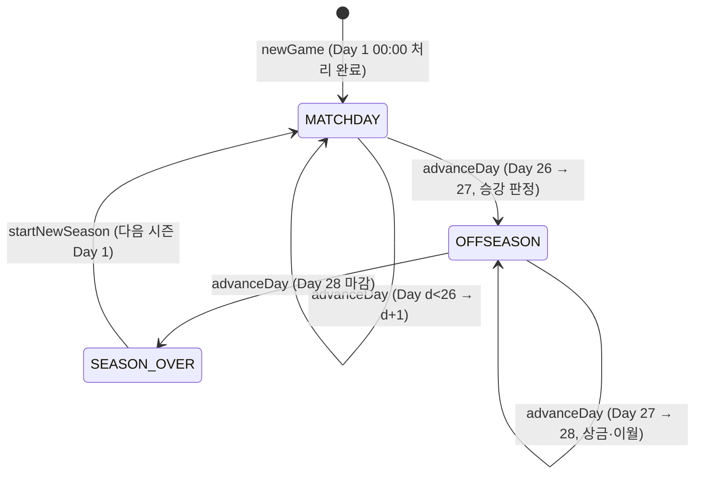
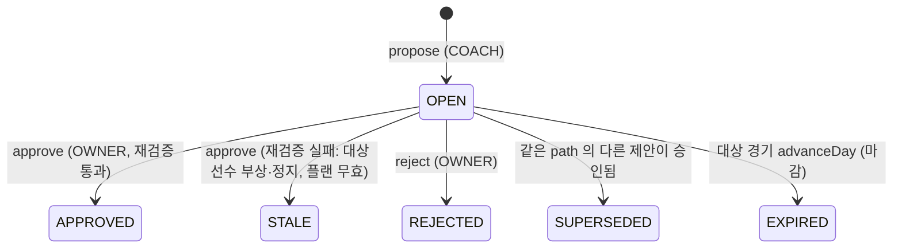

# 킥오프 FM Phase 0 프로토타입 아키텍처

- 대상: 기획서 v2 **12.3 Phase 0 프로토타입 범위**와 참조 절(3.6, 4, 4.7, 5.0, 6, 7, 8)
- 스택(고정): React 18 + TypeScript(strict) + Vite + Vitest. 서버 없음. 로컬 목 백엔드(순수 TS 서비스 + localStorage)
- 계약 버전: `CONTRACT_VERSION = 1.2.0` (`src/services/api.ts`, 변경 이력은 16장). 엔진 `0.4.0`, 세이브 스키마 `2`
- 표기: `[PH]` = 기획서 제안 기본값 또는 이 문서가 임시로 정한 값(튜닝 대상). `[해석]` = 기획서가 모호해서 이 문서가 정한 해석

---

## 0. 요약

| 항목 | 결정 |
|---|---|
| 구조 | 4레이어 단방향: `types ← engine ← domain ← services ← ui`. 테스트(`tests/architecture.test.ts`)가 import 방향을 강제한다 |
| 엔진 | 순수 TS, 결정적 시드(mulberry32), 외부 패키지·React·Date·Math.random 금지. 서버 단계로 그대로 옮긴다(8.7) |
| 백엔드 모양 | `GameService` 파사드. CBT 서버 API 이름(`submitPlan`, `advanceDay`, `getReport`, `propose`, `approve`)을 그대로 쓴다. 동기 호출 + `subscribe` |
| 상태 | 단일 `GameState` 문서. domain 순수 함수가 `state → state'`를 계산하고 services가 저장·통지만 한다 |
| 영속화 | localStorage 1키(`kickoff-fm/save/v1`), 시즌당 2MB 미만 예산. 결정 로그는 저장하지 않고 재시뮬로 복원 |
| 병렬 개발 | A(Backend Architect): engine·domain·services·scripts·tests / B(Frontend Developer): ui·main.tsx·스타일. 공유 계약 = `src/types/**` + `src/services/api.ts` + `src/services/index.ts` |

---

## 1. 실행 명령

| 명령 | 내용 |
|---|---|
| `npm run dev` | Vite 개발 서버 (모바일 확인은 `--host` 후 휴대폰 접속) |
| `npm run build` | `tsc --noEmit && vite build` |
| `npm run typecheck` | `tsc --noEmit` |
| `npm test` | Vitest 1회 실행 (아키텍처 경계 테스트 포함) |
| `npm run sim:batch -- --n 2000 --cap 0.35 --seed 42 [--scenario A,B] [--json sim-out/r.json] [--strict]` | 8.1 보정 목표 몬테카를로 (12장) |

---

## 2. 폴더 구조

```
kickoff-fm/
├─ index.html                     # 모바일 viewport(viewport-fit=cover), lang=ko          [B]
├─ package.json / tsconfig.json / vite.config.ts / vitest.config.ts                     [아키텍트 → A 관리]
├─ scripts/
│  └─ sim-batch.ts                # 8.1 보정 배치 CLI (tsx)                               [A]
├─ tests/                                                                                [A]
│  ├─ architecture.test.ts        # 레이어 의존 방향 + 엔진 결정성 정적 검사 (구현 완료)
│  ├─ engine/  rng.test.ts(구현 완료), engine.test.ts(todo 목록)
│  └─ domain/  domain.test.ts(todo 목록)
├─ src/
│  ├─ types/            ★공유 계약. 타입 전용(런타임 코드 금지)
│  │  ├─ common.ts      # ID, Kc, Step, Lane, GameTime, GameTimestamp
│  │  ├─ player.ts      # Player, Attributes(15키), FitLevel, Contract
│  │  ├─ tactics.ts     # FormationId(6), RoleId(14), TeamInstructions, TacticSlot, TacticCap, BotStyleTag
│  │  ├─ plan.ts        # MatchPlan, ConditionalOrder, OpponentOrders, PlanRecord, ResolvedPlan
│  │  ├─ engine.ts      # SimulateInput, EngineTeamInput, DecisionLog, MatchResult, ValueTable, MatchExplanation
│  │  ├─ league.ts      # Club, Fixture, MatchSummary, StandingRow, SeasonOutcome, OpponentScout
│  │  ├─ economy.ts     # TierEconomy, Finance, LedgerEntry, FinanceSummary, CarryOverResult
│  │  ├─ coach.ts       # Seat, Membership, Proposal, PlanChangePatch, ActionKind, PermissionResult
│  │  ├─ report.ts      # MatchReport(블록 1·2·3·4·5·6·8), MatchReplay
│  │  ├─ calibration.ts # CalibrationOptions/Report, ScenarioId
│  │  ├─ catalog.ts     # UI용 정적 카탈로그
│  │  ├─ game.ts        # GameState, GamePhase, DayStep, DayResult, PlanState, GameErrorCode
│  │  └─ index.ts
│  ├─ engine/           # 순수 시뮬레이션 (8장)                                         [A]
│  │  ├─ data/constants.ts   # 모든 튜닝 상수 (기획서 수치 입력 완료)
│  │  ├─ data/roleWeights.ts, formations.ts, shooterWeights.ts, valueTable.ts   (A 추가 예정)
│  │  ├─ rng.ts (구현 완료) · math.ts (구현 완료)
│  │  ├─ units.ts · rules.ts · decide.ts · sequence.ts · simulate.ts · explain.ts
│  │  └─ index.ts            # 엔진 공개 API
│  ├─ domain/           # 게임 규칙 (리그·스쿼드·플랜·경제·코치·감독 AI·리포트·하루 진행)  [A]
│  │  ├─ league/ schedule.ts standings.ts promotion.ts
│  │  ├─ squad/  generator.ts condition.ts
│  │  ├─ plan/   resolvePlan.ts engineInput.ts
│  │  ├─ economy/economy.ts  (TIER_ECONOMY 표 입력 완료)
│  │  ├─ coach/  permissions.ts proposals.ts
│  │  ├─ ai/     managerAi.ts
│  │  ├─ report/ buildReport.ts commentary.ts
│  │  ├─ calibration/runCalibration.ts
│  │  ├─ day/    advanceDay.ts   # 하루 진행 상태 머신
│  │  └─ index.ts
│  ├─ services/         # 로컬 목 백엔드                                                  [A]
│  │  ├─ api.ts          ★공유 계약: GameService 인터페이스
│  │  ├─ index.ts        ★공유 계약: UI가 import 하는 유일한 파일
│  │  ├─ errors.ts       # GameError(code)
│  │  ├─ ports.ts        # StoragePort(localStorage/메모리), Clock
│  │  ├─ gameService.ts  # LocalGameService (현재 TODO 스텁)
│  │  └─ workers/calibration.worker.ts
│  ├─ ui/               # React                                                           [B]
│  │  ├─ app/App.tsx     # 빈 셸(하단 탭 5개)
│  │  └─ styles/global.css
│  └─ main.tsx                                                                           [B]
└─ docs/ 기획서_v2.md, 아키텍처.md
```

---

## 3. 모듈 경계와 의존 방향

```
         ┌────────────────────────── src/types (타입 전용, 모두가 참조) ──────────────────────────┐
         │                                                                                        │
   [engine] ◀── [domain] ◀── [services] ◀── [ui] ◀── main.tsx
   순수 시뮬      게임 규칙      파사드·영속화     React 화면
```

| 레이어 | import 허용 | 금지 | 책임 |
|---|---|---|---|
| types | types | 전부 | 계약. `export const/function/class` 금지(테스트로 검사) |
| engine | types, engine | 외부 패키지, domain 이상, `Math.random`·`Date`·`performance` | 한 경기 시뮬레이션, 유닛 계산, 8.8 기여도 분해 |
| domain | types, engine(`engine/index.ts`) | 외부 패키지, services, ui, 시계·난수 직접 사용 | 일정·순위·승강, 선수 생성·컨디션, 4.7 플랜 결정, 경제, 권한·제안, 감독 AI, 리포트·중계 문장, 하루 진행 상태 머신 |
| services | types, engine, domain | ui | `GameService` 구현, 권한 검사 호출, 원자적 상태 교체, 영속화, 행동 로그, 워커 |
| ui | types, `services/index.ts` 만 | engine, domain, services 내부 파일 | 화면·상호작용. 계산을 하지 않는다(4.7 미리보기도 서비스 호출) |

규칙:
- **시간과 난수는 주입한다.** domain/engine은 `Rng`와 `GameTime`만 받는다. 실제 시각(행동 로그)은 services의 `Clock` 포트가 만든다.
- **UI는 GameState를 수정하지 않는다.** `getSnapshot()`은 읽기 전용이며, 상태 변경은 서비스 메서드로만 한다.
- **엔진은 도메인 개념(구단 재정, 제안, 일정)을 모른다.** domain의 `toEngineTeamInput`이 번역 경계(반부패 계층)다.
- 강제 수단: `tests/architecture.test.ts` (레이어 import 방향, UI의 services 내부 import 금지, types 런타임 코드 금지, engine/domain 비결정 API 금지).

---

## 4. 핵심 데이터 모델

전체 정의는 `src/types/*.ts`. 여기서는 불변식과 설계 이유만 적는다.

### 4.1 선수 (`Player`)
- 능력치 키 15개 = 필드 12(패스·드리블·결정력·크로스·태클 / 시야·위치선정·침착성·활동량 / 속도·체력·피지컬) + GK 3(선방·공중 장악·킥). **기획서는 "14종"이라 쓰지만 나열은 15개**라서 15키로 고정했다(기획 확인 필요, 15장).
- `ovr`는 표시 전용 캐시. 엔진은 쓰지 않는다. `potential`은 UI 노출 금지(`scoutRange`만 노출).
- `condition` 0~100, `morale` −2..+2, `availability.injuryDays / suspendedMatches`.

### 4.2 전술 (`TacticSlot`)과 플랜 (`MatchPlan`)
- 팀 지시는 **구단 소유 슬롯 A/B**(`Club.tactics`)에 있고, 플랜은 "어느 슬롯으로 시작할지"만 가진다. 슬롯 숙련도가 슬롯 단위라서 이렇게 나눴다(4.4-4).
- `MatchPlan.lineup.starters[i]` ↔ 시작 슬롯 포메이션의 `FormationSlot.index = i`. 슬롯 전환(조건부 지시)으로 포메이션이 바뀌면 엔진이 경기장 위 11명을 새 포메이션 슬롯에 **적합도 최대 탐욕 배정**으로 다시 앉힌다.
- 초안(`DRAFT`)과 확정본(`CONFIRMED`)은 `GameState.plans[clubId]`에 "다음 경기 1건" 기준으로 저장하고, 그 경기가 처리되면 비운다(예약 플랜·플랜 저장소는 Phase 0 제외).
- `OpponentOrders.opponentId`로 "어느 상대 기준으로 작성했는가"를 기록해 4.7 ②-1 초기화를 판단한다.

### 4.3 경기 결과
- 엔진 출력 `MatchResult`는 결정 로그(`DecisionLog[]`, 경기당 약 500~700개)를 포함한다.
- **영속 대상은 `MatchSummary`(모든 경기, 약 0.7KB)와 `StoredMatchRecord`(사용자 구단 경기만: 양 팀 `EngineTeamInput` + 적용 플랜 + 리포트)**. 결정 로그는 저장하지 않는다. 중계 재생·개발자 재시뮬은 저장된 입력과 시드로 다시 시뮬레이션해 같은 로그를 얻는다(ADR-002).

### 4.4 게임 상태 (`GameState`)
- 단일 문서: 구단 14, 선수 약 310, 일정 182, 요약, 기록, 플랜, 재정, 멤버십 2, 제안, 시즌 이력, 행동 로그.
- `seq`는 게임 내 사건 순서 카운터(`GameTimestamp`). 제안·플랜 기록의 선후 비교에 쓴다.
- `phase`: `MATCHDAY`(Day 1~26) / `OFFSEASON`(Day 27·28) / `SEASON_OVER`(Day 28 처리 완료, 새 시즌 대기).
- 크기 예산(시즌 1회 기준): 선수 약 220KB + 요약 약 130KB + 사용자 경기 기록 약 300KB + 행동 로그(최대 5,000건) 약 500KB → **2MB 미만**. 새 시즌 시작 시 지난 시즌의 `summaries`·`records`는 버리고 `SeasonOutcome`만 남긴다. 행동 로그는 새 시즌 전에 내보내기를 안내한다.

### 4.5 식별자
- `MatchId = s{season}-d{day}-{homeId}-{awayId}` (`makeMatchId`). 시드는 `seedFrom(gameSeed, matchId, ENGINE_VERSION)`.
- 사용자: `u-owner`(구단주), `u-coach`(코치, roleLabel TAC). 로컬 역할 전환은 `actorUserId`만 바꾼다.

---

## 5. 시뮬레이션 엔진 (기획서 8장 구현 명세)

### 5.1 공개 API

```ts
simulateMatch(input: SimulateInput): MatchResult            // 순수, 결정적
explainMatch(result: MatchResult, values: ValueTable): MatchExplanation
computeUnits(onPitch, slot, redCards): Units
```
`EngineConfig`: `tacCap`(0.25/0.35/0.50), `tacticsEnabled`, `disabledRules`, `onlyRules`, `neutralVenue`, `engineVersion`. 상수는 전부 `engine/data/constants.ts`(기획서 수치 입력 완료). 값을 바꾸면 `ENGINE_VERSION`을 올린다.

### 5.2 경기 루프

```
rng = mulberry32(input.seed)
totalSeq = round(100 × tempoFactor × (1 + U(−0.08, +0.08)))
  tempoFactor = 1 + 0.075 × mean(home.tempo, away.tempo)        // 0.85..1.15, 양 팀 공통
seqPerSeg = 18 등분(나머지는 rng로 배분)
attacker = coinFlip ? home : away ; startZone = 0
for seg in 0..17:
  recomputeUnits(home), recomputeUnits(away)                      // 컨디션 효율·교체·퇴장·지시 변화 반영
  for s in 0..seqPerSeg[seg]-1:
    r = runSequence(attacker, defender, minute = seg*5 + s*5/seqPerSeg[seg])
    (attacker, startZone) = nextPossession(r)
  applyFatigue(home, away)                                       // 5.5
  rollInjuriesAndRedCards(seg)                                   // 5.5
  evaluateTriggers(home), evaluateTriggers(away)                  // 조건부 지시 (seg 경계 = 5·10·…·90분)
  autoSubstitute(home), autoSubstitute(away)
return buildResult(log, events)
```

`nextPossession`: 골 → 실점 팀이 Z0에서 / 슈팅 무득점·세트피스 종료 → 수비 팀 Z0 / 턴오버(구역 z) → 수비 팀이 `2 − z`에서 시작(미러링, 8.4). `2 − z = 2`면 바로 DP3부터.

### 5.3 결정 지점 (모든 확률은 `decide()` 하나로 계산)

```ts
function decide(dp, actor, opp, ctx): boolean {
  const [a, d] = pairFor(dp, actor, opp, ctx)
  const strength = K * (a - d) + matchupTerm(dp, ctx)          // DP4 유형별 매치업 포함
  const prep = MORALE_STEP_MOD * actor.morale - 0.05 * (1 - fam(actor)/100)   // [-0.09, +0.04]
  const home = config.neutralVenue ? 0 : actor.isHome ? 0.04 : 0
  const base = BASE[dp] (+ LONG 유형이면 DP4에 +0.60)
  const raw = applyRules(dp, actor, opp, ctx)                   // RULES_BY_DP[dp] 만 평가, disabled/onlyRules 적용
  for (k in raw) if (raw[k] > 0) raw[k] *= 0.5 + 0.5 * fam(actor)/100   // famCoef: 긍정 효과에만
  const tac = config.tacticsEnabled ? clamp(sum(raw), -cap, +cap) : 0     // ★ 전술 상한
  const logitNoTac = base + strength + prep + home
  const p = clamp(sigmoid(logitNoTac + tac), 0.05, 0.95)        // DP5는 [0.01, 0.85]
  const success = rng() < p
  log.push({ kind:'BINARY', dp, actor, a, d, base, strength, prep, home, logitNoTac, raw, tac, p, success, ... })
  return success
}
```

| DP | actor(성공을 원하는 팀) | 유닛 쌍 (A, D) | BASE | 추가 항 |
|---|---|---|---|---|
| DP1 | 공격 | BU vs PRS | +1.10 | — |
| DP2 | 공격 | PRG vs MID | +0.20 | — |
| DP3 | 공격 | (다항 로짓, 5.4) | — | — |
| DP4 | 공격 | CRE vs BOX | −0.40 | CROSS: K(AER_A−AER_D) / THROUGH: K(PACE_A−PACE_D) / SOLO: K(드리블러 eff 드리블 − 상대 BOX 기여 선수 평균 eff 태클) / LONG: BASE +0.60 / CUTBACK: 없음 |
| DP5 | 공격(슈터) | — | logit(xG_유형) | +0.03 × (FIN_슈터 − GK). CORNER는 +K(SPA−SPD) `[해석]` |
| DP6 | **공을 뺏은 팀** | PACE_A(탈취 팀) vs PACE_D(뺏긴 팀) | −1.40 | Z1 이상 턴오버에서만 판정 |
| DP7 | 공을 뺏은 팀 | PACE_A vs PACE_D | 0.00 | 성공 → 찬스 유형 COUNTER로 DP5 |
| DP8 | 공격(점유 유지) | CTRL vs PRS | Z0 −0.40 / Z1 −0.62 | 시퀀스당 리셋 최대 2회. 성공 = 한 구역 뒤로 리셋 |

- `prep`는 **actor 팀 것만** 쓴다(8.4 공식 그대로). `FIN_슈터` = 슈터 eff(결정력 .5, 침착 .3, 위치선정 .2).
- Z2 실패 분기(DP4 실패): 기본 코너 25% / 프리킥 8% / 턴오버 67%, 크로스 유형은 40/8/52 `[PH]`. 코너·프리킥은 해당 유형으로 바로 DP5.
- 페널티킥: DP4 성공한 박스 내 유형(CROSS·THROUGH·CUTBACK·SOLO)의 2.5%가 PK(xG 0.76)로 바뀐다.

### 5.4 DP3 찬스 유형 선택

```
side = pickSide(att.orders.attackSide)     // 기본 L/C/R 35/30/35, R10 지정 시 지정측 55 / 중앙 25 / 반대 20
for t in [CROSS, THROUGH, CUTBACK, LONG, SOLO]:
  baseLogit[t] = ln(CHANCE_BASE_WEIGHT[t]) + roleAdj(t)     // 역할 보정: 윙어·오버래핑 FB·타깃맨→CROSS, 침투형→THROUGH,
                                                            // 인사이드→CUTBACK, AM→LONG, 드리블 상위→SOLO. 크기 ±0.3 [PH]
  raw[t] = R2(THROUGH +0.15), R3(LONG·CROSS +0.15), R4(CROSS·CUTBACK +0.15) ... × famCoef(양수만)
  tac[t] = clamp(Σ raw[t], −cap, +cap)                      // 유형마다 상한
P(t) = softmax(baseLogit + tac)
log.push({ kind:'CHOICE', baseLogits, tacByType, rawByType, chosen })
```

### 5.5 유닛·컨디션·교체·징계

- `eff(attr) = attr × 5 × FIT_MULT[fit] × condEff(condition)`, `condEff`: ≥90 → 1.00, 90→60 선형 1.00→0.85, <60 → 0.80.
- 유닛 = 역할 가중치 파일(`engine/data/roleWeights.ts`)로 가중 평균(8.3 표). R9 마커는 다른 유닛 기여 × 0.8. 퇴장 인원당 모든 유닛 × 0.9 `[PH]`.
- 스쿼드-전술 적합도(8.3-4): 압박 +2 & PRS < 65 → R1 × PRS/65 / 라인 +2 & PACE_D < 60 → `LINE_FIT` 규칙(DP4 THROUGH·DP7에 공격 측 +0.10) / 패스 −2 & BU < 60 → R7의 DP8 리셋 가산 × BU/60 / 폭 +2 & 측면 크로스·속도 평균 < 60 → R4 × 비율.
- 체력: 세그먼트마다 `(30 + 3 × press + 역할 보정(박스투박스 +3) + 마커 +4) / 18` 감소. 교체 투입 선수는 투입 이후 세그먼트만.
- 자동 교체: 세그먼트 경계에서 컨디션 ≤ `autoSubThreshold`(기본 55) 인 선수를 같은 포지션 벤치 최고 적합자로 교체. 최대 5명, 교체 창 3회(하프타임 교체는 창 소모 없음).
- 부상: 선수별 경기 확률 0.8%(컨디션 < 60이면 ×2)를 18등분해 세그먼트마다 판정, 기간 1~7일 균등 `[PH]`. 퇴장: 팀당 경기 6% `[PH]`, 다음 1경기 정지.
- 조건부 지시: 세그먼트 경계에서 위에서부터 평가, 지시당 경기 1회. `SWITCH_SLOT`(슬롯 숙련도 사용, 선수 재배정), `MENTALITY_DELTA`(현재 값에 더해 −2..2 clamp), `HT_ADJUST`(TIME=HT 전용, 템포/압박 ±1). 발동 시 `TRIGGER_FIRED` 이벤트.

### 5.6 전술 상성 규칙 (엔진 0.4.0, actor 관점 부호, + = actor 유리)

규칙 정의·실제 축구 논리는 `docs/실축구_전술설계.md` 2.2, 확정 수치는 `src/engine/data/constants.ts` 의 `RULES`·`RULES_BY_DP` 가 원본이다(이 표는 구조만 요약한다).

| 규칙 | DP | 0.4.0 구조 (선수·역할 결합) |
|---|---|---|
| R1 압박 vs 빌드업 | DP1·DP8 (수비 압박), DP6 (역압박 전환) | 수비 press ≥ 1 & 공격 directness ≤ 0. g = clamp(0.5 + (PRS + 3×프레싱 포워드 − BU)/20). 압박 저항 역할(스위퍼 GK·볼플레잉 CB·레지스타·딥 플레이메이커·인버티드 FB) 1명당 감쇠, 3백 vs 전방 압박 ≤ 2 × 0.7. DP6 는 잃은 팀 directness ≤ 0 일 때만 |
| R2 뒷공간 | DP1·DP3(스루) / 역효과 DP1·DP2 | 공격 directness ≥ 1 & 수비 line ≥ 1. 크기 × paceMult = clamp(1 + (최고 러너 속도 − 최저 CB 속도(커버 CB 가중))/scale) × 스위퍼 GK(속도 ≥ 10: 0.5, 아니면 0.75) × 3백 vs 2톱 배수. 수비 line ≤ −1 이면 롱볼 역효과 |
| R3 로우 블록 | DP4 (−), DP3·DP4 크로스·DP5 중거리 (해답), DP2 (비용) | 수비 line ≤ −1 & mentality ≤ 0 & 공격 directness ≤ −1. comp = BOX − CRE 배수, 크로스 해답 = 공중전 차 tanh, 중거리 해답 = 최고 중거리 능력 |
| R4 측면 과부하 | DP3·DP4 크로스·컷백 | O = 공격 측면 wA − 수비 맞은편 wD (역할 형태값 + 폭 지시). \|O\| > 0.2 양방향(수비 측면 우위는 negMult 배로 −) |
| R5 공격 성향 ↔ 역습 | DP4 (성향 ±), DP6·DP7 (처벌) | 공격 성향은 양방향 DP4 가산. 처벌: 잃은 팀 mentality ≥ 1 & 탈취 팀 counter. × 잔류 수비 RD(앵커·볼 위닝·인버티드 FB), DP7 은 러너 vs CB 속도 |
| R6 오프사이드 트랩 | DP4 스루 (−), DP5 (+) | 수비 offsideTrap & 공격 러너 ≥ 1. × (1 − 침투 숙련) × 2선 침투 역할 0.6 × 느린 CB(최저 < 13) 0.5 |
| R7 중앙 통제 | DP2·DP8 | 공격 directness ≤ 0. C = cA(공격) − cD(수비, 2톱 커버 섀도·라인 +2 압축 포함). tanh(C/scale) 포화 |
| R9 집중 마크 / R10 공략 측면 / TEMPO | 0.3.0 과 같음 | — |
| R11 하프스페이스 (신규) | DP2·DP3·DP4 | H = hs(공격) − hsC(수비, 5백·3백 가산) − offset > 0 |
| R12 측면 1:1 (신규) | DP4 돌파·크로스(해당 측), DP7 | 수비 해당 측이 윙백·공격형 풀백 & 수비 mentality ≥ 0 & 공격 해당 측 윙 역할. 윙어 vs 수비수 속도·드리블 매치업 |
| R13 타깃맨 롱볼 (신규) | DP1·DP2 | 공격 directness ≥ 1 & 타깃맨. 타깃맨 공중 vs AER_D (상대 압박 시 × 1.25), 세컨드볼 = MID + 볼 위닝·박스투박스 수 |
| LINE_FIT | DP4 스루·DP7 | 수비 line ≥ 2 & (PACE_D < 60 또는 최저 CB 속도 < 11) |

- **구조 보정 (전술 cap 밖, 0.4.0)**: 추가시간(세그먼트 9·18 시퀀스 × 1.5 · 2.1, 이벤트 `addedMinute`), 후반 개방도 `LATE_DRIFT`(DP4·DP7 BASE), 경기 흐름 `STATE_MOD`(60분 이후 스코어 기반, 로그 `state`, 기여도 막대 `state`), 홈 이점 `HOME_MOD`, 경고(파울 기회마다 판정, 2경고 퇴장, 별도 RNG 스트림).
- **표시 판정 (결과 불변)**: 유효슈팅(`SOT_Q`), 빗나간 슈팅의 코너, 실패한 스루·역습의 오프사이드 표기, 시간 가중 점유(`POSSESSION_WEIGHT`). 메인 RNG 와 분리된 스트림을 써서 표시 상수를 바꿔도 결정 로그·스코어가 같다(Vitest 로 검사).
- 팀 형태값 `TeamShape`(엔진 내부, `units.ts computeShape`)는 경기 시작·세그먼트 경계·교체·퇴장마다 다시 계산한다.
- R8은 v2에서 삭제. 템포는 시퀀스 수(경기 길이)와 DP8에만 작용한다.
- **모든 전술 효과는 위 raw → clamp(±cap) 경로로만 들어간다.** 다른 경로(확률 직접 수정, 경합 생략)를 만들면 리뷰에서 거부한다.
- 규칙별 발동 수(`ruleFires`)는 raw가 0이 아닌 결정 수를 수혜 팀 기준으로 센다.

### 5.7 승부 요인 기여도 (8.8) — `explainMatch`

```
for each BINARY log L (actor = X, opp = Y):
  p0 = sigmoid(L.logitNoTac); p1 = L.p; Δtac = p1 − p0
  S = Σ L.raw; a_i = (S == 0) ? 0 : raw_i × L.tac / S          // clamp 비례 배분 → Σ a_i = tac
  g = (L.tac == 0) ? p0(1−p0) : Δtac / L.tac
  Δp_i = a_i × g                                               // Σ Δp_i = Δtac (정확히 보존)
  V = VALUE(L.dp, L.zone, L.chance)                            // DP5는 V = 1 (Δp가 곧 xG)
  xg_i = Δp_i × V → X에 +xg_i, Y에 −xg_i
  막대: pb = sigmoid(base); 전력 = sigmoid(base+strength) − pb
        준비 = sigmoid(base+strength+prep+home) − sigmoid(base+strength); 전술 = Δtac   (각 × V, X +, Y −)
for each CHOICE log C:
  P_with = softmax(baseLogits + tacByType); P_without = softmax(baseLogits)
  for t: ΔP_t = P_with[t] − P_without[t]; 규칙 i 몫 = ΔP_t × (raw_i,t / Σ raw_t) (Σraw_t=0이면 0)
  xg_i += Σ_t 몫_i,t × chanceEv[t]
운 = (GF − GA) − (xGF − xGA)
conservationError = Σ|Σ_i Δp_i − Δtac| (테스트: < 1e-9)
```
- **VALUE 테이블**(`engine/data/valueTable.ts`): 엔진 버전별로 10만 시퀀스 몬테카를로를 돌려 `E[이후 순 xG | 성공] − E[… | 실패]`를 구한다. `sim:batch`에 `--build-values` 모드를 추가해 파일을 생성한다(A). 최초 값은 기획서 추정치(DP1 0.04, DP2 0.07, DP4 0.13)로 시작한다.
- 네 막대의 합은 VALUE 근사라 실제 득실 차와 정확히 같지 않다. 테스트는 ±0.3 허용오차로 본다.

### 5.8 리포트 조립 (domain/report)

| 블록 | 계산 |
|---|---|
| 1 결과 요약 | TeamMatchStats |
| 2 운 지표 | 운 ≤ −1.0 UNLUCKY / ≥ +1.0 LUCKY / 그 외 NEUTRAL `[PH]` |
| 3 승부 요인 Top 3 | 규칙별 순 xG |절댓값| 상위 3. count = 실제 판정 이벤트(R6 → 오프사이드, R2 → 롱볼 전진, R5 → 역습) 또는 발동 수, leagueAvgCount = 시즌 요약의 팀·경기당 평균 |
| 4 요소별 막대 | 5.7의 전력/준비/전술/운 |
| 5 구역 흐름 | Z0/Z1/Z2 통과율 vs 시즌 리그 평균 |
| 6 타임라인 | GOAL, TRIGGER_FIRED, SUBSTITUTION, CONDITION_DROP(< 60 최초), INJURY, RED_CARD |
| 8 다음 경기 제안 | 우리에게 가장 불리한 규칙 1~2개의 파훼법 문장 + `instructionPatch`(예: R1 → directness +2, R5 → mentality 0, R3 → width +2, R6 → tempo −1) |
| 시즌 기대 승점 | 경기별 xG로 독립 포아송(0~10골) 승·무 확률 → xPts 누적 vs 실제 승점 |

### 5.9 결정성 규칙
1. 엔진 안의 무작위는 전부 `rng()` 하나에서, **호출 순서가 고정된 코드 경로**로만 소비한다(객체 키 순회 순서에 의존하지 않도록 배열 순서를 쓴다).
2. 입력 배열 순서(선발·벤치)도 결과에 영향을 준다. `toEngineTeamInput`이 정렬 규칙을 고정한다(슬롯 인덱스 순, 벤치는 입력 순).
3. 하루 7경기는 `matchId` 사전순으로 처리한다(경기 간 상태 공유 없음 → 순서 무관이어야 하지만 방어적으로 고정).
4. 골든 테스트: 시드 3개의 `MatchResult` JSON 해시를 스냅샷으로 저장. 엔진 버전을 올릴 때만 갱신한다.

---

## 6. 게임 상태 머신 (하루 진행)

### 6.1 영속 국면



`MATCHDAY` 상태 = 기획서 3.1의 "00:00 이후 ~ 20:50 이전" (플랜 편집 가능). 버튼 한 번이 "20:50 마감 → 시뮬 → 21:15 결과 → 다음 날 00:00 처리"를 한 트랜잭션으로 실행한다.

### 6.2 `advanceDayState(state)` 내부 단계 (`DayStep`)

**MATCHDAY (Day d, 1 ≤ d ≤ 26)**

| # | 단계 | 처리 | 기획서 |
|---|---|---|---|
| 1 | DEADLINE | `expiresAt.day == d`인 OPEN 제안 → EXPIRED (로그) | 5.0.2 |
| 2 | RESOLVE_PLANS | 사용자 구단: `resolvePlan`(4.7 ①②). 봇 13팀: `managerAi.buildPlan(mode='BOT', 상대 스카우트)`를 확정본으로 넣고 같은 `resolvePlan` ② 보정 적용 | 4.7, 6.6 |
| 3 | SIMULATE | 그날 7경기: `seed = seedFrom(gameSeed, matchId, ENGINE_VERSION)`, `toEngineTeamInput` → `simulateMatch` (matchId 순) | 8 |
| 4 | APPLY_RESULTS | ① `MatchSummary` 저장 ② 선수: `applyMatchLine`(컨디션·부상·퇴장 정지·스탯, 출전 안 한 선수의 정지 경기 −1) ③ 사기: 승 +1 / 패 −1 / 무 0 쪽으로 1단계 `[PH]` ④ 숙련도: 사용 슬롯 +6 (경기 중 전환된 슬롯 포함) ⑤ 경제: 전 구단 승/무/패 수당 ⑥ 사용자 경기: `explainMatch` → `buildReport` → `StoredMatchRecord` ⑦ `club.lastUsedPlan` = 적용 플랜(맞춤 지시 제거) ⑧ `plans[club]` 비우기 | 4.2, 4.4, 7.4 |
| 5 | SEASON_JUDGEMENT | d = 26일 때만: `computeStandings` → `judgeSeason` → `pendingOutcome` | 6.2, 6.5 ①② |
| 6 | ROLLOVER | `day = d + 1` | — |
| 7 | DAILY_PROCESSING | 전 선수 회복(+14 + 체력 보정 0~6), 부상 일수 −1, 미사용 슬롯 숙련도 −2, 연봉 일할 차감(전 구단). Day 27이면 순위 상금·우승 수당 입금 | 3.1, 6.5 ③ |

**OFFSEASON**
- Day 27 → 28: DAILY_PROCESSING(28): 연봉 차감 후 **이월 판정**(`carryOver`: R = 잔액, C = 배정금 × 20%, 초과분 → `transferOnlyBudget`). phase는 OFFSEASON 유지.
- Day 28 → SEASON_OVER: 날짜는 바꾸지 않고 phase만 바꾼다. `DayResult.seasonOutcome`으로 시즌 종료 화면을 띄운다.

**`startNewSeasonState` (SEASON_OVER에서만)**
1. `pendingOutcome` → `seasonHistory`, 지난 시즌 `summaries`·`records` 폐기.
2. 사람 선수: 나이 +1, 성장·노화(16~23 성장 / 24~29 정점 / 30+ 하락 `[PH]`), 계약 −1(만료 선수 처리 Phase 0: 자동 1시즌 재계약 `[해석]`, 이적 시스템이 없으므로).
3. 봇 13팀 폐기·재생성(성향 분포 유지).
4. 새 일정 생성(새 시즌 번호로 rng 파생).
5. Day 1 00:00: 기본 배정금 입금, 일일 처리. Day 3 00:00에 `transferOnlyBudget` 소멸(LP 표시).
6. **티어 이동 없음**(12.3). 승강 라벨과 보상만 보여준다.

### 6.3 원자성과 멱등
- `advanceDayState`는 입력 상태를 바꾸지 않고 새 상태를 돌려준다(구조적 공유 허용, 제자리 수정 금지). services는 `save` 성공 후에만 스냅샷을 교체한다. 저장 실패(용량 초과) 시 이전 상태를 유지하고 `GameError('STORAGE_FULL')`.
- 같은 상태에서 두 번 실행하면 같은 결과가 나온다(시드가 상태에서만 유도됨). 테스트로 검사한다.
- `advanceDays(n)`, `advanceToSeasonEnd()`는 단계를 반복하되 **저장은 마지막에 1회**, 리스너 통지도 1회.
- `SEASON_OVER`에서 `advanceDay` → `GameError('INVALID_PHASE')`.

### 6.4 4.7 플랜 결정 (`resolvePlan`) — 마감과 미리보기가 같은 함수

```
① 후보: plans[club].confirmed → club.defaultPlan → club.lastUsedPlan(맞춤 지시 제거) → managerAi SYSTEM_DEFAULT
   (초안은 절대 쓰지 않는다)
② 보정(순서 고정, 각 보정은 PlanAdjustment 로 기록):
   1. opponentOrders.opponentId ≠ 오늘 상대 또는 markTarget 이 상대 명단에 없음 → 제거 (OPP_ORDERS_CLEARED)
   2. 부상·징계 선발/벤치 → 같은 슬롯 역할 적합도 최고 가용 선수 (UNAVAILABLE_REPLACED)
   3. autoRotation ON: 경기 전 컨디션 < 70 선발 → 벤치/비엔트리 중 대체 (AUTO_ROTATION)
   4. 11명 미만·GK 없음·중복 등 → 감독 AI 최소 보정 (VALIDITY_FIX)
   5. 빠진 선수를 참조하는 조건부 지시 → enabled=false (CONDITIONAL_DISABLED)
③ source 와 adjustments 를 담은 ResolvedPlan 반환 → 홈 카드 "지금 마감되면 적용될 플랜"
```
"추천대로"(`recommendPlan`) = ② 보정만 적용한 현재 유효 플랜(상대 맞춤 없음). UI가 받아서 `submitPlan`으로 확정한다.

---

## 7. 최소 경제 (기획서 7장)

| 항목 | 구현 |
|---|---|
| 티어 | `settings.tier` 기본 **T3**(승격·강등 라벨이 모두 나오는 티어). `TIER_ECONOMY` 표는 7.4.1·7.4.2 수치 입력 완료 |
| 단위 | KC 정수. 1M = 1,000,000 |
| 기본 배정금 | Day 1 00:00 입금 |
| 연봉 | 매일 00:00 `round(연봉 합 / 28)`, Day 28에 28일 합계 오차 보정 |
| 경기 수당 | 결과 적용 시 승/무/패 수당(모든 참가 구단) |
| 상금 | Day 27 00:00: 순위 상금(1위 20%, 2~3위 15%, 4~6위 10%, 7~10위 6%, 11~14위 3%) + 우승 수당 10% |
| 이월 | Day 28 00:00: `carried = min(R, C)`, `excess = R − carried` → `transferOnlyBudget`(표시만, 다음 시즌 Day 3 소멸) |
| 지출 가능액 B | `잔액 − 연봉 합 × 남은 일수 / 28` (예약·위약금은 Phase 0에 없음) |
| 재정 화면 | `FinanceSummary`: 잔액, 한정 예산, B, 캡 사용률, 시즌 수입/지출, 예상 이월, 최근 원장 |
| 선수 연봉 생성 | 사람 팀 연봉 합 ≈ 캡의 94%(7.5), 봇은 전력 비례 `[PH]` |

**경제 게이트 주의**: 12.3의 "중위권 순유입 비율 1.05~1.10"은 이적료·FA·갱신 보너스 싱크를 전제로 한다. Phase 0에는 연봉 외 싱크가 없어 비율이 약 1.4로 나온다. Phase 0 게이트는 **"시즌 수입 / 캡"을 7.4.1 성적별 표(최하위 1.14배 ~ 우승 1.62배)와 ±3% 안에서 비교**하는 대체 지표로 측정할 것을 제안한다(15장 확인 필요).

---

## 8. 코치 권한 체크와 제안 흐름 (5.0)

### 8.1 로컬 역할 전환
- 멤버십 2개: `u-owner`(OWNER), `u-coach`(COACH, roleLabel TAC). 코치는 합류 24시간이 지난 것으로 간주(`joinedAt = season 0`)해 열람 제한이 없다.
- `switchRole('OWNER' | 'COACH')`는 `actorUserId`만 바꾸고 `ROLE_SWITCHED` 로그를 남긴다. UI는 `getActor().seat`로 화면을 분기한다(코치: 편집 대신 "제안하기").

### 8.2 `checkAction(membership, action, ctx)` — 서비스의 모든 변경 메서드가 첫 줄에서 호출

| ActionKind | OWNER | COACH | COACH_SPECTATOR | 거부 코드 |
|---|---|---|---|---|
| VIEW_TODAY_PLAN | ✓ | ✓ (합류 24h 이내면 마감 후만) | ✗ | NEW_COACH_LOCK / SPECTATOR |
| EDIT_PLAN · SUBMIT_PLAN · EDIT_TACTIC · SET_DEFAULT_PLAN | ✓ | ✗ | ✗ | NOT_OWNER |
| PROPOSE · REACT | ✗ | ✓ | ✗ | NOT_COACH / SPECTATOR |
| APPROVE · REJECT | ✓ | ✗ | ✗ | NOT_OWNER |
| ADVANCE_DAY | ✓ | ✓ | ✓ | — (Phase 0의 "시계" 역할) |

거부 시 services는 `GameError('PERMISSION_DENIED', message)`를 던진다. UI는 버튼을 미리 숨기지만 **권한 판단의 원천은 서비스**다(서버 이전 시 그대로 유지).

### 8.3 제안 수명 주기



- `propose`: 사유 1~80자, 코치 1인 동시 OPEN ≤ 5, 같은 작성자·같은 path 집합 중복 불가, 변경 없음(diff 0) 거부. 기준 = `PlanBundle { plan: 확정본 > 초안 > 4.7 미리보기, tactics: club.tactics }`. `diff`를 생성해 저장(카드의 전/후 값).
- `approve(id, edits?)`: 현재 기준 번들에 `edits ?? patch` 적용 → `validatePlan` + 참조 선수 가용성 재검증 → 실패 시 `STALE`(details). 통과 시 ① 팀 지시 패치는 `club.tactics[slot].instructions`에 반영(숙련도 하락 없음) ② 플랜은 **구단주 명의 CONFIRMED** 저장(`sourceProposalId`) ③ 같은 path의 OPEN 제안 → SUPERSEDED ④ 로그.
- 찬성/반대(`react`)는 참고 정보, 자동 처리 없음.

---

## 9. 감독 AI와 봇 (3.5, 6.6)

- 단일 모듈 `domain/ai/managerAi.ts`, `mode`: `BOT`(상대 스카우트 반영해 슬롯 A/B 선택, 조건부 지시 템플릿 "지키기·추격") / `RECOMMEND`(대체+로테이션만) / `SYSTEM_DEFAULT`(4.7 ① 4순위, 유효성 보정).
- 봇 13팀 성향 분포: 점유 3 · 역습 3 · 전방압박 3 · 잠그기 2 · 측면 2. 성향별 슬롯 A(주 전술)·B(리드 시 잠그기 또는 추격용).
- 봇 전력: **사람 팀 주전 평균 OVR × U(0.90, 1.08)** `[PH]`. 기획서 6.6의 "사람 팀 평균의 85~95%"는 다수 사람 팀이 있는 리그 기준이라, 사람 1팀뿐인 Phase 0에 그대로 쓰면 사용자가 항상 최강이 되어 Q-A·Q-B 검증이 왜곡된다(15장 확인 필요).
- 봇 로테이션: 컨디션 < 70 자동 로테이션 동일 적용(봇도 피로 규칙을 따른다).
- 상대 분석 요약(`getOpponentScout`): 최근 5경기 포메이션·지시 요약 + 약점 한 줄(그 팀이 최근 5경기에서 가장 크게 손해 본 규칙 → 문장 템플릿).

---

## 10. 서비스 계층

### 10.1 `GameService` 공개 API (요약, 정의는 `src/services/api.ts`)

| 분류 | 메서드 |
|---|---|
| 구독 | `getSnapshot(): GameSnapshot \| null`, `subscribe(fn): unsubscribe` |
| 수명 주기 | `newGame(opts?)`, `loadGame()`, `resetGame()`, `exportSave(): string`, `importSave(json)` |
| 역할 | `getActor(): Membership`, `switchRole('OWNER'\|'COACH')` |
| 조회 | `getCatalog()`, `getSquad(clubId?)`, `getPlayer(id)`, `getStandings()`, `getFixtures(filter?)`, `getNextMatch()`, `getOpponentScout(clubId)`, `getFinance(clubId?)` |
| 전술·플랜 | `updateTacticSlot(slot, next): {slot, familiarityHalved}`, `getPlanState(): PlanState`, `validatePlan(plan)`, `saveDraft(plan)`, **`submitPlan(plan)`**, `setDefaultPlan(plan)`, `recommendPlan()`, `previewResolvedPlan()` |
| 진행 | **`advanceDay(): DayResult`**, `advanceDays(n)`, `advanceToSeasonEnd()`, `startNewSeason()`, `getSeasonOutcome(season?)` |
| 리포트 | **`getReport(matchId)`**, `getMatchReplay(matchId)` |
| 코치 | **`propose(input)`**, `react(id, choice, reason?)`, **`approve(id, edits?)`**, `reject(id, note?)`, `listProposals(filter?)` |
| 로그 | `logEvent(kind: UiLogKind, data?)`, `exportActionLog(): string` |
| 개발자 | `setTacCap(cap)`, `resimulate(matchId, overrides?)`, `runCalibration(opts, onProgress?): Promise<CalibrationReport>` |
| 스타일 (1.2.0, 선택 메서드) | `applyStyle?(slot, styleId, 'INSTRUCTIONS_ONLY'\|'FULL'): StyleApplyResult`, `getStyleFits?(): StyleFit[]`, `getMatchupPreview?(ourSlot, opponentId): MatchupPreview` |

- 생성: `createGameService({ storage: createLocalStorageAdapter(), clock: systemClock })`. 테스트·CLI는 `createMemoryStorage()`.
- 오류: `GameError { code: GameErrorCode, message, details }`. UI는 `isGameError(e)`로 분기.
- React 연결(B): `useSyncExternalStore(service.subscribe, service.getSnapshot)`. `getSnapshot`은 상태가 같으면 같은 참조를 돌려준다(계약).

### 10.2 변경 메서드 공통 절차
`checkAction` → domain 순수 함수로 새 상태 계산 → `seq++`, 행동 로그 추가 → `storage.save(JSON)` → 스냅샷 교체 → 리스너 통지. 조회 메서드는 스냅샷에서 계산만 한다(부작용 없음, `logEvent` 제외).

### 10.3 영속화 (ADR-004)
- 키 `kickoff-fm/save/v1`, 값 = `JSON.stringify(GameState)`. 불러오기·가져오기는 먼저 `migrateSave`(domain/save/migrate.ts)로 알려진 이전 스키마를 올린 뒤 검사한다. 그래도 `schemaVersion` 불일치 → `loadGame()`은 null, UI가 "새 게임/가져오기"를 안내.
- 스키마 2 (엔진 0.4.0): `Club.botStyle`(레거시 5종) → `Club.style`(8종, `'WIDE'` → `'WING_PLAY'`), 3·5백 FB 슬롯의 `FB_OVERLAPPING` → `WB_WINGBACK`. 스키마 1 세이브는 자동 변환된다(Vitest).
- 내보내기/가져오기 = 같은 JSON 문자열. 행동 로그 내보내기 = `ActionLogEntry[]` JSON(12.3 로그 요구: 플랜 변경, 리포트 열람, 세션 시간, 제안·승인).
- 세션 시간: UI가 `visibilitychange`에서 `logEvent('SESSION_START'|'SESSION_END')`를 호출한다.

### 10.4 개발자 패널
- `runCalibration`: `workers/calibration.worker.ts`를 모듈 워커로 띄워 domain `runCalibration`을 실행(메인 스레드 비차단, 진행률 메시지).
- `setTacCap`: 이후 경기부터 적용(0.25/0.35/0.50 A/B 그룹).
- `resimulate`: 저장된 입력 + 같은 시드 + override(`tacCap`, `disabledRules`, `tacticsEnabled`)로 재시뮬한 리포트(원본 상태는 바꾸지 않음). 결정 지점별 tac 기여는 `MatchReport.debug`.
- 표시 조건: `settings.devMode` (테스터 빌드에서 false).

---

## 11. UI 구성 가이드 (B 참고, 계약 아님)

| 화면(11장 ID) | 사용하는 서비스 |
|---|---|
| H01 홈 | `getNextMatch`, `getOpponentScout`, `previewResolvedPlan`, `getPlanState`, `listProposals({status:'OPEN'})`, `recommendPlan`+`submitPlan`, `advanceDay/advanceDays/advanceToSeasonEnd` |
| Q01·Q02 선수 목록·상세 | `getSquad`, `getPlayer`, `getCatalog().attributes` |
| T01 라인업(탭-탭 교환) | `getPlanState`, `validatePlan`, `saveDraft`, `submitPlan` |
| T03 전술(슬롯 A/B, 슬라이더, 프리셋) | `getCatalog().formations/roles/presets`, `updateTacticSlot` (포메이션 변경 시 숙련도 절반 경고) |
| T04 조건부 지시(최대 3) | `MatchPlan.conditionals` 편집 → `saveDraft/submitPlan` |
| M03 텍스트 중계(즉시 재생·스킵) | `getMatchReplay` |
| M05 리포트 | `getReport`, `logEvent('REPORT_VIEWED')` |
| C01 순위·시즌 종료 | `getStandings`, `getSeasonOutcome`, `startNewSeason` |
| C04 재정 | `getFinance` |
| C05 코치 | `getActor`, `switchRole`, `propose`, `react`, `approve`, `reject`, `listProposals` |
| 개발자 패널 | `runCalibration`, `setTacCap`, `resimulate`, `exportSave/importSave`, `exportActionLog` |

한 손 조작(10.3): 주요 CTA(다음 날로 넘기기, 추천대로 제출)는 하단 엄지 영역, 터치 대상 44px 이상, 360px 폭 기준.

---

## 12. 테스트 전략

| 층 | 대상 | 방법 | 위치 |
|---|---|---|---|
| 경계 | 레이어 import 방향, types 런타임 금지, 엔진 비결정 API 금지 | 정적 소스 검사 (**구현 완료**) | `tests/architecture.test.ts` |
| 단위(엔진) | RNG(**구현 완료**), `decide` clamp·famCoef, 규칙별 발동 조건, DP별 규칙 집합 = `RULES_BY_DP`, 컨디션 효율 곡선 | 입력 고정 단위 테스트 | `tests/engine/` |
| 성질(엔진) | 모든 로그 `|tac| ≤ cap`, `p ∈ [0.05,0.95]`, `tacticsEnabled=false → tac=0`, 8.8 합 보존(Σ Δp_i = Δtac, 1e-9) | 무작위 시드 200개 반복 | `tests/engine/` |
| 골든 | 시드 3개 `MatchResult` 해시 스냅샷 | 엔진 버전 변경 때만 갱신 | `tests/engine/` |
| 단위(도메인) | 일정(26일×7경기, 쌍마다 홈/원정 1회), 순위 규칙 ①~⑦, 승강 라벨, 4.2 표 재현(100→70→87→57→74→44→61), 4.7 순서, 경제 7.5 예시(84.60M, 이월 12.2/4.6), 권한 매트릭스, 제안 상태 전이 | 표 기반 테스트 | `tests/domain/` |
| 통합 | `createGameService(memory)`로 새 게임 → 시즌 1회 완주 → SEASON_OVER → 새 시즌. 결정성(같은 시드 두 번 → 같은 순위표), 저장 크기 < 2MB, 코치 제안 → 승인 → 적용 플랜 반영 | 서비스 공개 API만 사용 | `tests/services/` |
| **배치(1,000경기+)** | 8.1 보정 목표 | Vitest: 시나리오별 1,000경기 핵심 3개 목표(`engine.test.ts` todo). CLI: 전 시나리오 `--n 2000`~`10000` | `tests/engine/`, `scripts/sim-batch.ts` |

### 12.1 `sim:batch` 시나리오 정의 (`domain/calibration`)

합성 팀은 `generateSquad`로 목표 주전 평균 OVR을 맞춰 만든다(기준 OVR 60 `[PH]`). 목표 수치와 최신 결과는 `docs/시뮬레이션_검증.md`(엔진 0.4.0), 정의는 `docs/실축구_전술설계.md` 5장이 원본이다.

| ScenarioId | 구성 |
|---|---|
| BASELINE | OVR 60 vs 60, 둘 다 균형 4-2-3-1, `neutralVenue` |
| REAL_HOME | BASELINE + 홈/원정 |
| LEAGUE_REALISM | 20팀(OVR 60±6) × 봇 스타일 분포 × 38라운드 × 시즌(n=2000 이면 30시즌), 봇 조건부 지시 포함, 실제 리그 통계 항목 + 스타일 점유 |
| STYLE_MATRIX (= COUNTER_SPREAD 확장) | 9×9 스타일, 스타일 적합 스쿼드(`STYLE_FIT_MODS`, 능력치 합 보존), 중립. 교차검증 최선−최악, 절대 우위 없음, ±6%p 상대 수, 설계 행렬 부호 일치율 |
| FORMATION_PARITY | 9 포메이션 라운드로빈, 중립 지시·기본 역할 |
| STYLE_FIT | 게겐프레싱 적합 vs 부적합 스쿼드의 상성 이득 차, R2 러너 17 vs CB 11 ÷ 러너 12 vs CB 14 |
| ROLE_SIGNATURE | 기본 4-3-3 에서 한 슬롯 역할 교체 12쌍 × 서명 지표 |
| STAMINA_CURVE | 게겐프레싱 vs 균형: 후반 xG 비중 차, 경기 후 컨디션 차 |
| OVR_DIFF_10 / 10_COUNTER / 25, TEMPO_VARIANCE | 0.3.0 과 같음 (10_COUNTER 의 최선 카운터는 9 스타일 중) |
| RULE_ISOLATION | 규칙 14개 단독(onlyRules) 대진 + 9×9 조합의 합. R7 은 P95 ≤ 0.30 |

- 출력: 콘솔 표 + 행렬·역할 서명 상세 + `--json`. `--strict`면 실패 시 exit 1.

---

## 13. 병렬 구현을 위한 파일 소유권

### 13.1 소유 경계

| 영역 | 경로 | 소유 | 비고 |
|---|---|---|---|
| **공유 계약** | `src/types/**`, `src/services/api.ts`, `src/services/index.ts` | **A·B 공동(고정)** | 변경은 아래 13.3 절차로만 |
| 엔진 | `src/engine/**` | A (Backend Architect) | 순수 TS |
| 도메인 | `src/domain/**` | A | 순수 TS |
| 서비스 구현 | `src/services/**` (위 공유 계약 2파일 제외) | A | `gameService.ts`, `ports.ts`, `errors.ts`, `workers/` |
| 스크립트·테스트 | `scripts/**`, `tests/**` | A | UI 컴포넌트 테스트가 필요하면 B가 `src/ui/**/*.test.tsx`에 둔다(jsdom 의존성 추가는 A에 요청) |
| 설정 | `package.json`, `tsconfig.json`, `vite.config.ts`, `vitest.config.ts`, `.gitignore` | A(관리) | B의 의존성 추가 요청은 A가 반영 |
| UI | `src/ui/**`, `src/main.tsx`, `src/ui/styles/**`, `index.html`, `public/**` | B (Frontend Developer) | `src/ui/dev/fakeService.ts`(아래) 포함 |
| 문서 | `docs/아키텍처.md` | 아키텍트(변경 시 A·B 공유) | — |

**두 사람이 같은 파일을 편집하지 않는다.** 겹치는 파일은 공유 계약 3개뿐이다.

### 13.2 B의 독립 진행 방법
- B는 `src/ui/dev/fakeService.ts`에 `GameService`를 구현한 **가짜 서비스**(고정 픽스처, 메모리 상태)를 만들어 화면을 개발한다. `import.meta.env.VITE_FAKE_SERVICE === '1'`이면 가짜, 아니면 `createGameService(...)`를 쓴다.
- 가짜 서비스가 계약을 만족하는지는 타입 체크가 보장한다(`implements GameService`).
- A의 마일스톤 M3(아래)부터 실제 서비스로 전환해 통합 확인한다.

### 13.3 계약 변경 절차
1. 필드·메서드 **추가**(선택 필드, 새 메서드): 제안자가 PR로 올리고 상대가 확인 → `CONTRACT_VERSION` minor +1.
2. 이름 변경·삭제·필수화: 두 사람 합의 후 한 커밋에서 계약 + 양쪽 사용처를 함께 수정 → major +1.
3. 계약 파일에는 구현 코드를 넣지 않는다(`types`는 테스트로 강제).

### 13.4 마일스톤 (기획서 12.3 개발 순서 ①~⑦ 대응)

| # | A (엔진·도메인·서비스) | B (UI) | 통합 확인 |
|---|---|---|---|
| M1 | ① 엔진 + `sim:batch` 보정 통과(BASELINE·OVR 시나리오) | 앱 셸, 내비, 가짜 서비스, 홈 카드 레이아웃 | `npm run sim:batch -- --strict` |
| M2 | ② `explainMatch` + 리포트 + 중계 문장 | 리포트(M05)·텍스트 중계(M03) | 골든 시드 리포트 |
| M3 | ③ 리그 일정·순위·`advanceDay`·경제·저장 | 순위표·시즌 종료·재정 | 실제 서비스로 전환, 시즌 완주 |
| M4 | 생성기·스쿼드·전술 슬롯 API | ④ 선수 목록·라인업 탭-탭·전술 슬라이더·조건부 지시 | 편성 변경이 리포트에 보임 |
| M5 | ⑤ 4.7 결정·로테이션·추천 | "지금 마감되면 적용될 플랜", 추천대로 제출 | 미제출 시 기본 플랜 적용 |
| M6 | ⑥ 권한·제안 | 역할 전환·제안 카드·승인 화면 | 코치 제안 → 승인 → 반영 |
| M7 | ⑦ 행동 로그·내보내기, 개발자 패널 API·워커 | 개발자 패널 | 로그 JSON 확인 |

---

## 14. 아키텍처 결정 기록 (ADR)

### ADR-001 동기 로컬 파사드 + CBT 모양 API
- **상태**: Accepted
- **맥락**: Phase 0는 서버가 없지만 Phase 1에서 같은 엔진·규칙을 서버로 옮긴다(8.7). UI와 규칙이 섞이면 이전 비용이 크다.
- **결정**: UI는 `GameService` 하나만 본다. 메서드 이름은 CBT API(`submitPlan`, `advanceDay`, `getReport`, `propose`, `approve`)와 같게 한다. 로컬이라 동기 호출로 두고, 서버 전환 시 비동기 어댑터(`Promise` 반환)로 감싼다.
- **대안**: 처음부터 `Promise` API(서버 전환 쉬움, UI 코드 복잡 ↑) / Redux 스토어에 규칙 내장(빠르지만 서버 이전 불가).
- **결과**: UI 개발이 단순해진다. 대신 서버 전환 때 UI의 호출부를 비동기로 바꾸는 작업이 한 번 필요하다(호출부가 서비스 경계에 모여 있어 범위가 제한됨).

### ADR-002 결정 로그 비영속, 재시뮬 복원
- **상태**: Accepted
- **맥락**: 경기당 결정 로그 약 600건 × 182경기 ≈ 20MB. localStorage 한도(약 5MB)를 넘는다.
- **결정**: 모든 경기는 요약만, 사용자 경기는 엔진 입력 스냅샷 + 리포트만 저장한다. 중계·개발자 분석은 같은 입력·시드로 재시뮬한다(수 ms).
- **결과**: 저장 크기 2MB 미만. 대신 엔진 버전이 바뀌면 과거 경기 재생이 달라질 수 있으므로 `StoredMatchRecord.engineVersion`이 현재와 다르면 재생 대신 저장된 리포트만 보여준다.

### ADR-003 튜닝 상수를 TS 데이터 모듈로
- **상태**: Accepted
- **맥락**: 기획서는 `roleWeights.json` 같은 데이터 파일을 제안한다.
- **결정**: Phase 0는 `engine/data/*.ts`(as const 객체)로 둔다. 타입 검사를 받고, 기획자가 코드 로직을 건드리지 않고 값만 바꿀 수 있다.
- **결과**: 서버 단계에서 JSON 원격 설정이 필요하면 같은 모양으로 직렬화한다.

### ADR-004 localStorage (IndexedDB 아님)
- **상태**: Accepted (Phase 0 한정)
- **맥락**: 기획서 12.3은 IndexedDB를 적었지만, 이번 요청 스택은 localStorage로 고정했다. 저장량은 ADR-002로 2MB 미만이다.
- **결정**: `StoragePort`(동기 load/save/clear) 뒤에 localStorage 어댑터를 둔다.
- **결과**: 구현이 단순하다. 용량이 부족해지면 IndexedDB 어댑터를 추가하되, IndexedDB는 비동기라 서비스 초기화(`loadGame`)를 비동기로 바꿔야 한다(계약 major 변경).

---

## 15. 확인이 필요한 사항과 리스크

| # | 내용 | 임시 결정 | 확인 대상 |
|---|---|---|---|
| 1 | 능력치 "14종"이지만 나열은 15개 | 15키 | 기획 |
| 2 | 봇 전력 85~95%(6.6)는 사람 1팀 Phase 0에 부적합 | 사람 팀 × U(0.90, 1.08) `[PH]` | 기획 |
| 3 | Phase 0 경제 게이트(순유입 1.05~1.10)는 연봉 외 싱크가 없어 측정 불가 | "시즌 수입 / 캡"을 7.4.1 성적별 표와 비교 | 기획·경제 |
| 4 | R7 불리 측 음수 적용 여부 | 대칭 적용 `[해석]` | 기획·엔진 보정 |
| 5 | 팀 지시 슬라이더는 규칙 발동 없이는 효과가 거의 없다(8.1 "모든 전술 효과는 규칙 경로로만"). 상대가 반응하지 않는 슬라이더는 체감이 없을 수 있음 | 기획서대로. Q-A 설문에서 확인 | 기획 |
| 6 | 퇴장·부상 확률, 퇴장 후 유닛 배수, 부상 기간 미정의 | 6%/팀·경기, × 0.9, 1~7일 `[PH]` | 기획 |
| 7 | 계약 만료 처리(이적 시스템 없음) | 새 시즌에 자동 1시즌 재계약 `[해석]` | 기획 |
| 8 | 기획서 BASE 값으로는 총 득점이 목표보다 높게 나올 가능성 | M1에서 보정 | A |
| 9 | 개발자 패널 1만 경기 웹 워커 시간(모바일에서 수십 초) | 진행률 표시, 데스크톱 권장 | A·B |

## 16. 계약 변경 이력

### 1.2.0 (2026-09-27, 엔진 0.4.0 · 세이브 스키마 2) — 추가만, 기존 UI 코드는 수정 없이 컴파일된다

UI 담당(다음 단계 P2-b)이 쓸 계약. 모든 새 필드는 선택(optional) 이거나 유니온 확장이며, 기존 `Record<PresetId|BotStyleTag, …>` 를 쓰는 UI 코드가 깨지지 않도록 **기존 유니온(`PresetId`, `BotStyleTag`)은 그대로 두고 새 타입을 추가**했다.

| 영역 | 변경 |
|---|---|
| `FormationId` | `'4-1-4-1' \| '3-4-3' \| '5-4-1'` 추가 (9종) |
| `RoleId` | 14종 추가 (28종): `CB_COVER, FB_INVERTED, WB_WINGBACK, DM_REGISTA, DM_BALL_WINNER, CM_MEZZALA, CM_DEEP_PLAYMAKER, AM_TREQUARTISTA, AM_SHADOW_STRIKER, AM_ENGANCHE, W_INVERTED_WINGER, W_WIDE_MIDFIELDER, ST_PRESSING_FORWARD, ST_ADVANCED_FORWARD` |
| `RoleDef` | 선택 필드 `effect`(경기에서 하는 일), `drainExtra`(체력 가산), `fitsIn`(어울리는 포메이션) |
| `FormationSlot.allowedRoles` | 포메이션별로 다르다: 4백 FB = 수비형·공격형·인버티드, 3·5백 FB = 수비형·윙백. UI 는 슬롯의 `allowedRoles` 만 쓸 것 |
| `StyleId` (신규) | `PresetId` + `'DIRECT' \| 'WING_PLAY' \| 'HIGH_LINE' \| 'WINGBACK_3'`. 기존 ID 의 뜻: POSSESSION = 포지셔널, COUNTER = 미드 블록 역습, HIGH_PRESS = 게겐프레싱 |
| `StyleDef` (신규) | `{ id, label, realModel, summary, principle, instructions, formation, roles(11), requirements: {key,min,label}[], strengths: RuleId[], weaknesses: RuleId[], drainExtra, staminaCost: 1~4, goodAgainst: StyleId[], badAgainst: StyleId[] }` |
| `Catalog` | 선택 필드 `styles?: StyleDef[]` (로컬 서비스는 항상 9종). `roles` 28종(효과 문구 포함), `formations` 9종, `rules` 에 R11~R13 + 선택 필드 `why` |
| `PresetDef` / `PresetId` | 불변 (라벨만 실제 스타일 이름으로 변경) |
| `BotStyle` (신규) | `Exclude<StyleId, 'BALANCED'>` 8종. `Club.style?: BotStyle` 이 봇 성향의 원본 |
| `BotStyleTag` | 불변, **@deprecated** 표시용 5종. `OpponentScout.botStyle` 은 `style` 을 접은 값(DIRECT→COUNTER, HIGH_LINE→HIGH_PRESS, WING_PLAY·WINGBACK_3→WIDE) |
| `OpponentScout` | 선택 필드 `style?: StyleId`, `styleEstimated?: boolean` (사람 구단·기록 기반이면 가장 가까운 스타일 추정) |
| `RuleId` | `'R11' \| 'R12' \| 'R13'` 추가 |
| `MatchEvent` | `YELLOW_CARD` 추가, 모든 이벤트에 선택 `addedMinute`(추가시간 "45+2"/"90+4": minute 은 45/90), `SHOT.onTarget?` |
| `TeamMatchStats` | 선택 `shotsOnTarget`, `corners`, `yellowCards`, `possessionTime`(시간 가중 점유 0~1, 표시용. 기존 `possession` 은 시퀀스 비율) |
| `PlayerMatchLine` | 선택 `yellowCards` |
| `BinaryDecisionLog` | 선택 `state` (경기 흐름 보정, logitNoTac 에 포함) |
| `FactorBars` | 선택 `state` (경기 흐름 막대: 전력 → 준비 → 경기 흐름 → 전술) |
| `StyleFit`, `MatchupRuleHint`, `MatchupPreview` (신규) | 아래 메서드 반환형 |
| `ScenarioId` | `REAL_HOME, LEAGUE_REALISM, STYLE_MATRIX, FORMATION_PARITY, STYLE_FIT, ROLE_SIGNATURE, STAMINA_CURVE` 추가. `CalibrationTarget.unit` 에 `'ppg' \| 'min' \| 'count' \| 'x'` |

**새 서비스 메서드 (모두 선택 메서드 `?` — 목 서비스 호환. 로컬 서비스는 구현)**

```ts
applyStyle?(slot: SlotKey, styleId: StyleId, mode: 'INSTRUCTIONS_ONLY' | 'FULL'): StyleApplyResult
//   INSTRUCTIONS_ONLY: 지시값만 교체, 포메이션·역할·숙련도 유지
//   FULL: 권장 포메이션·역할·지시 교체. 포메이션이 바뀌면 숙련도 × 0.5 → familiarityHalved=true + warning 문구(UI 필수 표시)
//   StyleApplyResult = TacticUpdateResult & { styleId, mode, warning? }. OWNER 전용(COACH 는 PERMISSION_DENIED)
getStyleFits?(): StyleFit[]
//   사용자 스쿼드로 스타일마다 최적 선발을 뽑아 요구 특성 비교.
//   StyleFit = { styleId, fit 0~1, level 'GOOD'(≥0.95)|'OK'(0.8~0.95)|'POOR', missing: {key,label,actual,required}[] }
getMatchupPreview?(ourSlot: SlotKey, opponentId: ClubId): MatchupPreview
//   MatchupPreview = { ourSlot, opponentId, opponentStyle?, opponentStyleEstimated, rules: MatchupRuleHint[] (≤ 6, 크기순), styleEdge: −2..+2 }
//   MatchupRuleHint = { id: RuleId, dp: DP, sign: 1 | −1 (우리 유리/불리), size: 'S'|'M'|'L', reason: 문장(선수 매치업 수치 포함) }
//   엔진 rules.ts 를 RNG 없이 평가(도메인 ai/matchup.ts, 감독 AI 슬롯 선택과 같은 함수). logit 숫자는 노출하지 않는다
```

- UI 가 역할 적합 점수(★)를 계산할 때는 `RoleDef.keyAttrs` 평균(1~20)을 쓰면 된다(설계 3.4, 엔진은 별도 배수 없음).
- 세이브 스키마 2: 로컬 서비스가 스키마 1 을 자동 변환한다. 목 서비스(`src/ui/dev/fakeService.ts`)는 아직 스키마 1·`botStyle` 을 쓰며 P2-b 에서 갱신한다.

