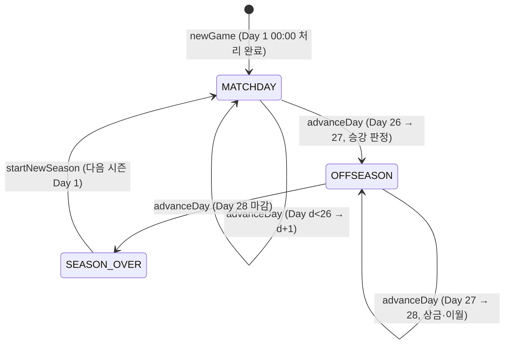
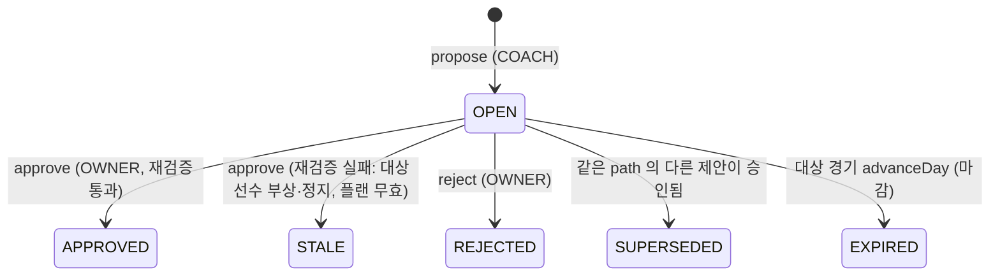

# 킥오프 FM Phase 0 프로토타입 아키텍처

- 대상: 기획서 v2 **12.3 Phase 0 프로토타입 범위**와 참조 절(3.6, 4, 4.7, 5.0, 6, 7, 8)
- 스택(고정): React 18 + TypeScript(strict) + Vite + Vitest. 서버 없음. 로컬 목 백엔드(순수 TS 서비스 + localStorage)
- 계약 버전: `CONTRACT_VERSION = 1.2.0` (`src/services/api.ts`, 변경 이력은 16장). 엔진 `0.4.0`, 세이브 스키마 `2`
- 표기: `[PH]` = 기획서 제안 기본값 또는 이 문서가 임시로 정한 값(튜닝 대상). `[해석]` = 기획서가 모호해서 이 문서가 정한 해석

---

## 0. 요약

| 항목 | 결정 |
|---|---|
| 구조 | 4레이어 단방향: `types ← engine ← domain ← services ← ui`. 테스트(`tests/architecture.test.ts`)가 import 방향을 강제한다 |
| 엔진 | 순수 TS, 결정적 시드(mulberry32), 외부 패키지·React·Date·Math.random 금지. 서버 단계로 그대로 옮긴다(8.7) |
| 백엔드 모양 | `GameService` 파사드. CBT 서버 API 이름(`submitPlan`, `advanceDay`, `getReport`, `propose`, `approve`)을 그대로 쓴다. 동기 호출 + `subscribe` |
| 상태 | 단일 `GameState` 문서. domain 순수 함수가 `state → state'`를 계산하고 services가 저장·통지만 한다 |
| 영속화 | localStorage 1키(`kickoff-fm/save/v1`), 시즌당 2MB 미만 예산. 결정 로그는 저장하지 않고 재시뮬로 복원 |
| 병렬 개발 | A(Backend Architect): engine·domain·services·scripts·tests / B(Frontend Developer): ui·main.tsx·스타일. 공유 계약 = `src/types/**` + `src/services/api.ts` + `src/services/index.ts` |

---

## 1. 실행 명령

| 명령 | 내용 |
|---|---|
| `npm run dev` | Vite 개발 서버 (모바일 확인은 `--host` 후 휴대폰 접속) |
| `npm run build` | `tsc --noEmit && vite build` |
| `npm run typecheck` | `tsc --noEmit` |
| `npm test` | Vitest 1회 실행 (아키텍처 경계 테스트 포함) |
| `npm run sim:batch -- --n 2000 --cap 0.35 --seed 42 [--scenario A,B] [--json sim-out/r.json] [--strict]` | 8.1 보정 목표 몬테카를로 (12장) |

---

## 2. 폴더 구조

```
kickoff-fm/
├─ index.html                     # 모바일 viewport(viewport-fit=cover), lang=ko          [B]
├─ package.json / tsconfig.json / vite.config.ts / vitest.config.ts                     [아키텍트 → A 관리]
├─ scripts/
│  └─ sim-batch.ts                # 8.1 보정 배치 CLI (tsx)                               [A]
├─ tests/                                                                                [A]
│  ├─ architecture.test.ts        # 레이어 의존 방향 + 엔진 결정성 정적 검사 (구현 완료)
│  ├─ engine/  rng.test.ts(구현 완료), engine.test.ts(todo 목록)
│  └─ domain/  domain.test.ts(todo 목록)
├─ src/
│  ├─ types/            ★공유 계약. 타입 전용(런타임 코드 금지)
│  │  ├─ common.ts      # ID, Kc, Step, Lane, GameTime, GameTimestamp
│  │  ├─ player.ts      # Player, Attributes(15키), FitLevel, Contract
│  │  ├─ tactics.ts     # FormationId(6), RoleId(14), TeamInstructions, TacticSlot, TacticCap, BotStyleTag
│  │  ├─ plan.ts        # MatchPlan, ConditionalOrder, OpponentOrders, PlanRecord, ResolvedPlan
│  │  ├─ engine.ts      # SimulateInput, EngineTeamInput, DecisionLog, MatchResult, ValueTable, MatchExplanation
│  │  ├─ league.ts      # Club, Fixture, MatchSummary, StandingRow, SeasonOutcome, OpponentScout
│  │  ├─ economy.ts     # TierEconomy, Finance, LedgerEntry, FinanceSummary, CarryOverResult
│  │  ├─ coach.ts       # Seat, Membership, Proposal, PlanChangePatch, ActionKind, PermissionResult
│  │  ├─ report.ts      # MatchReport(블록 1·2·3·4·5·6·8), MatchReplay
│  │  ├─ calibration.ts # CalibrationOptions/Report, ScenarioId
│  │  ├─ catalog.ts     # UI용 정적 카탈로그
│  │  ├─ game.ts        # GameState, GamePhase, DayStep, DayResult, PlanState, GameErrorCode
│  │  └─ index.ts
│  ├─ engine/           # 순수 시뮬레이션 (8장)                                         [A]
│  │  ├─ data/constants.ts   # 모든 튜닝 상수 (기획서 수치 입력 완료)
│  │  ├─ data/roleWeights.ts, formations.ts, shooterWeights.ts, valueTable.ts   (A 추가 예정)
│  │  ├─ rng.ts (구현 완료) · math.ts (구현 완료)
│  │  ├─ units.ts · rules.ts · decide.ts · sequence.ts · simulate.ts · explain.ts
│  │  └─ index.ts            # 엔진 공개 API
│  ├─ domain/           # 게임 규칙 (리그·스쿼드·플랜·경제·코치·감독 AI·리포트·하루 진행)  [A]
│  │  ├─ league/ schedule.ts standings.ts promotion.ts
│  │  ├─ squad/  generator.ts condition.ts
│  │  ├─ plan/   resolvePlan.ts engineInput.ts
│  │  ├─ economy/economy.ts  (TIER_ECONOMY 표 입력 완료)
│  │  ├─ coach/  permissions.ts proposals.ts
│  │  ├─ ai/     managerAi.ts
│  │  ├─ report/ buildReport.ts commentary.ts
│  │  ├─ calibration/runCalibration.ts
│  │  ├─ day/    advanceDay.ts   # 하루 진행 상태 머신
│  │  └─ index.ts
│  ├─ services/         # 로컬 목 백엔드                                                  [A]
│  │  ├─ api.ts          ★공유 계약: GameService 인터페이스
│  │  ├─ index.ts        ★공유 계약: UI가 import 하는 유일한 파일
│  │  ├─ errors.ts       # GameError(code)
│  │  ├─ ports.ts        # StoragePort(localStorage/메모리), Clock
│  │  ├─ gameService.ts  # LocalGameService (현재 TODO 스텁)
│  │  └─ workers/calibration.worker.ts
│  ├─ ui/               # React                                                           [B]
│  │  ├─ app/App.tsx     # 빈 셸(하단 탭 5개)
│  │  └─ styles/global.css
│  └─ main.tsx                                                                           [B]
└─ docs/ 기획서_v2.md, 아키텍처.md
```

---

## 3. 모듈 경계와 의존 방향

```
         ┌────────────────────────── src/types (타입 전용, 모두가 참조) ──────────────────────────┐
         │                                                                                        │
   [engine] ◀── [domain] ◀── [services] ◀── [ui] ◀── main.tsx
   순수 시뮬      게임 규칙      파사드·영속화     React 화면
```

| 레이어 | import 허용 | 금지 | 책임 |
|---|---|---|---|
| types | types | 전부 | 계약. `export const/function/class` 금지(테스트로 검사) |
| engine | types, engine | 외부 패키지, domain 이상, `Math.random`·`Date`·`performance` | 한 경기 시뮬레이션, 유닛 계산, 8.8 기여도 분해 |
| domain | types, engine(`engine/index.ts`) | 외부 패키지, services, ui, 시계·난수 직접 사용 | 일정·순위·승강, 선수 생성·컨디션, 4.7 플랜 결정, 경제, 권한·제안, 감독 AI, 리포트·중계 문장, 하루 진행 상태 머신 |
| services | types, engine, domain | ui | `GameService` 구현, 권한 검사 호출, 원자적 상태 교체, 영속화, 행동 로그, 워커 |
| ui | types, `services/index.ts` 만 | engine, domain, services 내부 파일 | 화면·상호작용. 계산을 하지 않는다(4.7 미리보기도 서비스 호출) |

규칙:
- **시간과 난수는 주입한다.** domain/engine은 `Rng`와 `GameTime`만 받는다. 실제 시각(행동 로그)은 services의 `Clock` 포트가 만든다.
- **UI는 GameState를 수정하지 않는다.** `getSnapshot()`은 읽기 전용이며, 상태 변경은 서비스 메서드로만 한다.
- **엔진은 도메인 개념(구단 재정, 제안, 일정)을 모른다.** domain의 `toEngineTeamInput`이 번역 경계(반부패 계층)다.
- 강제 수단: `tests/architecture.test.ts` (레이어 import 방향, UI의 services 내부 import 금지, types 런타임 코드 금지, engine/domain 비결정 API 금지).

---

## 4. 핵심 데이터 모델

전체 정의는 `src/types/*.ts`. 여기서는 불변식과 설계 이유만 적는다.

### 4.1 선수 (`Player`)
- 능력치 키 15개 = 필드 12(패스·드리블·결정력·크로스·태클 / 시야·위치선정·침착성·활동량 / 속도·체력·피지컬) + GK 3(선방·공중 장악·킥). **기획서는 "14종"이라 쓰지만 나열은 15개**라서 15키로 고정했다(기획 확인 필요, 15장).
- `ovr`는 표시 전용 캐시. 엔진은 쓰지 않는다. `potential`은 UI 노출 금지(`scoutRange`만 노출).
- `condition` 0~100, `morale` −2..+2, `availability.injuryDays / suspendedMatches`.

### 4.2 전술 (`TacticSlot`)과 플랜 (`MatchPlan`)
- 팀 지시는 **구단 소유 슬롯 A/B**(`Club.tactics`)에 있고, 플랜은 "어느 슬롯으로 시작할지"만 가진다. 슬롯 숙련도가 슬롯 단위라서 이렇게 나눴다(4.4-4).
- `MatchPlan.lineup.starters[i]` ↔ 시작 슬롯 포메이션의 `FormationSlot.index = i`. 슬롯 전환(조건부 지시)으로 포메이션이 바뀌면 엔진이 경기장 위 11명을 새 포메이션 슬롯에 **적합도 최대 탐욕 배정**으로 다시 앉힌다.
- 초안(`DRAFT`)과 확정본(`CONFIRMED`)은 `GameState.plans[clubId]`에 "다음 경기 1건" 기준으로 저장하고, 그 경기가 처리되면 비운다(예약 플랜·플랜 저장소는 Phase 0 제외).
- `OpponentOrders.opponentId`로 "어느 상대 기준으로 작성했는가"를 기록해 4.7 ②-1 초기화를 판단한다.

### 4.3 경기 결과
- 엔진 출력 `MatchResult`는 결정 로그(`DecisionLog[]`, 경기당 약 500~700개)를 포함한다.
- **영속 대상은 `MatchSummary`(모든 경기, 약 0.7KB)와 `StoredMatchRecord`(사용자 구단 경기만: 양 팀 `EngineTeamInput` + 적용 플랜 + 리포트)**. 결정 로그는 저장하지 않는다. 중계 재생·개발자 재시뮬은 저장된 입력과 시드로 다시 시뮬레이션해 같은 로그를 얻는다(ADR-002).

### 4.4 게임 상태 (`GameState`)
- 단일 문서: 구단 14, 선수 약 310, 일정 182, 요약, 기록, 플랜, 재정, 멤버십 2, 제안, 시즌 이력, 행동 로그.
- `seq`는 게임 내 사건 순서 카운터(`GameTimestamp`). 제안·플랜 기록의 선후 비교에 쓴다.
- `phase`: `MATCHDAY`(Day 1~26) / `OFFSEASON`(Day 27·28) / `SEASON_OVER`(Day 28 처리 완료, 새 시즌 대기).
- 크기 예산(시즌 1회 기준): 선수 약 220KB + 요약 약 130KB + 사용자 경기 기록 약 300KB + 행동 로그(최대 5,000건) 약 500KB → **2MB 미만**. 새 시즌 시작 시 지난 시즌의 `summaries`·`records`는 버리고 `SeasonOutcome`만 남긴다. 행동 로그는 새 시즌 전에 내보내기를 안내한다.

### 4.5 식별자
- `MatchId = s{season}-d{day}-{homeId}-{awayId}` (`makeMatchId`). 시드는 `seedFrom(gameSeed, matchId, ENGINE_VERSION)`.
- 사용자: `u-owner`(구단주), `u-coach`(코치, roleLabel TAC). 로컬 역할 전환은 `actorUserId`만 바꾼다.

---

## 5. 시뮬레이션 엔진 (기획서 8장 구현 명세)

### 5.1 공개 API

```ts
simulateMatch(input: SimulateInput): MatchResult            // 순수, 결정적
explainMatch(result: MatchResult, values: ValueTable): MatchExplanation
computeUnits(onPitch, slot, redCards): Units
```
`EngineConfig`: `tacCap`(0.25/0.35/0.50), `tacticsEnabled`, `disabledRules`, `onlyRules`, `neutralVenue`, `engineVersion`. 상수는 전부 `engine/data/constants.ts`(기획서 수치 입력 완료). 값을 바꾸면 `ENGINE_VERSION`을 올린다.

### 5.2 경기 루프

```
rng = mulberry32(input.seed)
totalSeq = round(100 × tempoFactor × (1 + U(−0.08, +0.08)))
  tempoFactor = 1 + 0.075 × mean(home.tempo, away.tempo)        // 0.85..1.15, 양 팀 공통
seqPerSeg = 18 등분(나머지는 rng로 배분)
attacker = coinFlip ? home : away ; startZone = 0
for seg in 0..17:
  recomputeUnits(home), recomputeUnits(away)                      // 컨디션 효율·교체·퇴장·지시 변화 반영
  for s in 0..seqPerSeg[seg]-1:
    r = runSequence(attacker, defender, minute = seg*5 + s*5/seqPerSeg[seg])
    (attacker, startZone) = nextPossession(r)
  applyFatigue(home, away)                                       // 5.5
  rollInjuriesAndRedCards(seg)                                   // 5.5
  evaluateTriggers(home), evaluateTriggers(away)                  // 조건부 지시 (seg 경계 = 5·10·…·90분)
  autoSubstitute(home), autoSubstitute(away)
return buildResult(log, events)
```

`nextPossession`: 골 → 실점 팀이 Z0에서 / 슈팅 무득점·세트피스 종료 → 수비 팀 Z0 / 턴오버(구역 z) → 수비 팀이 `2 − z`에서 시작(미러링, 8.4). `2 − z = 2`면 바로 DP3부터.

### 5.3 결정 지점 (모든 확률은 `decide()` 하나로 계산)

```ts
function decide(dp, actor, opp, ctx): boolean {
  const [a, d] = pairFor(dp, actor, opp, ctx)
  const strength = K * (a - d) + matchupTerm(dp, ctx)          // DP4 유형별 매치업 포함
  const prep = MORALE_STEP_MOD * actor.morale - 0.05 * (1 - fam(actor)/100)   // [-0.09, +0.04]
  const home = config.neutralVenue ? 0 : actor.isHome ? 0.04 : 0
  const base = BASE[dp] (+ LONG 유형이면 DP4에 +0.60)
  const raw = applyRules(dp, actor, opp, ctx)                   // RULES_BY_DP[dp] 만 평가, disabled/onlyRules 적용
  for (k in raw) if (raw[k] > 0) raw[k] *= 0.5 + 0.5 * fam(actor)/100   // famCoef: 긍정 효과에만
  const tac = config.tacticsEnabled ? clamp(sum(raw), -cap, +cap) : 0     // ★ 전술 상한
  const logitNoTac = base + strength + prep + home
  const p = clamp(sigmoid(logitNoTac + tac), 0.05, 0.95)        // DP5는 [0.01, 0.85]
  const success = rng() < p
  log.push({ kind:'BINARY', dp, actor, a, d, base, strength, prep, home, logitNoTac, raw, tac, p, success, ... })
  return success
}
```

| DP | actor(성공을 원하는 팀) | 유닛 쌍 (A, D) | BASE | 추가 항 |
|---|---|---|---|---|
| DP1 | 공격 | BU vs PRS | +1.10 | — |
| DP2 | 공격 | PRG vs MID | +0.20 | — |
| DP3 | 공격 | (다항 로짓, 5.4) | — | — |
| DP4 | 공격 | CRE vs BOX | −0.40 | CROSS: K(AER_A−AER_D) / THROUGH: K(PACE_A−PACE_D) / SOLO: K(드리블러 eff 드리블 − 상대 BOX 기여 선수 평균 eff 태클) / LONG: BASE +0.60 / CUTBACK: 없음 |
| DP5 | 공격(슈터) | — | logit(xG_유형) | +0.03 × (FIN_슈터 − GK). CORNER는 +K(SPA−SPD) `[해석]` |
| DP6 | **공을 뺏은 팀** | PACE_A(탈취 팀) vs PACE_D(뺏긴 팀) | −1.40 | Z1 이상 턴오버에서만 판정 |
| DP7 | 공을 뺏은 팀 | PACE_A vs PACE_D | 0.00 | 성공 → 찬스 유형 COUNTER로 DP5 |
| DP8 | 공격(점유 유지) | CTRL vs PRS | Z0 −0.40 / Z1 −0.62 | 시퀀스당 리셋 최대 2회. 성공 = 한 구역 뒤로 리셋 |

- `prep`는 **actor 팀 것만** 쓴다(8.4 공식 그대로). `FIN_슈터` = 슈터 eff(결정력 .5, 침착 .3, 위치선정 .2).
- Z2 실패 분기(DP4 실패): 기본 코너 25% / 프리킥 8% / 턴오버 67%, 크로스 유형은 40/8/52 `[PH]`. 코너·프리킥은 해당 유형으로 바로 DP5.
- 페널티킥: DP4 성공한 박스 내 유형(CROSS·THROUGH·CUTBACK·SOLO)의 2.5%가 PK(xG 0.76)로 바뀐다.

### 5.4 DP3 찬스 유형 선택

```
side = pickSide(att.orders.attackSide)     // 기본 L/C/R 35/30/35, R10 지정 시 지정측 55 / 중앙 25 / 반대 20
for t in [CROSS, THROUGH, CUTBACK, LONG, SOLO]:
  baseLogit[t] = ln(CHANCE_BASE_WEIGHT[t]) + roleAdj(t)     // 역할 보정: 윙어·오버래핑 FB·타깃맨→CROSS, 침투형→THROUGH,
                                                            // 인사이드→CUTBACK, AM→LONG, 드리블 상위→SOLO. 크기 ±0.3 [PH]
  raw[t] = R2(THROUGH +0.15), R3(LONG·CROSS +0.15), R4(CROSS·CUTBACK +0.15) ... × famCoef(양수만)
  tac[t] = clamp(Σ raw[t], −cap, +cap)                      // 유형마다 상한
P(t) = softmax(baseLogit + tac)
log.push({ kind:'CHOICE', baseLogits, tacByType, rawByType, chosen })
```

### 5.5 유닛·컨디션·교체·징계

- `eff(attr) = attr × 5 × FIT_MULT[fit] × condEff(condition)`, `condEff`: ≥90 → 1.00, 90→60 선형 1.00→0.85, <60 → 0.80.
- 유닛 = 역할 가중치 파일(`engine/data/roleWeights.ts`)로 가중 평균(8.3 표). R9 마커는 다른 유닛 기여 × 0.8. 퇴장 인원당 모든 유닛 × 0.9 `[PH]`.
- 스쿼드-전술 적합도(8.3-4): 압박 +2 & PRS < 65 → R1 × PRS/65 / 라인 +2 & PACE_D < 60 → `LINE_FIT` 규칙(DP4 THROUGH·DP7에 공격 측 +0.10) / 패스 −2 & BU < 60 → R7의 DP8 리셋 가산 × BU/60 / 폭 +2 & 측면 크로스·속도 평균 < 60 → R4 × 비율.
- 체력: 세그먼트마다 `(30 + 3 × press + 역할 보정(박스투박스 +3) + 마커 +4) / 18` 감소. 교체 투입 선수는 투입 이후 세그먼트만.
- 자동 교체: 세그먼트 경계에서 컨디션 ≤ `autoSubThreshold`(기본 55) 인 선수를 같은 포지션 벤치 최고 적합자로 교체. 최대 5명, 교체 창 3회(하프타임 교체는 창 소모 없음).
- 부상: 선수별 경기 확률 0.8%(컨디션 < 60이면 ×2)를 18등분해 세그먼트마다 판정, 기간 1~7일 균등 `[PH]`. 퇴장: 팀당 경기 6% `[PH]`, 다음 1경기 정지.
- 조건부 지시: 세그먼트 경계에서 위에서부터 평가, 지시당 경기 1회. `SWITCH_SLOT`(슬롯 숙련도 사용, 선수 재배정), `MENTALITY_DELTA`(현재 값에 더해 −2..2 clamp), `HT_ADJUST`(TIME=HT 전용, 템포/압박 ±1). 발동 시 `TRIGGER_FIRED` 이벤트.

### 5.6 전술 상성 규칙 (엔진 0.4.0, actor 관점 부호, + = actor 유리)

규칙 정의·실제 축구 논리는 `docs/실축구_전술설계.md` 2.2, 확정 수치는 `src/engine/data/constants.ts` 의 `RULES`·`RULES_BY_DP` 가 원본이다(이 표는 구조만 요약한다).

| 규칙 | DP | 0.4.0 구조 (선수·역할 결합) |
|---|---|---|
| R1 압박 vs 빌드업 | DP1·DP8 (수비 압박), DP6 (역압박 전환) | 수비 press ≥ 1 & 공격 directness ≤ 0. g = clamp(0.5 + (PRS + 3×프레싱 포워드 − BU)/20). 압박 저항 역할(스위퍼 GK·볼플레잉 CB·레지스타·딥 플레이메이커·인버티드 FB) 1명당 감쇠, 3백 vs 전방 압박 ≤ 2 × 0.7. DP6 는 잃은 팀 directness ≤ 0 일 때만 |
| R2 뒷공간 | DP1·DP3(스루) / 역효과 DP1·DP2 | 공격 directness ≥ 1 & 수비 line ≥ 1. 크기 × paceMult = clamp(1 + (최고 러너 속도 − 최저 CB 속도(커버 CB 가중))/scale) × 스위퍼 GK(속도 ≥ 10: 0.5, 아니면 0.75) × 3백 vs 2톱 배수. 수비 line ≤ −1 이면 롱볼 역효과 |
| R3 로우 블록 | DP4 (−), DP3·DP4 크로스·DP5 중거리 (해답), DP2 (비용) | 수비 line ≤ −1 & mentality ≤ 0 & 공격 directness ≤ −1. comp = BOX − CRE 배수, 크로스 해답 = 공중전 차 tanh, 중거리 해답 = 최고 중거리 능력 |
| R4 측면 과부하 | DP3·DP4 크로스·컷백 | O = 공격 측면 wA − 수비 맞은편 wD (역할 형태값 + 폭 지시). \|O\| > 0.2 양방향(수비 측면 우위는 negMult 배로 −) |
| R5 공격 성향 ↔ 역습 | DP4 (성향 ±), DP6·DP7 (처벌) | 공격 성향은 양방향 DP4 가산. 처벌: 잃은 팀 mentality ≥ 1 & 탈취 팀 counter. × 잔류 수비 RD(앵커·볼 위닝·인버티드 FB), DP7 은 러너 vs CB 속도 |
| R6 오프사이드 트랩 | DP4 스루 (−), DP5 (+) | 수비 offsideTrap & 공격 러너 ≥ 1. × (1 − 침투 숙련) × 2선 침투 역할 0.6 × 느린 CB(최저 < 13) 0.5 |
| R7 중앙 통제 | DP2·DP8 | 공격 directness ≤ 0. C = cA(공격) − cD(수비, 2톱 커버 섀도·라인 +2 압축 포함). tanh(C/scale) 포화 |
| R9 집중 마크 / R10 공략 측면 / TEMPO | 0.3.0 과 같음 | — |
| R11 하프스페이스 (신규) | DP2·DP3·DP4 | H = hs(공격) − hsC(수비, 5백·3백 가산) − offset > 0 |
| R12 측면 1:1 (신규) | DP4 돌파·크로스(해당 측), DP7 | 수비 해당 측이 윙백·공격형 풀백 & 수비 mentality ≥ 0 & 공격 해당 측 윙 역할. 윙어 vs 수비수 속도·드리블 매치업 |
| R13 타깃맨 롱볼 (신규) | DP1·DP2 | 공격 directness ≥ 1 & 타깃맨. 타깃맨 공중 vs AER_D (상대 압박 시 × 1.25), 세컨드볼 = MID + 볼 위닝·박스투박스 수 |
| LINE_FIT | DP4 스루·DP7 | 수비 line ≥ 2 & (PACE_D < 60 또는 최저 CB 속도 < 11) |

- **구조 보정 (전술 cap 밖, 0.4.0)**: 추가시간(세그먼트 9·18 시퀀스 × 1.5 · 2.1, 이벤트 `addedMinute`), 후반 개방도 `LATE_DRIFT`(DP4·DP7 BASE), 경기 흐름 `STATE_MOD`(60분 이후 스코어 기반, 로그 `state`, 기여도 막대 `state`), 홈 이점 `HOME_MOD`, 경고(파울 기회마다 판정, 2경고 퇴장, 별도 RNG 스트림).
- **표시 판정 (결과 불변)**: 유효슈팅(`SOT_Q`), 빗나간 슈팅의 코너, 실패한 스루·역습의 오프사이드 표기, 시간 가중 점유(`POSSESSION_WEIGHT`). 메인 RNG 와 분리된 스트림을 써서 표시 상수를 바꿔도 결정 로그·스코어가 같다(Vitest 로 검사).
- 팀 형태값 `TeamShape`(엔진 내부, `units.ts computeShape`)는 경기 시작·세그먼트 경계·교체·퇴장마다 다시 계산한다.
- R8은 v2에서 삭제. 템포는 시퀀스 수(경기 길이)와 DP8에만 작용한다.
- **모든 전술 효과는 위 raw → clamp(±cap) 경로로만 들어간다.** 다른 경로(확률 직접 수정, 경합 생략)를 만들면 리뷰에서 거부한다.
- 규칙별 발동 수(`ruleFires`)는 raw가 0이 아닌 결정 수를 수혜 팀 기준으로 센다.

### 5.7 승부 요인 기여도 (8.8) — `explainMatch`

```
for each BINARY log L (actor = X, opp = Y):
  p0 = sigmoid(L.logitNoTac); p1 = L.p; Δtac = p1 − p0
  S = Σ L.raw; a_i = (S == 0) ? 0 : raw_i × L.tac / S          // clamp 비례 배분 → Σ a_i = tac
  g = (L.tac == 0) ? p0(1−p0) : Δtac / L.tac
  Δp_i = a_i × g                                               // Σ Δp_i = Δtac (정확히 보존)
  V = VALUE(L.dp, L.zone, L.chance)                            // DP5는 V = 1 (Δp가 곧 xG)
  xg_i = Δp_i × V → X에 +xg_i, Y에 −xg_i
  막대: pb = sigmoid(base); 전력 = sigmoid(base+strength) − pb
        준비 = sigmoid(base+strength+prep+home) − sigmoid(base+strength); 전술 = Δtac   (각 × V, X +, Y −)
for each CHOICE log C:
  P_with = softmax(baseLogits + tacByType); P_without = softmax(baseLogits)
  for t: ΔP_t = P_with[t] − P_without[t]; 규칙 i 몫 = ΔP_t × (raw_i,t / Σ raw_t) (Σraw_t=0이면 0)
  xg_i += Σ_t 몫_i,t × chanceEv[t]
운 = (GF − GA) − (xGF − xGA)
conservationError = Σ|Σ_i Δp_i − Δtac| (테스트: < 1e-9)
```
- **VALUE 테이블**(`engine/data/valueTable.ts`): 엔진 버전별로 10만 시퀀스 몬테카를로를 돌려 `E[이후 순 xG | 성공] − E[… | 실패]`를 구한다. `sim:batch`에 `--build-values` 모드를 추가해 파일을 생성한다(A). 최초 값은 기획서 추정치(DP1 0.04, DP2 0.07, DP4 0.13)로 시작한다.
- 네 막대의 합은 VALUE 근사라 실제 득실 차와 정확히 같지 않다. 테스트는 ±0.3 허용오차로 본다.

### 5.8 리포트 조립 (domain/report)

| 블록 | 계산 |
|---|---|
| 1 결과 요약 | TeamMatchStats |
| 2 운 지표 | 운 ≤ −1.0 UNLUCKY / ≥ +1.0 LUCKY / 그 외 NEUTRAL `[PH]` |
| 3 승부 요인 Top 3 | 규칙별 순 xG |절댓값| 상위 3. count = 실제 판정 이벤트(R6 → 오프사이드, R2 → 롱볼 전진, R5 → 역습) 또는 발동 수, leagueAvgCount = 시즌 요약의 팀·경기당 평균 |
| 4 요소별 막대 | 5.7의 전력/준비/전술/운 |
| 5 구역 흐름 | Z0/Z1/Z2 통과율 vs 시즌 리그 평균 |
| 6 타임라인 | GOAL, TRIGGER_FIRED, SUBSTITUTION, CONDITION_DROP(< 60 최초), INJURY, RED_CARD |
| 8 다음 경기 제안 | 우리에게 가장 불리한 규칙 1~2개의 파훼법 문장 + `instructionPatch`(예: R1 → directness +2, R5 → mentality 0, R3 → width +2, R6 → tempo −1) |
| 시즌 기대 승점 | 경기별 xG로 독립 포아송(0~10골) 승·무 확률 → xPts 누적 vs 실제 승점 |

### 5.9 결정성 규칙
1. 엔진 안의 무작위는 전부 `rng()` 하나에서, **호출 순서가 고정된 코드 경로**로만 소비한다(객체 키 순회 순서에 의존하지 않도록 배열 순서를 쓴다).
2. 입력 배열 순서(선발·벤치)도 결과에 영향을 준다. `toEngineTeamInput`이 정렬 규칙을 고정한다(슬롯 인덱스 순, 벤치는 입력 순).
3. 하루 7경기는 `matchId` 사전순으로 처리한다(경기 간 상태 공유 없음 → 순서 무관이어야 하지만 방어적으로 고정).
4. 골든 테스트: 시드 3개의 `MatchResult` JSON 해시를 스냅샷으로 저장. 엔진 버전을 올릴 때만 갱신한다.

---

## 6. 게임 상태 머신 (하루 진행)

### 6.1 영속 국면



`MATCHDAY` 상태 = 기획서 3.1의 "00:00 이후 ~ 20:50 이전" (플랜 편집 가능). 버튼 한 번이 "20:50 마감 → 시뮬 → 21:15 결과 → 다음 날 00:00 처리"를 한 트랜잭션으로 실행한다.

### 6.2 `advanceDayState(state)` 내부 단계 (`DayStep`)

**MATCHDAY (Day d, 1 ≤ d ≤ 26)**

| # | 단계 | 처리 | 기획서 |
|---|---|---|---|
| 1 | DEADLINE | `expiresAt.day == d`인 OPEN 제안 → EXPIRED (로그) | 5.0.2 |
| 2 | RESOLVE_PLANS | 사용자 구단: `resolvePlan`(4.7 ①②). 봇 13팀: `managerAi.buildPlan(mode='BOT', 상대 스카우트)`를 확정본으로 넣고 같은 `resolvePlan` ② 보정 적용 | 4.7, 6.6 |
| 3 | SIMULATE | 그날 7경기: `seed = seedFrom(gameSeed, matchId, ENGINE_VERSION)`, `toEngineTeamInput` → `simulateMatch` (matchId 순) | 8 |
| 4 | APPLY_RESULTS | ① `MatchSummary` 저장 ② 선수: `applyMatchLine`(컨디션·부상·퇴장 정지·스탯, 출전 안 한 선수의 정지 경기 −1) ③ 사기: 승 +1 / 패 −1 / 무 0 쪽으로 1단계 `[PH]` ④ 숙련도: 사용 슬롯 +6 (경기 중 전환된 슬롯 포함) ⑤ 경제: 전 구단 승/무/패 수당 ⑥ 사용자 경기: `explainMatch` → `buildReport` → `StoredMatchRecord` ⑦ `club.lastUsedPlan` = 적용 플랜(맞춤 지시 제거) ⑧ `plans[club]` 비우기 | 4.2, 4.4, 7.4 |
| 5 | SEASON_JUDGEMENT | d = 26일 때만: `computeStandings` → `judgeSeason` → `pendingOutcome` | 6.2, 6.5 ①② |
| 6 | ROLLOVER | `day = d + 1` | — |
| 7 | DAILY_PROCESSING | 전 선수 회복(+14 + 체력 보정 0~6), 부상 일수 −1, 미사용 슬롯 숙련도 −2, 연봉 일할 차감(전 구단). Day 27이면 순위 상금·우승 수당 입금 | 3.1, 6.5 ③ |

**OFFSEASON**
- Day 27 → 28: DAILY_PROCESSING(28): 연봉 차감 후 **이월 판정**(`carryOver`: R = 잔액, C = 배정금 × 20%, 초과분 → `transferOnlyBudget`). phase는 OFFSEASON 유지.
- Day 28 → SEASON_OVER: 날짜는 바꾸지 않고 phase만 바꾼다. `DayResult.seasonOutcome`으로 시즌 종료 화면을 띄운다.

**`startNewSeasonState` (SEASON_OVER에서만)**
1. `pendingOutcome` → `seasonHistory`, 지난 시즌 `summaries`·`records` 폐기.
2. 사람 선수: 나이 +1, 성장·노화(16~23 성장 / 24~29 정점 / 30+ 하락 `[PH]`), 계약 −1(만료 선수 처리 Phase 0: 자동 1시즌 재계약 `[해석]`, 이적 시스템이 없으므로).
3. 봇 13팀 폐기·재생성(성향 분포 유지).
4. 새 일정 생성(새 시즌 번호로 rng 파생).
5. Day 1 00:00: 기본 배정금 입금, 일일 처리. Day 3 00:00에 `transferOnlyBudget` 소멸(LP 표시).
6. **티어 이동 없음**(12.3). 승강 라벨과 보상만 보여준다.

### 6.3 원자성과 멱등
- `advanceDayState`는 입력 상태를 바꾸지 않고 새 상태를 돌려준다(구조적 공유 허용, 제자리 수정 금지). services는 `save` 성공 후에만 스냅샷을 교체한다. 저장 실패(용량 초과) 시 이전 상태를 유지하고 `GameError('STORAGE_FULL')`.
- 같은 상태에서 두 번 실행하면 같은 결과가 나온다(시드가 상태에서만 유도됨). 테스트로 검사한다.
- `advanceDays(n)`, `advanceToSeasonEnd()`는 단계를 반복하되 **저장은 마지막에 1회**, 리스너 통지도 1회.
- `SEASON_OVER`에서 `advanceDay` → `GameError('INVALID_PHASE')`.

### 6.4 4.7 플랜 결정 (`resolvePlan`) — 마감과 미리보기가 같은 함수

```
① 후보: plans[club].confirmed → club.defaultPlan → club.lastUsedPlan(맞춤 지시 제거) → managerAi SYSTEM_DEFAULT
   (초안은 절대 쓰지 않는다)
② 보정(순서 고정, 각 보정은 PlanAdjustment 로 기록):
   1. opponentOrders.opponentId ≠ 오늘 상대 또는 markTarget 이 상대 명단에 없음 → 제거 (OPP_ORDERS_CLEARED)
   2. 부상·징계 선발/벤치 → 같은 슬롯 역할 적합도 최고 가용 선수 (UNAVAILABLE_REPLACED)
   3. autoRotation ON: 경기 전 컨디션 < 70 선발 → 벤치/비엔트리 중 대체 (AUTO_ROTATION)
   4. 11명 미만·GK 없음·중복 등 → 감독 AI 최소 보정 (VALIDITY_FIX)
   5. 빠진 선수를 참조하는 조건부 지시 → enabled=false (CONDITIONAL_DISABLED)
③ source 와 adjustments 를 담은 ResolvedPlan 반환 → 홈 카드 "지금 마감되면 적용될 플랜"
```
"추천대로"(`recommendPlan`) = ② 보정만 적용한 현재 유효 플랜(상대 맞춤 없음). UI가 받아서 `submitPlan`으로 확정한다.

---

## 7. 최소 경제 (기획서 7장)

| 항목 | 구현 |
|---|---|
| 티어 | `settings.tier` 기본 **T3**(승격·강등 라벨이 모두 나오는 티어). `TIER_ECONOMY` 표는 7.4.1·7.4.2 수치 입력 완료 |
| 단위 | KC 정수. 1M = 1,000,000 |
| 기본 배정금 | Day 1 00:00 입금 |
| 연봉 | 매일 00:00 `round(연봉 합 / 28)`, Day 28에 28일 합계 오차 보정 |
| 경기 수당 | 결과 적용 시 승/무/패 수당(모든 참가 구단) |
| 상금 | Day 27 00:00: 순위 상금(1위 20%, 2~3위 15%, 4~6위 10%, 7~10위 6%, 11~14위 3%) + 우승 수당 10% |
| 이월 | Day 28 00:00: `carried = min(R, C)`, `excess = R − carried` → `transferOnlyBudget`(표시만, 다음 시즌 Day 3 소멸) |
| 지출 가능액 B | `잔액 − 연봉 합 × 남은 일수 / 28` (예약·위약금은 Phase 0에 없음) |
| 재정 화면 | `FinanceSummary`: 잔액, 한정 예산, B, 캡 사용률, 시즌 수입/지출, 예상 이월, 최근 원장 |
| 선수 연봉 생성 | 사람 팀 연봉 합 ≈ 캡의 94%(7.5), 봇은 전력 비례 `[PH]` |

**경제 게이트 주의**: 12.3의 "중위권 순유입 비율 1.05~1.10"은 이적료·FA·갱신 보너스 싱크를 전제로 한다. Phase 0에는 연봉 외 싱크가 없어 비율이 약 1.4로 나온다. Phase 0 게이트는 **"시즌 수입 / 캡"을 7.4.1 성적별 표(최하위 1.14배 ~ 우승 1.62배)와 ±3% 안에서 비교**하는 대체 지표로 측정할 것을 제안한다(15장 확인 필요).

---

## 8. 코치 권한 체크와 제안 흐름 (5.0)

### 8.1 로컬 역할 전환
- 멤버십 2개: `u-owner`(OWNER), `u-coach`(COACH, roleLabel TAC). 코치는 합류 24시간이 지난 것으로 간주(`joinedAt = season 0`)해 열람 제한이 없다.
- `switchRole('OWNER' | 'COACH')`는 `actorUserId`만 바꾸고 `ROLE_SWITCHED` 로그를 남긴다. UI는 `getActor().seat`로 화면을 분기한다(코치: 편집 대신 "제안하기").

### 8.2 `checkAction(membership, action, ctx)` — 서비스의 모든 변경 메서드가 첫 줄에서 호출

| ActionKind | OWNER | COACH | COACH_SPECTATOR | 거부 코드 |
|---|---|---|---|---|
| VIEW_TODAY_PLAN | ✓ | ✓ (합류 24h 이내면 마감 후만) | ✗ | NEW_COACH_LOCK / SPECTATOR |
| EDIT_PLAN · SUBMIT_PLAN · EDIT_TACTIC · SET_DEFAULT_PLAN | ✓ | ✗ | ✗ | NOT_OWNER |
| PROPOSE · REACT | ✗ | ✓ | ✗ | NOT_COACH / SPECTATOR |
| APPROVE · REJECT | ✓ | ✗ | ✗ | NOT_OWNER |
| ADVANCE_DAY | ✓ | ✓ | ✓ | — (Phase 0의 "시계" 역할) |

거부 시 services는 `GameError('PERMISSION_DENIED', message)`를 던진다. UI는 버튼을 미리 숨기지만 **권한 판단의 원천은 서비스**다(서버 이전 시 그대로 유지).

### 8.3 제안 수명 주기



- `propose`: 사유 1~80자, 코치 1인 동시 OPEN ≤ 5, 같은 작성자·같은 path 집합 중복 불가, 변경 없음(diff 0) 거부. 기준 = `PlanBundle { plan: 확정본 > 초안 > 4.7 미리보기, tactics: club.tactics }`. `diff`를 생성해 저장(카드의 전/후 값).
- `approve(id, edits?)`: 현재 기준 번들에 `edits ?? patch` 적용 → `validatePlan` + 참조 선수 가용성 재검증 → 실패 시 `STALE`(details). 통과 시 ① 팀 지시 패치는 `club.tactics[slot].instructions`에 반영(숙련도 하락 없음) ② 플랜은 **구단주 명의 CONFIRMED** 저장(`sourceProposalId`) ③ 같은 path의 OPEN 제안 → SUPERSEDED ④ 로그.
- 찬성/반대(`react`)는 참고 정보, 자동 처리 없음.

---

## 9. 감독 AI와 봇 (3.5, 6.6)

- 단일 모듈 `domain/ai/managerAi.ts`, `mode`: `BOT`(상대 스카우트 반영해 슬롯 A/B 선택, 조건부 지시 템플릿 "지키기·추격") / `RECOMMEND`(대체+로테이션만) / `SYSTEM_DEFAULT`(4.7 ① 4순위, 유효성 보정).
- 봇 13팀 성향 분포: 점유 3 · 역습 3 · 전방압박 3 · 잠그기 2 · 측면 2. 성향별 슬롯 A(주 전술)·B(리드 시 잠그기 또는 추격용).
- 봇 전력: **사람 팀 주전 평균 OVR × U(0.90, 1.08)** `[PH]`. 기획서 6.6의 "사람 팀 평균의 85~95%"는 다수 사람 팀이 있는 리그 기준이라, 사람 1팀뿐인 Phase 0에 그대로 쓰면 사용자가 항상 최강이 되어 Q-A·Q-B 검증이 왜곡된다(15장 확인 필요).
- 봇 로테이션: 컨디션 < 70 자동 로테이션 동일 적용(봇도 피로 규칙을 따른다).
- 상대 분석 요약(`getOpponentScout`): 최근 5경기 포메이션·지시 요약 + 약점 한 줄(그 팀이 최근 5경기에서 가장 크게 손해 본 규칙 → 문장 템플릿).

---

## 10. 서비스 계층

### 10.1 `GameService` 공개 API (요약, 정의는 `src/services/api.ts`)

| 분류 | 메서드 |
|---|---|
| 구독 | `getSnapshot(): GameSnapshot \| null`, `subscribe(fn): unsubscribe` |
| 수명 주기 | `newGame(opts?)`(2.0.0 `opts.slotId`), `exportSave(): string`, `importSave(json, slotId?)`, ~~`loadGame()`~~·~~`resetGame()`~~ (2.0.0 deprecated) |
| 세이브 슬롯 (2.0.0, 선택 메서드·비동기) | `listSlots(): Promise<SaveSlotMeta[]>`, `openSlot(id): Promise<GameSnapshot>`, `deleteSlot(id)`, `closeSlot()`, `flush()`, `exportSlot(id): Promise<string>`, `getActiveSlot()`, `getSaveStatus(): SaveStatus` |
| 역할 | `getActor(): Membership`, `switchRole('OWNER'\|'COACH')` |
| 조회 | `getCatalog()`, `getSquad(clubId?)`, `getPlayer(id)`, `getStandings()`, `getFixtures(filter?)`, `getNextMatch()`, `getOpponentScout(clubId)`, `getFinance(clubId?)` |
| 전술·플랜 | `updateTacticSlot(slot, next): {slot, familiarityHalved}`, `getPlanState(): PlanState`, `validatePlan(plan)`, `saveDraft(plan)`, **`submitPlan(plan)`**, `setDefaultPlan(plan)`, `recommendPlan()`, `previewResolvedPlan()` |
| 진행 | **`advanceDay(): DayResult`**, `advanceDays(n)`, `advanceToSeasonEnd()`, `startNewSeason()`, `getSeasonOutcome(season?)` |
| 리포트 | **`getReport(matchId)`**, `getMatchReplay(matchId)` |
| 코치 | **`propose(input)`**, `react(id, choice, reason?)`, **`approve(id, edits?)`**, `reject(id, note?)`, `listProposals(filter?)` |
| 로그 | `logEvent(kind: UiLogKind, data?)`, `exportActionLog(): string` |
| 개발자 | `setTacCap(cap)`, `resimulate(matchId, overrides?)`, `runCalibration(opts, onProgress?): Promise<CalibrationReport>` |
| 스타일 (1.2.0, 선택 메서드) | `applyStyle?(slot, styleId, 'INSTRUCTIONS_ONLY'\|'FULL'): StyleApplyResult`, `getStyleFits?(): StyleFit[]`, `getMatchupPreview?(ourSlot, opponentId): MatchupPreview` |

- 생성(2.0.1): `createGameService({ slots: createIndexedDbSlotStorage(), clock: systemClock })`(IndexedDB, 불가 시 localStorage 슬롯 폴백, 1.x 세이브 자동 이전). 테스트·CLI는 `createMemorySlotStorage()`. 1.x 방식 `{ storage: createLocalStorageAdapter() }`는 M2.3 이전까지 그대로 동작한다.
- 오류: `GameError { code: GameErrorCode, message, details }`. UI는 `isGameError(e)`로 분기.
- React 연결(B): `useSyncExternalStore(service.subscribe, service.getSnapshot)`. `getSnapshot`은 상태가 같으면 같은 참조를 돌려준다(계약).

### 10.2 변경 메서드 공통 절차
`checkAction` → domain 순수 함수로 새 상태 계산 → `seq++`, 행동 로그 추가 → `storage.save(JSON)` → 스냅샷 교체 → 리스너 통지. 조회 메서드는 스냅샷에서 계산만 한다(부작용 없음, `logEvent` 제외).

### 10.3 영속화 (ADR-004, 2.0.0 슬롯은 16장 2.0.0 참고)
- 키 `kickoff-fm/save/v1`, 값 = `JSON.stringify(GameState)`. 불러오기·가져오기는 먼저 `migrateSave`(domain/save/migrate.ts)로 알려진 이전 스키마를 올린 뒤 검사한다. 그래도 `schemaVersion` 불일치 → `loadGame()`은 null, UI가 "새 게임/가져오기"를 안내.
- 스키마 2 (엔진 0.4.0): `Club.botStyle`(레거시 5종) → `Club.style`(8종, `'WIDE'` → `'WING_PLAY'`), 3·5백 FB 슬롯의 `FB_OVERLAPPING` → `WB_WINGBACK`. 스키마 1 세이브는 자동 변환된다(Vitest).
- 내보내기/가져오기 = 같은 JSON 문자열. 행동 로그 내보내기 = `ActionLogEntry[]` JSON(12.3 로그 요구: 플랜 변경, 리포트 열람, 세션 시간, 제안·승인).
- 세션 시간: UI가 `visibilitychange`에서 `logEvent('SESSION_START'|'SESSION_END')`를 호출한다.

### 10.4 개발자 패널
- `runCalibration`: `workers/calibration.worker.ts`를 모듈 워커로 띄워 domain `runCalibration`을 실행(메인 스레드 비차단, 진행률 메시지).
- `setTacCap`: 이후 경기부터 적용(0.25/0.35/0.50 A/B 그룹).
- `resimulate`: 저장된 입력 + 같은 시드 + override(`tacCap`, `disabledRules`, `tacticsEnabled`)로 재시뮬한 리포트(원본 상태는 바꾸지 않음). 결정 지점별 tac 기여는 `MatchReport.debug`.
- 표시 조건: `settings.devMode` (테스터 빌드에서 false).

---

## 11. UI 구성 가이드 (B 참고, 계약 아님)

| 화면(11장 ID) | 사용하는 서비스 |
|---|---|
| H01 홈 | `getNextMatch`, `getOpponentScout`, `previewResolvedPlan`, `getPlanState`, `listProposals({status:'OPEN'})`, `recommendPlan`+`submitPlan`, `advanceDay/advanceDays/advanceToSeasonEnd` |
| Q01·Q02 선수 목록·상세 | `getSquad`, `getPlayer`, `getCatalog().attributes` |
| T01 라인업(탭-탭 교환) | `getPlanState`, `validatePlan`, `saveDraft`, `submitPlan` |
| T03 전술(슬롯 A/B, 슬라이더, 프리셋) | `getCatalog().formations/roles/presets`, `updateTacticSlot` (포메이션 변경 시 숙련도 절반 경고) |
| T04 조건부 지시(최대 3) | `MatchPlan.conditionals` 편집 → `saveDraft/submitPlan` |
| M03 텍스트 중계(즉시 재생·스킵) | `getMatchReplay` |
| M05 리포트 | `getReport`, `logEvent('REPORT_VIEWED')` |
| C01 순위·시즌 종료 | `getStandings`, `getSeasonOutcome`, `startNewSeason` |
| C04 재정 | `getFinance` |
| C05 코치 | `getActor`, `switchRole`, `propose`, `react`, `approve`, `reject`, `listProposals` |
| 개발자 패널 | `runCalibration`, `setTacCap`, `resimulate`, `exportSave/importSave`, `exportActionLog` |

한 손 조작(10.3): 주요 CTA(다음 날로 넘기기, 추천대로 제출)는 하단 엄지 영역, 터치 대상 44px 이상, 360px 폭 기준.

---

## 12. 테스트 전략

| 층 | 대상 | 방법 | 위치 |
|---|---|---|---|
| 경계 | 레이어 import 방향, types 런타임 금지, 엔진 비결정 API 금지 | 정적 소스 검사 (**구현 완료**) | `tests/architecture.test.ts` |
| 단위(엔진) | RNG(**구현 완료**), `decide` clamp·famCoef, 규칙별 발동 조건, DP별 규칙 집합 = `RULES_BY_DP`, 컨디션 효율 곡선 | 입력 고정 단위 테스트 | `tests/engine/` |
| 성질(엔진) | 모든 로그 `|tac| ≤ cap`, `p ∈ [0.05,0.95]`, `tacticsEnabled=false → tac=0`, 8.8 합 보존(Σ Δp_i = Δtac, 1e-9) | 무작위 시드 200개 반복 | `tests/engine/` |
| 골든 | 시드 3개 `MatchResult` 해시 스냅샷 | 엔진 버전 변경 때만 갱신 | `tests/engine/` |
| 단위(도메인) | 일정(26일×7경기, 쌍마다 홈/원정 1회), 순위 규칙 ①~⑦, 승강 라벨, 4.2 표 재현(100→70→87→57→74→44→61), 4.7 순서, 경제 7.5 예시(84.60M, 이월 12.2/4.6), 권한 매트릭스, 제안 상태 전이 | 표 기반 테스트 | `tests/domain/` |
| 통합 | `createGameService(memory)`로 새 게임 → 시즌 1회 완주 → SEASON_OVER → 새 시즌. 결정성(같은 시드 두 번 → 같은 순위표), 저장 크기 < 2MB, 코치 제안 → 승인 → 적용 플랜 반영 | 서비스 공개 API만 사용 | `tests/services/` |
| **배치(1,000경기+)** | 8.1 보정 목표 | Vitest: 시나리오별 1,000경기 핵심 3개 목표(`engine.test.ts` todo). CLI: 전 시나리오 `--n 2000`~`10000` | `tests/engine/`, `scripts/sim-batch.ts` |

### 12.1 `sim:batch` 시나리오 정의 (`domain/calibration`)

합성 팀은 `generateSquad`로 목표 주전 평균 OVR을 맞춰 만든다(기준 OVR 60 `[PH]`). 목표 수치와 최신 결과는 `docs/시뮬레이션_검증.md`(엔진 0.4.0), 정의는 `docs/실축구_전술설계.md` 5장이 원본이다.

| ScenarioId | 구성 |
|---|---|
| BASELINE | OVR 60 vs 60, 둘 다 균형 4-2-3-1, `neutralVenue` |
| REAL_HOME | BASELINE + 홈/원정 |
| LEAGUE_REALISM | 20팀(OVR 60±6) × 봇 스타일 분포 × 38라운드 × 시즌(n=2000 이면 30시즌), 봇 조건부 지시 포함, 실제 리그 통계 항목 + 스타일 점유 |
| STYLE_MATRIX (= COUNTER_SPREAD 확장) | 9×9 스타일, 스타일 적합 스쿼드(`STYLE_FIT_MODS`, 능력치 합 보존), 중립. 교차검증 최선−최악, 절대 우위 없음, ±6%p 상대 수, 설계 행렬 부호 일치율 |
| FORMATION_PARITY | 9 포메이션 라운드로빈, 중립 지시·기본 역할 |
| STYLE_FIT | 게겐프레싱 적합 vs 부적합 스쿼드의 상성 이득 차, R2 러너 17 vs CB 11 ÷ 러너 12 vs CB 14 |
| ROLE_SIGNATURE | 기본 4-3-3 에서 한 슬롯 역할 교체 12쌍 × 서명 지표 |
| STAMINA_CURVE | 게겐프레싱 vs 균형: 후반 xG 비중 차, 경기 후 컨디션 차 |
| OVR_DIFF_10 / 10_COUNTER / 25, TEMPO_VARIANCE | 0.3.0 과 같음 (10_COUNTER 의 최선 카운터는 9 스타일 중) |
| RULE_ISOLATION | 규칙 14개 단독(onlyRules) 대진 + 9×9 조합의 합. R7 은 P95 ≤ 0.30 |

- 출력: 콘솔 표 + 행렬·역할 서명 상세 + `--json`. `--strict`면 실패 시 exit 1.

---

## 13. 병렬 구현을 위한 파일 소유권

### 13.1 소유 경계

| 영역 | 경로 | 소유 | 비고 |
|---|---|---|---|
| **공유 계약** | `src/types/**`, `src/services/api.ts`, `src/services/index.ts` | **A·B 공동(고정)** | 변경은 아래 13.3 절차로만 |
| 엔진 | `src/engine/**` | A (Backend Architect) | 순수 TS |
| 도메인 | `src/domain/**` | A | 순수 TS |
| 서비스 구현 | `src/services/**` (위 공유 계약 2파일 제외) | A | `gameService.ts`, `ports.ts`, `errors.ts`, `workers/` |
| 스크립트·테스트 | `scripts/**`, `tests/**` | A | UI 컴포넌트 테스트가 필요하면 B가 `src/ui/**/*.test.tsx`에 둔다(jsdom 의존성 추가는 A에 요청) |
| 설정 | `package.json`, `tsconfig.json`, `vite.config.ts`, `vitest.config.ts`, `.gitignore` | A(관리) | B의 의존성 추가 요청은 A가 반영 |
| UI | `src/ui/**`, `src/main.tsx`, `src/ui/styles/**`, `index.html`, `public/**` | B (Frontend Developer) | `src/ui/dev/fakeService.ts`(아래) 포함 |
| 문서 | `docs/아키텍처.md` | 아키텍트(변경 시 A·B 공유) | — |

**두 사람이 같은 파일을 편집하지 않는다.** 겹치는 파일은 공유 계약 3개뿐이다.

### 13.2 B의 독립 진행 방법
- B는 `src/ui/dev/fakeService.ts`에 `GameService`를 구현한 **가짜 서비스**(고정 픽스처, 메모리 상태)를 만들어 화면을 개발한다. `import.meta.env.VITE_FAKE_SERVICE === '1'`이면 가짜, 아니면 `createGameService(...)`를 쓴다.
- 가짜 서비스가 계약을 만족하는지는 타입 체크가 보장한다(`implements GameService`).
- A의 마일스톤 M3(아래)부터 실제 서비스로 전환해 통합 확인한다.

### 13.3 계약 변경 절차
1. 필드·메서드 **추가**(선택 필드, 새 메서드): 제안자가 PR로 올리고 상대가 확인 → `CONTRACT_VERSION` minor +1.
2. 이름 변경·삭제·필수화: 두 사람 합의 후 한 커밋에서 계약 + 양쪽 사용처를 함께 수정 → major +1.
3. 계약 파일에는 구현 코드를 넣지 않는다(`types`는 테스트로 강제).

### 13.4 마일스톤 (기획서 12.3 개발 순서 ①~⑦ 대응)

| # | A (엔진·도메인·서비스) | B (UI) | 통합 확인 |
|---|---|---|---|
| M1 | ① 엔진 + `sim:batch` 보정 통과(BASELINE·OVR 시나리오) | 앱 셸, 내비, 가짜 서비스, 홈 카드 레이아웃 | `npm run sim:batch -- --strict` |
| M2 | ② `explainMatch` + 리포트 + 중계 문장 | 리포트(M05)·텍스트 중계(M03) | 골든 시드 리포트 |
| M3 | ③ 리그 일정·순위·`advanceDay`·경제·저장 | 순위표·시즌 종료·재정 | 실제 서비스로 전환, 시즌 완주 |
| M4 | 생성기·스쿼드·전술 슬롯 API | ④ 선수 목록·라인업 탭-탭·전술 슬라이더·조건부 지시 | 편성 변경이 리포트에 보임 |
| M5 | ⑤ 4.7 결정·로테이션·추천 | "지금 마감되면 적용될 플랜", 추천대로 제출 | 미제출 시 기본 플랜 적용 |
| M6 | ⑥ 권한·제안 | 역할 전환·제안 카드·승인 화면 | 코치 제안 → 승인 → 반영 |
| M7 | ⑦ 행동 로그·내보내기, 개발자 패널 API·워커 | 개발자 패널 | 로그 JSON 확인 |

---

## 14. 아키텍처 결정 기록 (ADR)

### ADR-001 동기 로컬 파사드 + CBT 모양 API
- **상태**: Accepted
- **맥락**: Phase 0는 서버가 없지만 Phase 1에서 같은 엔진·규칙을 서버로 옮긴다(8.7). UI와 규칙이 섞이면 이전 비용이 크다.
- **결정**: UI는 `GameService` 하나만 본다. 메서드 이름은 CBT API(`submitPlan`, `advanceDay`, `getReport`, `propose`, `approve`)와 같게 한다. 로컬이라 동기 호출로 두고, 서버 전환 시 비동기 어댑터(`Promise` 반환)로 감싼다.
- **대안**: 처음부터 `Promise` API(서버 전환 쉬움, UI 코드 복잡 ↑) / Redux 스토어에 규칙 내장(빠르지만 서버 이전 불가).
- **결과**: UI 개발이 단순해진다. 대신 서버 전환 때 UI의 호출부를 비동기로 바꾸는 작업이 한 번 필요하다(호출부가 서비스 경계에 모여 있어 범위가 제한됨).

### ADR-002 결정 로그 비영속, 재시뮬 복원
- **상태**: Accepted
- **맥락**: 경기당 결정 로그 약 600건 × 182경기 ≈ 20MB. localStorage 한도(약 5MB)를 넘는다.
- **결정**: 모든 경기는 요약만, 사용자 경기는 엔진 입력 스냅샷 + 리포트만 저장한다. 중계·개발자 분석은 같은 입력·시드로 재시뮬한다(수 ms).
- **결과**: 저장 크기 2MB 미만. 대신 엔진 버전이 바뀌면 과거 경기 재생이 달라질 수 있으므로 `StoredMatchRecord.engineVersion`이 현재와 다르면 재생 대신 저장된 리포트만 보여준다.

### ADR-003 튜닝 상수를 TS 데이터 모듈로
- **상태**: Accepted
- **맥락**: 기획서는 `roleWeights.json` 같은 데이터 파일을 제안한다.
- **결정**: Phase 0는 `engine/data/*.ts`(as const 객체)로 둔다. 타입 검사를 받고, 기획자가 코드 로직을 건드리지 않고 값만 바꿀 수 있다.
- **결과**: 서버 단계에서 JSON 원격 설정이 필요하면 같은 모양으로 직렬화한다.

### ADR-004 localStorage (IndexedDB 아님)
- **상태**: Accepted (Phase 0 한정)
- **맥락**: 기획서 12.3은 IndexedDB를 적었지만, 이번 요청 스택은 localStorage로 고정했다. 저장량은 ADR-002로 2MB 미만이다.
- **결정**: `StoragePort`(동기 load/save/clear) 뒤에 localStorage 어댑터를 둔다.
- **결과**: 구현이 단순하다. 용량이 부족해지면 IndexedDB 어댑터를 추가하되, IndexedDB는 비동기라 서비스 초기화(`loadGame`)를 비동기로 바꿔야 한다(계약 major 변경).
- **후속 (2026-10-04, 계약 2.0.0)**: 슬롯 저장소 `StoragePort`를 비동기로 바꾸고 부트스트랩만 비동기(`listSlots`·`openSlot`)로 만들었다. 게임 메서드는 동기 그대로(ADR-001 유지), 저장은 write-behind. IndexedDB 어댑터는 M2.2가 같은 포트로 추가한다.
- **후속 (2026-10-04, 계약 2.0.1, M2.2)**: IndexedDB 어댑터 `createIndexedDbSlotStorage()` 추가(외부 패키지 없음). 상태: **Superseded** — 브라우저 기본 저장소는 IndexedDB, localStorage 는 폴백.

---

## 15. 확인이 필요한 사항과 리스크

| # | 내용 | 임시 결정 | 확인 대상 |
|---|---|---|---|
| 1 | 능력치 "14종"이지만 나열은 15개 | 15키 | 기획 |
| 2 | 봇 전력 85~95%(6.6)는 사람 1팀 Phase 0에 부적합 | 사람 팀 × U(0.90, 1.08) `[PH]` | 기획 |
| 3 | Phase 0 경제 게이트(순유입 1.05~1.10)는 연봉 외 싱크가 없어 측정 불가 | "시즌 수입 / 캡"을 7.4.1 성적별 표와 비교 | 기획·경제 |
| 4 | R7 불리 측 음수 적용 여부 | 대칭 적용 `[해석]` | 기획·엔진 보정 |
| 5 | 팀 지시 슬라이더는 규칙 발동 없이는 효과가 거의 없다(8.1 "모든 전술 효과는 규칙 경로로만"). 상대가 반응하지 않는 슬라이더는 체감이 없을 수 있음 | 기획서대로. Q-A 설문에서 확인 | 기획 |
| 6 | 퇴장·부상 확률, 퇴장 후 유닛 배수, 부상 기간 미정의 | 6%/팀·경기, × 0.9, 1~7일 `[PH]` | 기획 |
| 7 | 계약 만료 처리(이적 시스템 없음) | 새 시즌에 자동 1시즌 재계약 `[해석]` | 기획 |
| 8 | 기획서 BASE 값으로는 총 득점이 목표보다 높게 나올 가능성 | M1에서 보정 | A |
| 9 | 개발자 패널 1만 경기 웹 워커 시간(모바일에서 수십 초) | 진행률 표시, 데스크톱 권장 | A·B |

## 16. 계약 변경 이력

### 1.2.0 (2026-09-27, 엔진 0.4.0 · 세이브 스키마 2) — 추가만, 기존 UI 코드는 수정 없이 컴파일된다

UI 담당(다음 단계 P2-b)이 쓸 계약. 모든 새 필드는 선택(optional) 이거나 유니온 확장이며, 기존 `Record<PresetId|BotStyleTag, …>` 를 쓰는 UI 코드가 깨지지 않도록 **기존 유니온(`PresetId`, `BotStyleTag`)은 그대로 두고 새 타입을 추가**했다.

| 영역 | 변경 |
|---|---|
| `FormationId` | `'4-1-4-1' \| '3-4-3' \| '5-4-1'` 추가 (9종) |
| `RoleId` | 14종 추가 (28종): `CB_COVER, FB_INVERTED, WB_WINGBACK, DM_REGISTA, DM_BALL_WINNER, CM_MEZZALA, CM_DEEP_PLAYMAKER, AM_TREQUARTISTA, AM_SHADOW_STRIKER, AM_ENGANCHE, W_INVERTED_WINGER, W_WIDE_MIDFIELDER, ST_PRESSING_FORWARD, ST_ADVANCED_FORWARD` |
| `RoleDef` | 선택 필드 `effect`(경기에서 하는 일), `drainExtra`(체력 가산), `fitsIn`(어울리는 포메이션) |
| `FormationSlot.allowedRoles` | 포메이션별로 다르다: 4백 FB = 수비형·공격형·인버티드, 3·5백 FB = 수비형·윙백. UI 는 슬롯의 `allowedRoles` 만 쓸 것 |
| `StyleId` (신규) | `PresetId` + `'DIRECT' \| 'WING_PLAY' \| 'HIGH_LINE' \| 'WINGBACK_3'`. 기존 ID 의 뜻: POSSESSION = 포지셔널, COUNTER = 미드 블록 역습, HIGH_PRESS = 게겐프레싱 |
| `StyleDef` (신규) | `{ id, label, realModel?(2.4.0 선택·가상 표현), summary, principle, instructions, formation, roles(11), requirements: {key,min,label}[], strengths: RuleId[], weaknesses: RuleId[], drainExtra, staminaCost: 1~4, goodAgainst: StyleId[], badAgainst: StyleId[] }` |
| `Catalog` | 선택 필드 `styles?: StyleDef[]` (로컬 서비스는 항상 9종). `roles` 28종(효과 문구 포함), `formations` 9종, `rules` 에 R11~R13 + 선택 필드 `why` |
| `PresetDef` / `PresetId` | 불변 (라벨만 실제 스타일 이름으로 변경) |
| `BotStyle` (신규) | `Exclude<StyleId, 'BALANCED'>` 8종. `Club.style?: BotStyle` 이 봇 성향의 원본 |
| `BotStyleTag` | 불변, **@deprecated** 표시용 5종. `OpponentScout.botStyle` 은 `style` 을 접은 값(DIRECT→COUNTER, HIGH_LINE→HIGH_PRESS, WING_PLAY·WINGBACK_3→WIDE) |
| `OpponentScout` | 선택 필드 `style?: StyleId`, `styleEstimated?: boolean` (사람 구단·기록 기반이면 가장 가까운 스타일 추정) |
| `RuleId` | `'R11' \| 'R12' \| 'R13'` 추가 |
| `MatchEvent` | `YELLOW_CARD` 추가, 모든 이벤트에 선택 `addedMinute`(추가시간 "45+2"/"90+4": minute 은 45/90), `SHOT.onTarget?` |
| `TeamMatchStats` | 선택 `shotsOnTarget`, `corners`, `yellowCards`, `possessionTime`(시간 가중 점유 0~1, 표시용. 기존 `possession` 은 시퀀스 비율) |
| `PlayerMatchLine` | 선택 `yellowCards` |
| `BinaryDecisionLog` | 선택 `state` (경기 흐름 보정, logitNoTac 에 포함) |
| `FactorBars` | 선택 `state` (경기 흐름 막대: 전력 → 준비 → 경기 흐름 → 전술) |
| `StyleFit`, `MatchupRuleHint`, `MatchupPreview` (신규) | 아래 메서드 반환형 |
| `ScenarioId` | `REAL_HOME, LEAGUE_REALISM, STYLE_MATRIX, FORMATION_PARITY, STYLE_FIT, ROLE_SIGNATURE, STAMINA_CURVE` 추가. `CalibrationTarget.unit` 에 `'ppg' \| 'min' \| 'count' \| 'x'` |

**새 서비스 메서드 (모두 선택 메서드 `?` — 목 서비스 호환. 로컬 서비스는 구현)**

```ts
applyStyle?(slot: SlotKey, styleId: StyleId, mode: 'INSTRUCTIONS_ONLY' | 'FULL'): StyleApplyResult
//   INSTRUCTIONS_ONLY: 지시값만 교체, 포메이션·역할·숙련도 유지
//   FULL: 권장 포메이션·역할·지시 교체. 포메이션이 바뀌면 숙련도 × 0.5 → familiarityHalved=true + warning 문구(UI 필수 표시)
//   StyleApplyResult = TacticUpdateResult & { styleId, mode, warning? }. OWNER 전용(COACH 는 PERMISSION_DENIED)
getStyleFits?(): StyleFit[]
//   사용자 스쿼드로 스타일마다 최적 선발을 뽑아 요구 특성 비교.
//   StyleFit = { styleId, fit 0~1, level 'GOOD'(≥0.95)|'OK'(0.8~0.95)|'POOR', missing: {key,label,actual,required}[] }
getMatchupPreview?(ourSlot: SlotKey, opponentId: ClubId): MatchupPreview
//   MatchupPreview = { ourSlot, opponentId, opponentStyle?, opponentStyleEstimated, rules: MatchupRuleHint[] (≤ 6, 크기순), styleEdge: −2..+2 }
//   MatchupRuleHint = { id: RuleId, dp: DP, sign: 1 | −1 (우리 유리/불리), size: 'S'|'M'|'L', reason: 문장(선수 매치업 수치 포함) }
//   엔진 rules.ts 를 RNG 없이 평가(도메인 ai/matchup.ts, 감독 AI 슬롯 선택과 같은 함수). logit 숫자는 노출하지 않는다
```

- UI 가 역할 적합 점수(★)를 계산할 때는 `RoleDef.keyAttrs` 평균(1~20)을 쓰면 된다(설계 3.4, 엔진은 별도 배수 없음).
- 세이브 스키마 2: 로컬 서비스가 스키마 1 을 자동 변환한다. 목 서비스(`src/ui/dev/fakeService.ts`)는 아직 스키마 1·`botStyle` 을 쓰며 P2-b 에서 갱신한다.


### 1.3.0 (2026-09-28, 엔진 0.5.0 불변 · 세이브 스키마 2 유지) — 추가만, 엔진 수치·결정 로그 불변

엔진이 1.2.0 부터 계산하던 경기 통계·추가시간·경고·경기 흐름을 리포트/리플레이/요약 경로로 UI 까지 전달한다. 필드 이름은 UI(`MatchCenterScreen`·`DevPanel`·`fakeService`)가 이미 기대하던 이름 그대로다. 구 세이브의 요약·리포트에는 새 필드가 없을 뿐이다(UI 는 "–" 로 표시).

| 영역 | 변경 |
|---|---|
| `ReportSummary` | 선택 `shotsOnTargetFor/Against`, `cornersFor/Against`, `yellowCardsFor/Against`, `possessionTime`(우리 시간 가중 점유 0~1). `buildReport` 가 `TeamMatchStats` 에서 채운다 |
| `TeamSummaryLite` (`MatchSummary.home/away`) | 선택 `shotsOnTarget`, `corners`, `yellowCards`, `possessionTime`. `advanceDay` 가 모든 경기(봇 경기 포함)에 채운다 |
| `TimelineItem` · `CommentaryLine` | 선택 `addedMinute` (minute 45/90 과 함께 "45+2"/"90+4"). `buildReport`·`buildReplay` 가 `MatchEvent.addedMinute` 를 그대로 전달 |
| `TimelineKind` | `'YELLOW_CARD'` 추가. 타임라인에 경고(`"{선수} 경고"`)가 포함된다. 중계는 기존대로 `CARD` + `"경고! …"` |
| `MatchReport.factorBars` | `state`(경기 흐름) 를 엔진 설명에서 복사 (1.2.0 에서 타입만 있고 비어 있던 필드) |
| `CalibrationReport` | 선택 `details?: CalibrationReportDetails`. `details.counterMatrix?: { us: StyleId, them: StyleId, winPct, lossPct }[]` (%, 0~100, 9×9 = 81 셀). `scenarios` 에 `STYLE_MATRIX` 가 있을 때만 채운다 |
| `StyleFit.level` (동작) | 요구치 미달 항목(`missing`)이 하나라도 있으면 fit ≥ 0.95 여도 `GOOD` 이 아니다(최대 `OK`) |
| `MatchupRuleHint.reason` (동작) | 가능한 규칙마다 관련 수치를 붙인다. 예: 압박 `압박 70 vs 빌드업 55`, 역습 `러너 속도 17 vs CB 11`, 오프사이드 트랩 `침투 숙련 14 vs 최저 CB 속도 12`, 측면 과부하 `왼쪽 2.5 vs 1.5`, 중앙 `3.0 vs 2.5`, 하프스페이스 `2.0 vs 1.5`, 측면 1:1 `속도 17 vs 11`, 느린 라인 `수비 속도 55 vs 필요 60` |

- `CONTRACT_VERSION = '1.3.0'`. 서비스 메서드 시그니처 변경 없음.
- 엔진(`src/engine/**`) 변경 없음: 스코어·결정 로그·보정 게이트 수치 동일.
- 테스트: `tests/services/contract13.test.ts` (항목 ①~⑦).


### 2.0.0 (2026-10-04, 엔진 불변 · 세이브 스키마 2 유지) — 세이브 슬롯과 비동기 시작 (M2.1)

목표: 슬롯 3개(D28)와 IndexedDB(M2.2)를 받칠 비동기 저장 포트. **게임 메서드는 동기 그대로**(ADR-001), 비동기는 부트스트랩·슬롯 관리만이다. 새 메서드는 모두 `?` 선택 메서드로 추가해 fake 서비스와 현재 UI가 수정 없이 컴파일된다. 실제 서비스(`createGameService`)는 전부 구현한다.

**major 인 이유**: `StoragePort` 의 모양이 바뀌었다(동기 단일 세이브 → 비동기 슬롯). 이전 포트는 `LegacyStoragePort` 로 이름이 바뀌었다. `loadGame`·`resetGame` 은 deprecated 이며 M2.3 이 UI 를 옮긴 뒤 제거한다(로드맵의 "제거"를 호환을 위해 한 단계 미룸).

#### 타입·상수

| 이름 | 정의 |
|---|---|
| `SaveSlotId` (`types/save.ts`) | `1 \| 2 \| 3` |
| `SAVE_SLOT_IDS` (`services`) | `[1, 2, 3]` |
| `SaveSlotMeta` | `{ slotId, clubName, tier, season, day, phase, savedAt(ISO, 마지막 플레이), schemaVersion }` — 세이브 본문을 읽지 않고 슬롯 목록을 그린다 |
| `SaveStatus` | `{ slotId: SaveSlotId \| null, pending: boolean, lastSavedAt: string \| null, error: string \| null }` |
| `NewGameOptions.slotId?` | 이 슬롯에 새 게임(덮어쓰기, 확인은 UI) |

#### 메서드 (`GameService`)

| 시그니처 | 동작 |
|---|---|
| `listSlots?(): Promise<SaveSlotMeta[]>` | 저장된 슬롯만, slotId 오름차순. 빈 슬롯은 `SAVE_SLOT_IDS` 와 대조해 UI 가 채운다 |
| `openSlot?(slotId): Promise<GameSnapshot>` | 진행 중 쓰기를 기다린 뒤 읽기 → 마이그레이션·검증 → 현재 게임으로. 리스너 통지. 빈 슬롯 `NOT_FOUND`, 손상 `SAVE_INCOMPATIBLE`(현재 게임·슬롯 유지) |
| `newGame(opts & { slotId })` (동기) | 슬롯을 열고 새 게임. 쓰기는 뒤에서 |
| `importSave(json, slotId?)` (동기) | `slotId` 가 있으면 그 슬롯에 넣고 연다. 없으면 현재 슬롯(또는 레거시 저장소) |
| `deleteSlot?(slotId): Promise<void>` | 열린 슬롯이면 게임이 닫힌다(`getSnapshot() = null`, 통지) |
| `closeSlot?(): Promise<void>` | `flush` 후 게임을 닫는다(타이틀로). flush 실패 시 닫지 않고 reject |
| `flush?(): Promise<void>` | 밀린 쓰기와 실패한 쓰기를 재시도해 끝낸다. 남은 실패가 있으면 `GameError('STORAGE_FULL')` |
| `exportSlot?(slotId): Promise<string>` | 슬롯 세이브 JSON(열린 슬롯은 메모리 최신). 빈 슬롯 `NOT_FOUND`. 로드맵의 `exportSave(slotId?)` 대신 별도 비동기 메서드로 둔다(동기 `exportSave()` 를 유지하려고) |
| `getActiveSlot?(): SaveSlotId \| null` | 열린 슬롯 |
| `getSaveStatus?(): SaveStatus` | 같은 상태면 같은 참조. **`error` 가 바뀔 때만** 리스너 통지(`logEvent` 무통지 계약 유지) |

#### 저장 포트 (`services/ports.ts`)

```ts
interface StoragePort {               // 2.0.0, 비동기 슬롯 저장소
  listSlots(): Promise<SaveSlotMeta[]>;
  read(slotId): Promise<string | null>;
  write(slotId, data: string, meta: SaveSlotMeta): Promise<void>; // 본문 먼저, meta 나중(커밋 표식). 실패 = STORAGE_FULL
  remove(slotId): Promise<void>;
}
```
- 구현: `createMemorySlotStorage()`(테스트), `createLocalStorageSlotStorage()`(키 `kickoff-fm/slot/{n}`·`kickoff-fm/slot/{n}/meta`, IndexedDB 전까지의 브라우저 구현). M2.2: IndexedDB 어댑터(`slots`·`saves`·`logs`), 기존 `kickoff-fm/save/v1` → 슬롯 1 이전.
- `GameServiceDeps = { slots?: StoragePort; storage?: LegacyStoragePort; clock? }`. 둘 다 기본은 메모리.

#### 저장 의미론 (write-behind)
- 슬롯이 열려 있으면 모든 변경(`advanceDay` 포함 = D28 "매일 처리 직후 자동 저장")은 메모리에 즉시 반영·통지되고, `scheduleWrite`(자동 저장 훅 지점)가 쓰기를 예약한다. 슬롯별 최신 상태만 쓴다(합치기). 슬롯을 바꿔도 이전 슬롯의 대기 쓰기는 남는다.
- 1.x 의 "저장 성공 후에만 스냅샷 교체"(원자성)는 **슬롯 모드에서는 쓰지 않는다.** 쓰기 실패는 상태를 되돌리지 않고 `SaveStatus.error` 로 알리며, 다음 변경이나 `flush` 가 최신 상태로 재시도한다.
- 슬롯이 없으면(1.x 경로) 이전과 같이 `LegacyStoragePort` 에 동기 저장한다.
- `logEvent` 는 슬롯 모드에서 세이브 전체 쓰기를 예약한다(M2.2 가 logs 저장소 분리로 해소).

#### UI 사용법 (M2.3 이 할 일)
1. `serviceHost.createServiceFor('real')`: `createGameService({ slots: createLocalStorageSlotStorage(), clock: systemClock })` (M2.2 뒤 IndexedDB 어댑터로 교체). `storage` 는 넘기지 않는다.
2. `App` 부트스트랩: `service.loadGame()` 대신 `await service.listSlots?.()` → 타이틀/슬롯 화면. 로딩·오류 화면은 이 Promise 기준.
3. 슬롯 화면: `SAVE_SLOT_IDS.map(id => metas.find(m => m.slotId === id))` 로 3칸. 이어하기 = `await openSlot(id)`(오류: `NOT_FOUND` → 빈 슬롯 표시, `SAVE_INCOMPATIBLE` → "손상됨 · 삭제/내보내기" 안내). 새 게임 = `newGame({ ..., slotId: id })`(차 있으면 덮어쓰기 확인). 삭제 = 확인 후 `await deleteSlot(id)`.
4. 게임 중 "타이틀로" = `await closeSlot()`. `getSnapshot() === null` 이면 타이틀을 보인다.
5. `pagehide`·`visibilitychange(hidden)` 에서 `void service.flush?.()`.
6. 저장 실패 배너: 구독 콜백에서 `getSaveStatus?.().error` 를 읽는다(`useSyncExternalStore(subscribe, getSaveStatus)` 가능 — 같은 상태면 같은 참조).
7. 내보내기 = `exportSave()`(현재 게임) 또는 `await exportSlot(id)`(타이틀 화면). 가져오기 = `importSave(json, id)`.
8. DevPanel 의 `resetGame()` → `deleteSlot(getActiveSlot())` 또는 `closeSlot()`. 이전이 끝나면 `loadGame`·`resetGame`·`LegacyStoragePort`·`createLocalStorageAdapter`·`createMemoryStorage` 를 지운다(계약 2.0.0 정리, 서비스 단위).
9. fake 서비스(`src/ui/dev/fakeService.ts`)에 슬롯 메서드를 추가한다(메모리 3칸이면 충분).

- `CONTRACT_VERSION = '2.0.0'`. 엔진·도메인·세이브 스키마(2) 변경 없음.
- (2.0.1) 1번 항목의 저장소는 `createIndexedDbSlotStorage()` 로 바꾼다.
- 테스트: `tests/services/saveSlots.test.ts`(슬롯 3개 왕복, 합치기, 슬롯 전환 중 쓰기 보존, 쓰기 실패·재시도, logEvent 무통지, 손상 슬롯, 레거시 경로, localStorage 어댑터 키).

### 2.0.1 (2026-10-04, 엔진 불변 · 세이브 스키마 2 유지) — IndexedDB 슬롯 저장소와 행동 로그 분리 (M2.2)

추가만(패치). 기존 UI·fake 서비스는 수정 없이 컴파일된다.

| 이름 | 내용 |
|---|---|
| `createIndexedDbSlotStorage(): StoragePort` (`services/idbStorage.ts`) | **UI(serviceHost) 가 쓸 팩토리.** DB `kickoff-fm` v1, 저장소 `slots`(SaveSlotMeta 객체)·`saves`(본문 JSON)·`logs`(로그 JSON), 키 = slotId. `write` 는 `saves`·`slots` 한 트랜잭션(본문 put 먼저, 메타 put 나중), 트랜잭션 error/abort(용량 초과 포함) = `GameError('STORAGE_FULL')`. `indexedDB` 가 없거나 열리지 않으면 `createLocalStorageSlotStorage()` 로 폴백. 첫 사용 전에 `migrateLocalSaves` 를 한 번 돌린다(실패해도 부팅은 계속, 원본 유지) |
| `migrateLocalSaves(target, kv, moveSlots, nowIso?)` | `kickoff-fm/save/v1` → 슬롯 1(차 있으면 첫 빈 슬롯). `moveSlots` 면 localStorage 슬롯 `kickoff-fm/slot/{n}`(+`/meta`·`/log`) → 슬롯 n(차 있으면 첫 빈 슬롯; 폴백 모드에선 원본=대상이라 false). 차 있는 슬롯은 덮어쓰지 않고, 원본은 대상 쓰기 성공 뒤에만 지운다. 읽을 수 없는 v1 은 남긴다. 반환 = 이전된 슬롯 번호 |
| `StoragePort.readLog?(id)`·`writeLog?(id, json)` | 행동 로그 저장소(선택). 메모리·localStorage(`{prefix}{n}/log`)·IndexedDB 구현 모두 제공. `remove` 는 로그도 지운다 |
| `kvSlotStorage(kv, prefix?)`, `localStorageKv`, `KeyValue` | 키-값 슬롯 포트(메모리·localStorage 공용, 이전 테스트용) |

**로그 분리 의미론** (코드리뷰 m8 해소): 포트에 `writeLog` 가 있으면 서비스는 본문에서 `actionLog` 를 빼고 쓰며, 로그는 같은 쓰기에서 **본문보다 먼저** `logs` 에 쓴다. `logEvent` 는 로그만 쓰도록 예약한다(본문 재직렬화 없음, 대기 중이던 본문 쓰기는 유지·재시도). `openSlot`·`exportSlot` 은 본문 + 로그를 합친다. 로그가 없거나 깨졌으면 본문의 `actionLog`(없으면 `[]`)를 쓴다 — 로그 손상이 세이브를 막지 않는다. 이전된 1.x 본문(로그 포함)도 그대로 열린다. 로그는 슬롯별로 통째로 다시 쓴다(≤ `ACTION_LOG_LIMIT`, `ponytail:` 표시, 커지면 append 저장소).

- 테스트(`tests/services/saveSlots.test.ts`, Node·새 의존성 없음): 로그 1건 = 본문 쓰기 0회, 로그 대기 중 본문 실패 재시도 보존, 구형 본문·깨진 로그 열기, v1 이전·원본 보존·1회성·빈 슬롯 배치, localStorage 슬롯(+로그) 이전, 팩토리 폴백 + 이전 왕복. IndexedDB 어댑터 자체는 얇게 두고 브라우저 실측(M2.4)으로 확인한다.
- 미포함: 스키마 3 버전 필드·2→3 변환 골격(M3.3 과 함께), `navigator.storage.persist()`(UI).

### 2.1.0 (2026-10-04, 엔진 불변 · 세이브 스키마 2 유지) — 피라미드·다시즌 커리어 계약 (M3.1)

추가만. 기존 UI·fake 서비스는 수정 없이 컴파일된다(새 메서드는 `?` 선택, 새 필드는 선택). 70구단 상태·경량 시뮬(M3.2)과 실제 승강·스키마 2→3 변환(M3.3)은 아직 없다. 실제 서비스는 **단일 리그 상태에서 합리적인 값**을 돌려준다(피라미드 = 사용자 리그 하나).

#### 타입

| 이름 | 정의 |
|---|---|
| `LeagueId` (`types/league.ts`) | `string`, 형식 `L-{tier}`(1리그/티어, D3). UI 는 해석하지 말고 `LeagueInfo.tier` 를 쓴다(서버 트랙은 티어당 여러 리그) |
| `LeagueInfo` | `{ id, tier, name(기획서 6.1: 프리미어 디비전·디비전 1·2·3·루키 리그), clubIds(정렬), promoteCount, relegateCount, isUserLeague }` |
| `Pyramid` | `{ season, leagues: LeagueInfo[](T1→T5), userLeagueId }` |
| `ClubMovement` | `{ clubId, from: Tier, to: Tier, kind: 'PROMOTED' \| 'RELEGATED', position, isHuman }` |
| `SeasonOutcome.leagueId?` · `movements?` | 판정 리그, 시즌 경계 실제 이동(전 리그, D6). 없으면 실제 이동 없음 → UI 는 기존 `labels` 만 |
| `Fixture.leagueId?` | 없으면 사용자 리그 |
| `CareerSeason` | `{ season, tier, leagueId, position, points, won, drawn, lost, goalsFor, goalsAgainst, label: PromotionLabel, champion }` |
| `CareerTrophy` | `{ season, tier, kind: 'LEAGUE_TITLE' }` (컵은 v1 범위 밖) |
| `CareerRecord` | `{ clubId, startTier, currentTier, seasons(판정 끝난 시즌, 오래된 순), trophies, highestTier }` |
| `GameSettings.startTier?` | 새 게임 시작 티어. 없으면(스키마 2) 첫 판정 티어 → `tier` |
| `Player.history?: PlayerSeasonLine[]` | `{ season, age, ovr, clubId, tier?, apps, goals }`, 시즌 경계에서 M3.3 이 추가(성장 추이 화면, M3.5) |
| `PromotionLedgerKind` (`types/economy.ts`) | `'PROMOTION_BONUS' \| 'PARACHUTE'` (경제 설계 4.2·14장) — 아래 주의 |

#### 메서드 (`GameService`)

| 시그니처 | 동작 |
|---|---|
| `getPyramid?(): Pyramid` | 같은 상태면 같은 참조. 지금은 사용자 리그 하나 |
| `getCareer?(): CareerRecord` | `seasonHistory` + `pendingOutcome` 에서 사용자 구단 행. 진행 중 시즌 제외 |
| `getStandings(leagueId?: LeagueId)` | 생략 = 사용자 리그. 피라미드에 없는 리그 = `NOT_FOUND` |
| `getFixtures({ leagueId? })` | 생략 = 사용자 리그. 없는 리그 = `[]`(필터 의미) |
| `newGame({ startTier? })` | 시작 티어(D4). `tier` 는 deprecated(둘 다 주면 `startTier`). **단일 리그 상태 기본값은 T3 유지** — `DEFAULT_START_TIER = 'T5'` 로의 전환은 M3.2(피라미드 생성)에서 |

#### 규칙 상수 (`src/domain/league/pyramid.ts`, [PH])
- `TIERS`, `TIER_NAMES`, `BOUNDARY_MOVES = { T1: 2, T2: 2, T3: 3, T4: 3 }`(키 = 위 티어, 메인 결정 U-1: T3↔T4·T4↔T5 경계 3팀, T1~T3 2팀; D5 의 2/2 를 대체), `DEFAULT_START_TIER`, `leagueIdOf`, `movesOf(tier)`, `leagueInfo`, `buildCareer`.
- 리그별 인원: T1 ↑0 ↓2, T2 ↑2 ↓2, T3 ↑2 ↓3, T4 ↑3 ↓3, T5 ↑3 ↓0.
- `domain/index.ts` 는 이 단위 소유가 아니어서 서비스가 직접 import 한다(M3.2 가 index 로 옮긴다).

#### 주의: `PromotionLedgerKind` 를 아직 `LedgerKind` 에 합치지 않은 이유
UI `src/ui/format.ts` 의 `LEDGER_LABEL: Record<LedgerKind, string>` 이 키 누락으로 컴파일에 실패한다(실측). UI 수정 없이 컴파일돼야 한다는 계약 단위 조건 때문에 별도 타입으로 둔다. **처음 기록하는 단위(M3.3)가 `LedgerKind = … | PromotionLedgerKind` 로 합치고, 같은 변경에서 UI 라벨 두 줄(`PROMOTION_BONUS: '승격 보너스'`, `PARACHUTE: '낙하산 지원금'`)이 들어가야 한다**(M3.5 소유 파일, 메인이 조율). `Finance.parachute?`·`TierEconomy.promotionBonusRate?` 는 M3.3 이 실제로 쓸 때 추가한다.

#### 동작 수정: `deleteSlot` 통지 순서
열린 슬롯 삭제 시 이전에는 게임을 먼저 닫아 통지한 뒤 `remove` 가 끝나, 리스너가 `listSlots()` 로 삭제 전 목록을 읽었다. 이제 `remove` 완료 **뒤** 닫고 통지한다. 대기 중 변경이 슬롯을 되살리지 않도록 삭제 중 슬롯은 쓰기 예약을 건너뛴다. `remove` 가 실패하면 게임은 열린 채로 남고 reject 한다.

#### 다음 단위가 할 일
- **M3.2**: `GameState` 에 피라미드(5리그 × 14구단, 리그별 일정·요약) 추가, 70구단 생성(D14), 경량 시뮬(D7), `getPyramid`·`getStandings(leagueId)`·`getFixtures({leagueId})` 를 실제 5리그로, `Fixture.leagueId` 채우기, 새 게임 기본 `startTier` = `DEFAULT_START_TIER`(T5), pyramid 도우미를 `domain/index.ts` 로.
- **M3.3**: 시즌 경계에서 `BOUNDARY_MOVES` 대로 승강 실행 → `SeasonOutcome.movements`·`leagueId`, `settings.tier` 갱신, `labels`·`StandingRow.zone` 을 리그별 인원으로, `Player.history` 추가, `PromotionLedgerKind` 를 `LedgerKind` 로 합침(위 주의), 멱등 표식(U6), 스키마 2→3 변환(기존 리그 = T3, `startTier` 없으면 T3).
- **M3.5**: 리그 화면 티어 탭(`getPyramid().leagues` → `getStandings(id)`), 결산 승강 연출(`movements`, 없으면 `labels`), 커리어 화면(`getCareer`), 새 게임 시작 티어 선택(`startTier`), 선수 상세 성장 추이(`history ?? []`), fake 서비스에 `getPyramid`·`getCareer` 추가, `LEDGER_LABEL` 두 줄.

- `CONTRACT_VERSION = '2.1.0'`. 테스트: `tests/services/pyramid21.test.ts`(피라미드 단일 리그·참조 동일성, `startTier` 우선·티어별 승강 인원, `leagueId` 조회, 커리어 판정 전후, `deleteSlot` 통지 순서·삭제 중 변경 미부활).

### 2.1.1 (2026-10-04, 엔진 불변 · 세이브 스키마 3) — 실제 승강·시즌 경계·스키마 2→3 (M3.2 기록 포함, M3.3)

패치(시그니처 불변, 선택 필드 추가와 2.1.0 이 예고한 `LedgerKind` 합치기). UI 수정 없이 컴파일된다(`LEDGER_LABEL: Record<LedgerKind | PromotionLedgerKind, string>` 그대로 통과, 확인).

#### M3.2 가 만든 것 (기록 누락분)
| 항목 | 내용 |
|---|---|
| `GameState.leagues?: LeagueState[]` | `{ id: L-{tier}, tier, clubIds(정렬, 14) }` × 5 (T1→T5). 순서·승강 인원은 저장하지 않고 `pyramid.ts` 가 티어로 계산. 새 게임: 사용자 리그 = c01~c14, 나머지 T1→T5 순 c15~c70, 구단마다 `${seed}\|club\|${id}` 시드(D14 `TIER_BAND` sd 2, ±6) |
| `Fixture.score?` | 치른 경기 스코어. 피라미드는 **모든 리그**에 채운다(다른 리그는 `MatchSummary` 가 없어 유일한 결과). 사용자 리그 순위표는 여전히 `summaries`(xG 포함) |
| 경량 시뮬 (D7) | 사용자 리그만 풀 엔진, 나머지 4리그는 `quickSimScore`: 팀당 기대 득점 `QUICK_SIM.base 1.4 × home 1.1^(±1) × exp(perOvr 0.04 × 전력 차)` 푸아송. 전력 = 출전 가능 상위 11명 평균 OVR − (100 − 평균 컨디션) × `conditionPenalty 0.1`. 시드 `${seed}\|quick\|${matchId}`. 경기 수당만 지급, 선수 상태·스탯 불변. 원장은 사용자 리그 구단만(다른 리그는 잔액만, 세이브 크기) |
| 순위 타이브레이크 시드 | 사용자 리그 `${seed}\|tiebreak\|${season}`, 다른 리그 `…\|${leagueId}` |

#### 계약 (2.1.1)
| 이름 | 정의 |
|---|---|
| `LedgerKind` | `+ 'PROMOTION_BONUS' \| 'PARACHUTE'`. `PromotionLedgerKind` 는 deprecated 별칭(같은 두 값) |
| `Finance.parachute?` | 강등 시즌 연봉 전용 계정 잔액. 없으면 0 |
| `Player.dev?` · `retiring?` · `faSince?` · `academyClubId?` · `PlayerDev` | 수명주기 설계 14.1 을 앞당겨 들임(UI 비노출 `dev`). `LifePlayer` 는 이제 `Player` 별칭 |
| `GameState.players` | 소속 선수 + **FA 풀**(`clubId === null`, 어느 구단 `playerIds` 에도 없음). 은퇴·해외 이적·FA 은퇴 선수는 지운다 |
| `GameState.boundarySeason?` | 시즌 경계 멱등 표식(U6) = 경계를 마친 마지막 끝난 시즌 |
| `SeasonOutcome.leagueId` · `movements` | **Day 26 판정에서** 전 리그 최종 순위로 채운다(결산 화면이 새 시즌 전에 보도록). M3.2 세이브처럼 없으면 경계에서 계산해 `seasonHistory` 에 채움 |
| `SeasonOutcome.labels` | 사람 구단, 리그별 승강 인원(`movesOf`): T1 ↑0 ↓2, T2 ↑2 ↓2, T3 ↑2 ↓3, T4 ↑3 ↓3, T5 ↑3 ↓0. 봇 비율 규칙(Phase 0) 폐기(D6). 라벨 = 실제 이동 |
| `StandingRow.zone` | 같은 인원 (`computeStandings(…, moves?)`, 기본값은 Phase 0 의 2/4) |
| `CONTRACT_VERSION` | `'2.1.1'` |

#### 시즌 경계 (`domain/career/seasonTransition.ts` `startNewSeasonState`, 6.5 순서)
1. `pendingOutcome` → `seasonHistory` (movements 채움)
2. 모든 선수(FA 포함) `history` 에 끝난 시즌 한 줄 `{ season, age, ovr, clubId, tier?(FA 없음), apps, goals }`
3. `applyMovements` → `leagues`, `settings.tier` = 사용자 구단의 새 티어
4. 수명주기 경계(설계 15.1): ① `retiring` 선수 제거 ② `ageOneSeason`(시드 `life|{끝난 시즌}|age|{id}`) ③ `cleanFreeAgents` ④ `aiSquadMaintenance`(AI 전 구단, **다음 시즌 티어**) + 사람 구단 유스(`generateYouthCandidates` → `pickYouthAi(…, fillToMin = true)` = AI 규칙 자동, 선택 UI 는 M5). 생성 선수(연봉 0)는 `baseSalary(ovr)`. ⑤ 경고 누적 초기화는 필드가 M5 에 생기면 추가
5. 계약 −1(만료 = 자동 1시즌 재계약, M4.2 전), 컨디션 100·사기 0·부상 0·시즌 스탯 0
6. **D28 보관**: `records` 는 끝난 시즌 것만 남김(새 시즌에서 "직전 시즌", 그 전은 판정표로만), `summaries` 비움
7. 일정 재생성, 원장 비움, K4 강등 계정 개설 → Day 1 배정금·연봉 → K4 승격 보너스
- 1~4·K4 는 `boundarySeason < 끝난 시즌` 일 때만(U6). 같은 입력이면 같은 결과(모든 무작위 = `lifeRng` 대상 단위 시드).

#### 일일 수명주기 (`advanceDay` DAILY_PROCESSING)
- Day 8·15·22·28: `weeklyGrowth`(소속 + FA, 시드 `grow-w1..4`). 사용자 리그는 출전 시간, **경량 시뮬 리그는 스쿼드 OVR 순위로 출전 비중 대용**(상위 11명 0.85, 12~16위 0.35, 나머지 0.05, 설계 13.2 모델) → `weeklyGrowth` ctx 에 선택 `share` 추가.
- Day 20: `rollRetirement`(구단 티어 기준 OVR) → `retiring = true`, 사용자 구단은 알림.

#### K4 승강 자금 (`economy.ts`, [PH])
- `PROMOTION_BONUS_RATE 0.3`: 승격 구단 새 시즌 Day 1 에 `promotionBonus(to)` = 새 배정금 × 30% (T5→T4 11.85M … T2→T1 43.2M).
- `PARACHUTE_RATE 0.5`: 강등 구단 `Finance.parachute = (이전 배정금 − 새 배정금) × 50%` (T1→T2 25.25M … T4→T5 7.25M). 매일 연봉 중 **새 캡 초과분의 일할**만 계정에서 대신 내고(`PARACHUTE +`), Day 28 이월 판정 전에 소멸(이월 제외). 개설 시 금액 0 원장 한 줄(메모).
- 미반영(이적·계약이 생기는 M4): 캡 유예 110%, 강등 시즌 이적료 한도 25%, 무위약 방출권 2장, 승격팀 영입 한도 12.

#### 세이브 스키마 3 (`SCHEMA_VERSION = 3`, `save/migrate.ts`)
- 2 → 3: `leagues` 있으면(M3.2 세이브) 버전만. 없으면 `toPyramid`: 기존 리그 = **T3**(`settings.tier = 'T3'`, `startTier ??= 'T3'`), 나머지 4티어는 같은 시드의 새 게임과 같은 구단(c15~c70)·선수·재정(새 게임 Day 1 값), 사용자 일정에 `leagueId`·`score`(요약에서), 다른 리그 일정은 이미 치른 날짜까지 경량 시뮬로 채움(시즌 중간 세이브도 순위·승강 판정 가능). 변환 실패 시 2 로 남아 `SAVE_INCOMPATIBLE`.
- `saveProblem`: 스키마 3 은 `leagues` 5개 필수. 가져오기(`importSave`)·슬롯 열기(`openSlot`)·레거시 `loadGame` 모두 `parseSave` → `migrateSave` 경로.
- 슬롯 본문은 다음 자동 저장 때 3 으로 다시 써진다(열기만으로는 쓰지 않음).

#### 측정 (2026-10-04, Node, 시드 7, T5 시작, 자동 운영)
| 항목 | 값 |
|---|---|
| `advanceDay` (서비스, 커밋 포함) | p50 38 ms · p95 45 ms · 최대 76 ms (도메인만 p50 26 ms) |
| `startNewSeason` (서비스) | p50 60 ms · 최대 66 ms (도메인만 47 ms) |
| 세이브 크기 (SEASON_OVER, JSON) | 1시즌 1.93 MB · 3시즌 2.78 MB · 5시즌 2.96 MB · 10시즌 3.26 MB |
| 크기 구성 (11시즌 SEASON_OVER, 총 3.41 MB) | players 1.88 MB(이 중 history 0.74 MB) · records 0.98 MB(현재 + 직전 시즌 52경기) · summaries 0.19 MB · fixtures 0.12 MB |
| 인구 (10시즌) | 구단 70, 리그 14×5, 선수 1,610~1,670(FA 64~122 포함), AI 선수단 22~25 |

- **세이브 크기 목표: 10시즌 SEASON_OVER < 4 MB** (테스트 `career33`). `history` 는 은퇴로 순환해 시즌당 증가가 줄어든다(3→10시즌 +0.5 MB). 압축은 하지 않았다 — 넘으면 먼저 `records` 의 직전 시즌 `home`/`away` 입력을 빼고(리포트만 남김), 다음으로 AI 구단 선수 history 의 `apps/goals = 0` 줄을 접는다.
- 기존 1시즌 < 2 MB 검사는 그대로 통과(1.93 MB, 여유 작음 — D28 직전 시즌 보관이 첫 경계 뒤부터 +0.5 MB).

#### 다음 단위
- **M3.6 `CAREER_SIM`**: 진입점 = `createInitialState(seed, { clubName, tier, devMode: false }, now)` → `advanceDayState` 반복(SEASON_OVER 까지) → `startNewSeasonState`. 시즌마다 `state.seasonHistory.at(-1).movements`(승격 직후 강등률), `clubTierMap(state)` + `squadStrength`/`TIER_REFERENCE_OVR`(티어별 OVR), `players` 나이 분포·FA(`clubId === null`), `finances[*].balance`(경제 드리프트). 수명주기 사건 계수가 필요하면 `lifecycleBoundary` 가 버리는 `LifecycleEvent` 를 돌려주도록 확장. 측정 결과 10시즌 시드 7: 티어 주전 OVR − 기준 T1 −1.0 · T5 +1.4(드리프트, C3 ±3 안).
- **M3.5/UI**: `LEDGER_LABEL` 은 이미 두 키를 가짐. 결산 연출은 Day 26 의 `seasonOutcome.movements` 를 바로 쓸 수 있다. 사람 구단은 이적이 없어 은퇴로 22명 밑(관측 19~20)으로 줄 수 있다 — 유스 2명/시즌 상한 때문(M4 이적·M5 유스 UI 가 해소).

### 2.2.0 (2026-10-04, 엔진 불변 · 세이브 스키마 3 유지) — 이적·계약·받은 편지함 계약 (M4.1)

추가만(모든 필드 선택, 모든 메서드 선택). UI 수정 없이 컴파일된다(`tsc`·`build` 확인). 실제 도메인은 M4.2·M4.3, 연결은 M4.4. 근거: 경제 설계 5·6·14장, 수명주기 설계(편지함 소비 사건).

#### 타입
| 이름 | 정의 |
|---|---|
| `types/transfer.ts` (신규) | `WindowKind = 'MID' \| 'REGULAR'`, `TransferWindow { kind, season, openDay, settleDay, settleSeason }`, `ListingKind = 'NPC' \| 'FA' \| 'CLUB'`, `TransferListing { id, kind, playerId, sellerClubId \| null, value(V, 등록 시 고정), minPrice, maxPrice, bonusMax?, salaryFloor?, seasonsRange? }`(FA 는 min/max 0), `TransferListingFilter { kind?, position?, minOvr?, maxPrice? }`, `Bid { listingId, clubId, placedDay, fee?, bonus?, salary?, seasons? }`, `BidInput = Omit<Bid, 'clubId' \| 'placedDay'>`, `RenewalQuote { playerId, askSalary, seasonsRange, bonusPerSeasonRate }`, `RenewalResult { accepted, ask }`, `ReleaseQuote { playerId, penalty, exempt }` |
| `types/inbox.ts` (신규) | `InboxKind`(이적 5: WINDOW_OPENED·BID_WON·BID_LOST·PLAYER_SOLD·LISTING_UNSOLD / 계약·재정 5: RENEWAL_OPEN·CONTRACT_EXPIRED·PLAYER_RELEASED·NEGATIVE_BALANCE·FORCED_SALE / 수명주기 5: RETIREMENT_NOTICE·YOUTH_INTAKE·YOUTH_AUTO_DECIDED·DISCIPLINE_WARNING·SUSPENDED / GENERAL), `InboxMessage { id, season, day, kind, title, body, playerId?, clubId?, listingId?, matchId?, read }` |
| `TransferLedgerKind` (신규, `economy.ts`) | `TRANSFER_FEE_PAID \| TRANSFER_FEE_RECEIVED \| TRANSFER_TAX \| SIGNING_BONUS \| RENEWAL_BONUS \| RELEASE_PENALTY \| FORCED_SALE`. **`LedgerKind` 에 넣지 않았다**: UI `LEDGER_LABEL: Record<LedgerKind \| PromotionLedgerKind, string>`(format.ts)가 키 누락으로 깨지고, `LedgerEntry.kind` 를 넓히면 `LEDGER_LABEL[l.kind]`(FinanceScreen·HomeScreen) 색인이 깨진다. M3.1 의 `PromotionLedgerKind` 와 같은 방식 |
| `Finance` | `reserved?`(입찰 예약액), `legacyPoints?`(LP 누계), `negativeSinceDay?`(D18 유예 시작일) |
| `FinanceSummary` | `reserved?`(표시용, `spendable` 은 이미 뺀 값). `spendable` 정의는 오프시즌 B 까지 넓힌다(시그니처 불변, M4.4) |
| `Contract` | `bonusPerSeason?`(계약금·갱신 보너스 ÷ 시즌 수), `capCharge?`(캡 산입액, 시즌 경계 재계산 표시값) |
| `GameState.inbox?` | `InboxMessage[]`, 오래된 것 → 최신. 선택 필드라 스키마 3 그대로(버전 올리지 않음) |
| `GameErrorCode` | `+ WINDOW_CLOSED, BID_OUT_OF_RANGE, INSUFFICIENT_FUNDS, CAP_EXCEEDED, SQUAD_FULL, SIGNING_LIMIT, RENEWAL_NOT_OPEN, NEGATIVE_BALANCE_LOCK` |
| `CONTRACT_VERSION` | `'2.2.0'` |
| 미반영 | `TierEconomy.promotionBonusRate?`(경제 14장 초안) — K4 는 M3.3 이 상수 `PROMOTION_BONUS_RATE` 로 이미 처리, 필드 불필요 |

#### 서비스 선택 메서드 (`GameService`)
```ts
getTransferWindow?(): TransferWindow | null;
listTransferListings?(filter?: TransferListingFilter): TransferListing[];
placeBid?(bid: BidInput): Bid;
withdrawBid?(listingId: string): void;
listBids?(): Bid[];
listForSale?(playerId: PlayerId, minPrice: number): TransferListing;
withdrawListing?(listingId: string): void;
getRenewalQuote?(playerId: PlayerId): RenewalQuote;
offerRenewal?(playerId: PlayerId, salary: number, seasons: number): RenewalResult;
getReleaseQuote?(playerId: PlayerId): ReleaseQuote;
releasePlayer?(playerId: PlayerId): void;
getInbox?(filter?: { unreadOnly?: boolean }): InboxMessage[];
markRead?(ids?: readonly string[]): void;
```
- 권한: 조회는 모든 좌석, 변경(입찰·철회·명단·재계약·방출)은 **OWNER 전용** → 코치 `PERMISSION_DENIED`(details `OWNER_ONLY`). v1 은 코치 이적 제안 없음. `markRead` 는 모든 좌석.
- 오류 순서: `NO_GAME` → `PERMISSION_DENIED` → `NOT_FOUND`(내 선수 아님) → 상태 오류(`WINDOW_CLOSED`·`RENEWAL_NOT_OPEN` …).
- 2.2.0 로컬 기본 구현(`gameService.ts`): 창 없음(`getTransferWindow` = null, 목록 = []), 입찰·명단 변경 = `WINDOW_CLOSED`, 재계약 = `RENEWAL_NOT_OPEN`, 방출·방출 견적 = `INVALID_PHASE`. 편지함은 `GameState.inbox` 를 최신 먼저(같은 상태·필터면 같은 참조), `markRead` 는 바뀐 게 있을 때만 커밋·통지하고 `seq`·행동 로그는 건드리지 않는다(읽음은 게임 사건이 아님).
- 테스트: `tests/services/contract22.test.ts`.

#### 다음 단위가 할 일
- **M4.2 (계약·편지함 도메인, `src/domain/contract/**`·`src/domain/inbox/**`)**: 캡 산입액·연봉 하한·허용 기간(5.1), `ask`·갱신 보너스(5.2, U-6 기본 필수 10%), 위약금·면제(5.3, 강등 무위약 방출권 2장·캡 유예 110%), 긴급 FA(5.4). 편지함: `LifecycleEvent`·이적 결과 → `InboxMessage` 변환(문구), id 규칙, 보관 D27(개수·시즌 상한), 시즌 경계 계약 만료 → FA(지금은 자동 1시즌 재계약). 갱신 보너스·위약금 원장은 `TransferLedgerKind` 값을 쓴다.
- **M4.3 (이적 도메인, `src/domain/transfer/**`)**: 창 일정(D16) → `TransferWindow`, NPC·FA·CLUB 매물 생성과 V(6.1, 공개 잠재 추정치), 입찰 검증(6.3)·예약, 정산(6.4, 시드 `hash(gameSeed, season, window.kind)`, 하위 티어 가중 D17), D18 잔액 부족·강제 매각 0.5V, AI 구단 이적(7장, 수명주기 U4: 약체 방출·대역 상한 판매를 실제 이적으로, C3 불변식 유지). 창·매물·입찰 저장 위치는 M4.3 이 `GameState` 에 **선택 필드**로 추가(스키마 버전은 M4.4 에서 판단).
- **M4.4 (서비스 연결)**: 위 기본 구현을 도메인 호출로 교체(시그니처 불변), `advanceDay`·시즌 경계에 정산·재계약 창·편지함 생성 연결, `getFinance` 의 `reserved`·`spendable`(예약 차감·오프시즌 B), `Finance` 새 필드 채움, 필요하면 스키마 4 + 변환, 세이브 크기 재측정(10시즌 < 4 MB 유지). **`TransferLedgerKind` 를 `LedgerKind` 에 합치는 것은 M4.6 이 `LEDGER_LABEL` 에 7개 라벨을 넣은 뒤**(또는 같은 변경에서 format.ts 한 줄 묶음) — 그 전에는 이적 금액을 원장에 쓸 수 없으니 순서를 맞출 것.
- **M4.5 (이적 화면)**: `getTransferWindow`·`listTransferListings`·`placeBid`·`listBids`·`getFinance().spendable/reserved` 만으로 그린다(AI 입찰·다른 구단 입찰 수 비공개, 6.6). 창 없음 = 다음 정산일 대신 "창 닫힘" 안내. fakeService 는 선택 메서드라 수정 없이 컴파일된다.
- **M4.6 (선수 상세·편지함 화면)**: 재계약·방출 견적/실행, `getInbox`·`markRead`, 홈 배지 = `getInbox({ unreadOnly: true }).length`, 편지함 항목의 `playerId`·`clubId`·`listingId`·`matchId` 로 화면 이동. `LEDGER_LABEL` 에 `TransferLedgerKind` 7개 라벨 추가(타입을 `Record<LedgerKind \| PromotionLedgerKind \| TransferLedgerKind, string>` 로).

### 2.2.1 (2026-10-04, 엔진 불변 · 세이브 스키마 3 유지) — 이적·계약·편지함 연결 (M4.4)

패치(기존 시그니처 불변, 선택 필드·선택 메서드 추가, 2.2.0 이 예고한 `LedgerKind` 합치기). UI 수정 없이 컴파일된다(`LEDGER_LABEL: Record<LedgerKind | PromotionLedgerKind | TransferLedgerKind, string>` 그대로 통과, `tsc`·`build` 확인).

#### 계약 (2.2.1)
| 이름 | 정의 |
|---|---|
| `LedgerKind` | `+ TRANSFER_FEE_PAID · TRANSFER_FEE_RECEIVED · TRANSFER_TAX · SIGNING_BONUS · RENEWAL_BONUS · RELEASE_PENALTY · FORCED_SALE`. `TransferLedgerKind` 는 deprecated 별칭. 원장 금액 = **잔액 변화**(정규 창 이적료 중 이적 한정 예산에서 나간 몫은 금액에서 빼고 메모에 "이적 한정 예산 xM 사용") |
| `types/transfer.ts` | `PendingRenewal { playerId, salary, seasons, bonusPerSeason }`(contract.ts 에서 옮김), `TransferMarketState { window, listings, bids, npcPlayers }` |
| `GameState` 선택 필드 | `transferMarket?`(창이 열린 동안만, 정규 창은 경계를 넘어 다음 시즌 Day 2 정산까지), `signingsThisSeason?: Record<ClubId, number>`(경계에서 `{}`), `pendingRenewals?`(사람 + Day 20 AI, 경계에서 적용 후 `[]`), `freeReleasesLeft?`(사람 구단 강등 시즌 2장) |
| `Finance` | `negativeSinceDay`(D18) 채움, `legacyPoints`(Day 3 한정 예산 소멸분 ÷ 1M 누적) 채움. `reserved` 는 **저장하지 않는다**(입찰에서 계산) |
| `FinanceSummary` | `reserved` = 사용자 미정산 입찰 예약 합. `spendable` = B − reserved. B = 시즌 중 `잔액 + 한정 예산 − 남은 연봉`, 정규 창 경계 전(Day 25~28) = B_off `+ 다음 배정금(+ 승격 보너스) − 다음 시즌 연봉 부채(잔여 ≥ 2 + 성립 재계약)`. `projectedCarry` 는 이전 정의 그대로 |
| `GameService.getPlayerValue?(id)` | `{ value, minPrice(0.7V), maxPrice(1.3V) }` — 판매 등록 전 범위 표시. NPC·FA 는 계약 잔여 3시즌 취급 |
| `getPlayer` | NPC 매물 선수(`transferMarket.npcPlayers`)도 돌려준다 |
| 오류 문구 | 도메인 메시지를 해요체 + 범위로(예: "입찰가는 7.72M~14.35M 사이여야 해요", "FA 조건을 확인해 주세요: 계약금 0~1.25M, 연봉 1.12M 이상, 기간 1~3시즌") |
| `CONTRACT_VERSION` | `'2.2.1'` |
| 중복 제거 | `maxContractSeasons`·`salaryFloor`·`capCharge`(`CapChargeInput`)·`capUsage` 는 `contract/contract.ts` 하나. `transfer/value.ts` 의 `capChargeOf`·`capUse`·`salaryFloor`·`maxContractSeasons`·`TRANSFER.minSalary/salaryFloorRate/capFloorRate` 삭제 |

#### 하루 진행 (`transfer/flow.ts` `transferDaily`, DAILY_PROCESSING 끝 = 연봉·수명주기·상금·이월 뒤)
| 날 | 처리 |
|---|---|
| Day 11 | 중간 창 열림: NPC 10·FA 풀 전원·AI 판매 명단(7.4+U4) → 편지 `WINDOW_OPENED` → **AI 입찰**(7.3) |
| Day 15 | 중간 창 정산 `settleWindow` → 선수 이동(NPC 는 세계에 들어옴, 미판매 NPC 소멸)·원장·`signingsThisSeason`·편지(`BID_WON/LOST`, `PLAYER_SOLD`, `LISTING_UNSOLD`) → 시장 삭제 |
| Day 20 | `rollRetirement` → 사람 구단 `RETIREMENT_NOTICE` 편지, AI 재계약(7.5, 은퇴 예정 제외) → `pendingRenewals`, 사람 구단 `RENEWAL_OPEN` 편지 |
| Day 25 | 정규 창 열림(NPC 30·FA·AI 판매 명단. AI 판단 선수단은 성립 재계약을 "남는 선수"로 본다) |
| Day 28 | 재계약 안 된 만료 예정자 FA 매물 등록(6.2) → **AI 입찰** |
| 다음 시즌 Day 2 | 정규 창 정산(새 시즌 티어·캡·영입 한도, 한정 예산 먼저) |
| 매일 | D18: 잔액 < 0 첫날 `negativeSinceDay`·`NEGATIVE_BALANCE` 편지, 3일째 처리 뒤 강제 매각 0.5V(선수는 세계에서 사라짐, `FORCED_SALE`), ≥ 0 이면 해제. 전 구단 |
- 사람 매물은 등록 뒤 다음 AI 입찰 시점에만 AI 입찰을 받는다: **중간 창은 AI 입찰이 Day 11 열림 처리에 끝나므로 사람이 중간 창에 올린 선수는 AI 가 사지 않는다**(정규 창은 Day 25~27 등록분이 Day 28 입찰 대상). 바꾸려면 중간 창 AI 입찰을 Day 14 처리로 옮기면 된다(코드 한 줄, 경제 담당 판단).

#### 시즌 경계 (`startNewSeasonState`)
- ②' **계약 경계**(나이·노화 뒤, FA 정리·AI 선수단 관리 전): `contractBoundary(소속 선수, pendingRenewals)` — 기존 "계약 −1, 만료 = 자동 1시즌 재계약"을 대체. 만료 = FA 풀(`faSince` = 끝난 시즌), 사람 구단은 `CONTRACT_EXPIRED` 편지. `pendingRenewals` 가 없는 이전 세이브는 **모든 구단(사람 포함) AI 규칙**으로 재계약.
- ④ `aiSquadMaintenance` 는 안전망으로 유지. 그 `RELEASED`(약체·인원 초과)에 위약금 0.5 × 잔여 연봉(Day 1 기준) → Day 1 처리 뒤 `RELEASE_PENALTY` (U4).
- 사람 구단: 유스 자동 승격 → `YOUTH_AUTO_DECIDED` 편지. 등록 18명 미만이면 FA 풀에서 **긴급 FA 자동 계약**(`emergencyFaSign`, 1시즌·ask, GK 2명 우선) + `GENERAL` 편지 — 방출·강제 매각·정산 뒤에도 같은 안전망.
- `signingsThisSeason = {}`, `pendingRenewals = []`, 사람 구단 강등이면 `freeReleasesLeft = 2`, 시장은 정리(`pruneMarket`: 선수가 사라졌거나 소속이 바뀐 매물·입찰 삭제)만 하고 Day 2 까지 유지.

#### 서비스 (도메인 호출로 교체, 시그니처 불변)
- 오류 순서 그대로: `NO_GAME` → `PERMISSION_DENIED`(OWNER 전용) → `NOT_FOUND` → 상태 오류. 창 = `transferMarket` 존재 여부(없으면 `WINDOW_CLOSED`).
- `placeBid` = `validateBid`(B·예약·D18 잠금) 후 `upsertBid`. `listForSale` 재등록 = 최저가 수정(새 최저가 미만 입찰 삭제). `withdrawListing` 은 그 매물의 입찰도 지운다. 변경은 `seq + 1`(행동 로그 종류는 추가하지 않음).
- `offerRenewal`: 캡 판단은 **다음 시즌**(Day 26 판정 뒤면 이동 티어, 강등 110%) 사용량 = 다른 선수 중 잔여 ≥ 2 + 성립 재계약. 잔액 < 0 이면 연봉 인상 재계약 `NEGATIVE_BALANCE_LOCK`. 수락 시 갱신 보너스 즉시 원장.
- `releasePlayer`: 위약금 원장(강등 시즌이면 연봉 전용 계정이 먼저 `PARACHUTE +`), 방출권 차감, 시장·재계약에서 제거, 편지, 18명 미만이면 긴급 FA.
- 세이브 검사: `transferMarket` 이 있으면 형태 확인. 스키마는 3 유지(새 필드 모두 선택). 이전 세이브는 창 도중이면 그 창은 열리지 않은 것으로(다음 창부터), Day 20 을 지났으면 경계에서 AI 규칙 재계약.

#### `CAREER_SIM`
- 사람 구단 자동 운영(7.7): `autoManageDay(state, 'c01', 0.75)` — Day 20 AI 규칙 재계약, Day 11·28 AI 입찰.
- 새 측정: E5 낙찰가/V(정산 전후 소속 변화 + 그 구단 입찰), E6 Σ캡 산입액/ΣS(OVR) 티어 중앙값, E9 싱크 참여율(정산당 이적료 낙찰 구단 수 합 / 시즌 / 70, 근사).

#### 측정 (2026-10-04, Node, 시드 7, T5, 서비스 커밋 포함, 3시즌)
| 항목 | p50 | 최대 |
|---|---|---|
| 평일 `advanceDay` | 36 ms | 73 ms |
| Day 11(중간 창 열림 + AI 입찰) | 53 ms | 60 ms |
| Day 15·Day 2(정산) | 43·45 ms | 44·70 ms |
| Day 25(정규 창 열림)·Day 28(FA 등록 + AI 입찰) | 41·38 ms | 60·46 ms |
| `startNewSeason` | 54 ms | 115 ms |

| 세이브(SEASON_OVER, JSON) | 1시즌 2.00 MB · 3시즌 2.86 · 5시즌 3.16 · **10시즌 3.54 MB (< 4 MB 유지)** |
|---|---|
- SEASON_OVER 에는 정규 창이 열려 있어 시장 72~114 KB(매물 ~270·입찰 ~110~250·NPC 30) + AI 재계약 ~21 KB 가 더해진다. 1시즌 회귀 검사 상한을 2 MB → 2.25 MB 로 올렸다(시드 1 은 2.06 MB). 10시즌 증가의 다른 원인은 FA 풀(0 → 80~160명, 만료 FA).

#### `npm run sim:career -- --seeds 4 --seasons 5` (판정값 확정은 M4.7)
- **안전 게이트 통과**: C1 예외·교착 0, C2 구조 100%, C3 선수단 18~25명 100%, C4 음수 잔액 3일 초과 0, C5 음수 구단-일 0.0%, L-C2 AI 인원 22~24.
- 이적 지표: E5 낙찰가/V 중앙값 1.08(n=148, 범위 안), E6 1.00 전 티어, E9 싱크 참여율 10.4%(목표 ≥ 40%, AI 가 싼 FA 를 먼저 산다 — 입찰 76건 중 FA 72건 관측), E7 FA 풀 70~178(L-C8 상한 200 근접).
- **M3.6 대비 나빠진 HARD**(18/24, M3.6 기준선 23/24): P1 티어 XI 최대 +2.55(상한 2.5), P2 드리프트 p95 3.18(≤ 2.0), P3 1.75(≤ 1.5), B2 45.6%(≤ 45%), L-C7 33세+ 2.7~4.1%(≥ 4%), L-C5 유입−유출 41~46(±15, 기준선 21~23도 FAIL). H1(사람 구단 22명 미만) 10% 경고.
- 원인 추정(실험 확인): 만료 FA 로 풀이 커지면서 `aiSquadMaintenance` 최소 인원 보충이 풀에서 **ref ± 6 중 OVR 최고**를 골라 하위 티어 전력이 오른다(T5 XI 48 → 50). 보충 조건을 `ref − 6 ≤ ovr ≤ ref` 로 바꾸면 P1 통과·P2 2.15·P3 1.51 로 거의 회복(대신 재생성 L-C6 14.4 로 상한 근접). 33세+ 감소는 AI 재계약 7.5(32세+ 는 순위 ≤ 11 만 1시즌)와 FA 30세+ 은퇴 규칙의 결합. → M4.7 상수 조정안의 입력.


### 2.3.0 (2026-10-05, 엔진 불변 · 세이브 스키마 3 유지) — 훈련 포커스·유스·경고 누적 (M5.1)

추가만(새 필드·선택 메서드, 유니온 확장). `InboxKind`·`GameErrorCode`·`ActionKind` 는 건드리지 않았다(UI 의 `Record<InboxKind, …>` 그대로 통과). 설계: `docs/설계/선수_수명주기.md` 7·8·10·14장, 경제 8장 K14.

#### 계약 (2.3.0)
| 이름 | 정의 |
|---|---|
| `TrainingFocus` (`types/league.ts`) | `'BALANCED' \| 'ATTACK' \| 'DEFENSE' \| 'PHYSICAL' \| 'TACTICAL' \| 'RECOVERY'` |
| `Club.training?` | `{ focus, next? }`. 없으면 `{ focus: 'BALANCED' }`. `next` 는 다음 주 시작(Day 1·8·15·22 00:00)에 `focus` 로 옮겨진다 |
| `YouthCandidate` (`types/player.ts`) | `Player & { tierRange?: [ScoutGrade, ScoutGrade] }` — U3 티어 기준 상대 등급(절대 척도를 `60 − ref(T)` 만큼 옮김: 그 티어 주전급 ≈ C). 로컬 서비스는 항상 채운다 |
| `YouthIntake` | `{ season, clubId, tier?, candidates: YouthCandidate[], deadlineDay(7), decided?, promotedIds? }`. `tier`·`tierRange` 가 선택인 이유는 UI fake 호환뿐 |
| `GameState.youthIntake?` | 사용자 구단 유스 후보. 새 시즌 Day 1 생성, 결정 뒤에도 `decided` 로 Day 7 까지 남음, Day 8 00:00 삭제. 후보는 `players` 에 없다 |
| `Availability.yellowAccum?` | 이번 시즌 경고 누적 0..4 (없으면 0). 시즌 경계 0 |
| `PlayerSeasonStats.yellowCards?` | 표시용 시즌 경고 수(퇴장 경기 포함) |
| `LifecycleEvent` | `domain/squad/lifecycle.ts` 로컬 타입 → `types/player.ts`. 설계 14.2 전체 + `YOUTH_AUTO_NONE { clubId, count }`(자동 처리 승격 0명). `domain/inbox` 의 `InboxLifecycleEvent` 삭제(이 타입으로 통합) |
| `ActionLogKind` | `+ 'TRAINING_FOCUS_SET' \| 'YOUTH_DECIDED'` |
| `CONTRACT_VERSION` | `'2.3.0'` |

```ts
setTrainingFocus?(focus: TrainingFocus): GameSnapshot
//   OWNER 전용(코치 PERMISSION_DENIED — 코치 제안 흐름은 v1 에 없음), 모르는 값 INVALID_TACTIC.
//   training.next 에 예약(같은 값이면 예약 취소). 적용은 다음 주 시작부터. 행동 로그 TRAINING_FOCUS_SET
getYouthIntake?(): YouthIntake | null
//   후보 potential 은 ovr 로 가려서 돌려준다(스냅숏 원본은 그대로 — UI 는 이 메서드만 쓸 것)
decideYouth?(promoteIds: readonly PlayerId[]): GameSnapshot
//   OWNER 전용. 0~2명 승격(계약 3시즌, 연봉 youthSalary = max(0.2M, 0.9·S(OVR)) K14), 나머지는 세계에서 사라짐(FA 풀에 안 감).
//   후보 없음·이미 결정 INVALID_PHASE, 후보 아님 NOT_FOUND, 3명 이상·선수단(임시 제외) 25명 초과 SQUAD_FULL. 행동 로그 YOUTH_DECIDED
```

#### 동작
- **하루 처리 순서**(DAILY_PROCESSING): 수명주기(Day 8·15·22·28 성장 틱 = 끝난 주의 포커스, Day 20 은퇴) → 포커스 예약 적용(Day 8·15·22) → 유스 마감(Day 8) → 회복(+회복 포커스 4) → 숙련도(전술 숙련 포커스면 두 슬롯 +3/일·미사용 감쇠 없음, 사용자 리그만) → 연봉 … . 성장·회복은 서로 독립이라 순서 이동으로 기존 결과는 바뀌지 않는다.
- **성장**: `weeklyGrowth` 에 구단 포커스를 넘긴다(FA 는 BALANCED). AI 구단은 포커스를 바꾸지 않아 항상 BALANCED(설계 8.3).
- **유스**: 시즌 경계(`startNewSeasonState`) 끝에서 `offerYouthIntake` → `YOUTH_INTAKE` 편지. 기존 "경계에서 사람 구단 유스 AI 자동 승격"은 삭제. Day 8 미결정이면 AI 규칙 7.4(유망주 조건만, 최대 1명) → `YOUTH_AUTO_DECIDED` 편지(승격 0명이어도 1통). AI 구단 유스는 그대로 `aiSquadMaintenance`, 연봉만 K14 유스 연봉으로.
- **자동 운영**(`autoManageDay`, CAREER_SIM 사람 구단): 후보가 있으면 AI 규칙(22명까지 채움, 최대 2명)으로 즉시 결정 — 이전 경계 자동 승격과 같은 규칙. `careerSim` 은 시즌 시작 측정 전에 호출한다.
- **징계**(`applyDiscipline`, `applyMatchLine` 이 호출): 정지 = 남은 정지 + 퇴장 1 + 누적 5장마다 1(가산식, 이전 "퇴장이면 1로 덮어쓰기" 대체). 퇴장 경기의 경고는 누적에 넣지 않는다. 사람 구단만 편지: 누적 4장 `DISCIPLINE_WARNING`, 누적 정지 `SUSPENDED`. 시즌 경계 ⑤에서 `yellowAccum = 0`, 정지 경기는 이어진다.
- **경량 시뮬 리그는 징계를 하지 않는다**: 경기 기록(선수 라인)이 없어 경고·퇴장이 없다(D7). 경고 누적 정지는 사용자 리그(풀 엔진) 구단만 생긴다. 수명주기 D5(`CAREER_SIM` 구단·시즌당 누적 정지 2~6회)는 계속 측정 불가(L-C10 INFO).
- 세이브: 스키마 3 유지. 이전 세이브는 새 필드가 없을 뿐(포커스 BALANCED, 누적 0, 진행 중 시즌의 유스 후보 없음 — 다음 시즌 Day 1 부터).

#### `CAREER_SIM` (`npm run sim:career -- --seeds 20 --seasons 10 --strict`, exit 0)
- RESULT PASS hard 25/25, warn 3(E4·E9·H1, M4.8 과 같은 경고). M4.8 대비: P2 1.76 → 2.04, U1 50% → 40%, L-C3 1.78 → 2.17, L-C4 최소 4.21 → 3.97, H1 22명 미만 시즌 19.5% → 23.0%. 나머지 거의 같음.
- 원인(추정): 유스 연봉 K14(0.9S, AI 유스 포함)로 연봉 부담이 줄고, 징계 가산식으로 사용자 리그 경기 결과가 조금 바뀐다.

### 2.4.0 (2026-10-05, 엔진 불변 · 세이브 스키마 3 유지) — 2D 중계 큐·빌드 정보·도메인 문구 (M6.2)

추가만(선택 필드·선택 메서드). 엔진 코드·수치 변경 없음: 2D 큐는 `domain/report/commentary.ts` 가 기존 결정 로그(`BinaryDecisionLog.zone/side/chance`, `ChoiceDecisionLog.side`)와 이벤트에서 복사만 한다. 로컬 프로필(로드맵 M6.2 의 나머지)은 이 버전에 없음. 설계: `docs/설계/온보딩_UX.md` 2.3·3.4·3.7(20~24)·4.6.

#### 계약 (2.4.0)
| 이름 | 정의 |
|---|---|
| `CommentaryLine.event?` | 원본 `MatchEvent['type']`. 필러(NEUTRAL) 줄은 없음, 경기 종료 줄은 `FULL_TIME`. 카드 종류는 `text` 대신 이것으로 판정 |
| `CommentaryLine.pitch?: PitchCue` | `{ team: 'HOME'\|'AWAY', zone, lane, playerId?, chance?, onTarget? }`. 명세 초안의 `side` 는 결정 로그 `side`(Lane)와 겹쳐 `team` 으로 바꿈 |
| `MatchReplay.formations?` | `{ home, away }` = `TeamMatchStats.formationStart` |
| `MatchReplay.starters?` | 선발 11명 id, 시작 슬롯 `FormationDef.slots` 순 (서비스가 경기 입력에서 채움) |
| `MatchReplay.ballTrack?` | `[분, 팀 0\|1, 구역, 레인 0\|1\|2][]`, DP1·DP2·DP3·DP4·DP6(성공, 구역 뒤집음) 1점씩, 최대 300점(고르게 솎음) |
| `GameService.getBuildInfo?()` | `{ app, engineVersion, contractVersion, saveSchema }` — 이름은 온보딩_UX 2.3·기존 `SettingsSheet` 와 같게, `app` = `__APP_VERSION__`(없으면 'dev') |
| `StyleDef.realModel?` | 선택 필드로 바꿈, 값은 실존 감독·구단 이름 없는 가상 표현 |
| `CONTRACT_VERSION` | `'2.4.0'` |

#### `pitch` 채우는 규칙
- SHOT/GOAL: 같은 분·같은 팀의 n번째 DP5 로그 ↔ n번째 SHOT 이벤트(엔진 `shoot()` 이 DP5 1개 → SHOT 1개). `zone` = DP5 zone(없으면 2), `lane` = DP5 side → 같은 공격 시퀀스의 DP3·DP4 side → C. `chance`·`playerId`(슈터 없으면 생략)·`onTarget`(GOAL 은 true).
- OFFSIDE: zone 2, 같은 분·같은 팀 마지막 결정의 side(없으면 C), `playerId`. LONG_BALL_ADVANCE·COUNTER_ATTACK: zone 1, 같은 규칙의 lane. KICK_OFF: HOME·1·C.
- 필러: 그 5분 구간 우세 팀(기존 텍스트와 같은 판정), 그 팀 결정(DP1→0, DP2→1, DP3·DP4→2)의 최빈 zone·lane(동률이면 1/C 우선).
- 그 외(교체·카드·부상·조건부 지시·하프타임·종료): 없음.

#### 문구
- 도메인 조사 함수 `domain/josa.ts`(UI `src/ui/josa.ts` 사본, 레이어 규칙 때문에 두 벌). 중계 "{팀} 가/의" → 조사 처리, "골!!!" → "골!". 경고 줄은 UI `isYellow` 호환을 위해 "경고!" 접두어 유지.
- resolvePlan·permissions·proposals·advanceDay·scout·buildReport 사용자 문구 해요체. "LP" 노출 제거(Day 3 공지 "쓰지 않은 이적창 한정 예산 …이 사라졌어요", 내부 `legacyPoints` 는 유지).

#### 결과 불변 증거
- HEAD(19962ac)와 작업본에서 같은 스크립트로 엔진 골든 시드 3개(1·42·20260926) `JSON.stringify(MatchResult)` 해시 + 서비스 28일 사용자 경기 스코어·xG·factorBars 해시가 모두 같음. `sim:batch --n 300` 출력이 소요 시간 줄을 빼고 같음.

### 2.4.1 (2026-10-05, 엔진 불변 · 세이브 스키마 3 유지) — 리뷰 M4·M5 결함 수정 (Critical 1 · Major 6 · Minor 일부)

추가만(선택 상태 필드·행동 로그 종류·오류 details), 시그니처 불변. 처리 표는 `docs/코드리뷰_M4M5.md` "처리 결과" 열.

#### 계약 (2.4.1)
| 이름 | 정의 |
|---|---|
| `GameState.releasedThisSeason?` | `Record<ClubId, PlayerId[]>` 이번 시즌 구단이 방출한 선수(서비스 `releasePlayer`, FA 풀로 간 선수만). 긴급 FA 후보·FA 매물 입찰에서 그 구단은 제외. 경계에서 지움 |
| `GameState.emergencySignedThisSeason?` | `Record<ClubId, PlayerId[]>` 이번 시즌 긴급 FA 계약. 시즌당 상한 계산·강제 매각 제외. 경계에서 지움 |
| `ActionLogKind` | `BID_PLACED`·`BID_WITHDRAWN`·`LISTING_CREATED`·`LISTING_WITHDRAWN`·`RENEWAL_OFFERED`·`PLAYER_RELEASED` (data: listingId·playerId·금액). 시장 변경도 `seq +1` 그대로 |
| `offerRenewal` | 이미 성립한 재계약이 있는 선수 → `RENEWAL_NOT_OPEN`, details `['ALREADY_RENEWED']` (재협상·교체 없음, 보너스 1회) |
| `placeBid` | 이번 시즌 우리가 방출한 선수의 FA 매물 → `BID_OUT_OF_RANGE`, details `['RELEASED']` (CLUB·NPC 매물은 허용: 다른 구단에서 이적료로 사 오는 것) |
| `setTrainingFocus` | 허용 목록 `TRAINING_FOCI`(= `LIFECYCLE.focus` 자기 키)로 검사. 프로토타입 키(`constructor` 등)는 `INVALID_TACTIC`. `trainingFocusOf` 는 모르는 값을 `BALANCED` 로 읽는다 |
| 가져오기·불러오기 | `saveProblem` 이 2.2.1~2.4.1 선택 필드 형태를 본다(아래). 깨진 세이브는 `SAVE_INCOMPATIBLE` |
| `CONTRACT_VERSION` | `'2.4.1'` |

#### 규칙 변경
- **강제 매각(D18) 하한**(C1·M5): 등록(임시 제외) 18명 아래로 팔지 않고, 출전 가능 선수를 16명 아래로 내리지 않는다(경제 5.4 하한과 같음, 사람·AI 공통). 하한에 닿으면 잔액이 음수로 남고 잠금이 이어진다. 이번 시즌 긴급 FA 선수는 팔지 않는다.
- **비주전 판정**(M5): 사용자 구단은 이번 시즌 최근 5경기 기록(`records`)이 모두 있으면 "선발 ≤ 2" 선수(`benchIdsOf`)만 판다. 기록이 없는 AI 구단·시즌 초에는 OVR 상위 11명 밖(대용 규칙).
- **긴급 FA**(C1·M6): 시즌 중에는 `emergencyFaAllowed`(시즌당 2명)를 지킨다. 캡 검사는 하지 않는다(안전망: 강등·성장으로 캡을 넘은 구단이 18명 아래에 묶이면 CAREER_SIM C3 실패). 새 시즌 Day 1 경계 보충은 만료·은퇴로 빈 자리라 상한 없이 18명까지 채우되 그 계약도 시즌 수에 들어간다. 창 열림 조건은 보지 않는다(정규 창이 Day 2 까지 열려 있어 Day 1 보충이 막히므로). 방출 이력은 편지함이 아니라 `releasedThisSeason` 을 본다.
- **음수 경과일**(m1): `negativeBalanceStatus` 가 강제 매각 단계에 들어가면 `negativeSinceDay` 를 "오늘 − 2일"로 당겨 저장한다. 28일 넘게 음수여도 매각 단계가 끊기지 않는다.
- **이전 세이브 재계약**(M2): `pendingRenewals` 없이 Day ≥ 20 인 세이브를 불러오면 `fillLegacyRenewals` 가 모든 구단의 재계약을 AI 규칙으로 바로 채운다(보너스 없음, 예전 경계 폴백과 같은 결과). 그 뒤 사용자 재계약이 AI 구단 폴백을 끄지 않는다. 사람 구단 몫도 성립 재계약이라 다시 제안할 수 없다.
- **결정 경로 정렬**(m8): `aiRenewals`·경계 FA 정리는 `cmpId`(코드 포인트 순). 다른 `localeCompare`(일정·순위표·플랜)는 소문자·숫자·하이픈 ID 만 비교해 순서가 같아 그대로 둔다.
- 정리: `windowAt`(사용처 없음) 삭제(m9). `aiView` 재계약 조회는 Map(m12).

#### 가져오기 검증 추가 (M3)
모든 선수(소속·FA·NPC·유스 후보): id·attrs·availability(injuryDays·suspendedMatches 정수 ≥ 0, yellowAccum 0~4)·contract(seasonsLeft·salary 정수 ≥ 0). `transferMarket`: window(kind MID/REGULAR, season·openDay·settleDay·settleSeason 정수), 매물(id·playerId·kind, value·minPrice ≤ maxPrice 정수 ≥ 0, 판매 구단 존재), 입찰(매물 존재·구단 존재·금액 정수 ≥ 0·seasons 1~4). `pendingRenewals`(소속 선수, salary ≥ 0.2M, seasons 1~4). `youthIntake`(candidates 배열·선수 형태, deadlineDay 1~28). `Club.training.focus/next` ∈ `TRAINING_FOCI`. `freeReleasesLeft` 0~2, `signingsThisSeason` 정수 ≥ 0, `releasedThisSeason`·`emergencySignedThisSeason` 문자열 배열, `inbox` 원소 형태, `Finance.negativeSinceDay` 1~28.

#### `CAREER_SIM` (`--seeds 20 --seasons 10 --strict`, exit 0)
- RESULT PASS hard 25/25, warn 4(E4·E9·H1 + 새 C4F). H1 최소 인원 14 → 18(강제 매각 하한).
- C4 를 나눴다: "팔 선수가 있는데 음수 3일 초과"(HARD, 0건)와 "강제 매각 하한(등록 18명)에 막힌 음수 3일 초과"(C4F, WARN, seed 4 시즌 10 Day 25~28 자동 운영 구단 1건, −4.0M, 다음 시즌 배정금으로 해소). 예전에는 이 경우 11명까지 팔고 긴급 FA 로 채우는 순환(C1)이 음수를 지웠다.
- 긴급 FA 캡 검사는 넣지 않았다: 넣으면 캡을 넘은 자동 운영 구단이 시즌 시작 14명에 묶여 C3 가 실패한다.

#### 결과 불변 증거
- 엔진 코드 변경 없음. 수정 전(54a61ca)과 작업본에서 시드 1·42·7 × 60일(시즌 경계 포함) 사용자 리그 경기 스코어·xG + 세계 선수 수 해시가 같음(`a1cb80f1…`).

### 2.5.0 (2026-10-05, 엔진 불변 · 세이브 스키마 3 유지) — 로컬 프로필: 한 기기 핫시트 코치 협동 (M6.2 프로필 항목)

추가만. 기존 UI 코드는 수정 없이 컴파일된다(`Proposal.payload` 를 넓히지 않고 이적·재계약 제안을 별도 타입·저장소로 뒀다). 모든 새 메서드는 **기기 전용**(서버 이관 시 계정·초대로 대체, `서버_이관_가이드.md` 표시 대상).

| 영역 | 변경 |
|---|---|
| `Membership` | 선택 `name?`(1~12자) · `emoji?`(색 이모지 1글자) · `subRole?`(보조 역할, `roleLabel` 과 달라야 함). 멤버 id = `userId` |
| `ClubMember` (신규) | `Membership & { name; emoji }`. `getActor()`·`listMembers()` 가 기본값을 채워 돌려준다(구단주 = '구단주'·👑, 코치 = 역할 이름·안 쓰는 색) |
| 선택 메서드 | `listMembers` · `addMember(name, role, {subRole?, emoji?})` · `updateMember(id, MemberPatch)` · `removeMember(id)` · `switchMember(id, pin?)` · `hasOwnerPin` · `setOwnerPin(pin \| null)`. 관리(추가·수정·제거·PIN)는 OWNER 전용 |
| 인원 | 구단주 1 + 코치 최대 5 (기획 5.0.1, D26 의 "코치 4"보다 기획서 우선). 위반 = `INVALID_MEMBER`(신규 GameErrorCode) |
| `switchRole` | 호환 유지: 그 좌석의 첫 멤버로 `switchMember`. PIN 이 있으면 OWNER 전환은 `PERMISSION_DENIED`(`PIN_REQUIRED`) |
| 제안 영역 | `checkProposeKind`(domain/coach/permissions): PLAN_CHANGE = TAC·ANL·SQD, TRANSFER_BID = SCT·FIN, RENEWAL = SQD·FIN, 보조 역할 영역 합산, 역할 없는 코치 = PLAN_CHANGE. 밖이면 `PERMISSION_DENIED`(`ROLE_AREA`, 신규 PermissionDenyCode) |
| 이적·재계약 제안 | `DealProposal`(kind `TRANSFER_BID` \| `RENEWAL`, `payload: DealPayload`, `summary`), `GameState.dealProposals?`, 선택 메서드 `proposeDeal` · `reactDeal` · `approveDeal` · `rejectDeal` · `listDealProposals`. 제안 때 입찰·재계약 창 검증, 승인 때 구단주 명의로 `placeBid`/`offerRenewal` 재실행 — 실패·선수 거절은 `STALE`. 만료 = 다음 날 처리(24시간). 미결 5장은 플랜 제안과 합산. `ProposalKind` 에 `'RENEWAL'` |
| 작성자 기록 | `Proposal.authorName?·authorEmoji?`, `ProposalReaction.name?`, `ActionLogEntry.actorName?`(기록 시점 이름 스냅샷 — 멤버가 나가도 남는다). `ActionLogKind` MEMBER_ADDED·MEMBER_UPDATED·MEMBER_REMOVED·OWNER_PIN_SET (전환은 ROLE_SWITCHED) |
| 코치 제거 | 그 코치의 미결 제안(플랜·거래) = `EXPIRED`, 메모 '작성자가 구단을 떠났어요' (5.0.3) |
| 구단주 PIN | `GameState.ownerPin?: {salt, hash}` — 솔트 + FNV 2000회 반복 해시(16 hex), 평문 저장 금지. 4자리라 세이브만 있으면 대입으로 풀린다: 기기 공유 시 전환 방지용이지 보안 경계가 아니다. 잊으면 내보내기 JSON 에서 `ownerPin` 을 지우고 가져오기 |
| 세이브 검증 | `membersProblem`: 멤버 형식·userId 중복·역할·보조 역할·이름·이모지, 사용자 구단 구단주 정확히 1 · 코치 ≤ 5, `ownerPin` 형식, `dealProposals` 형식. 이전 세이브(표시 필드·dealProposals 없음)는 그대로 읽힌다 |

권한 표 (MVP 5.0: 실행은 구단주만, 코치는 제안·반응):

| 행동 | 구단주 | TAC | SCT | SQD | ANL | FIN |
|---|:---:|:---:|:---:|:---:|:---:|:---:|
| 플랜·전술 편집·제출, 이적·계약 실행, 승인·거부 | E | — | — | — | — | — |
| 플랜 변경 제안 | — | P | — | P | P | — |
| 이적 입찰 제안 | — | — | P | — | — | P |
| 재계약 제안 | — | — | — | P | — | P |
| 반응(찬성·반대) | — | P | P | P | P | P |
| 멤버 추가·수정·제거·PIN | E | — | — | — | — | — |
| 멤버 전환 | 누구나 (구단주로 전환은 PIN 이 있으면 PIN) |||||

- 새로 추가한 코치는 합류일(`joinedAt`) 하루 동안 당일 플랜 열람이 막힌다(5.0.3 `NEW_COACH_LOCK`, 기존 규칙 그대로).
- 테스트: `tests/services/profiles25.test.ts`.
